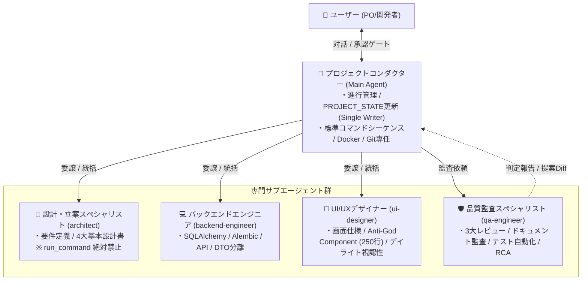
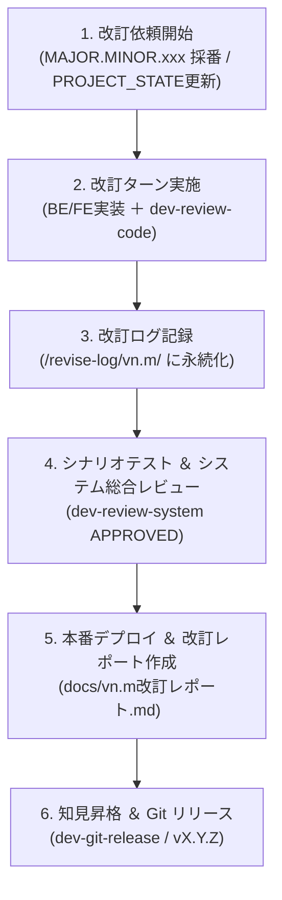

# AI駆動システム開発フェーズ定義書 V2.4（Central Knowledge Hub・2層プロファイル・SemVer完全準拠版）

文書バージョン: 2.4  
作成日: 2026-10-23  
対象バージョン: AI駆動システム開発ライフサイクルテンプレート V2.4.0  
ステータス: 正式改訂版 (Current 正本)  
関連文書:
- [AI駆動システム開発手順書V2.4.md](./AI駆動システム開発手順書V2.4.md)
- [V2.4セマンティックバージョニング仕様書.md](./V2.4セマンティックバージョニング仕様書.md)
- [V2.4改変計画書.md](./V2.4改変計画書.md)
- [ProfileA詳細設計書.md](./ProfileA詳細設計書.md)
- [ProfileD詳細設計書.md](./ProfileD詳細設計書.md)
- [レビューシステム設計書V2.4.md](./レビューシステム設計書V2.4.md)
- [エージェント設計書V2.4.md](./エージェント設計書V2.4.md)
- [状態管理機構設計書V2.4.md](./状態管理機構設計書V2.4.md)
- [システム改訂ルール.md](../../../.agents/plugins/system-dev-pipeline/templates/システム改訂ルール.md)

---

## 1. 目的と位置付け

本文書は、Antigravity環境におけるAI駆動システム開発ライフサイクル（新規開発 PHASE 1〜8、および本番リリース後の継続的システム改訂プロセス）において、**メインエージェント（コンダクター）、4つの専門サブエージェント（architect, backend-engineer, ui-designer, qa-engineer）、決定論的スキル群、およびユーザー（開発者/PO）** が協調して開発・改訂を完遂するためのフェーズ定義、作業工程、および役割分担を規定する仕様正本である。

プロジェクト進行状態管理票（`PROJECT_STATE.md`）のチェックリスト項目およびステータス遷移と 1 対 1 で完全同期し、各フェーズの開始条件・作業工程・完了条件（承認ゲート・レビュー基準）を厳格に定義する。

### 1.1 V2.4 改訂の 3 大ピラー
1. **Central Knowledge Hub 6大知見の公式本流統合 (Core Integration)**:
   - 実結合時のサイレントモックフォールバック厳格禁止（Fail-Fast原則 / PAT-MOCK-001）。
   - デイライトモード視認性担保とTailwind明暗ペア指定必須化（PAT-UI-001）。
   - バックエンド DTO・パーサー物理分離と Anti-God Module (400行制限) 遵守（PAT-CODE-001）。
   - Profile D 結合テスト時の一時実ファイルDB動的プロビジョニングとアトミック破棄（PAT-TEST-001）。
   - 決定論的バグ(Hard Gate)と文脈判断(Soft Engine)の2系統物理分離（PAT-002）。
   - `PROJECT_STATE.md` のシステム改訂ルール改定履歴表適用除外（PAT-REV-001）。
2. **公式セマンティックバージョニング（SemVer 2.0.0）への完全準拠**:
   - ソフトウェア本体・環境変数: `MAJOR.MINOR.PATCH`（数値3桁、先頭 `v` なし。例: `APP_VERSION=1.0.0`）。
   - 管理台帳・Git・UIバッジ: `vMAJOR.MINOR.PATCH`（小文字 `v` ＋ 数値3桁。例: `v1.0.0`）。
   - 改訂依頼番号: `MAJOR.MINOR.xxx`（通番3桁連番。例: `1.0.001`）。
   - ドキュメント管理・ログ命名: `vn.m`（小文字 `v` ＋ 2桁。例: `docs/設計書/v2.4/`, `/revise-log/v1.0/`）。
   - リリースコマンド保護: `dev-git-release` での先頭 `v`/`V` サニタイズによる二重プレフィックス防止ガード。
3. **2層構造システムプロファイル体系 (Profile A〜E) & Shift-Left**:
   - 第1層（定常コア8項目）と第2層（展開プロファイル A〜E）の完全バインド、初期スケルトン（`skeletons/`）による品質の前倒し組込。

---

## 2. 5大エージェント協調モデルと責務境界

---

## 3. 開発フェーズ詳細定義 (新規開発 PHASE 1〜8)

---

### PHASE 1: プロジェクトの準備 (Project Setup)

- **ステータス表記**: `PHASE_1_SETUP`
- **目的**: 新規開発プロジェクトの初期実行基盤、検証済み静的スケルトン、ローカルナレッジ領域、および状態管理台帳を自動生成・配備する。
- **開始条件 (Entry Criteria)**: Antigravity で対象プロジェクトディレクトリが開かれ、`system-dev-pipeline` プラグインが有効であること。
- **主担当エージェント**: 👑 プロジェクトコンダクター (`conductor`)
- **詳細作業工程 (`PROJECT_STATE.md` 準拠)**:
  1. `dev-phase1-setup` スキルの発動。
  2. Central Knowledge Hub（`~/.gemini/knowledge-hub/`）初期化 & 未処理原票確認（`pipeline-reconciler.sh --status`）。
  3. 静的スケルトン基盤展開（`skeletons/common/`, `skeletons/profile-a/` 等）。
  4. 環境変数初期化（`.env` に `APP_VERSION=1.0.0`, `VITE_ENABLE_MOCK=true` 等を設定）。
  5. 永続ナレッジ領域初期化（`wiki/patterns/{local,universal,rejected}`, `wiki/archive/`, `promotions/`）。
  6. 知見・メトリクス領域初期化（`wiki/`, `metrics/`, `promotions/` の `.gitignore` 自動登録）。
  7. 知見昇格提示サマリ初期配置（`TEMPLATE_PROMOTIONS.md`）。
  8. `PROJECT_STATE.md` 初期化（2層プロファイル・MOCK_MODE・Knowledge Hub 連携状態記録）。
- **完了条件 (Exit Criteria)**:
  - ディレクトリ基盤および `.env` が配置されていること。
  - `PROJECT_STATE.md` が正常に生成され、未処理原票が 0 件（または確認済み）であること。

---

### PHASE 2: 要件定義 (Requirements Definition)

- **ステータス表記**: `PHASE_2_REQUIREMENTS`
- **目的**: システムの機能・非機能要件を明確化し、2層構造プロファイル体系に基づいて最適な展開アーキテクチャを選定・合意する。
- **開始条件 (Entry Criteria)**: PHASE 1 が完了していること。
- **主担当エージェント**: 📐 設計・立案スペシャリスト (`architect`)
- **詳細作業工程 (`PROJECT_STATE.md` 準拠)**:
  1. 📐 `architect`: `docs/要件定義書.md` 作成・精査（ディシジョンツリーによる Profile A〜E 選定、チェックリスト適用）。
  2. 📐 `architect`: 定常コア8項目（250行制限、型同期、Pydantic、Aware UTC、CI、構造化ログ、モック制御、グランドデザイン）の非機能要件自動バインド。
  3. 👤 ユーザー: Open Questions（未決事項）への回答。
  4. **【承認ゲート】👤 ユーザー: 要件定義完了の明示的承認**。
- **完了条件 (Exit Criteria)**:
  - `docs/要件定義書.md` が完成し、未決事項（Open Questions）がすべて解消されていること。
  - ユーザーから「要件定義を承認する」旨の明示的合意が得られ、`PROJECT_STATE.md` に承認日が記録されていること。

---

### PHASE 3: 基本設計書の作成と整合性チェック (Basic Design)

- **ステータス表記**: `PHASE_3_DESIGN`
- **目的**: 4大基本設計書を策定し、ドキュメント相互の多次元整合性検証および第1の品質ゲート「基本設計レビュー」を通過させる。
- **開始条件 (Entry Criteria)**: PHASE 2 の承認ゲートを通過していること。
- **主担当エージェント**: 📐 `architect`, 🎨 `ui-designer`, 🛡️ `qa-engineer`
- **詳細作業工程 (`PROJECT_STATE.md` 準拠)**:
  1. 📐 `architect`: `docs/技術要件定義書.md` 作成（Profile A/D標準構成、250行制限、型同期、キャッシュ戦略明記）。
  2. 📐 `architect`: `docs/テーブルスキーマ定義書.md` 作成（Alembic前提、生SQL禁止、Aware UTC、`user_id` 拡張性）。
  3. 📐 `architect`: `docs/ビジネスロジック仕様書.md` 作成（外部API二重キャッシュ、モック制御仕様、内部監視エンドポイント）。
  4. 🎨 `ui-designer`: `docs/画面仕様書.md` 作成（グランドデザイン新規格準拠、HEX/px絶対値併記、ウィンドウ形態選定、システムバージョンバッジ `v1.0.0`、デイライト視認性明暗ペア規約）。
  5. 🛡️ `qa-engineer`: `dev-doc-reviewer` 整合性多次元クロスチェック（最大5回自動修復ループ、不整合0件確認）。
  6. 🛡️ `qa-engineer`: `dev-review-arch` 基本設計レビュー（定常コア8項目＋プロファイル適合監査 / 判定: `PASS` または `CONDITIONAL PASS` 必須 / CRITICAL: 0件, MAJOR: 0件）。
  7. **【承認ゲート】👤 ユーザー: 基本設計完了の明示的承認**。
- **完了条件 (Exit Criteria)**:
  - 4大基本設計書が揃い、相互のリンク・型・スキーマ矛盾が 0 件であること。
  - `dev-review-arch` で `PASS` 判定を獲得し、ユーザーの明示的承認が得られていること。

---

### PHASE 4: 開発環境とシステム構築 (Environment & System Build)

- **ステータス表記**: `PHASE_4_BUILD`
- **目的**: 静的スケルトン基盤を土台に BE/FE を並行実装し、標準コマンドシーケンスを自動実行してコンテナ初回疎通を確立する。
- **開始条件 (Entry Criteria)**: PHASE 3 の承認ゲートを通過していること。
- **統括・インフラ担当**: 👑 `conductor`
- **実装担当エージェント**: 💻 `backend-engineer`, 🎨 `ui-designer`
- **詳細作業工程 (`PROJECT_STATE.md` 準拠)**:
  1. 👑 コンダクター: Docker環境構築・統括。
  2. 💻 `backend-engineer`: バックエンドAPI・SQLAlchemyモデル・Alembicマイグレーション実装（DTO・パーサー物理分離 PAT-CODE-001、IAP JWT認可、ヘルスチェック）。
  3. 🎨 `ui-designer`: フロントエンド画面・コンポーネント実装（Anti-God Component 250行制限、MSWハンドラー構築、直書きモック完全排除、Tailwind明暗ペアによるデイライト視認性担保 PAT-UI-001）。
  4. ⚙️ `dev-git-init`: Gitリポジトリ初期化（`.gitignore` 包含、`main` 初回コミット、`feature` 作成・チェックアウト）。
  5. 👑 コンダクター: 標準コマンドシーケンス自動実行
     - `docker compose exec backend alembic revision --autogenerate -m "Initial schema"`
     - `docker compose exec backend alembic upgrade head`
     - `docker compose exec frontend npm run codegen:types`
     - コミット前CI同等ローカル検証 (`ruff check`, `pytest`, `npm run lint`, `npm run type-check`)
  6. 👑 コンダクター: コンテナ初回ビルド・疎通確認 (`docker compose up --build -d`)。
- **完了条件 (Exit Criteria)**:
  - BE/FE の初期実装が完了し、Alembic マイグレーションおよび Codegen が成功していること。
  - CI 同等ローカル検証をパスし、Docker コンテナが正常起動（HTTP 200 / ヘルスチェック正常）していること。

---

### PHASE 5: ウォークスルー動作確認とデバッグ (Walkthrough)

- **ステータス表記**: `PHASE_5_WALKTHROUGH`
- **目的**: 実際の画面操作・機能検証、およびモック透過切替検証を行い、最新コードを正としてドキュメントを同期する。
- **開始条件 (Entry Criteria)**: PHASE 4 の初回疎通が確認されていること。
- **統括・修正担当**: 👑 `conductor`, 💻 `backend-engineer`, 🎨 `ui-designer`
- **ドキュメント同期担当**: 📐 `architect`, 🛡️ `qa-engineer`
- **詳細作業工程 (`PROJECT_STATE.md` 準拠)**:
  1. 👤 ユーザー: 画面操作・機能検証。
  2. 👑 コンダクター: モック透過切替検証（`VITE_ENABLE_MOCK=true` ↔ `false` での動作整合確認）。
     - **Fail-Fast 監査 (PAT-MOCK-001)**: 実結合モードにおけるエラー時のサイレントモックフォールバック厳格禁止の検証。
  3. 👑 コンダクター: 指摘不具合修正統括（修正後は必ず `docker compose up --build -d` でコンテナ再構成）。
  4. 📐 `architect`: 最新コードを正としたAPI仕様同期（`docs/バックエンドAPI仕様書.md`）。
  5. 🛡️ `qa-engineer`: ドキュメント整合性再確認。
  6. **【承認ゲート】👤 ユーザー: ウォークスルー完了の明示的承認**。
- **完了条件 (Exit Criteria)**:
  - ユーザーの指摘事項がすべて修正・解消されていること。
  - モック有効/無効両モードで機能整合性が確認され、サイレントモックフォールバックがないこと。
  - バックエンドAPI仕様書が最新コードと完全同期し、ユーザーの明示的承認が得られていること。

---

### PHASE 5.5: コード品質・整合性レビュー & リファクタリング (Code Review)

- **ステータス表記**: `PHASE_5_5_CODE_REVIEW`
- **目的**: 実装コード全域の品質、保守性、DRY原則、行数制限、モック排除、DTO分離を批判的に監査し、リファクタリングを完遂する。
- **開始条件 (Entry Criteria)**: PHASE 5 のウォークスルー承認を通過していること。
- **監査担当エージェント**: 🛡️ `qa-engineer`
- **詳細作業工程 (`PROJECT_STATE.md` 準拠)**:
  1. 🛡️ `qa-engineer`: `dev-review-code` 実行（判定: `CLEAN` 必須）。
     - 1ファイル最大250行制限の機械的検査（超過0件確認）。
     - コンポーネント内直書きモックの機械的検出・完全排除確認。
     - DTO・パーサー物理分離検査（PAT-CODE-001）。
     - デイライト視認性明暗ペア検査（PAT-UI-001）。
     - openapi-typescript による型同期・不整合0件確認。
  2. 💻 `backend-engineer` / 🎨 `ui-designer`: 提案Diff反映・重複排除・型安全性是正。
  3. 👑 コンダクター: コンテナ再ビルド・疎通確認。
- **完了条件 (Exit Criteria)**:
  - `dev-review-code` において判定 `CLEAN` を獲得していること。
  - 修正後のコンテナ疎通および CI 同等検証が全件パスしていること。

---

### PHASE 6: スルーテスト環境の構築と実施 (Scenario Testing)

- **ステータス表記**: `PHASE_6_TESTING`
- **目的**: 結合・シナリオテスト計画を策定し、自動テストおよび自律修復ループを実行して品質を確定させ、失敗のRCAをWikiへ永続化する。
- **開始条件 (Entry Criteria)**: PHASE 5.5 で判定 `CLEAN` を獲得していること。
- **主担当エージェント**: 🛡️ `qa-engineer` (Wiki Maintainer 兼任)
- **詳細作業工程 (`PROJECT_STATE.md` 準拠)**:
  1. 🛡️ `qa-engineer`: `docs/plans/シナリオテスト計画書.md` 作成（モック有効/無効両面シナリオ）。
  2. 🛡️ `qa-engineer`: 自動テスト実行・修復ループ（成功率100%達成、最大5回ループ）。
     - Profile D の場合: 一時ディレクトリ配下に UUID 付き実ファイルDBを動的プロビジョニングし、マイグレーションとWAL並行性を本番同等に検証後アトミック破棄（PAT-TEST-001）。
  3. 🛡️ `qa-engineer`: Wiki Maintainer によるエラー根本原因（RCA）記録（`wiki/patterns/`）。
  4. **【承認ゲート】👤 ユーザー: リリース準備移行の明示的承認**。
- **完了条件 (Exit Criteria)**:
  - シナリオテスト成功率 100% を達成していること。
  - 発生した全失敗の RCA がローカル Wiki へ記録され、ユーザーの明示的承認が得られていること。

---

### PHASE 7: 本番リリース (Production Release)

- **ステータス表記**: `PHASE_7_RELEASE`
- **目的**: システム総合レビューを通過させ、本番適用作業手順書に基づいて本番環境へ安全にデプロイする。
- **開始条件 (Entry Criteria)**: PHASE 6 の全テスト合格および承認ゲートを通過していること。
- **統括・デプロイ担当**: 👑 `conductor`
- **監査担当エージェント**: 🛡️ `qa-engineer`
- **詳細作業工程 (`PROJECT_STATE.md` 準拠)**:
  1. 👑 コンダクター: `docs/plans/本番適用作業手順書.md` 作成（ロールバック手順・Litestream同期ラグ確認手順明記）。
  2. 🛡️ `qa-engineer`: `dev-review-system` システム総合レビュー（判定: `RELEASE APPROVED` 必須）。
     - 本番用 `VITE_ENABLE_MOCK=false` 二重防御検証（Fail-Fast 含む）。
     - IAP JWT 署名検証ミドルウェア有効化検証。
     - `entrypoint.sh` による起動時 Alembic マイグレーション実行保証。
     - Litestream レプリケーション設定および監視エンドポイント検証。
     - 平文シークレット完全排除、非root実行確認。
  3. 👑 コンダクター: 本番環境（Cloud Run等）初回デプロイ実行（`--quiet` 非対話フラグ＋`schedule` タイムアウト監視）。
  4. 🛡️ `qa-engineer`: IAM / IAP セキュリティ設定監査。
  5. **【承認ゲート】👤 ユーザー: 本番稼働確認の明示的承認**。
- **完了条件 (Exit Criteria)**:
  - `dev-review-system` で `RELEASE APPROVED` を獲得していること。
  - 本番環境でヘルスチェックが正常応答し、ユーザーの明示的承認が得られていること。

---

### PHASE 8: ドキュメント改訂管理・Central Knowledge Hub 自己進化の開始 (Knowledge & Handover)

- **ステータス表記**: `PHASE_8_HANDOVER` ➔ `PRODUCTION_ACTIVE`
- **目的**: 開発定量メトリクスを集計し、汎用知見を Central Knowledge Hub へ投函・3段階意味的監査を実施して Local Overlay へ即時反映し、Git本番リリースを完遂する。
- **開始条件 (Entry Criteria)**: PHASE 7 の本番稼働承認を通過していること。
- **統括担当**: 👑 `conductor`
- **意味的監査担当**: 🛡️ `qa-engineer` (Semantic Auditor)
- **詳細作業工程 (`PROJECT_STATE.md` 準拠)**:
  1. 👑 コンダクター: 定量メトリクス集計（`dev-metrics-collector`）。
  2. 👑 コンダクター: `wiki-compactor` によるWiki整理・原票クラスタリング。
  3. 👑 コンダクター: `wiki-proposer` による標準化知見原票（`CLAIM-*.md`）生成 & `~/.gemini/knowledge-hub/inbox/` 投函。
  4. 🛡️ `qa-engineer`: 3段階意味的整合性監査（新・複合検証ゲート Gate 1〜4: Invariants監査、4分類矛盾監査、過剰適合排除、純度＆絶対行数バジェット監査）実行。
  5. **【承認ゲート】👤 ユーザー: `ask_question` モーダルによる知見昇格・裁定承認 (`./TEMPLATE_PROMOTIONS.md`)**。
  6. 👑 コンダクター: `pipeline-reconciler.sh` による `overlay/LOCAL_FEEDBACK_RULES.md` クリーン再生成（または Core 統合）。
  7. ⚙️ `dev-git-release`: 先頭サニタイズ処理を経て `feature` を `main` へ Squash Merge（`Release v1.0.0`）、Push、次期 `feature` 切り直し。
  8. ⚙️ `dev-phase8-rules`: 改訂運用ルールファイル群の配置。
  9. 👑 コンダクター: ステータスを `PRODUCTION_ACTIVE` へ移行。
- **完了条件 (Exit Criteria)**:
  - 知見昇格判定が完了し、`LOCAL_FEEDBACK_RULES.md` が正常更新されていること。
  - Git タグ `v1.0.0` が打鍵され、次期改訂ブランチが用意されていること。
  - `PROJECT_STATE.md` のステータスが `PRODUCTION_ACTIVE` になっていること。

---

## 4. システム改訂プロセス (REVISION)

本番リリース完了以降（`PRODUCTION_ACTIVE`）の継続的な改訂運用は、[システム改訂ルール.md](../../../.agents/plugins/system-dev-pipeline/templates/システム改訂ルール.md) に基づき以下の工程で進行する。

1. **改訂依頼開始宣言**:
   - 👑 コンダクターが `MAJOR.MINOR.xxx`（例: `1.0.001`）を採番し、`PROJECT_STATE.md` の改訂管理表を更新。
2. **改訂ターンの実施**:
   - 💻 BE / 🎨 UI が機能追加・修正を実装。
   - 🛡️ QA が `dev-review-code`（250行制限、直書きモック排除、DTO分離）でコード品質を監査。
3. **改訂作業ログ記録**:
   - `/revise-log/vn.m/vn.m_revise-review_xxx.md`（小文字 `v` 統一）にレビュー結果と修正履歴を記録。
4. **シナリオテスト & 総合レビュー**:
   - `docs/plans/scenario-test/vn.mシナリオテスト結果レポート.md` の更新および `dev-review-system` による合格確認。
5. **本番デプロイ & 改訂レポート作成**:
   - 本番デプロイを実行し、`docs/vn.m改訂レポート.md` を作成。
6. **知見昇格 & GitHub本番リリース**:
   - `dev-git-release` により、SemVer 3桁（`v1.0.1` や `v1.1.0`）タグを付与してリリース完了。

---

## 5. 各エージェントの絶対禁止事項 (Guardrails)

| エージェント | 絶対禁止事項 (Hard Gate Guardrails) |
| :--- | :--- |
| 👑 **コンダクター** | ・`PROJECT_STATE.md` 以外のサブエージェントによる状態更新の許可 ・大文字 `V` を含むタグの付与（先頭サニタイズ必須） ・承認ゲートをバイパスしたフェーズ進行 |
| 📐 **アーキテクト** | ・**いかなる場合も `run_command` を呼び出してはならない（二重防御ガード）** ・生SQL前提のスキーマ設計（Alembic必須） |
| 💻 **バックエンド** | ・Git操作、デプロイ実行、DB強制上書き、コンテナ起動停止コマンドの実行 ・1モジュール400行超過、DTO・パーサーのController内同居（PAT-CODE-001） ・生SQLによる手動DDL操作 |
| 🎨 **UIデザイナー** | ・Git操作、デプロイ実行、DB操作コマンドの実行 ・1コンポーネント250行超過（Anti-God Component違反） ・コンポーネント内へのダミーデータ直書き（MSW必須） ・デイライトモードでの淡色・透過カラー単独直書き（PAT-UI-001） |
| 🛡️ **QAエンジニア** | ・**システム本体のプログラムコードの直接改変（必ず提案Diffをコンダクターへ報告）** ・自律修復ループの5回超過反復（5回失敗時は中断しユーザー報告） |
