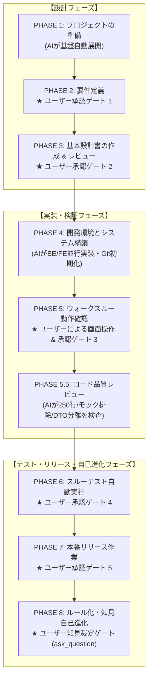
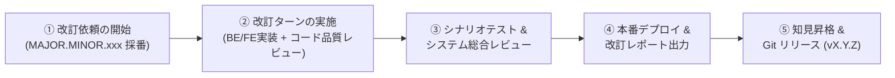

# AI駆動システム開発手順書 V2.4（Central Knowledge Hub・SemVer準拠・5大エージェント協調手順）

文書バージョン: 2.4  
作成日: 2026-10-23  
対象バージョン: AI駆動システム開発ライフサイクルテンプレート V2.4.0  
ステータス: 正式改訂版 (Current 正本)  
関連文書:
- [AI駆動システム開発フェーズ定義書V2.4.md](./AI駆動システム開発フェーズ定義書V2.4.md)
- [V2.4セマンティックバージョニング仕様書.md](./V2.4セマンティックバージョニング仕様書.md)
- [V2.4改変計画書.md](./V2.4改変計画書.md)
- [ProfileA詳細設計書.md](./ProfileA詳細設計書.md)
- [ProfileD詳細設計書.md](./ProfileD詳細設計書.md)
- [レビューシステム設計書V2.4.md](./レビューシステム設計書V2.4.md)
- [エージェント設計書V2.4.md](./エージェント設計書V2.4.md)
- [状態管理機構設計書V2.4.md](./状態管理機構設計書V2.4.md)

---

## 1. はじめに

### 1.1 本書の目的
本書は、ユーザー（開発者・プロダクトオーナー）が `system-dev-pipeline` を利用して、迷うことなくスムーズにシステム開発を推進できるようにするための**実践的オペレーションガイド**である。

`PROJECT_STATE.md`（プロジェクト進行状態管理票）に定義されたフェージング（新規開発 PHASE 1〜8、および本番リリース後の継続改訂管理）と作業工程をベースに、**「各フェーズでユーザー自身が行うべきこと（User Action）」** を明確に示し、その裏で **「AI（コンダクターおよび専門サブエージェント）が自律実行する作業内容（AI Execution）」** を要約・可視化して作業工程の流れを説明する。

### 1.2 5大エージェント協調体制と役割分担
本パイプラインでは、以下の役割分担に基づいて作業が自律推進される。ユーザーは基本的に **メインエージェントである「👑 プロジェクトコンダクター」と対話するだけ** で全工程をコントロールできる。

| エージェント | 役割と責務 | 主な担当作業 |
| :--- | :--- | :--- |
| 👑 **コンダクター** (`conductor`)<br>*[メインエージェント]* | **プロジェクト進行管理・統括**<br>・`PROJECT_STATE.md` の一元更新（Single Writer）<br>・標準コマンドシーケンス統括実行<br>・Docker/Git/デプロイ専任実行 | ユーザーとの対話窓口、サブエージェントへの作業委譲、環境構築、Git運用、リリース作業 |
| 📐 **アーキテクト** (`architect`)<br>*[専門サブエージェント]* | **要件定義・アーキテクチャ・基本設計**<br>・2層プロファイル選定（Profile A〜E）<br>・4大基本設計書策定<br>※ `run_command` は絶対禁止 | 要件定義書、技術要件定義書、テーブル定義書、ロジック仕様書、API仕様同期 |
| 💻 **バックエンドエンジニア** (`backend-engineer`)<br>*[専門サブエージェント]* | **サーバーサイド実装・マイグレーション**<br>・SQLAlchemy 2.0 / Alembic マイグレーション<br>・DTO・パーサー物理分離（PAT-CODE-001）<br>・IAP JWT認可、ヘルスチェック実装 | FastAPI/Rust実装、マイグレーションコード、単体テスト、構文チェック |
| 🎨 **UIデザイナー** (`ui-designer`)<br>*[専門サブエージェント]* | **UI/UX設計・フロントエンド実装**<br>・グランドデザイン新規格準拠<br>・Anti-God Component（250行制限）<br>・デイライト視認性担保（PAT-UI-001）<br>・MSWモックハンドラー構築 | 画面仕様書、React/Vue/Tauriフロント実装、Tailwind CSS明暗ペアスタイリング、モック制御 |
| 🛡️ **QAエンジニア** (`qa-engineer`)<br>*[専門サブエージェント]* | **品質監査・多次元レビュー・テスト自動化**<br>・3大レビューゲート監査<br>・ドキュメント整合性多次元クロスチェック<br>・スルーテスト自動実行＆RCAナレッジ記録<br>・知見原票の3段階意味的監査 | 基本設計レビュー、コード品質レビュー、システム総合レビュー、シナリオテスト、Wiki Maintainer |

---

## 2. 全体作業フロー概要



---

## 3. 各フェーズの開発手順（新規開発 PHASE 1〜8）

---

### 3.1 PHASE 1: プロジェクトの準備 (Project Setup)

#### 👤 ユーザーが行うべきこと (User Action)
1. **新規プロジェクトの開始指示**:
   Antigravity のチャット欄で、開発したいシステムのアイデアや概要とともに、環境初期化を依頼します。
   ```text
   【プロンプト例】
   新しい社内備品管理システムを構築したいです。
   dev-phase1-setup スキルを実行して、プロジェクトの初期セットアップを開始してください。
   ```
2. **初期化完了の確認**:
   AIから初期セットアップ完了サマリが報告されたら、ディレクトリ内に `PROJECT_STATE.md` や `.env`、`skeletons/` が配置されていることを確認します。

#### 🤖 AIによって行われる作業 (AI Execution)
- 👑 **コンダクター** が `dev-phase1-setup` スキルを統括実行します：
  1. **Knowledge Hub 検知**: `~/.gemini/knowledge-hub/` の未処理原票を確認（`pipeline-reconciler.sh --status`）。
  2. **基盤スケルトン展開**: 検証済みの静的スケルトン（`skeletons/common/`, `skeletons/profile-a/` 等）を配置。
  3. **環境変数生成**: `.env` を生成し、`APP_VERSION=1.0.0`, `VITE_ENABLE_MOCK=true` などの初期値を設定。
  4. **ナレッジ領域初期化**: ローカル Wiki 構造（`wiki/patterns/{local,universal}`, `promotions/`）とメトリクス受皿を配備し、`.gitignore` に自動登録。
  5. **管理台帳初期化**: `PROJECT_STATE.md` を生成し、ステータスを `PHASE_1_SETUP` ➔ `PHASE_2_REQUIREMENTS` へ進めます。

---

### 3.2 PHASE 2: 要件定義 (Requirements Definition)

#### 👤 ユーザーが行うべきこと (User Action)
1. **要件定義の開始指示**:
   コンダクターへ要件定義の作成を依頼します。
   ```text
   【プロンプト例】
   dev-phase2-requirements スキルを実行し、要件定義書を作成してください。
   主な要件は、社員が備品を一覧検索・予約・貸出申請できるWebアプリです。
   ```
2. **Open Questions（未決事項）への回答**:
   AI（`architect`）からシステムプロファイルの選定案や仕様の確認（未決事項）が提示されたら、要望に沿って回答します。
3. **【承認ゲート】要件定義完了の明示的承認**:
   提示された `docs/要件定義書.md` を確認し、問題がなければチャットで承認を発話します。
   ```text
   【承認プロンプト例】
   要件定義書を確認しました。この内容で承認します。PHASE 3 へ進んでください。
   ```

#### 🤖 AIによって行われる作業 (AI Execution)
- 📐 **アーキテクト** が要件定義書（`docs/要件定義書.md`）を作成・精査します：
  1. **プロファイル選定**: ディシジョンツリーにより、最適なシステムプロファイル（例: Profile A: Cloud Run + Litestream + SQLite + React SPA）を決定。
  2. **定常コア8項目の自動バインド**: 250行制限、型同期、Pydantic Settings、Aware UTC、モック制御、グランドデザイン等の非機能要件を自動包含。
  3. **Open Questions の集約**: 不明確な業務ルールを抽出し、ユーザーへ提示。
- 👑 **コンダクター** がユーザーの承認を確認後、`PROJECT_STATE.md` の承認日を記録し、ステータスを `PHASE_3_DESIGN` へ更新します。

---

### 3.3 PHASE 3: 基本設計書の作成と整合性チェック (Basic Design)

#### 👤 ユーザーが行うべきこと (User Action)
1. **基本設計の開始指示**:
   コンダクターへ基本設計の策定を依頼します。
   ```text
   【プロンプト例】
   dev-phase3-design スキルを実行し、4大基本設計書の作成、整合性チェック、および基本設計レビューを実施してください。
   ```
2. **レビュー結果報告書の確認**:
   AIが作成した4大設計書および 🛡️ QAエンジニアによる基本設計レビュー（`dev-review-arch`）の合否判定（`PASS`）を確認します。
3. **【承認ゲート】基本設計完了の明示的承認**:
   設計内容に問題がなければ、チャットで承認を発話します。
   ```text
   【承認プロンプト例】
   基本設計書およびレビュー結果を確認しました。合格判定を承認します。PHASE 4 の構築に進んでください。
   ```

#### 🤖 AIによって行われる作業 (AI Execution)
- 📐 **アーキテクト** & 🎨 **UIデザイナー** が 4大基本設計書を同時策定します：
  1. `docs/技術要件定義書.md`: 技術スタック、外部API二重キャッシュ、モック制御仕様。
  2. `docs/テーブルスキーマ定義書.md`: Alembic前提モデル、生SQL禁止、Aware UTC、`user_id` 拡張性。
  3. `docs/ビジネスロジック仕様書.md`: ビジネスルール、エラーハンドリング、内部監視エンドポイント。
  4. `docs/画面仕様書.md`: グランドデザイン準拠、ウィンドウ形態、システムバージョンバッジ（`v1.0.0`）、デイライト視認性明暗ペア規約。
- 🛡️ **QAエンジニア** が2段階の監査を自律実行します：
  1. `dev-doc-reviewer`: 4大設計書間の矛盾・型不一致を多次元クロスチェック（最大5回自動修復ループ）。
  2. `dev-review-arch`: 定常コア8項目＋プロファイル適合監査を実施し、報告書（`PASS` 判定）を出力。
- 👑 **コンダクター** が承認を記録し、`PROJECT_STATE.md` を `PHASE_4_BUILD` へ更新します。

---

### 3.4 PHASE 4: 開発環境とシステム構築 (Build & Implementation)

#### 👤 ユーザーが行うべきこと (User Action)
1. **システム実装と環境構築の開始指示**:
   コンダクターへ構築開始を依頼します。
   ```text
   【プロンプト例】
   dev-phase4-env-build スキルを実行し、システムの並行実装、標準コマンドシーケンス自動実行、およびGit初期化を行ってください。
   ```
2. **構築完了サマリの確認**:
   AIがバックエンド、フロントエンド、DBマイグレーション、Git初期化、Docker起動まで全自動で行います。完了報告を受け取ったら、指示されたURL（例: `http://localhost:5173`）にアクセスできるか確認します。

#### 🤖 AIによって行われる作業 (AI Execution)
- 👑 **コンダクター** の統括のもと、専門サブエージェントが並行して実装します：
  1. 💻 **バックエンドエンジニア**:
     - SQLAlchemy 2.0 モデル、FastAPI ルーター、ビジネスロジックの実装。
     - **DTO・パーサー物理分離 (PAT-CODE-001)**: DTO構造体とパーサーを独立モジュールへ分離し、Controllerを薄く保つ（400行制限）。
     - IAP JWT 認証ミドルウェア、ヘルスチェックエンドポイントの実装。
  2. 🎨 **UIデザイナー**:
     - 画面コンポーネント実装（Anti-God Component / **1ファイル最大250行制限**）。
     - **デイライト視認性担保 (PAT-UI-001)**: Tailwind の明暗ペア（`dark:` 併記）またはデザイントークン適用。
     - MSW モックハンドラー（`src/mocks/handlers.ts`）構築（直書きダミーデータ完全排除）。
  3. ⚙️ **Git初期化 (`dev-git-init`)**: `.gitignore` 設定、`main` 初回コミット、`feature` ブランチ作成・切替。
  4. 👑 **標準コマンドシーケンス自動実行**:
     - Alembic マイグレーション生成・適用 (`alembic revision --autogenerate`, `alembic upgrade head`)
     - OpenAPI から TypeScript 型定義自動同期 (`npm run codegen:types`)
     - コミット前ローカルCI検証 (`ruff check`, `pytest`, `npm run lint`, `npm run type-check`)
  5. 👑 **コンテナ起動**: `docker compose up --build -d` による疎通確認。

---

### 3.5 PHASE 5: ウォークスルー動作確認とデバッグ (Walkthrough)

#### 👤 ユーザーが行うべきこと (User Action)
1. **ウォークスルーの開始指示**:
   ```text
   【プロンプト例】
   dev-phase5-walkthrough スキルを実行して、ウォークスルー動作確認を開始してください。
   ```
2. **ブラウザでの実機操作・機能検証**:
   実際にブラウザ（またはデスクトップアプリ）を操作し、画面レイアウト、ボタン動作、データの登録・検索などを確認します。
3. **気になる点・不具合の指摘**:
   「備品の検索条件にカテゴリ絞り込みを追加したい」「ボタンの配色を調整したい」など、気になった点をAIに伝えます。
4. **【承認ゲート】ウォークスルー完了の明示的承認**:
   指摘事項の修正が完了し、動作に納得できたら承認を発話します。
   ```text
   【承認プロンプト例】
   画面操作およびモック切替動作を確認しました。不具合修正も反映されているため承認します。PHASE 5.5 へ進んでください。
   ```

#### 🤖 AIによって行われる作業 (AI Execution)
- 👑 **コンダクター** が以下の検証と修正を統括します：
  1. **モック透過切替検証**:
     - `VITE_ENABLE_MOCK=true`（MSW モック環境での完全動作確認）
     - `VITE_ENABLE_MOCK=false`（実バックエンドAPI・実DB結合での完全動作確認）
     - **Fail-Fast 監査 (PAT-MOCK-001)**: 実結合モード時に通信エラーが発生した際、モックデータへサイレントフォールバックせず、即座に例外をスローして画面にエラーを表示することを確認。
  2. **不具合修正とコンテナ再構成**: ユーザーの指摘に基づき、💻 BE / 🎨 UI が修正を行い、必ず `docker compose up --build -d` でコンテナを再ビルド。
  3. 📐 **API仕様同期**: 動作検証済みの最新実装コードを正として、`docs/バックエンドAPI仕様書.md` を最新状態へ自動同期。

---

### 3.6 PHASE 5.5: コード品質・整合性レビュー & リファクタリング (Code Review)

#### 👤 ユーザーが行うべきこと (User Action)
1. **コード品質レビューの開始指示**:
   ```text
   【プロンプト例】
   dev-review-code スキルを実行し、コード品質レビューおよび必要なリファクタリングを実施してください。
   ```
2. **レビュー結果の確認**:
   AIから提示されるレビュー判定（`CLEAN`）およびリファクタリング提案を確認します。

#### 🤖 AIによって行われる作業 (AI Execution)
- 🛡️ **QAエンジニア** が `dev-review-code` スキルで実装コード全域を機械的・厳格に監査します：
  1. **250行制限検査**: フロントエンドコンポーネントが 250行以内であるか（超過は即 REJECT）。
  2. **400行制限＆DTO分離検査**: バックエンドモジュールが 400行以内かつ DTO/パーサーが物理分離されているか。
  3. **直書きモック排除検査**: コンポーネント内にダミーオブジェクトが生で直書きされていないか。
  4. **デイライト視認性検査**: ダーク前提の淡色・透過カラーが単独で直書きされていないか。
  5. **型整合性検査**: 自動生成された型定義とコンポーネントの実装に不整合がないか。
- 💻 **BE** / 🎨 **FE** が指摘された提案 Diff を適用してコードをクリーンアップし、👑 コンダクターがコンテナを再ビルドして疎通を確認します。

---

### 3.7 PHASE 6: スルーテスト環境の構築と実施 (Scenario Testing)

#### 👤 ユーザーが行うべきこと (User Action)
1. **シナリオテストの開始指示**:
   ```text
   【プロンプト例】
   dev-phase6-testing スキルを実行し、シナリオテスト計画の策定と自動テストを実行してください。
   ```
2. **テスト実行結果と自己修復ログの確認**:
   自動テストが成功率 100% を達成した報告を確認します。
3. **【承認ゲート】リリース準備移行の明示的承認**:
   ```text
   【承認プロンプト例】
   全テストケースの合格を確認しました。本番リリース準備（PHASE 7）への移行を承認します。
   ```

#### 🤖 AIによって行われる作業 (AI Execution)
- 🛡️ **QAエンジニア** がシナリオテストを主導します：
  1. **テスト計画書策定**: `docs/plans/シナリオテスト計画書.md`（正常系・異常系・モック有効/無効両面シナリオ）を作成。
  2. **テスト自動実行・自律修復ループ**:
     - 自動テストスイートを実行。失敗した場合はテストコードや環境設定を自律修復（最大5回反復）。
     - Profile D の場合は、一時ディレクトリ配下に実ファイルDBを動的プロビジョニングしてマイグレーションとWAL並行性を検証後、アトミック破棄（PAT-TEST-001）。
  3. **Wiki Maintainer による RCA 記録**: テストや環境の不具合原因を `./wiki/patterns/` へ即時永続化。

---

### 3.8 PHASE 7: 本番リリース (Production Release)

#### 👤 ユーザーが行うべきこと (User Action)
1. **本番リリースの開始指示**:
   ```text
   【プロンプト例】
   dev-phase7-release スキルを実行し、システム総合レビューの実施、手順書の作成、および本番デプロイ検証を行ってください。
   ```
2. **システム総合レビュー結果の確認**:
   判定が `RELEASE APPROVED` になっていることを確認します。
3. **【承認ゲート】本番稼働確認の明示的承認**:
   本番環境（Cloud Run 等）へのデプロイ完了とヘルスチェック成功を確認し、承認を発話します。
   ```text
   【承認プロンプト例】
   本番環境のデプロイとヘルスチェック正常稼働を確認しました。本番リリースを承認します。PHASE 8 へ進んでください。
   ```

#### 🤖 AIによって行われる作業 (AI Execution)
- 👑 **コンダクター** & 🛡️ **QAエンジニア** が最終防壁を監査・実行します：
  1. `docs/plans/本番適用作業手順書.md` の作成（ロールバック手順、同期確認手順明記）。
  2. **システム総合レビュー (`dev-review-system`)**:
     - 本番用 `VITE_ENABLE_MOCK=false` 二重防御（Fail-Fast 含む）。
     - IAP JWT 署名検証ミドルウェアの強制有効化。
     - `entrypoint.sh` による起動時 Alembic マイグレーション実行保証。
     - Litestream レプリケーション設定および監視エンドポイントの動作確認。
     - 平文シークレットの完全排除、非root実行の確認。
  3. **本番デプロイ実行**: `--quiet` 非対話フラグおよびバックグラウンドタイムアウト監視（`schedule`）を伴う安全なデプロイ。

---

### 3.9 PHASE 8: ルール化と Central Knowledge Hub 自己進化 (Knowledge & Handover)

#### 👤 ユーザーが行うべきこと (User Action)
1. **知見昇格・自己進化プロセスの開始指示**:
   ```text
   【プロンプト例】
   dev-phase8-rules スキルを実行し、メトリクス集計、知見の Central Knowledge Hub 投函、および Git 本番リリースを実行してください。
   ```
2. **【承認ゲート】`ask_question` モーダルでの知見昇格裁定**:
   AIから `ask_question` インタラクティブモーダル（または `./TEMPLATE_PROMOTIONS.md` の提示）が表示されます。開発中に得られた汎用知見を次案件に反映するかどうかの選択肢（例: 「承認して Local Overlay に反映する」「スキップする」等）を選んで回答します。
3. **完了サマリの確認**:
   Gitタグ（`v1.0.0`）の打鍵、`main` への Squash Merge、および改訂運用ルール（`システム改訂ルール.md`）の配備完了を確認します。

#### 🤖 AIによって行われる作業 (AI Execution)
- 👑 **コンダクター** & 🛡️ **QAエンジニア** が知見の蒸留とリリースを行います：
  1. **メトリクス集計 (`dev-metrics-collector`)**: トークン効率、レビュー指摘件数、テスト合格率を記録。
  2. **Wiki 集約と原票投函 (`wiki-proposer`)**: `./wiki/patterns/universal/` から標準化知見原票（`CLAIM-*.md`）を生成し、`~/.gemini/knowledge-hub/inbox/` へ投函。
  3. **3段階意味的整合性監査**: QAが新・複合検証ゲート（Invariants監査、4分類矛盾監査、過剰適合排除、純度＆行数バジェット監査）を実行。
  4. **Local Overlay 反映**: ユーザー承認後、`pipeline-reconciler.sh` により `LOCAL_FEEDBACK_RULES.md` をクリーン再生成。
  5. **Git 本番リリース (`dev-git-release`)**:
     - 先頭サニタイズ処理を経て `git tag "v1.0.0"` を付与。
     - `feature` ブランチを `main` へ Squash Merge して Push。
     - 次期改訂用の `feature` ブランチを新規作成。
  6. **改訂運用ルールの配備 (`dev-phase8-rules`)**: `PROJECT_STATE.md` を `PRODUCTION_ACTIVE` へ移行。

---

## 4. 本番リリース後のシステム改訂手順 (REVISION)

本番リリース（PHASE 8 完了）以降の追加開発・バグ修正は、以下の改訂サイクルに従って迅速かつ安全に実施します。



### 4.1 👤 ユーザーが行うべきこと
1. **改訂依頼の発令**:
   改訂したい内容をコンダクターへ伝えます。
   ```text
   【プロンプト例】
   ユーザー一覧画面にCSVエクスポート機能を追加してください。改訂依頼を開始してください。
   ```
2. **改訂内容の確認とウォークスルー**:
   AIが実装した機能を確認し、動作を検証します。
3. **改訂完了承認**:
   テスト結果および `docs/v1.0改訂レポート.md` を確認し、リリースを承認します。

### 4.2 🤖 AIによって行われる作業
1. **改訂依頼番号の採番**: 👑 コンダクターが `MAJOR.MINOR.xxx`（例: `1.0.001`）を採番し、`PROJECT_STATE.md` の改訂テーブルを更新。
2. **実装とコード品質レビュー**: 💻 BE / 🎨 UI が実装し、🛡️ QA が `dev-review-code`（250行制限、直書きモック排除、DTO分離）で監査。
3. **ログの永続化**: `/revise-log/vn.m/vn.m_revise-review_xxx.md` にレビュー結果と作業内容を記録。
4. **テスト・総合レビュー**: シナリオテストと `dev-review-system` を実行。
5. **デプロイとレポート作成**: 本番デプロイ後、`docs/vn.m改訂レポート.md` を出力。
6. **Git タグリリース**: `dev-git-release` により、パッチまたはマイナーバージョンをインクリメント（例: `v1.0.1` または `v1.1.0`）してタグ付け・マージ。

---

## 5. ユーザーのためのTips & トラブルシューティング

> [!TIP]
> **1. 指示はメインエージェント（コンダクター）に伝えるだけでOK**
> サブエージェント（architect, backend-engineer 等）を個別に呼び出す必要はありません。コンダクターがフェーズやタスクに応じて最適なサブエージェントを自動的に呼び出します。

> [!NOTE]
> **2. 承認ゲートでは明確に「承認します」と伝える**
> パイプラインには品質を守るための「承認ゲート」が設定されています。設計書やテスト結果を確認したら、チャットで「承認します」「次へ進んでください」と明確に返答することで、スムーズに次のフェーズへ移行します。

> [!IMPORTANT]
> **3. コード修正後のコンテナ再構成**
> AIがコードを修正した後は、規約第7項に基づき自動で Docker コンテナの再ビルド（`docker compose up --build -d`）が行われます。画面の表示が変わらない場合は、ブラウザのキャッシュクリア（Super Reload / `Cmd + Shift + R`）をお試しください。

> [!WARNING]
> **4. バージョン表記のルール**
> 環境変数 `.env` に設定する `APP_VERSION` は `1.0.0` のように数値3桁（先頭の `v` なし）で管理されます。Gitタグや画面バッジには自動で小文字の `v`（`v1.0.0`）が付与されます。
