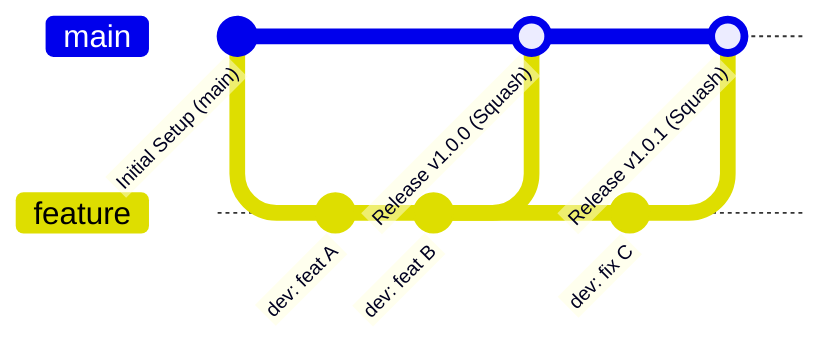

# Git運用基準書（ブランチ戦略・リリース手順）

- **主担当エージェント**: 👑 プロジェクトコンダクター専任 (`conductor`) (`dev-git-init`, `dev-git-release`)
- **禁止事項**: サブエージェント（`architect`, `backend-engineer`, `ui-designer`, `qa-engineer`）によるGit操作コマンド実行は厳禁（二重防御ガードレール）

本ドキュメントは、システム開発・保守時におけるGitブランチの運用基準、コミット・マージ規約、およびGitHub連携手順を定めたものです。

---

## 1. 基本方針

- **主軸ブランチモデル**: 
  - 本番ブランチ: `main`
  - 開発ブランチ: `feature`（単一の固定開発ブランチを更新・再作成して運用）
- **履歴集約方針**:
  - 開発中の試行錯誤や細かなコミット履歴は開発ブランチに留め、本番リリース時は `merge --squash` により1コミットに集約して `main` へ反映します。
  - squash マージ後は履歴コンフリクトを完全に防止するため、旧 `feature` ブランチを破棄し、最新の `main` から新たな `feature` ブランチを切り直します。
- **GitHub接続方式**:
  - GitHubへの接続はすべて **SSH接続（`git@github.com:...`）** を用いて行います（端末上のSSH Key認証）。
  - GitHubリポジトリ名は、**システムのルートディレクトリ名（プロジェクト名）と同一の名称**で管理します。

---

## 2. ブランチ命名規則と役割

| ブランチ名 | 種別 | 役割・運用規則 |
| :--- | :--- | :--- |
| **`main`** | 本番リリース | 本番公開可能なコードのみを配置する保護ブランチ。直接編集は原則禁止とし、必ず `feature` からの squash merge によりコミットを作成します。 |
| **`feature`** | 開発作業用 | 新規機能実装・バグ修正・改訂作業をすべて行う作業ブランチ。開発完了・本番公開の都度削除され、最新の `main` から再作成されます。 |

---

## 3. 開発サイクルとフェーズ別運用フロー

### 3.1 PHASE 4: 初回開発・環境構築時の初期化フロー（`dev-git-init`）
1. **Git運用基準書の配置**:
   - プラグインの `templates/Git運用基準書.md` をプロジェクトの `docs/Git運用基準書.md` へコピー・配置。
2. **リポジトリ初期化**:
   - `git init -b main` を実行。
3. **GitHubリモートの確認・設定**:
   - リモートURL（`origin`）の存在を確認（`git remote get-url origin`）。
   - 未設定の場合、プロジェクト名を取得し `git remote add origin git@github.com:<GitHub-Username>/<Project-Name>.git` を設定。
4. **基点コミットの作成**:
   - `docs/Git運用基準書.md`、`.gitignore`（`wiki/`, `metrics/` 自動除外設定を含む）、ライセンス、初期ドキュメント等の初期設定ファイルをステージングし、`main` 上で初期コミットを作成（例: `feat: initial project setup`）。
5. **開発ブランチの作成と移動**:
   - `git checkout -b feature` を実行。
   - 以降の実装作業はすべて `feature` 上で進行。

### 3.2 開発中（PHASE 4〜7）のコミット運用
- コミットのタイミングや粒度は開発者・エージェントの裁量に委ねられます。
- 細かな WIP（作業中）コミットや修正コミットを行っても、本番ブランチ側へ影響を与えることはありません。

### 3.3 PHASE 8: 本番リリース確定＆GitHub公開フロー（`dev-git-release`）
本番適用が完了し、ドキュメント改訂管理ルールを適用する段階で以下を自動実行します：

1. **未コミット変更のチェックと自動確定**:
   - 作業ツリーの変更（未コミット差分）を検知し、自動コミットして `feature` をクリーンな状態にする。
2. **バージョン番号の取得**:
   - `.env` の `VERSION`（または `APP_VERSION`）を読み取り（未設定時は `1.0.0` を設定）。
3. **本番ブランチへの統合（Squash Merge）**:
   - `git checkout main`
   - `git merge --squash feature`
   - `git commit -m "Release v${VERSION}"`
4. **GitHubへのPush**:
   - `git push -u origin main`（次回以降は `git push origin main`）
5. **開発ブランチの刷新**:
   - `git branch -D feature`（旧ブランチの破棄）
   - `git checkout -b feature`（最新の `main` から新たな作業ブランチをチェックアウト）

### 3.4 以降のシステム改訂時の運用フロー
- 本番公開後は常に最新の `feature` ブランチ上で作業を開始します。
- 改訂が完了した段階で、ユーザーが `dev-git-release` スキルを発動し、上記 3.3 と同様の手順でリリースと次期開発ブランチの再作成を自動化します。

---

## 4. 自動化スキル構成

| スキル名 | 発動タイミング | 主な役割 |
| :--- | :--- | :--- |
| **`dev-git-init`** | PHASE 4（環境構築時） | `Git運用基準書.md` の配置、`git init`、SSHリモートURL設定、`main` 初期コミット、`feature` 作成・移動 |
| **`dev-git-release`** | PHASE 8（リリース時）および改訂完了時 | 未コミット確定、バージョン取得、`main` へ squash merge、コミット、Push、旧 `feature` 削除と新 `feature` 再作成 |
