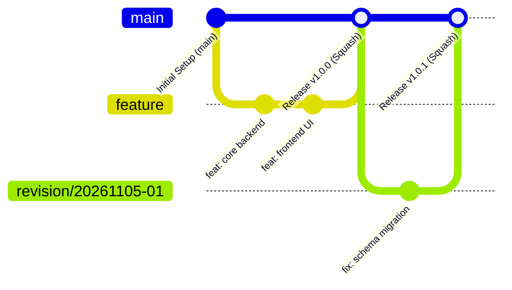

# Git運用基準書（ブランチ戦略・リリース手順）

本ドキュメントは、システム開発・保守時におけるGitブランチの運用基準、コミット・マージ規約、およびGitHub連携手順を定めた標準基準書である。

---

## 1. 基本方針

- **主軸ブランチモデル**: 
  - 本番ブランチ: `main`
  - 開発作業ブランチ: `feature`（または改訂時 `revision/<ID>`）
- **履歴集約方針**:
  - 開発中の試行錯誤や細かなコミット履歴は開発作業ブランチに留め、本番リリース時は `merge --squash` により1コミットに集約して `main` へ反映する。
  - squash マージ後は履歴コンフリクトを完全に防止するため、旧作業ブランチを破棄し、最新の `main` から新たな作業ブランチを切り直す。
- **GitHub接続方式**:
  - GitHubへの接続は **SSH接続（`git@github.com:...`）** を用いて行う（端末上のSSH Key認証）。
  - GitHubリポジトリ名は、**システムのルートディレクトリ名（プロジェクト名）と同一の名称**で管理する。

---

## 2. ブランチ命名規則と役割

| ブランチ名 | 種別 | 役割・運用規則 |
| :--- | :--- | :--- |
| **`main`** | 本番リリース | 本番公開可能なコードのみを配置する保護ブランチ。直接編集は原則禁止とし、必ず作業ブランチからの squash merge によりコミットを作成する。 |
| **`feature`** | 初期開発作業用 | 新規開発フェーズで実装作業を行う作業ブランチ。開発完了・本番公開の都度削除され、最新の `main` から再作成される。 |
| **`revision/<ID>`** | 改訂作業用 | 運用開始後の改訂サイクル（`REV-1`〜`REV-6`）で使用する個別改訂ブランチ。改訂完了時に `main` へ squash merge される。 |

---

## 3. 開発サイクルとフェーズ別運用フロー



### 3.1 初期環境構築時の運用フロー
1. **リポジトリ初期化**: `git init -b main`
2. **Hard Gate Pre-commit フックの有効化**:
   - `.githooks/pre-commit` を有効化し、コミット時に `harness_guard.py` が自動実行され、行数超過（FE 250行/BE 400行）、直書きモック、生SQL DDL、平文シークレット、AST適応度違反を機械遮断する。
3. **GitHubリモートの確認・設定**: `git remote add origin git@github.com:<User>/<Repo>.git`
4. **基点コミットの作成**: `.gitignore`、初期ドキュメント等の基本構成をステージングし、`main` 上で初期コミットを作成。
5. **開発ブランチの作成と移動**: `git checkout -b feature`

### 3.2 実装中のコミット運用
- コミットのタイミングや粒度は開発者の裁量に委ねられる。
- すべてのコミットは Git `pre-commit` フックにより検証され、規約違反コードの混入が防止される。
- 細かな WIP（作業中）コミットや修正コミットを行っても、本番ブランチ側へ影響を与えることはない。

### 3.3 本番リリース確定＆GitHub公開フロー
本番適用が完了し、システム総合レビューに合格した段階で以下を実行する：

1. **未コミット変更の確定**: 作業ツリーの変更をすべてコミットし、ブランチをクリーンにする。
2. **バージョン番号の確認**: `project_state.json` または `.env` の `APP_VERSION` を確認。
3. **本番ブランチへの統合（Squash Merge）**:
   ```bash
   git checkout main
   git merge --squash feature
   git commit -m "Release v${VERSION}"
   git tag "v${VERSION}"
   ```
4. **GitHubへのPush**:
   ```bash
   git push origin main --tags
   ```
5. **作業ブランチの刷新**:
   ```bash
   git branch -D feature
   git checkout -b feature
   ```

### 3.4 システム改訂時の運用フロー
- 本番公開後の改訂は、`revision/<ID>` ブランチを作成して作業を行う。
- 改訂完了時（Invariants Gate 合格後）に、上記 3.3 と同様の手順で `main` へ squash merge してタグ付け・公開を行う。
