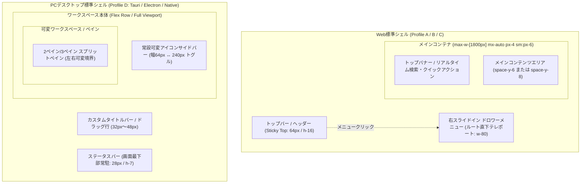
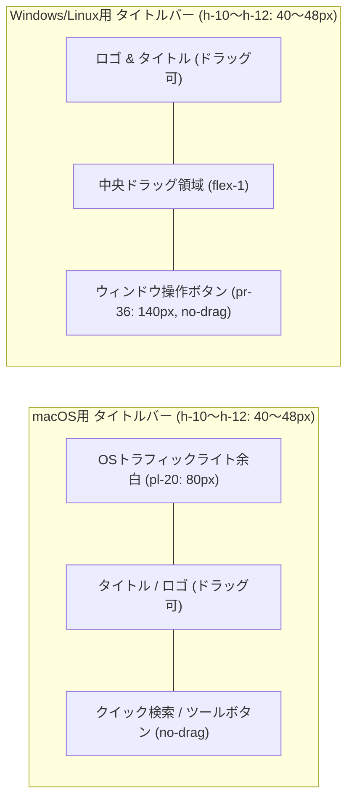
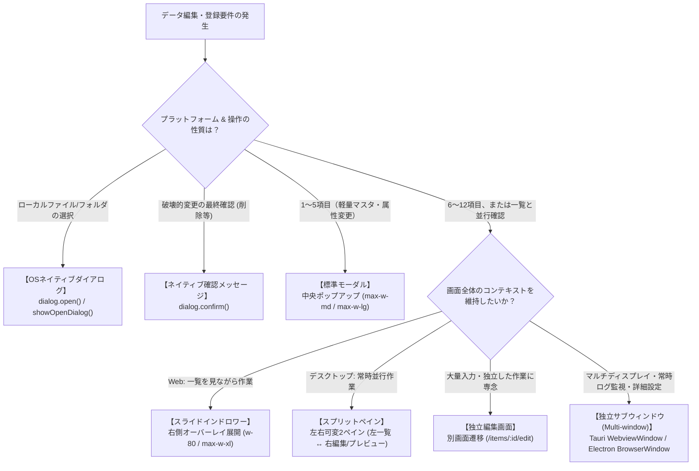
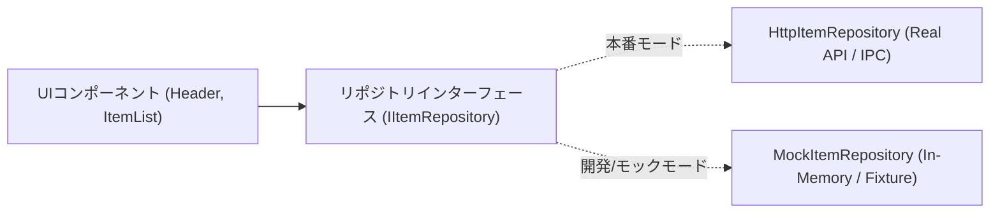

# グランドデザイン基本仕様書 (GRAND_DESIGN_BASE_SPEC)

## 1. 概要

本ドキュメントは、AI駆動開発プラットフォームにおけるフロントエンドおよびデスクトップUI/UXの品質均一化、デザインの一貫性確保、および実装の迅速化を目的とした**クロスプラットフォーム対応グランドデザイン標準（Design System Base）**の基本仕様書である。

本仕様は、先行実稼働システムである `bicycle-log`（走行ログ・滞在記録可視化システム）の実装成果・運用知見、「追加検討課題：モックアップコード制御および画面デザイン標準化」の「3.2 策定すべきグランドデザイン標準項目」、および [04_他フレームワーク・デスクトップアプリ適用評価レポート](./04_他フレームワーク・デスクトップアプリ適用評価レポート.md) で定義されたマルチプラットフォーム・デスクトップ展開要件（Profile A〜D: Web SPA, Web SSR, 静的MPA, PCデスクトップ）に全面的に準拠して策定されている。

---

## 2. 画面要素とレイアウト展開

### 2.1 全体シェルアーキテクチャ

システム全体の画面構造は、稼働環境（Webブラウザ または PCデスクトップ環境）およびレンダリング戦略に応じて、以下の2種類の「基本シェル（Application Shell）」を定型構成とする。



#### サーバーレンダリング（RSC / Islands / MPA）境界線規約
Next.js App Router, Astro, Nuxt 3 等のSSR/Islands構成、および Django/Rails/FastAPI などのMPA構成（Profile B/C）では、以下の境界線を厳格に遵守する：
1. **静的シェル（サーバー描画領域）**: 外枠レイアウト、ロゴ、静的ナビゲーション枠、著作権表示などはサーバー側で静的にレンダリングする（`'use client'` を付与しない）。
2. **対話アイランド（クライアントステート領域）**: ハンバーガーメニュー開閉、リアルタイムサジェスト検索、テーマ切替トグル、インライン編集など、動的ステートを要する最小限のコンポーネントのみに `'use client'`（または各フレームワークのクライアントアイランド指定）を局所適用する。

---

### 2.2 レスポンシブ & ウィンドウサイズ規格

#### A. Webブラウザ環境（ブレークポイント基準）
Tailwind CSSの標準ブレークポイントに準拠し、以下の2大デバイス区分を基本とする。

| デバイス区分 | 画面幅基準 (Tailwind) | レイアウト挙動・変形仕様 |
| :--- | :--- | :--- |
| **モバイル / 狭画面** | `< 768px` (`md:` 未満) | ・単一カラム縦スクロール構造<br/>・データテーブルは**カード型グリッド**へ自動変形 (`hidden md:block` / `md:hidden`)<br/>・主要アクションは縦積みまたはコンパクトボタン配置 |
| **デスクトップ / 広画面** | `≥ 768px` (`md:` 以上) | ・メインコンテナの最大幅を **`1800px`** に固定 (`max-w-[1800px] mx-auto px-6`)<br/>・テーブル表示、2〜4カラムグリッド、横並び検索バーを展開<br/>・地図や可視化チャートを広画面いっぱいに描画 |

#### B. PCローカルデスクトップアプリ環境（ウィンドウサイズ規格 & スプリットペイン）
PCローカルアプリ（Profile D）では、モバイルのような狭小幅画面（< 768px）への変形は想定せず、以下のサイズ制約と可変ペインを適用する：
- **初期ウィンドウサイズ**: `1280px × 800px`（標準WXGA/HD比率）
- **最小ウィンドウサイズ制約 (Min Window Size)**: `960px × 640px`（これ以下のリサイズをOSレベルで禁止し、レイアウト破綻を防止）
- **リサイザブル・スプリットペイン (Split Pane)**:
  - 画面左側にツリーや一覧（初期幅 280px〜360px、最小幅 200px）、画面右側に詳細・エディタを配置。
  - 境界線（スプリッター、幅 4px〜6px、ホバー時 `col-resize` カーソル）をマウスドラッグで可変にする。

---

### 2.3 トップバー & カスタムタイトルバー仕様

#### A. Web標準トップバー（Header）
- **配置・スタイル**:
  - `sticky top-0 z-40 bg-white/80 dark:bg-slate-800/80 backdrop-blur-md border-b border-slate-200 dark:border-slate-700`
  - 高さ: `h-16`（64px）
- **構成要素**:
  1. **ロゴ & タイトル**: 左端に配置。角丸8pxボックス（`w-8 h-8 rounded-lg bg-gradient-to-tr from-blue-600 to-indigo-500`）＋ アプリ名称。
  2. **システムバージョンバッジ**: タイトル直後に配置（例: `v1.2`）。フォントサイズ 11px、等幅フォント（`font-mono`）。
  3. **メニューボタン**: 右端に配置。`Menu` アイコンボタン。

#### B. デスクトップ用カスタムタイトルバー（Frameless Window / TitleBar）
OS標準のタイトルバーを消去（Frameless Window）し、アプリ内ヘッダーと一体化させる場合の必須仕様：



1. **ドラッグ領域とクリック領域の分離属性**:
   - タイトルバー全体には `data-tauri-drag-region` または CSS `-webkit-app-region: drag` を付与し、どこをドラッグしてもウィンドウが移動できるようにする。
   - タイトルバー内の**ボタン、入力欄、リンク等の対話要素**には、必ず `data-tauri-drag-region="false"` または CSS `-webkit-app-region: no-drag` を明示付与し、クリックや入力が阻害されないようにする。
2. **OSネイティブ操作ボタンとの干渉回避セーフエリア**:
   - **macOS**: ウィンドウ左上のトラフィックライトボタン（閉じる・最小化・最大化）とロゴの衝突を防ぐため、左端に **`pl-20`（約80px）** のセーフエリアパディングを必須確保する。
   - **Windows / Linux**: ウィンドウ右上の「最小化・最大化・閉じる」ボタン領域と干渉しないよう、右端に **`pr-36`（約140px）** の予約領域を設けるか、最上部に高さ 32px の独立タイトルバー行を配置する。

---

### 2.4 ナビゲーションメニュー仕様

#### A. Web標準: 右スライドインドロワー（Hamburger Menu）
画面幅を圧迫しないため、常設サイドバーではなく**ルート要素直下へのオーバーレイ描画（テレポート）**を標準とする。
- **実装仕様**:
  - React では `React.createPortal(..., document.body)`、Vue 3 では `<Teleport to="body">`、Svelte では `use:portal` を使用。
  - 背景オーバーレイ: `fixed inset-0 z-50 flex justify-end bg-black/40 backdrop-blur-sm transition-opacity`。
  - ドロワー本体: `w-80 h-full bg-white dark:bg-slate-800 p-6 shadow-2xl flex flex-col justify-between overflow-y-auto`。
  - **アクセシビリティ**: `Escape` キー押下で閉じる、メニュー展開中の背景スクロール抑止（`overflow: hidden`）。
  - **内部構成**: ヘッダー（ロゴ+閉じるボタン）、ナビゲーションリンク集（アクティブ時ハイライト）、フッターコントロール（3モードテーマ切替スイッチ、ログインユーザー表示、ログアウトボタン）。

#### B. デスクトップ標準: 常設可変サイドバー（Collapsible Sidebar）
頻繁な画面切替を伴うデスクトップ業務アプリでは、全画面オーバーレイドロワーは操作コストが高いため、**「アイコン幅（64px）↔ 展開幅（240px）」をトグル可能な左常設サイドバー**を採用する。
- **収納時 (Collapsed: 幅 64px)**:
  - アイコンのみを中央配置（Tooltipで画面名を表示）。
  - 画面作業領域を最大化。
- **展開時 (Expanded: 幅 240px)**:
  - アイコン + ラベルテキスト + バッジを表示。
  - 最下部に設定ボタン（`Ctrl/Cmd + ,`）とユーザーアカウント情報を配置。

---

### 2.5 ステータスバー仕様（Desktop / Status Bar）

デスクトップアプリ（Profile D）では、画面最下部に**高さ 24px〜28px（`h-7`）**のステータスバーを常駐配置する。
- **スタイル**: `h-7 bg-slate-100 dark:bg-slate-900 border-t border-slate-200 dark:border-slate-800 px-3 flex items-center justify-between text-xs text-slate-500 dark:text-slate-400 select-none font-mono`
- **表示内容**:
  - 左端: 接続ステータス（「● ローカルDB接続済」「オフライン」「同期中...」）
  - 中央: アクティブなプロジェクトパスまたは作業ファイル名
  - 右端: 処理件数・選択行数、バックグラウンド処理スピナー、文字コード/改行コード表示

---

## 3. ボタンおよびインタラクション要素

### 3.1 ボタンバリエーション規格

ボタンは用途に応じて以下の6種類に厳格に規格化し、野良スタイルの混入を防ぐ。Web（Tailwind）およびネイティブ環境向けに絶対値（px / HEX）を併記する。

| バリアント | 主な用途 | Tailwind スタイルクラス | 視覚定義（絶対値/HEX） |
| :--- | :--- | :--- | :--- |
| **Primary** | 主要アクション（保存、実行、新規作成） | `bg-blue-600 hover:bg-blue-700 text-white font-medium rounded-xl shadow-sm hover:shadow transition disabled:opacity-50` | 背景: `#2563eb` (ホバー: `#1d4ed8`)<br/>文字: `#ffffff`, 角丸: `12px` |
| **Secondary / Neutral** | キャンセル、戻る、一般操作 | `bg-slate-100 dark:bg-slate-700 hover:bg-slate-200 dark:hover:bg-slate-600 text-slate-700 dark:text-slate-200 font-medium rounded-xl transition` | 背景: `#f1f5f9` (ダーク: `#334155`)<br/>文字: `#334155` (ダーク: `#e2e8f0`), 角丸: `12px` |
| **Danger / Destructive** | 削除、強制破棄、重大な変更 | `border border-rose-200 dark:border-rose-900/50 text-rose-600 dark:text-rose-400 hover:bg-rose-50 dark:hover:bg-rose-900/30 rounded-xl transition` | 枠線: `#fecdd3`, 文字: `#e11d48`<br/>ホバー背景: `#fff1f2`, 角丸: `12px` |
| **Outline** | 検索、フィルター、補助機能 | `border border-slate-200 dark:border-slate-700 bg-white dark:bg-slate-800 text-slate-700 dark:text-slate-200 hover:bg-slate-50 dark:hover:bg-slate-700/50 rounded-xl transition` | 枠線: `#e2e8f0` (ダーク: `#334155`)<br/>背景: `#ffffff` (ダーク: `#1e293b`), 角丸: `12px` |
| **Ghost / Icon Only** | テーブル内アクション、閉じる | `p-1.5 sm:p-2 rounded-lg text-slate-500 hover:text-slate-700 dark:text-slate-400 dark:hover:text-slate-200 hover:bg-slate-100 dark:hover:bg-slate-700 transition` | 背景: 透明 (ホバー: `#f1f5f9`)<br/>文字: `#64748b`, 角丸: `8px` |
| **Accent / Banner Action** | バナー内専用ボタン（半透明背景） | `bg-white/20 hover:bg-white/30 backdrop-blur-md text-white border border-white/30 rounded-xl transition` | 背景: `rgba(255,255,255,0.2)`<br/>枠線: `rgba(255,255,255,0.3)`, 角丸: `12px` |

---

### 3.2 ミニマルアイコン化および英語表記ルール

- **ミニマルアイコン化原則**:
  - テーブル行内やカードヘッダーなど、操作の意味が文脈上自明なボタンはラベルテキストを省き、**アイコンのみのミニマル表示**とする。
  - ラベルを省いたボタンには、必ず `title` 属性および `aria-label` を付与する。
- **Tooltip（`title`）英語表記統一**:
  - ボタンのツールチップは、プラットフォーム横断で**英語表記（Title Case）**に統一する。

#### ボタン・アイコン対応マトリクス

| 操作内容 | アイコン (Lucide / 等価SVG) | 英語 Tooltip (`title`) | 推奨カラー・枠線スタイル |
| :--- | :--- | :--- | :--- |
| **編集** | `Pencil` | `Edit` | ブルー枠 (`border-blue-200 text-blue-600 / #2563eb`) |
| **削除** | `Trash2` | `Delete` | ローズ枠 (`border-rose-200 text-rose-600 / #e11d48`) |
| **詳細表示** | `Eye` / `ExternalLink` | `View Details` | スレート枠 (`border-slate-200 / #e2e8f0`) |
| **新規作成** | `Plus` | `Add New` | エメラルド枠 (`text-emerald-600 / #059669`) または Primary |
| **閉じる** | `X` | `Close` | スレート無地 (`text-slate-400 hover:text-slate-600`) |
| **変更保存** | `Check` / `Save` | `Save Changes` | エメラルド塗りつぶし または Primary |
| **検索** | `Search` | `Search` | Primary または スレート枠 |
| **フィルター** | `Filter` | `Filter` | スレート枠 |
| **データ同期** | `RefreshCw` | `Sync Data` | オレンジ枠 (`text-orange-500 / #f97316`) |
| **機能検出** | `Route` / `GitMerge` | `Detect` / `Detect Routes` | パープル枠 (`text-purple-600 / #9333ea`) |
| **全画面拡大** | `Maximize2` | `Maximize Map` / `Maximize` | スレート/ホワイト半透明 |
| **全画面解除** | `Minimize2` | `Minimize Map` / `Minimize` | スレート/ホワイト半透明 |
| **画像選択** | `Image` / `Upload` | `Select Image` / `Upload` | インディゴ/ブルー枠 |

---

### 3.3 デスクトップ操作規約・ショートカット体系

PCデスクトップアプリ（Profile D）およびキーボードファーストWebアプリにおいて、以下の標準キーボードショートカットおよびコンテキストメニューを規格化する。

#### A. 標準キーボードショートカットマトリクス

| ショートカットキー (macOS / Win,Linux) | アクション | 対象スコープ | 挙動仕様 |
| :--- | :--- | :--- | :--- |
| `Cmd + S` / `Ctrl + S` | **Save Changes** | 画面全体 / アクティブフォーム | 編集中の内容を即時保存しトースト通知を表示。 |
| `Cmd + F` / `Ctrl + F` | **Focus Search** | 一覧画面 / グローバル | リアルタイム検索バーへフォーカスし全選択。 |
| `Cmd + N` / `Ctrl + N` | **Add New** | 一覧画面 / マスタ管理 | 新規作成モーダルまたは入力ドロワーを展開。 |
| `Cmd + ,` / `Ctrl + ,` | **Preferences** | アプリケーション全域 | 環境設定画面（サブウィンドウまたはモーダル）を開く。 |
| `Cmd + W` / `Ctrl + W` | **Close** | モーダル / サブウィンドウ | 最前面のモーダル、ドロワー、またはタブを閉じる。 |
| `Escape` | **Cancel / Close** | モーダル / ドロワー / ポップオーバー | 展開中のオーバーレイを閉じ、フォーカスを元に戻す。 |
| `Ctrl + Enter` | **Submit** | 複数行テキスト入力 / コメント | モーダルやフォームの内容を確定・送信する。 |

#### B. コンテキストメニュー（右クリックメニュー）
テーブル行、ツリーノード、またはカード上で右クリックした際、OS標準のブラウザメニュー（「再読み込み」「名前を付けて保存」等）を抑止（`e.preventDefault()`）し、以下のカスタムアクションメニューを表示する：
- 「詳細を開く (`View Details`)」
- 「インライン編集 (`Edit`)」
- 「クリップボードへID/パスをコピー (`Copy ID`)」
- 区切り線
- 「削除 (`Delete`)」（文字色: `#e11d48`）

#### C. OSネイティブメニューバー規約
Tauri / Electron のデスクトップ起動時、OS標準メニューバー（File, Edit, View, Window, Help）に上記ショートカットと連動するメニュー項目を必ず登録する。

---

## 4. 編集画面・表示画面の標準ウィンドウ形態

### 4.1 ウィンドウ形態の選定基準

画面構造のばらつきを防ぐため、業務要件および稼働プロファイルに応じて、以下の6形態から厳格に選定する。



#### ウィンドウ形態の特性マトリクス

| ウィンドウ形態 | 推奨プラットフォーム | 主な用途 | 最大幅 / サイズ規格 |
| :--- | :--- | :--- | :--- |
| **標準モーダル** | 全環境 (Web / デスクトップ) | 軽量入力（1〜5項目）、クイックダイアログ | `max-w-md` (448px) 〜 `max-w-lg` (512px) |
| **スライドインドロワー** | Web (Profile A / B) | 6〜12項目の編集、一覧の文脈維持 | 幅 `w-80` (320px) 〜 `max-w-xl` (576px) |
| **スプリットペイン** | デスクトップ (Profile D) | 一覧と詳細・エディタの同時並行作業 | 左 280〜360px ↔ 右 残余幅（可変ドラッグ） |
| **独立編集画面 (フルページ)** | Web / デスクトップ | 13項目以上の大量入力、ステップフォーム | メインコンテナ `max-w-[1800px]` |
| **OSネイティブダイアログ** | デスクトップ (Profile D) | ファイル/フォルダインポート・エクスポート | OS標準ダイアログ |
| **独立サブウィンドウ** | デスクトップ (Profile D) | 設定画面、リアルタイムログ監視、外部プレビュー | 800×600px などの独立ウィンドウ生成 |
| **インライン編集** | 全環境 | 単一テキスト、名称、ステータス即時変更 | 要素直上（ポップアップなし） |

---

### 4.2 一覧画面（List View）の標準構造

- **構成要素**:
  1. **トップバナー & リアルタイム検索**:
     - グラデーション背景バナー（`from-blue-600 to-indigo-600 rounded-2xl p-6 text-white`）。
     - **リアルタイム検索窓**:
       - リモートWeb API: **250〜300ms デバウンス**処理による負荷軽減。
       - ローカルDB (SQLite / インメモリ): **即時検索モード（デバウンス 0〜50ms）**による高速追従。
       - サジェストドロップダウン付き。
     - 右端にクイックアクションボタン（データ同期、新規追加など）。
  2. **主要サマリーカードエリア**:
     - 2〜4カラムのグリッドで主要KPIを表示（`bg-white dark:bg-slate-800 p-6 rounded-2xl border`）。
     - アイコン + 指標ラベル + 大きな数値（`text-3xl font-bold`）。
  3. **タブ & フィルターバー**:
     - エンティティ切替タブ + ドロップダウンフィルター（ステータス、日付）。
  4. **データ表示領域（ハイブリッド / スプリットペイン展開）**:
     - **Web環境**: デスクトップでソート可能テーブル、モバイルでカード型グリッドへ自動変形。
     - **デスクトップ環境**: スプリットペイン左側にテーブル/ツリーを配置し、行クリック時に右側ペインへ詳細を即時展開。
  5. **ページネーション**: 現在ページ、総件数、前後移動ボタン。

---

### 4.3 詳細・閲覧画面（Detail View）の標準構造

- **構成要素**:
  1. **メタデータヘッダー**:
     - 戻るボタン（`ArrowLeft`）+ エンティティ名称 + 種別バッジ。
     - **インライン名称編集**: クリック時に直接入力欄に変化し、即座に保存可能。
  2. **リッチメディア・マップ領域**:
     - 地図（Leaflet / Mapbox）やメインチャート。全画面拡大トグルボタン（`Maximize2`）を常設。
  3. **カード型セクション分割**: 基本情報、履歴、統計情報などをカード単位（`rounded-2xl border p-6`）で分割。
  4. **複数写真・コメントギャラリー**: 正方形サムネイルグリッド + クリック時拡大モーダル。

---

### 4.4 編集・登録画面の標準構造

#### A. 標準モーダル（簡易入力）
- 中央ポップアップ（`max-w-lg`）、背景半透明ブラー（`backdrop-blur-sm`）。
- 必須項目には `text-rose-500` の `*`。
- 送信ボタンにはローディングスピナー（`Loader2 animate-spin`）および二重送信防止（`disabled`）。

#### B. インライン編集（直接編集）
- 名称やコメントなどの単一フィールドは、モーダルを開かず該当箇所を直接クリックして入力・保存する。
- 閲覧モード: テキスト + `Pencil` アイコン（ホバー時ハイライト）。
- 編集モード: `input` / `textarea` + `Check` 保存ボタン + `X` キャンセルボタン。

---

## 5. 基本ルック（トークン & スタイルガイド）

非Web技術（PyQt, Flutter, WPF）や別フレームワークへの移植を容易にするため、Tailwindクラス名と**絶対値（HEX / px）**を併記する。

### 5.1 セマンティックカラー体系

| セマンティック用途 | ライトモード (Tailwind / HEX) | ダークモード (Tailwind / HEX) | 役割・用途 |
| :--- | :--- | :--- | :--- |
| **Page Background** | `bg-slate-50` (`#f8fafc`) | `dark:bg-slate-900` (`#0f172a`) | アプリケーション全体の基底背景色 |
| **Card / Surface** | `bg-white` (`#ffffff`) | `dark:bg-slate-800` (`#1e293b`) | カード、モーダル、ドロワーの背景 |
| **Subsurface / Muted** | `bg-slate-100` (`#f1f5f9`) | `dark:bg-slate-700/50` (`#33415580`) | 入力欄背景、タグ、テーブルヘッダー |
| **Text Primary** | `text-slate-900` (`#0f172a`) | `dark:text-slate-100` (`#f1f5f9`) | 最重要見出し、主要テキスト |
| **Text Secondary** | `text-slate-600` (`#475569`) | `dark:text-slate-300` (`#cbd5e1`) | 本文、標準ラベル |
| **Text Muted** | `text-slate-400` (`#94a3b8`) | `dark:text-slate-500` (`#64748b`) | 補足説明、プレースホルダー、日時 |
| **Border** | `border-slate-200` (`#e2e8f0`) | `dark:border-slate-700` (`#334155`) | 境界線、区切り線 |
| **Brand Primary (Start)**| `from-blue-600` (`#2563eb`) | `from-blue-600` (`#2563eb`) | プライマリブランド、ボタン背景 |
| **Brand Primary (End)**  | `to-indigo-600` (`#4f46e5`) | `to-indigo-600` (`#4f46e5`) | バナーグラデーション終端 |
| **Status: Success** | `text-emerald-600` (`#059669`) / `bg-emerald-50` (`#ecfdf5`) | `dark:text-emerald-400` (`#34d399`) / `dark:bg-emerald-900/30` | 正常完了、保存成功、承認 |
| **Status: Warning** | `text-amber-600` (`#d97706`) / `bg-amber-50` (`#fffbeb`) | `dark:text-amber-400` (`#fbbf24`) / `dark:bg-amber-900/30` | 注意、未完了、同期処理中 |
| **Status: Error** | `text-rose-600` (`#e11d48`) / `bg-rose-50` (`#fff1f2`) | `dark:text-rose-400` (`#fb7185`) / `dark:bg-rose-900/30` | エラー、削除、危険警告 |
| **Status: Info** | `text-blue-600` (`#2563eb`) / `bg-blue-50` (`#eff6ff`) | `dark:text-blue-400` (`#60a5fa`) / `dark:bg-blue-900/30` | 情報、リンク、選択中項目 |

---

### 5.2 タイポグラフィ & 余白・角丸体系

#### A. 角丸体系 (Border Radius)
| トークン名 | Tailwind クラス | ピクセル絶対値 | 適用対象 |
| :--- | :--- | :--- | :--- |
| **Radius 2XL** | `rounded-2xl` | `16px` | カード、標準モーダル、トップバナー |
| **Radius XL** | `rounded-xl` | `12px` | 入力フィールド、標準ボタン、ドロップダウンメニュー |
| **Radius LG** | `rounded-lg` | `8px` | ミニボタン、タグ、アプリロゴアイコン |
| **Radius Full** | `rounded-full` | `9999px` | バッジ、アバター、ステータスインジケーター |

#### B. 余白グリッド体系 (Spacing Grid)
4px / 8px を基準単位とし、以下のスケールを厳格に適用する：
- `4px` (`gap-1`, `p-1`): 超小型バッジ内パディング
- `8px` (`gap-2`, `p-2`): アイコンボタン、リスト行間
- `12px` (`gap-3`, `p-3`): 入力フィールド内パディング、ボタンパディング
- `16px` (`gap-4`, `p-4`): モバイルカード内パディング、フォーム項目間隔
- `24px` (`gap-6`, `p-6`): デスクトップカード内パディング、モーダル内パディング
- `32px` (`space-y-8`, `p-8`): セクション間余白

#### C. プラットフォーム非依存 Design Tokens (JSON形式)
非Web環境（Qt, Flutter, WPF）やCSS-in-JSツールで直接利用可能なデザイントークンJSON規格：

```json
{
  "color": {
    "background": { "light": "#f8fafc", "dark": "#0f172a" },
    "surface": { "light": "#ffffff", "dark": "#1e293b" },
    "primary": { "main": "#2563eb", "gradientEnd": "#4f46e5" },
    "status": {
      "success": "#059669",
      "warning": "#d97706",
      "error": "#e11d48",
      "info": "#2563eb"
    }
  },
  "radius": {
    "sm": "8px",
    "md": "12px",
    "lg": "16px",
    "full": "9999px"
  },
  "spacing": {
    "xs": "4px",
    "sm": "8px",
    "md": "12px",
    "base": "16px",
    "lg": "24px",
    "xl": "32px"
  }
}
```

---

### 5.3 ダークモード対応 & テーマ永続化指針

1. **動作モード**: `light`（強制ライト）, `dark`（強制ダーク）, `system`（OS設定同期 `prefers-color-scheme`）。
2. **切替コンポーネント**: `Sun` / `Moon` / `Monitor` の3ボックストグル。
3. **SSR環境（Next.js / Nuxt 3）における FOUC（初期チラつき）防止**:
   - `localStorage` をクライアントでのみ同期読み出しすると、初期HTML描画時に白から黒へチラつく問題が発生する。
   - 対策として、`<head>` 直下に以下の極小インラインスクリプトを注入するか、フレームワーク公式モジュール（`@nuxtjs/color-mode`, `next-themes`）を利用する：
   ```html
   <script>
     (function() {
       var theme = localStorage.getItem('theme') || 'system';
       var isDark = theme === 'dark' || (theme === 'system' && window.matchMedia('(prefers-color-scheme: dark)').matches);
       if (isDark) document.documentElement.classList.add('dark');
       else document.documentElement.classList.remove('dark');
     })();
   </script>
   ```
4. **デスクトップ環境での永続化**:
   - デスクトップ環境では `localStorage` の揮発リスクがあるため、後述の `IStorageAdapter` 経由で設定ファイル（JSON/TOML）へ永続化する。

---

## 6. データアクセス & モックアップ制御層

### 6.1 リポジトリインターフェース分離（`IRepository`）

モックアップコードがコンポーネント内に散乱するのを防ぐため、データ取得・更新は必ず「リポジトリ層 / サービス層」を介して実行する。



### 6.2 プラットフォーム別モック方式マトリクス

| 実行環境 | 推奨モック方式 | 切り替え制御 |
| :--- | :--- | :--- |
| **Web SPA (Profile A)** | **MSW (Mock Service Worker)** | `VITE_ENABLE_MOCK=true` で Service Worker 起動 |
| **Web SSR (Profile B)** | **MSW Node / Repository DI** | サーバー側レンダリング時は `msw/node` または MockRepository を注入 |
| **PCデスクトップ (Profile D: Tauri/Electron)** | **MockRepository / IPCモック** | Service Worker を経由しないため、DIコンテナで MockRepository または IPCモックハンドラーを注入 |
| **静的MPA (Profile C)** | **Mock Backend Router** | FastAPI / Django のルーティング層でモックJSONを返却 |

---

## 7. まとめと改定運用

本仕様書は、全システムが参照する共通基盤である。
個別システムを設計する際は、本ドキュメントのルール（セマンティックカラー、角丸、英語Tooltip、プラットフォーム別シェル）を継承した上で、[03_画面仕様書テンプレート.md](./03_画面仕様書テンプレート.md) を用いてシステム固有の `画面仕様書.md` を作成すること。
