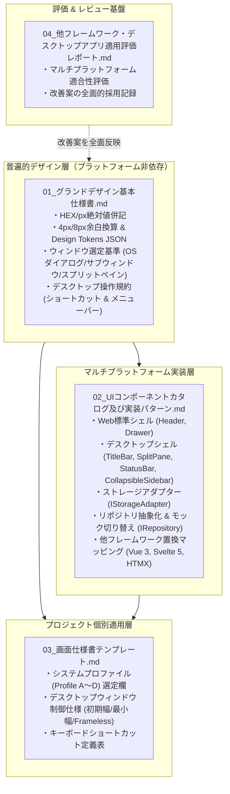

# グランドデザイン標準仕様書（Design System Base）概要

## 1. 概要と策定背景

本ディレクトリ（`doc_samples/グランドデザイン/`）は、AI駆動開発パイプライン（V2.2以降）において、生成されるシステムのUI/UXデザイン品質を均一化し、開発ごとのデザイン揺らぎ・ばらつきを排除するために策定された「**クロスプラットフォーム対応グランドデザイン標準（Design System Base）**」の設計書・カタログテンプレート群である。

先行実稼働システムである `bicycle-log`（走行ログ・滞在記録可視化システム）の実装成果・運用知見、「追加検討課題：モックアップコード制御および画面デザイン標準化」の「3.2 策定すべきグランドデザイン標準項目」、および [04_他フレームワーク・デスクトップアプリ適用評価レポート](./04_他フレームワーク・デスクトップアプリ適用評価レポート.md) で定義された**クロスプラットフォーム（Profile A〜D: Web SPA, Web SSR, 静的MPA, PCローカルデスクトップ）展開要件**を全面的に統合・反映している。

---

## 2. 解決する課題と多層化アーキテクチャ

これまでのテンプレートでは、特定フレームワーク（React + Tailwind CSS）およびWebブラウザ環境に暗黙のうちに依存していたため、以下の課題が生じていた：

1. **特定技術への密結合**: `React.createPortal`、`localStorage`、Tailwindクラス直書き、モバイルWeb前提レスポンシブへの過度な依存。
2. **PCデスクトップアプリ（Tauri / Electron / ネイティブ）との衝突**: タイトルバーのドラッグ領域欠落、macOSトラフィックライトボタンやWindows操作ボタンとの重なり、最小ウィンドウサイズ制約の欠落。
3. **他フレームワーク（Vue, Svelte, SSR/MPA）での摩擦**: SSRハイドレーション不整合（FOUC）、サーバーコンポーネント境界の曖昧さ。

これらを解消するため、本グランドデザイン標準は以下の**多層化アーキテクチャ**へ刷新された。

---

## 3. ディレクトリ構成

| ファイル名 | 概要 | 主な対象読者 / エージェント |
| :--- | :--- | :--- |
| [README.md](./README.md) | 本ドキュメント。グランドデザイン標準の背景、多層化アーキテクチャ、構成案内 | 全エージェント、開発者 |
| [01_グランドデザイン基本仕様書.md](./01_グランドデザイン基本仕様書.md) | 抽象トークン（HEX/px）、レイアウト原則、デスクトップ拡張規約を網羅した基本設計書 | `ui-designer`, `architect`, `conductor` |
| [02_UIコンポーネントカタログ及び実装パターン.md](./02_UIコンポーネントカタログ及び実装パターン.md) | Webおよびデスクトップ向けTSXコードスニペット、ストレージアダプター、フレームワーク置換表 | `ui-designer`, `backend-engineer` |
| [03_画面仕様書テンプレート.md](./03_画面仕様書テンプレート.md) | Profile A〜D選択欄、デスクトップ制御、ショートカット定義を事前組み込みした個別画面仕様書雛形 | `architect`, `ui-designer` |
| [04_他フレームワーク・デスクトップアプリ適用評価レポート.md](./04_他フレームワーク・デスクトップアプリ適用評価レポート.md) | 他フレームワーク（Vue/Svelte/SSR等）やPCデスクトップ（Tauri/Electron等）適用評価および改訂採用記録 | `architect`, `ui-designer`, `conductor`, `qa-engineer` |

---

## 4. AI駆動開発パイプラインでの適用手順

1. **PHASE 1（初期化）**:
   - 本ディレクトリを新規プロジェクトの `docs/設計書/グランドデザイン/` または `doc_samples/` から参照可能な位置に配置する。
2. **PHASE 2（要件定義）**:
   - `conductor` / `architect` は、システムの展開プロファイル（Profile A: Web SPA, Profile B: Web SSR, Profile C: 静的MPA, Profile D: PCデスクトップ）を選定・決定する。
3. **PHASE 3（基本設計）**:
   - `ui-designer` は、[03_画面仕様書テンプレート.md](./03_画面仕様書テンプレート.md) をベースにして個別システムの `docs/設計書/画面仕様書.md` を作成する。
   - 画面仕様書内では、プロファイルに応じたウィンドウ形態（モーダル / ドロワー / スプリットペイン / OSダイアログ / 別ウィンドウ）およびショートカットキーを明記する。
4. **PHASE 4（実装）**:
   - フロントエンド・デスクトップ構築時、`ui-designer` は [02_UIコンポーネントカタログ及び実装パターン.md](./02_UIコンポーネントカタログ及び実装パターン.md) の規格コードに従ってコンポーネントを実装する。
   - 状態永続化には `IStorageAdapter`、データ取得には `IRepository` を使用し、直書き `localStorage` や直書きモックを排除する。
5. **PHASE 5.5（コード品質レビューゲート `dev-review-code`）**:
   - `qa-engineer` は、ボタンの規格外クラス指定、コンポーネント内直書きモックコードの有無、デスクトップ時のタイトルバードラッグ領域指定（`data-tauri-drag-region`）の有無を自動監査する。

---

## 5. 関連ドキュメント（相対パスリンク）

- 「追加検討課題：モックアップコード制御および画面デザイン標準化」(V2.2設計検討資料)
- 「システムプロファイル設計および事前組込アーキテクチャ検討レポート」(V2.2設計検討資料)
- [既存 画面仕様書サンプル](../画面仕様書.md)
