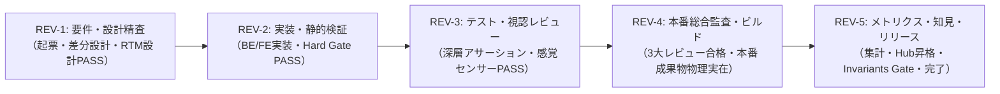

# システム改訂運用基準書

本ドキュメントは、システム初回リリース（PHASE 8完了）以降の機能追加、不具合修正、および運用保守における標準改訂プロセスと運用ルールを定める。

---

## 1. システムのバージョン管理と状態台帳

- **バージョン管理場所**: `.env` ファイル内の環境変数 `APP_VERSION` でシステム全体のバージョンを一元管理する。フォーマットはセマンティックバージョニング（SemVer 2.0.0: `MAJOR.MINOR.PATCH`、例: `1.0.1`）を厳格に遵守する。
- **構造化状態台帳 (`project_state.json` / `PROJECT_STATE.md`)**:
  - 機械正本 `project_state.json` および自動生成ビュー `PROJECT_STATE.md` において、現行バージョン、改訂ステータス（`IDLE` / `ACTIVE`）、進行中の改訂依頼番号、ターン番号を一元追跡する。
  - 台帳への更新権限は **👑 プロジェクトコンダクター専任 (Single Writer)** とし、`scripts/state_manager.py` を通じて原子的・決定論的に更新する。

---

## 2. 標準改訂パイプライン (REV-1 〜 REV-5)

初期開発完了後の改訂作業は、自由裁量による工程のスキップを防ぐため、以下の **5段階標準改訂パイプライン (REV-1〜REV-5)** を厳格に順守して進行する。

### REV-1: 要件・設計精査 (Planning & Design)
1. **改訂起票と計画スケルトン自動展開**:
   - 👑 コンダクターが `python3 scripts/state_manager.py start-revision --id <ID> --title "<改訂概要>"` を実行する。
   - `docs/plans/<ID>改訂計画/` 配下に `00_改訂基本計画書.md`（現行有効な Overlay ガードレール自動注入済み）および各手順書スケルトンが自動生成され、改訂作業ブランチ（`revision/<ID>`）へ自動切り替えが行われる。
2. **差分要件定義・基本設計**:
   - 📐 `architect` が差分要件定義および4大基本設計書（技術・スキーマ・ロジック・画面）を改訂し、サブ要件ID（`[REQ-Fxx-xx]`）を採番する。
3. **基本設計レビュー (Gate PASS 必須)**:
   - 🛡️ `qa-engineer` が `dev-review-arch` を実行し、`python3 scripts/traceability_checker.py --mode design` が 100% PASS することを確認する。

### REV-2: 実装・静的検証 (Implementation & Hard Gate)
1. **BE / FE 差分実装**:
   - 💻 `backend-engineer` および 🎨 `ui-designer` へ委譲し、設計書に準拠して差分実装を行う。
   - フロント250行制限、バック400行制限、直書きモック排除、生SQL排除を厳守する。
2. **Hard Gate 機械的遮断**:
   - コミット前に必ず `python3 scripts/harness_guard.py --all` を実行し、規約違反 0 件であることを機械検証する。
3. **修正後のコンテナ再構成徹底**:
   - コード修正後は、確実に変更を反映させるため、必ず `docker compose down` および `docker compose up --build -d` を実行する。

### REV-3: テスト・視認レビュー (Verification & Sensory)
1. **シナリオテスト拡充と実行**:
   - 🛡️ `qa-engineer` が `docs/plans/シナリオテスト計画書.md` を更新し、テストを実行する。
   - **3階層深層アサーション**（構造・状態遷移・副作用連動描画）を徹底し、自己完結型トートロジー・テスト（アリバイテスト）を排除する。
   - **モックOFF実データ一気通貫E2E検証**を実施する。
2. **ブラウザ感覚センサー検証**:
   - Chrome DevTools MCP により、コンソールエラー 0件、WCAG AA 4.5:1 コントラスト比、A11yツリーの健全性を実測検証する。
3. **不具合時の RCA 即時記録**:
   - テスト失敗や手戻りが発生した場合は、`wiki-maintainer` 手順で `./wiki/patterns/` へ根本原因を即時記録する。
4. **RTM フル充足検証**:
   - `python3 scripts/traceability_checker.py --mode full` を実行し、全要件のテスト反映および異常系比率 20% 以上を確認する。

### REV-4: 本番総合監査・成果物ビルド (System Review & Build)
1. **コード品質レビュー (`dev-review-code`)**:
   - 🛡️ `qa-engineer` が監査し、機能等価性マトリクス照合でプレースホルダーや縮退実装がないことを確認して `CLEAN` 判定を得る。
2. **システム総合レビュー (`dev-review-system`)**:
   - 本番モックOFF二重防御、IAP JWT有効化、平文シークレットゼロを監査し、`RELEASE APPROVED` 判定を得る。
3. **本番成果物の物理ビルド**:
   - Profile D: `npm run tauri build` を実行し、`src-tauri/target/release/` 配下に本番バイナリ/成果物を物理生成する。
   - Profile A: 本番コンテナビルド・デプロイ設定を確認する。

### REV-5: メトリクス・知見昇格・リリース (Metrics, Evolution & Closure)
1. **定量メトリクス集計と台帳同期**:
   - 👑 コンダクターが `python3 scripts/metrics_collector.py --all --sync-state` を実行し、最新メトリクスを台帳へ自動同期する。
2. **Knowledge Hub 知見昇格と Local Overlay 再生成**:
   - 獲得した汎用知見を `wiki-proposer` で標準化知見原票（`CLAIM-*.md`）として投函し、3段階意味的整合性監査を経て `ask_question` モーダルでユーザー承認を得る。
   - `pipeline-reconciler.sh --activate-claim` により `LOCAL_FEEDBACK_RULES.md` をクリーン再生成する。
3. **Invariants Hard Gate 自動検証 & クローズ**:
   - 👑 コンダクターが `python3 scripts/state_manager.py complete-revision --id <ID> --version <新バージョン>` を実行する。
   - スクリプト内部の `validate_revision_closure_invariants()` が「本番成果物実在」「メトリクス集計済み」「未処理原票ゼロ」「ブランチ整合性」を機械検査し、未達時は Exit Code 1 で自動遮断される。
4. **GitHub本番リリース (`dev-git-release`)**:
   - `main` ブランチへの Squash Merge、バージョンタグ付与、Push、および新規 `feature` ブランチの再作成を行う。

---

## 3. ドキュメント改定履歴の記載規約

改訂実行時には、システムの改訂とともに関連設計書・仕様書の改訂も行う。
正本設計書（`docs/設計書/Current/`）のタイトルからは個別バージョン番号を排除し、文書末尾の改定履歴テーブルに以下の形式で記録する。

| 対象バージョン | 改定日 | 改訂依頼番号 | 改定内容 |
| :--- | :--- | :--- | :--- |
| （システムバージョン: 例: 1.0.1） | （YY-MM-DD） | （MAJOR.MINOR.xxx） | （変更内容の簡潔な説明） |
