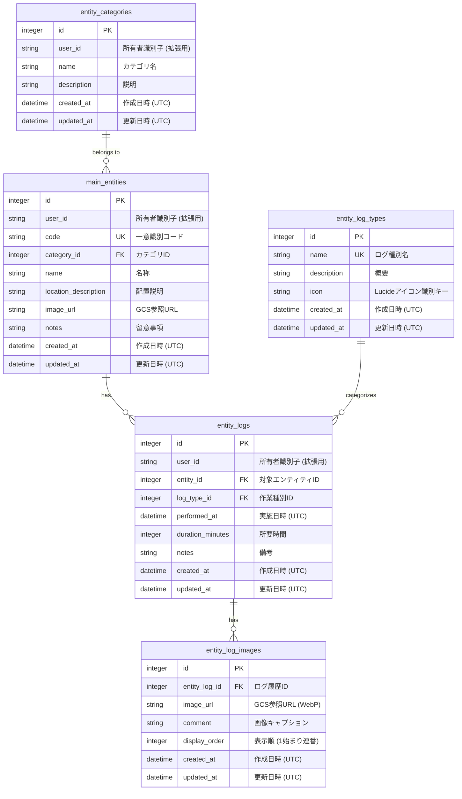

# テーブルスキーマ定義書 (DATABASE_SCHEMA)

- **主担当エージェント**: 📐 設計・立案スペシャリスト (`architect`)
- **実装担当**: 💻 バックエンドエンジニア (`backend-engineer`)
- **参照・整合性検証**: 🎨 UI/UXデザイナー (`ui-designer`), 🛡️ 品質・テスト & QA (`qa-engineer`)
- **承認ゲート**: 👤 ユーザーによる明示的承認必須

---

## 1. 概要 & データベース運用設計規範

本ドキュメントは、「<プロジェクト名>」におけるデータベースのテーブル構造、リレーションシップ、インデックス、およびデータ型を定義する。

### 1.1 運用アーキテクチャ & 設計規約
1. **Alembic マイグレーション運用の義務付け**:
   - 生SQL手動DDL（`CREATE TABLE`, `ALTER TABLE` 等）は**絶対禁止**とする。
   - すべてのテーブル定義は SQLAlchemy 2.0 宣言的モデル（`src/db/base.py` 継承）としてコード化し、変更時は必ず Alembic 標準コマンド（`docker compose exec backend alembic revision --autogenerate -m "..."`）でマイグレーションスクリプトを自動生成する。
2. **タイムゾーン規約 (Aware UTC 保存 / JST 表示)**:
   - データベース内部の日時カラム（`DATETIME` 型）には、必ず **Aware UTC（ISO 8601 形式 `YYYY-MM-DDTHH:MM:SSZ`）** を保存する。
   - JST (日本標準時) への変換はフロントエンドの UI 表示層（`dateTime.ts` ユーティリティ）においてのみ行う。
3. **`user_id` 拡張性の確保**:
   - 現在のシステムが単一ユーザー向けであっても、将来のマルチテナント化・マルチユーザー化に備え、業務エンティティテーブルには所有者識別用の `user_id` カラム（TEXT / UUID / Email等）を付与するか、拡張容易な設計とする。
4. **SQLite WAL モード & 整合性設定**:
   - `PRAGMA journal_mode=WAL;` (書き込み並行性向上)
   - `PRAGMA busy_timeout=5000;` (ロック待ちタイムアウト5秒)
   - `PRAGMA foreign_keys=ON;` (外部キー制約の強制有効化)
5. **物理削除 / 論理削除規約**:
   - マスタ参照整合性を保護するため、外部キー制約のあるマスタデータ削除時は参照レコードの存在チェックを行い、依存関係がある場合は削除を拒否（409 Conflict）する。

---

## 2. ER図 (Entity Relationship Diagram)

---

## 3. テーブル定義詳細

### 3.1 エンティティカテゴリマスタ (`entity_categories`)

エンティティの分類情報を管理するマスタテーブル。

| カラム名 | 論理名 | データ型 | 制約 | 説明 |
| :--- | :--- | :--- | :--- | :--- |
| `id` | ID | INTEGER | PRIMARY KEY AUTOINCREMENT | マスタ一意識別子 |
| `user_id` | 所有者識別子 | TEXT | NULLABLE (将来拡張用) | ユーザー識別子 (Email等) |
| `name` | カテゴリ名 | TEXT | NOT NULL | 例: 分類A、分類B |
| `description` | 特徴/説明 | TEXT | NULLABLE | カテゴリの概要説明 |
| `created_at` | 作成日時 | DATETIME | NOT NULL DEFAULT CURRENT_TIMESTAMP | Aware UTC タイムスタンプ |
| `updated_at` | 更新日時 | DATETIME | NOT NULL DEFAULT CURRENT_TIMESTAMP | Aware UTC タイムスタンプ |

---

### 3.2 メインエンティティ (`main_entities`)

個別データを管理するメインテーブル。

| カラム名 | 論理名 | データ型 | 制約 | 説明 |
| :--- | :--- | :--- | :--- | :--- |
| `id` | ID | INTEGER | PRIMARY KEY AUTOINCREMENT | 一意識別子 |
| `user_id` | 所有者識別子 | TEXT | NULLABLE (将来拡張用) | ユーザー識別子 (Email等) |
| `code` | 識別コード | TEXT | UNIQUE NOT NULL | 一意の識別コード（例: `A-1`, `B-3`） |
| `category_id` | カテゴリID | INTEGER | NOT NULL, FK(`entity_categories.id`) | 該当するカテゴリID |
| `name` | 名称 | TEXT | NOT NULL | 個体識別名称 |
| `location_description`| 位置・配置説明 | TEXT | NULLABLE | 具体的な配置エリアの説明 |
| `image_url` | 外観画像URL | TEXT | NULLABLE | Google Cloud Storage (GCS) 上の WebP 画像参照 URL |
| `notes` | 留意事項 | TEXT | NULLABLE | 留意点・メモ |
| `created_at` | 作成日時 | DATETIME | NOT NULL DEFAULT CURRENT_TIMESTAMP | Aware UTC タイムスタンプ |
| `updated_at` | 更新日時 | DATETIME | NOT NULL DEFAULT CURRENT_TIMESTAMP | Aware UTC タイムスタンプ |

---

### 3.3 ログ種別マスタ (`entity_log_types`)

エンティティに対するアクティビティ/ログの種類を定義するマスタテーブル。

| カラム名 | 論理名 | データ型 | 制約 | 説明 |
| :--- | :--- | :--- | :--- | :--- |
| `id` | ID | INTEGER | PRIMARY KEY AUTOINCREMENT | 一意識別子 |
| `name` | ログ種別名 | TEXT | UNIQUE NOT NULL | 例: 種別1、種別2 |
| `description` | 概要説明 | TEXT | NULLABLE | 作業内容の説明 |
| `icon` | 表示アイコン識別子 | TEXT | NULLABLE | UI上で表示する Lucide アイコン識別キー |
| `created_at` | 作成日時 | DATETIME | NOT NULL DEFAULT CURRENT_TIMESTAMP | Aware UTC タイムスタンプ |
| `updated_at` | 更新日時 | DATETIME | NOT NULL DEFAULT CURRENT_TIMESTAMP | Aware UTC タイムスタンプ |

---

### 3.4 エンティティログ履歴 (`entity_logs`)

個々のエンティティに対して実施した作業・アクティビティ履歴を記録するテーブル。

| カラム名 | 論理名 | データ型 | 制約 | 説明 |
| :--- | :--- | :--- | :--- | :--- |
| `id` | ID | INTEGER | PRIMARY KEY AUTOINCREMENT | 履歴一意識別子 |
| `user_id` | 所有者識別子 | TEXT | NULLABLE (将来拡張用) | ユーザー識別子 (Email等) |
| `entity_id` | エンティティID | INTEGER | NOT NULL, FK(`main_entities.id`) | 対象エンティティID |
| `log_type_id` | ログ種別ID | INTEGER | NOT NULL, FK(`entity_log_types.id`) | 作業種類ID |
| `performed_at` | 実施日時 | DATETIME | NOT NULL | 実施日時（Aware UTC） |
| `duration_minutes` | 所要時間（分） | INTEGER | NULLABLE | 作業にかかった時間 |
| `notes` | 備考 | TEXT | NULLABLE | メモ・観察事項 |
| `created_at` | 作成日時 | DATETIME | NOT NULL DEFAULT CURRENT_TIMESTAMP | Aware UTC タイムスタンプ |
| `updated_at` | 更新日時 | DATETIME | NOT NULL DEFAULT CURRENT_TIMESTAMP | Aware UTC タイムスタンプ |

---

### 3.5 ログ画像 (`entity_log_images`)

ログ履歴レコードに紐づく複数画像およびコメントを保持するテーブル。

| カラム名 | 論理名 | データ型 | 制約 | 説明 |
| :--- | :--- | :--- | :--- | :--- |
| `id` | ID | INTEGER | PRIMARY KEY AUTOINCREMENT | 一意識別子 |
| `entity_log_id` | エンティティログID | INTEGER | NOT NULL, FK(`entity_logs.id`) | 紐づくログ履歴ID |
| `image_url` | 画像URL | TEXT | NOT NULL | GCS上の 700x700px 正方形 WebP 画像URL |
| `comment` | 画像コメント | TEXT | NULLABLE | 写真ごとのキャプション・メモ |
| `display_order` | 表示順 | INTEGER | NOT NULL DEFAULT 1 | ギャラリー表示順（1始まり連番） |
| `created_at` | 作成日時 | DATETIME | NOT NULL DEFAULT CURRENT_TIMESTAMP | Aware UTC タイムスタンプ |
| `updated_at` | 更新日時 | DATETIME | NOT NULL DEFAULT CURRENT_TIMESTAMP | Aware UTC タイムスタンプ |

---

### 3.6 外部APIキャッシュテーブル (`api_cache`) ※外部API連携時のみ

外部APIレスポンスの二重キャッシュ用テーブル。

| カラム名 | 論理名 | データ型 | 制約 | 説明 |
| :--- | :--- | :--- | :--- | :--- |
| `cache_key` | キャッシュキー | TEXT | PRIMARY KEY | リクエストハッシュまたはエンドポイントキー |
| `response_data`| レスポンスJSON | TEXT | NOT NULL | キャッシュ対象のJSON文字列 |
| `expires_at` | 有効期限 | DATETIME | NOT NULL | キャッシュ破棄日時（Aware UTC） |
| `created_at` | 作成日時 | DATETIME | NOT NULL DEFAULT CURRENT_TIMESTAMP | Aware UTC タイムスタンプ |
