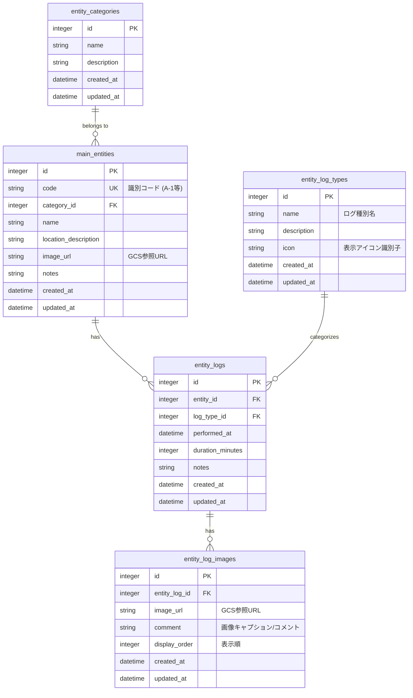

# テーブルスキーマ定義書 (DATABASE_SCHEMA)

## 1. 概要

本ドキュメントは、「<プロジェクト名>」におけるデータベース（SQLite）のテーブル構造、リレーションシップ、インデックス、およびデータ型を定義する。

- **データベース種類**: SQLite (単一ファイル `app.db`)
- **タイムゾーン方針**: 日時カラム（`DATETIME` 型）に保存する値はすべて日本標準時（JST, UTC+9 / ISO 8601 文字列 `YYYY-MM-DDTHH:MM:SS+09:00`）で扱う。
- **物理削除 / 論理削除**: マスタ参照整合性を保護するため、削除時は依存関係チェックを行い、制約がある場合は削除をエラー保護する。

---

## 2. ER図 (Entity Relationship Diagram)



---

## 3. テーブル定義詳細

### 3.1 エンティティカテゴリマスタ (`entity_categories`)

エンティティの分類情報を管理するマスタテーブル。

| カラム名 | 論理名 | データ型 | 制約 | 説明 |
| :--- | :--- | :--- | :--- | :--- |
| `id` | ID | INTEGER | PRIMARY KEY AUTOINCREMENT | マスタ一意識別子 |
| `name` | カテゴリ名 | TEXT | NOT NULL | 例: 分類A、分類B |
| `description` | 特徴/説明 | TEXT | NULLABLE | カテゴリの概要説明 |
| `created_at` | 作成日時 | DATETIME | NOT NULL DEFAULT CURRENT_TIMESTAMP | JSTタイムスタンプ |
| `updated_at` | 更新日時 | DATETIME | NOT NULL DEFAULT CURRENT_TIMESTAMP | JSTタイムスタンプ |

---

### 3.2 メインエンティティ (`main_entities`)

個別データを管理するメインテーブル。

| カラム名 | 論理名 | データ型 | 制約 | 説明 |
| :--- | :--- | :--- | :--- | :--- |
| `id` | ID | INTEGER | PRIMARY KEY AUTOINCREMENT | 一意識別子 |
| `code` | 識別コード | TEXT | UNIQUE NOT NULL | 一意の識別コード（例: `A-1`, `B-3`） |
| `category_id` | カテゴリID | INTEGER | NOT NULL, FK(`entity_categories.id`) | 該当するカテゴリID |
| `name` | 名称 | TEXT | NOT NULL | 個体識別名称 |
| `location_description`| 位置・配置説明 | TEXT | NULLABLE | 具体的な配置エリアの説明 |
| `image_url` | 外観画像URL | TEXT | NULLABLE | Google Cloud Storage (GCS) 上の画像参照 URL |
| `notes` | 留意事項 | TEXT | NULLABLE | 留意点・メモ |
| `created_at` | 作成日時 | DATETIME | NOT NULL DEFAULT CURRENT_TIMESTAMP | JSTタイムスタンプ |
| `updated_at` | 更新日時 | DATETIME | NOT NULL DEFAULT CURRENT_TIMESTAMP | JSTタイムスタンプ |

---

### 3.3 ログ種別マスタ (`entity_log_types`)

エンティティに対するアクティビティ/ログの種類を定義するマスタテーブル。

| カラム名 | 論理名 | データ型 | 制約 | 説明 |
| :--- | :--- | :--- | :--- | :--- |
| `id` | ID | INTEGER | PRIMARY KEY AUTOINCREMENT | 一意識別子 |
| `name` | ログ種別名 | TEXT | UNIQUE NOT NULL | 例: 種別1、種別2 |
| `description` | 概要説明 | TEXT | NULLABLE | 作業内容の説明 |
| `icon` | 表示アイコン識別子 | TEXT | NULLABLE | UI上で表示するアイコン識別キー |
| `created_at` | 作成日時 | DATETIME | NOT NULL DEFAULT CURRENT_TIMESTAMP | JSTタイムスタンプ |
| `updated_at` | 更新日時 | DATETIME | NOT NULL DEFAULT CURRENT_TIMESTAMP | JSTタイムスタンプ |

---

### 3.4 エンティティログ履歴 (`entity_logs`)

個々のエンティティに対して実施した作業・アクティビティ履歴を記録するテーブル。

| カラム名 | 論理名 | データ型 | 制約 | 説明 |
| :--- | :--- | :--- | :--- | :--- |
| `id` | ID | INTEGER | PRIMARY KEY AUTOINCREMENT | 履歴一意識別子 |
| `entity_id` | エンティティID | INTEGER | NOT NULL, FK(`main_entities.id`) | 対象エンティティID |
| `log_type_id` | ログ種別ID | INTEGER | NOT NULL, FK(`entity_log_types.id`) | 作業種類ID |
| `performed_at` | 実施日時 | DATETIME | NOT NULL | 実施日時（JST） |
| `duration_minutes` | 所要時間（分） | INTEGER | NULLABLE | 作業にかかった時間 |
| `notes` | 備考 | TEXT | NULLABLE | メモ・観察事項 |
| `created_at` | 作成日時 | DATETIME | NOT NULL DEFAULT CURRENT_TIMESTAMP | JSTタイムスタンプ |
| `updated_at` | 更新日時 | DATETIME | NOT NULL DEFAULT CURRENT_TIMESTAMP | JSTタイムスタンプ |

---

### 3.5 ログ画像 (`entity_log_images`)

ログ履歴レコードに紐づく複数画像およびコメントを保持するテーブル。

| カラム名 | 論理名 | データ型 | 制約 | 説明 |
| :--- | :--- | :--- | :--- | :--- |
| `id` | ID | INTEGER | PRIMARY KEY AUTOINCREMENT | 画像レコード一意識別子 |
| `entity_log_id` | ログID | INTEGER | NOT NULL, FK(`entity_logs.id`) | 紐づくログ履歴ID |
| `image_url` | 画像URL | TEXT | NOT NULL | Google Cloud Storage (GCS) 上の画像参照 URL |
| `comment` | 画像コメント | TEXT | NULLABLE | 画像に対する個別の説明・キャプション |
| `display_order` | 表示順 | INTEGER | NOT NULL DEFAULT 0 | 画面上の並び順（※画像追加順に1, 2, 3...と自動採番） |
| `created_at` | 作成日時 | DATETIME | NOT NULL DEFAULT CURRENT_TIMESTAMP | JSTタイムスタンプ |
| `updated_at` | 更新日時 | DATETIME | NOT NULL DEFAULT CURRENT_TIMESTAMP | JSTタイムスタンプ |

---

## 4. インデックス設計

検索の高速化およびリレーションシップ結合操作の最適化のため、以下のインデックスを作成する。

```sql
-- メインエンティティ検索・結合用インデックス
CREATE INDEX idx_main_entities_code ON main_entities(code);
CREATE INDEX idx_main_entities_category_id ON main_entities(category_id);

-- ログ履歴結合・日付ソート用インデックス
CREATE INDEX idx_entity_logs_entity_id ON entity_logs(entity_id);
CREATE INDEX idx_entity_logs_performed_at ON entity_logs(performed_at);

-- ログ画像結合・ソート用インデックス
CREATE INDEX idx_entity_log_images_log_id ON entity_log_images(entity_log_id);
```

---

## 5. 初期投入データ（シードデータ）

システム構築時に投入する標準マスタデータの定義。

### 5.1 ログ種別マスタ (`entity_log_types`)
1. 種別A (`icon`: `check-circle`)
2. 種別B (`icon`: `alert-triangle`)
3. 種別C (`icon`: `info`)
