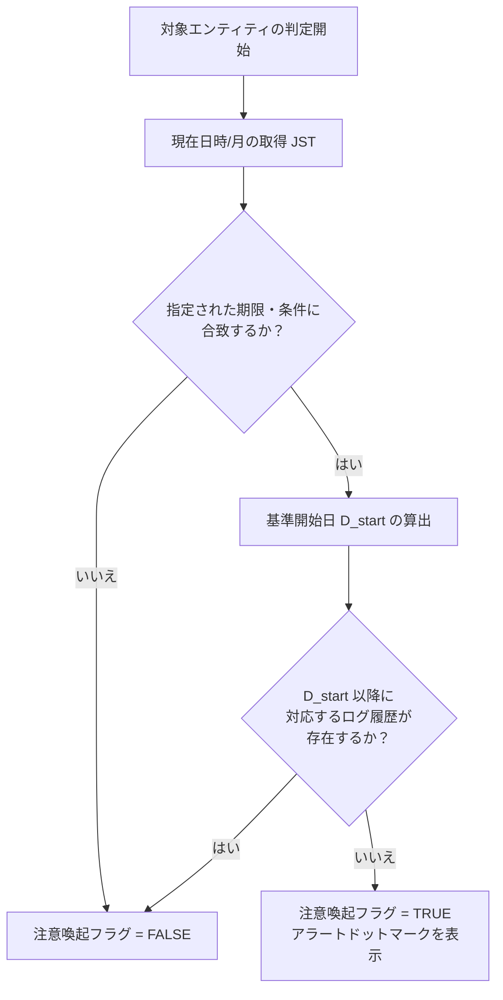

# ビジネスロジック仕様書 (BUSINESS_LOGIC_SPECIFICATION)

- **主担当エージェント**: 📐 設計・立案スペシャリスト (`architect`)
- **副担当・監査**: 🛡️ 品質・テスト & QA (`qa-engineer`)
- **承認ゲート**: 👤 ユーザーによる明示的承認必須

## 1. 概要

本ドキュメントは、「<プロジェクト名>」における主要機能の判定基準、計算アルゴリズム、データ集計・ドリルダウン処理、およびデータ整合性制御などのビジネスロジックを定義する。

---

## 2. 状態・注意喚起判定ロジック

### 2.1 目的

ダッシュボードや一覧画面において、特定の期限・条件に達しているにもかかわらず最新のアクティビティが記録されていないエンティティを特定し、視覚的な注意喚起（ドットマーク/アラート）を表示する。

### 2.2 判定アルゴリズム



#### 1. 期限・条件判定
- **入力データ**:
  - 現在日時/現在月: $M_{current}$ (日本標準時 JST)
  - エンティティ/マスタ設定上の判定基準パラメータ（開始時期・完了目標等）
- **判定結果**: 条件に合致している場合、対象期間内と判定する。

#### 2. 未対応状態判定
- **基準開始日 ($D_{start}$)** の算出:
  - 対象期間の開始日に対応する直近の年月日 $D_{start}$ を算出する。
- **履歴チェック**:
  - 対象エンティティ (`entity_id`) に対して、対応する `log_type_id` が存在し、かつ `performed_at \ge D_{start}` であるレコードが `entity_logs` テーブルに 1 件以上存在するか確認する。
- **結果出力**:
  - 対象期間内であり、かつ $D_{start}$ 以降の対応履歴が存在しない場合、**注意喚起フラグ `needs_alert = True`** を返す。

---

## 3. ビジュアル要素・データバインディング方針

### 3.1 要素の名寄せ・マッチング
- フロントエンドでマップ/ダイアグラムのノード要素をレンダリング後、各グループノードを走査する。
- ノード内のテキスト要素またはデータ属性から識別コード文字列（`code`）を抽出する。
- バックエンド API から取得したデータのうち、`entities.code == code` であるレコードとデータバインドを行う。
- マッチした要素に対して、ポインターカーソル設定 (`cursor: pointer`) およびホバーイベント、クリックイベントリスナーを付与する。

### 3.2 注意喚起ドットマークの描画ロジック
1. 前述の 2.2 のロジックで `needs_alert == True` と判定されたノードを特定する。
2. 該当ノードのバウンディングボックス中心座標 $(X_{center}, Y_{center})$ を計算する。
3. 中心座標付近に、注意喚起用の赤色点滅ドットインジケーター（SVG `<circle class="animate-pulse fill-red-500 stroke-white stroke-2" r="16" />` 等）をダイナミック追加描画する。

---

## 4. ログ履歴のドリルダウン & 可視化/集計ロジック

### 4.1 集計ドリルダウン構造と年度/期間絞り込み
可視化ビューは、ヘッダーでの対象期間の選択（例: 全年、2026年、2025年）と、以下の階層構造でインタラクティブにドリルダウン展開できる構造とする。

```
[Header: 対象期間選択] (例: 2026年)
   └── [Level 1: 区分/カテゴリ]
          └── [Level 2: ログ種別]
                 └── [Level 3: 対象エンティティ]
```

### 4.2 横軸スケールおよびアイコン配置仕様
- **時間軸スケール**: 横軸は **1 月から 12 月の月単位**（または日付単位）。
- **表示アイコンおよびプロット位置**:
  - マスタに登録された各ログ種別のアイコンを使用して描画する。
  - セル内において、該当期間に実施されたアクティビティをアイコンボタンとして整列表示する。
- **クリック動作**:
  - アイコンをクリックすると、該当ログ記録の詳細モーダル（複数写真・画像コメントギャラリー付き）を発火させる。

---

## 5. あいまい検索・フィルタリングロジック

### 5.1 検索対象フィールドおよび結合条件
検索機能は、フリーテキスト入力に対してデータベースを検索できる仕様とする。

- 名称 (`entities.name`)
- 識別コード (`entities.code`)
- カテゴリ名 (`entity_categories.name`)
- 概要・詳細説明 (`entities.notes`, `entity_categories.description`)
- ログ備考および画像コメント (`entity_logs.notes`, `entity_log_images.comment`)

### 5.2 マルチキーワード検索アルゴリズム
1. 入力された検索文字列を全角/半角スペースで分割し、キーワード配列 $[K_1, K_2, \dots, K_n]$ を生成する。
2. アルファベットは全角/半角変換・大文字/小文字変換を行った上で正規化する。
3. キーワードごとに各検索対象フィールドに対して部分一致（SQL `LIKE %K_i%`）を適用し、すべてのキーワードが含まれるレコード（AND 検索）を抽出する。

---

## 6. マスタ管理・データ保護制御ルール

### 6.1 参照整合性と削除保護
- **削除制御方針**: 外部キー制約のあるマスタデータを削除しようとした際、すでに該当マスタを参照している子テーブルのレコードが存在する場合、**物理削除を拒否しエラー（409 Conflict）を返す**。

### 6.2 バリデーションルール
- **識別コード形式**:
  - `entities.code` は英字＋ハイフン＋数字（例: `A-1`, `E-14`）のフォーマットで一意性をチェックする。

---

## 7. タイムゾーン運用・変換規約

- システム内のすべての処理（現在日時の判定、DB保存、APIリクエスト・レスポンス文字列）において **日本標準時 (JST, UTC+9 / Asia/Tokyo)** を適用する。
- ISO 8601 形式の文字列を入出力形式として採用する（例: `2026-08-02T18:00:00+09:00`）。

---

## 8. Google Cloud Storage (GCS) 画像連携 & 複数画像表示順制御ロジック

### 8.1 画像保存およびURL参照方針
- 本システムでは画像保存ストレージとして **Google Cloud Storage (GCS)** を採用する。
- メイン外観画像 URL は `entities.image_url` に保持し、各ログ履歴に付加される複数枚の写真および個別のキャプション/コメントは関連テーブル (`entity_log_images`) の `image_url` および `comment` カラムに保存・参照表示する。

### 8.2 GCS バケットからの降順ソート一覧取得
1. ユーザーが画面上の画像選択モーダルを起動すると、バックエンドは GCS SDK (`google-cloud-storage`) 経由で対象 GCS バケット内の全画像オブジェクトを一括取得する。
2. 取得処理では画像形式のオブジェクトを対象とし、並び順を **更新/アップロード日時の降順 (`updated` 降順)** にソートして最新画像から返却・表示する。
3. 返却データ（オブジェクト名、表示用 URL、更新日時）をフロントエンドへ渡し、ユーザーが視覚的に画像を選択してフォームに入力バインドする。

### 8.3 複数画像登録時の表示順 (`display_order`) 自動採番ロジック
1. 1件のログ記録に対して複数枚の画像およびコメントを紐づけて登録・追加する際、システムは画像の追加順序に従って `display_order` を自動採番する。
2. 採番ルールは `1, 2, 3...` の 1 始まりの整数連番とし、画面表示およびギャラリー表示のデフォルトの並び順として適用する。

### 8.4 画像アップロード時のフロントエンド軽量化ロジック
1. ユーザーがローカル端末からファイルを選択した際、フロントエンド（React/Canvas API）で画像オブジェクトをインメモリ読み込みする。
2. **自動変換・正方形クロップルール**:
   - 画像の短辺 (`Math.min(width, height)`) を抽出して中央基準の正方形領域を計算する。
   - 計算した中央領域を **700px × 700px 正方形** にクロップ描画する。
   - **80% (0.8)** の圧縮品質で **WebP フォーマット** に変換する。
   - 変換後のファイル名拡張子を `.webp` に書き換える。
3. 軽量化された正方形 WebP ファイルを FormData に添付し、バックエンドの `/api/storage/upload` エンドポイント経由で GCS バケットへ送信・保存する。
