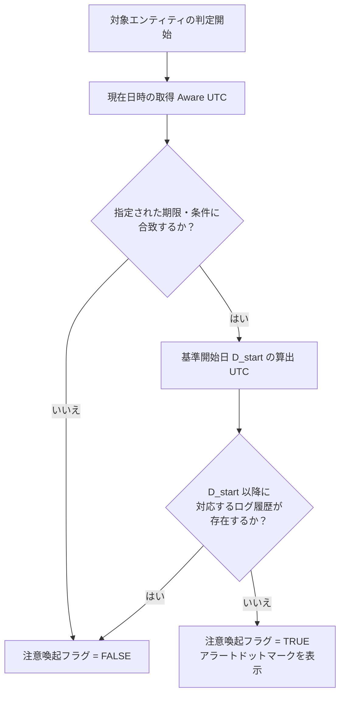
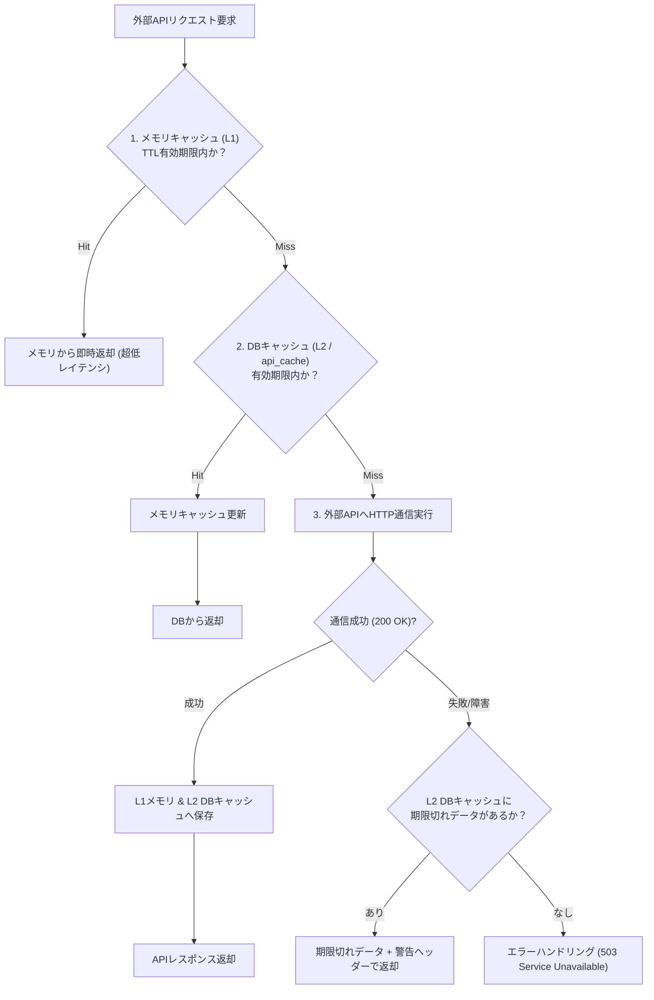

# ビジネスロジック仕様書 (BUSINESS_LOGIC_SPECIFICATION)

- **主担当エージェント**: 📐 設計・立案スペシャリスト (`architect`)
- **実装担当**: 💻 バックエンドエンジニア (`backend-engineer`), 🎨 UI/UXデザイナー (`ui-designer`)
- **副担当・監査**: 🛡️ 品質・テスト & QA (`qa-engineer`)
- **承認ゲート**: 👤 ユーザーによる明示的承認必須

---

## 1. 概要

本ドキュメントは、「<プロジェクト名>」における判定基準、計算アルゴリズム、データ集計・ドリルダウン処理、外部API二重キャッシュ戦略、モックアップ制御仕様、内部監視エンドポイント仕様などのビジネスロジックを定義する。

---

## 2. 状態・注意喚起判定ロジック

### 2.1 目的
ダッシュボードや一覧画面において、特定の期限・条件に達しているにもかかわらず最新のアクティビティが記録されていないエンティティを特定し、視覚的な注意喚起（ドットマーク/アラート）を表示する。

### 2.2 判定アルゴリズム



1. **期限・条件判定**: 現在日時（Aware UTC）と対象エンティティの基準日時を比較し、条件合致を判定。
2. **履歴チェック**: 対象エンティティに対して、基準日 $D_{start}$ 以降の対応ログレコード（`entity_logs`）が存在するか検証。
3. **結果出力**: 存在しない場合、`needs_alert = True` を返却。フロントエンドはグランドデザイン準拠の注意喚起インジケーター（Pulse Rose `#e11d48` ドット）を動的描画する。

---

## 3. 外部API二重キャッシュ戦略 (Two-Tier API Cache)

外部API（サードパーティWeb API、天気、為替、AI API等）と連携する場合、レートリミット対策、レスポンス高速化、および外部障害時の継続稼働（Graceful Degradation）のため、**インメモリTTLキャッシュ ＋ DBキャッシュの二重キャッシュ機構**を標準実装する。



### 3.1 キャッシュ有効期間（TTL）設定基準
- **高頻度変動データ**: メモリ TTL = 60秒、DB TTL = 5分
- **準静的データ（マスタ・日次更新データ等）**: メモリ TTL = 10分、DB TTL = 24時間
- **キャッシュキー生成ルール**: `cache:{endpoint}:{md5(params)}`

---

## 4. 外部システム・APIモックアップ制御仕様 (Mock Control: 案C＋案A)

開発時の俊敏性向上と本番環境へのモック混入事故を完全に防止するため、環境変数による明示的切替（案C）と直書きモックの原則禁止（案A）を適用する。

### 4.1 環境変数による透過的切替
- **制御環境変数**: `.env` 内の `VITE_ENABLE_MOCK=true/false`
- **動作マトリクス**:
  | 環境 | `VITE_ENABLE_MOCK` | 動作モード | 挙動 |
  | :--- | :--- | :--- | :--- |
  | **ローカル開発 (初期/UI先行)** | `true` | **モックモード (MSW有効)** | ブラウザService Workerが全APIリクエストを捕捉し、`src/mocks/handlers.ts` の擬似レスポンスを返却。 |
  | **ローカル結合検証 (PHASE 5)** | `false` | **実API結合モード** | 実FastAPIバックエンドコンテナ (`http://localhost:8000/api/v1/...`) へ直接通信。 |
  | **本番環境 (Cloud Run)** | `false` (強制) | **本番運用モード** | 同一コンテナ内のFastAPIルーターへ通信。Dockerfileビルド時に `ENV VITE_ENABLE_MOCK=false` を二重防御設定。 |

### 4.2 直書きモックの原則禁止 (Zero Stray Mock)
- コンポーネントファイル内部にダミーデータ配列、オブジェクト定数、またはローカル擬似ステートを直接ハードコードすることを原則禁止とする。
- モックデータは必ず `src/mocks/handlers.ts` または `src/mocks/data/` 配下に集約・配置する。

### 4.3 実結合モード時のサイレントモックフォールバック厳格禁止 (Fail-Fast原則 / PAT-MOCK-001)
- 実環境・実結合モード（`VITE_ENABLE_MOCK=false`）において、バックエンドAPIやTauri IPCで通信エラー・例外が発生した際、モックデータへサイレントにフォールバックして処理を継続することを**厳格に禁止**する。
- 通信エラーやIPCエラーが発生した場合は例外を即座にスローし、UI上でエラートーストやエラーバウンダリを表示して問題を顕在化させる（Fail-Fast原則）。サイレントフォールバックは重大な障害隠蔽・手戻り要因となるため絶対に排除する。

---

## 5. 内部監視・可観測性エンドポイント仕様 (Internal Observability)

サイレント障害の早期検知およびコンテナ死活監視のため、FastAPIバックエンドに以下の内部監視エンドポイントを標準配備する。

### 5.1 死活・DB接続監視 (`GET /api/internal/health`)
- **概要**: Uvicornプロセスおよび SQLite データベースファイルのアクセス健全性を監視。
- **レスポンス仕様**:
  ```json
  {
    "status": "healthy",
    "timestamp": "2026-10-15T08:00:00Z",
    "database": {
      "connected": true,
      "wal_mode": true
    },
    "version": "1.0.0"
  }
  ```

### 5.2 Litestream 同期ラグ監視 (`GET /api/internal/litestream/status`)
- **概要**: SQLite の WAL ログが GCS へ正常にレプリケーションされているか、最終同期時刻とレプリケーションラグ（遅延秒数）を監視。
- **判定基準**:
  - ラグ 10秒以内: `status: "in-sync"` (正常)
  - ラグ 10秒超過 60秒以内: `status: "syncing"` (軽度遅延)
  - ラグ 60秒超過 または GCSアクセス不能: `status: "lagging" / "error"` (異常アラート)

---

## 6. あいまい検索・フィルタリングロジック

### 6.1 検索対象フィールド
- 名称 (`name`), 識別コード (`code`), カテゴリ名 (`category_name`), 概要・備考 (`notes`, `description`)

### 6.2 マルチキーワード検索アルゴリズム
1. 入力文字列を全角/半角スペースで分割し、キーワード配列 $[K_1, K_2, \dots, K_n]$ を生成。
2. 英数字は全角/半角正規化・小文字統一を実施。
3. 各キーワードに対して各フィールドの部分一致（SQL `LIKE %K_i%`）を適用し、すべてのキーワードが含まれるレコード（AND検索）を抽出。

---

## 7. タイムゾーン運用・変換規約

- **バックエンド / DB / API 通信**:
  - すべて Aware UTC (ISO 8601 文字列 `YYYY-MM-DDTHH:MM:SSZ`) で統一。
- **フロントエンド表示層**:
  - `src/utils/dateTime.ts` の `formatToJST(utcString, format)` を介してのみ JST (`Asia/Tokyo`) 表示に変換。

---

## 8. Google Cloud Storage (GCS) 画像連携 & フロントエンド軽量化ロジック

### 8.1 フロントエンド事前圧縮ロジック (`useImageCompressor.ts`)
1. ユーザーがローカルファイルを選択。
2. HTML5 Canvas API により中央クロップ基準で **700px × 700px 正方形** にリサイズ。
3. **80% (0.8)** 品質で **WebP 形式 (`image/webp`)** へ自動エンコード。
4. 軽量化された WebP Blob を FormData に付与してバックエンドへ送信。

### 8.2 GCS バケットからの降順ソート一覧取得
1. バックエンドは GCS SDK を用いて対象バケット内の画像オブジェクト一覧を取得。
2. 更新日時（`updated`）の降順にソートしてフロントエンドへ返却。

---

## 9. ドキュメント改定履歴

| 改訂依頼番号 | 対象バージョン | ターン | 改定者 | 改定概要 | 完了日 |
| :--- | :--- | :---: | :--- | :--- | :--- |
| - | v1.0.0 | - | 📐 architect | 初期ビジネスロジック策定（Fail-Fastモック制御・二重キャッシュ・可観測性規約準拠） | - |

