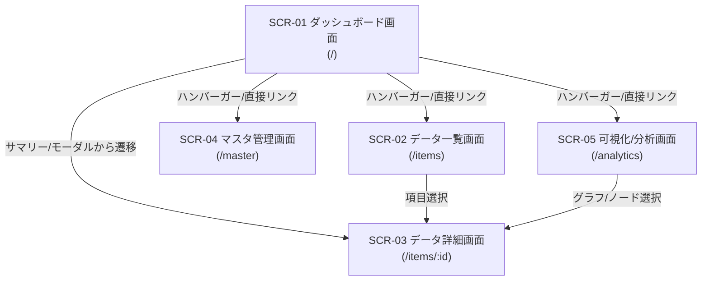

# 画面仕様書 (SCREEN_SPECIFICATIONS)

- **主担当エージェント**: 🎨 UI/UXデザイナー / フロントエンドエンジニア (`ui-designer`)
- **副担当・整合性検証**: 📐 設計・立案スペシャリスト (`architect`), 🛡️ 品質・テスト & QA (`qa-engineer`)
- **承認ゲート**: 👤 ユーザーによる明示的承認必須

## 1. 概要

本ドキュメントは、「<プロジェクト名> / <システム名>」における画面レイアウト、UI/UXデザイン仕様、インタラクション、画面遷移、および各種表示コンポーネントの挙動を定義する。

---

## 2. 画面一覧および画面遷移図

### 2.1 画面一覧

| 画面ID | 画面名称 | ルーティングパス | 主な機能 |
| :--- | :--- | :--- | :--- |
| `SCR-01` | ダッシュボード画面 | `/` | システム概要サマリー表示、アクティビティインジケーター、詳細・操作モーダル |
| `SCR-02` | データ一覧画面 | `/items` | データページング一覧、あいまい検索、新規登録モーダル（GCS画像選択連動） |
| `SCR-03` | データ詳細画面 | `/items/:id` | データ詳細表示、関連サブデータ/履歴一覧・追加（複数画像・コメント対応） |
| `SCR-04` | マスタ管理画面 | `/master` | 各種マスタデータ（カテゴリ、ステータス種別等）の追加・編集・削除マスタメンテナンス |
| `SCR-05` | 可視化/分析画面 | `/analytics` | 階層別集計、タイムライン/ガントチャート、対話的詳細モーダル |

### 2.2 画面遷移図



---

## 3. 共通 UI/UX ・レスポンシブ・テーマ仕様

### 3.1 デバイス別ブレークポイントおよびレイアウト枠構造 (Tailwind CSS)

- **モバイル表示（スマートフォン・狭画面端末）**: 画面幅 `767px` 以下（Tailwind CSS の `md:` 未満）
  - メイン領域は単一カラム縦スクロール構造。
  - テーブル表示はカード型レイアウトへ自動変換。
- **デスクトップ表示（PC・タブレット広画面）**: 画面幅 `768px` 以上
  - メインコンテナの最大幅を **`1800px`** に設定 (`max-w-[1800px] mx-auto px-6`)。
  - メインコンテナやグリッド一覧を画面幅いっぱいに活用したレイアウト。

### 3.2 トップバー & ハンバーガーメニュー方式

- **トップバー構成**:
  - 画面左上: アプリケーションタイトルロゴ（「<システム名>」）
  - 画面右上: ハンバーガーメニューアイコンボタン（`Lucide React: Menu`）
- **ハンバーガーメニュー仕様**:
  - クリック時、画面右側からスライドインオーバーレイ（ドロワー）表示。
  - **ナビゲーションリンク集**:
    - 🏠 ダッシュボード (`/`)
    - 📁 データ一覧 (`/items`)
    - 📊 可視化/分析 (`/analytics`)
    - ⚙️ マスタ管理 (`/master`)
  - **区切り線**: 下部に水平線を配置。
  - **最下部コントロール領域**:
    - **表示モード設定**: 「ライト」「ダーク」「システム (OS追従)」の切り替えボタン（`Sun`, `Moon`, `Monitor` アイコン）。
    - **ユーザー識別表示**: Cloud Run IAP から取得したログインユーザーのメールアドレス (`x-goog-authenticated-user-email`) を表示。
    - **ログアウトボタン**: Google IAP 認証セッション解除ボタン。

### 3.3 テーマデザイン仕様（マルチテーマ: ライト／ダーク／システム追従）

- **表示モード**:
  - **ライト (Light)**: 明るく清潔感のあるスタイリング (`bg-slate-50`, `bg-white`, 文字色 `text-slate-900`)
  - **ダーク (Dark)**: 落ち着いた洗練されたダークスタイリング (`dark:bg-slate-900`, `dark:bg-slate-800`, 文字色 `dark:text-slate-100`)
  - **システム (System)**: OSのダークモード設定 (`prefers-color-scheme: dark`) にリアルタイム連動

### 3.4 ボタン類のミニマルアイコン化および英語表記ルール

- **ボタンデザインルール**:
  - 操作が明確なアクションボタンはテキストを排除し、**Lucide React アイコンのみのミニマル表示**とする。
  - **ツールチップ (Tooltip / `title` 属性)**: すべて英語表記で統一する。
- **ボタン・アイコン対応一覧**:

| アクション | アイコン (Lucide React) | 英語Tooltip (`title`) | デザインスタイル |
| :--- | :--- | :--- | :--- |
| 編集 | `Pencil` | `Edit` | インディゴ/ブルー枠 |
| 削除 | `Trash2` | `Delete` | ローズ/レッド枠 |
| 検索 | `Search` | `Search` | スレート/ネイビー枠 |
| 新規追加 | `Plus` | `Add New` | エメラルド/グリーン枠 |
| 閉じる | `X` | `Close` | スレート無地 |
| 保存 | `Check` / `Save` | `Save Changes` | エメラルド塗りつぶし |
| フィルター | `Filter` | `Filter` | スレート枠 |
| 詳細表示 | `Eye` / `ExternalLink` | `View Details` | スレート/ネイビー枠 |
| 画像選択 | `Image` / `Folder` | `Select from Cloud Storage` | スレート/インディゴ枠 |

---

## 4. 画面別詳細仕様

### 4.1 ダッシュボード画面 (`SCR-01`)

トップページとして、システム主要データのサマリー表示、状態・アクティビティを把握できる画面。

```
+-----------------------------------------------------------------------------------+
| [Logo] <システム名>                                                         [=]   |
+-----------------------------------------------------------------------------------+
|  +-----------------------------------------------------------------------------+  |
|  |  Main Summary / Visual Indicator Component                                  |  |
|  |                                                                             |  |
|  |   [Item 1]    [Item 2(🔴 Alert)]         [Item 3]        [Item 4]            |  |
|  |                                                                             |  |
|  +-----------------------------------------------------------------------------+  |
+-----------------------------------------------------------------------------------+
```

- **構成要素**:
  1. **メインサマリー/ビジュアル表示エリア**:
     - インタラクティブな要約グラフィック/ノードの表示。
     - **注意喚起マーク (🔴)**: 特定条件を満たす対象に注意喚起ドットマークをダイナミック表示。
  2. **詳細・編集共通モーダル (`CommonDetailModal`)**:
     - ノードやリスト項目をクリックした際にモーダルがポップアップ起動。
     - 新規追加・編集・閲覧で統一されたデザインフォーマット（画像ギャラリー、コメント、アクションボタン）。

---

### 4.2 データ一覧画面 (`SCR-02`)

データベースから対象項目を一覧検索・確認・追加・管理する画面。

- **構成要素**:
  1. **検索・フィルターバー**:
     - あいまい検索キーワード入力フィールド（「名称」「概要」「備考」で検索）。
     - ミニマル検索ボタン (`Search`)。
     - カテゴリ/種類ドロップダウンフィルター。
     - 新規作成ボタン (`Add New`)。
  2. **一覧データ表示領域**:
     - **デスクトップ**: テーブル形式（サムネイル、識別キー/名称、カテゴリ/種類、特徴、アクションボタン）。
     - **モバイル**: カード型グリッド形式。
  3. **ページネーションコントローラー**:
     - 1ページあたり10件/20件表示切り替え、前へ/次へボタン、ページ番号インジケーター。
  4. **新規作成/編集モーダル**:
     - **GCS 画像選択コンポーネント**: クラウドストレージからの画像選択モーダル連動。クライアントサイドで 700px × 700px 正方形 WebP への自動圧縮に対応。

---

### 4.3 データ詳細画面 (`SCR-03`)

個別データの全メタデータおよび関連履歴/レコードを管理する詳細画面。

- **構成要素**:
  1. **基本メタデータパネル**:
     - メイン画像（GCS参照）、名称、識別キー、カテゴリ、詳細説明、留意事項。
  2. **関連履歴/タイムラインパネル**:
     - 並び替え可能な履歴タイムライン。
     - **複数画像・画像コメントギャラリー**: 各レコードに紐づく複数枚の写真と各画像に対する個別のコメントを表示。
     - **「新規記録を追加」ボタン**: 統一された編集モーダル表示。

---

### 4.4 可視化/分析画面 (`SCR-05`)

登録データを階層構造やタイムラインで集計・可視化し、対話的に把握する画面。

- **構成要素**:
  1. **ヘッダーコントロール**:
     - 区分・カテゴリフィルター
     - 対象期間/年度選択
  2. **集計・タイムラインエリア**:
     - 横軸スケール（月別/期間別）。
     - アイコン表示およびホバー・クリック動作。

---

### 4.5 マスタ管理画面 (`SCR-04`)

各マスタデータ（カテゴリ種類、ステータス定義等）を登録・更新・削除管理する画面。

- **構成要素**:
  1. **マスタカテゴリ切り替えタブ**:
     - 各マスタ種別を選択するタブコンポーネント。
  2. **マスタデータグリッド/テーブル**:
     - 項目一覧、編集ボタン (`Edit`)、削除ボタン (`Delete`)。参照制約保護付き。
