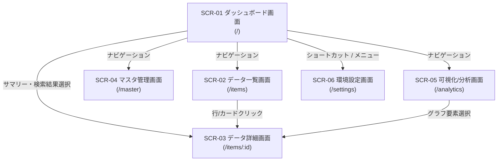

# 画面仕様書テンプレート (SCREEN_SPECIFICATIONS_TEMPLATE)

> **エージェント向け作成ガイド**:
> 本ドキュメントは、新規システム開発プロジェクトにおいて `ui-designer` が作成する `docs/画面仕様書.md` の標準雛形である。
> システム全体の共通デザインルールは [01_グランドデザイン基本仕様書.md](./グランドデザイン/01_グランドデザイン基本仕様書.md) および [02_UIコンポーネントカタログ及び実装パターン.md](./グランドデザイン/02_UIコンポーネントカタログ及び実装パターン.md) に準拠し、個別仕様のみを本仕様書に記述する。

---

# 画面仕様書 (<プロジェクト名>)

- **主担当エージェント**: 🎨 UI/UXデザイナー (`ui-designer`)
- **設計監修**: 📐 設計・立案スペシャリスト (`architect`)
- **品質・監査**: 🛡️ 品質・テスト & QA (`qa-engineer`)
- **承認ゲート**: 👤 ユーザーによる明示的承認必須

---

## 1. システムメタデータ & 展開プロファイル

### 1.1 プロファイル & 実行環境選定
本システムが準拠するシステム展開プロファイル（Profile A〜D）およびターゲットプラットフォームを明記する。

- **対象システム名**: <プロジェクト名 / システム名>
- **展開プロファイル** (該当するものを選択):
  - [ ] **Profile A: Web SPA**（React / Vite + Tailwind CSS + MSW / Cloud Run + Litestream + SQLite）
  - [ ] **Profile B: Web SSR / Islands**（Next.js App Router / Nuxt 3 / FastAPI + PostgreSQL）
  - [ ] **Profile C: 静的MPA / HTMX**（Python FastAPI/Django, Go + html/template + HTMX）
  - [ ] **Profile D: PCデスクトップ**（Tauri v2 / Electron / PyQt / Flutter Desktop）
- **ターゲット環境**: [例: Webブラウザ (Chrome/Safari/Edge), macOS / Windows デスクトップ]
- **状態永続化・ストレージ方式**: [例: SQLite (WAL) / Browser LocalStorage / Tauri Store (config.json)]
- **API通信・データ層方式**: [例: REST API (MSW開発モック切替: `VITE_ENABLE_MOCK`) / Tauri IPC (invoke) / MockRepository DI]

### 1.2 グランドデザイン準拠方針
本システムは、クロスプラットフォーム対応グランドデザイン標準（Design System Base）に全面準拠する。
- **全体シェル**:
  - Web環境: トップバー（Sticky 64px）+ 右スライドインドロワー（Hamburger Menu）+ 最大幅 `1800px` コンテナ。
  - デスクトップ環境: Frameless カスタムタイトルバー（ドラッグ領域 & セーフエリア対応）+ 常設可変サイドバー（64px ↔ 240px）+ 最下部ステータスバー（28px）。
- **テーマ対応**: ライト / ダーク / システムOS追従（3モード切替）。
- **ボタンスタイル**: ミニマルアイコン化 + 英語Tooltip（Title Case）の統一。
- **レスポンシブ / ペイン分割**:
  - Web: デスクトップ（テーブル）↔ モバイル（カード型グリッド自動変形）。
  - デスクトップ: 最小ウィンドウサイズ制約（Min 960x640px）+ リサイザブル・スプリットペイン。
- **Anti-God Component 規約**:
  - 1コンポーネントファイルの最大行数は **250行以下** を厳守。
  - 状態管理および副作用はカスタムフック（`src/hooks/`）に分離し、API通信はサービスクライアント（`src/services/`）に集約する。
- **直書きモックの原則禁止**:
  - コンポーネント内部へのダミーデータ配列やローカル擬似ステートのハードコードを原則禁止。
  - モックが必要な場合は MSW（Mock Service Worker）ハンドラー（`src/mocks/handlers.ts`）に定義し、環境変数（`VITE_ENABLE_MOCK=true`）で透過的に切り替える。

---

## 2. 画面一覧および画面遷移図

### 2.1 画面一覧

| 画面ID | 画面名称 | ルーティングパス / 識別子 | ウィンドウ形態 (※1) | 主な機能・役割 |
| :--- | :--- | :--- | :--- | :--- |
| `SCR-01` | ダッシュボード画面 | `/` | フルページ / スプリットペイン | 主要メトリクスサマリー、リアルタイム検索窓、直近履歴 |
| `SCR-02` | データ一覧・検索画面 | `/items` | フルページ / スプリットペイン | テーブル/カードハイブリッド一覧、リアルタイム検索、フィルター |
| `SCR-03` | データ詳細・編集画面 | `/items/:id` | フルページ + インライン編集 | 詳細メタデータ、インライン編集、リッチメディア/チャート、関連一覧 |
| `SCR-04` | マスタ管理画面 | `/master` | フルページ + 標準モーダル | マスタ種別タブ、グリッド一覧、新規登録・編集モーダル |
| `SCR-05` | 可視化/分析画面 | `/analytics` | フルページ + 全画面トグル | 期間別メトリクス集計グラフ、対話的チャート/ヒートマップ |
| `SCR-06` | 環境設定画面 | `/settings` | 標準モーダル / 独立サブウィンドウ | テーマ切替、ストレージパス設定、APIキー管理 |

*(※1) ウィンドウ形態の選定肢: 「フルページ」「標準モーダル (中央ポップアップ)」「スライドインドロワー (右オーバーレイ)」「スプリットペイン (左右可変2ペイン)」「OSネイティブダイアログ (ファイル選択等)」「独立サブウィンドウ (Multi-window)」「インライン編集」から選定。*

### 2.2 画面遷移図

---

## 3. デスクトップ / ウィンドウ制御仕様（※Profile D 採用時のみ記述）

Profile D（PCデスクトップアプリ）採用時におけるウィンドウ制御パラメータを定義する。

- **初期ウィンドウサイズ**: `1280px × 800px`（中央配置）
- **最小ウィンドウサイズ制約 (Min Size)**: 幅 `960px`、高さ `640px`
- **タイトルバー形態**:
  - [ ] **Frameless Window（推奨）**: `TitleBar.tsx` を採用し、OS別セーフエリア（macOS: `pl-20`, Windows: `pr-36`）を適用。
  - [ ] **OS標準タイトルバー**: OSネイティブ枠を使用。
- **常設可変サイドバー**: 初期幅 `240px`、トグル時 `64px`（アイコンのみ）。
- **最下部ステータスバー**: 高さ `28px`、ローカルDB接続状況、アクティブファイル名、総件数を常時表示。

---

## 4. キーボードショートカット定義表

本システム全域または特定画面で利用可能なアクセラレータキーを定義する。

| ショートカットキー (macOS / Win,Linux) | アクション | 対象スコープ | 説明 |
| :--- | :--- | :--- | :--- |
| `Cmd + S` / `Ctrl + S` | **Save Changes** | 画面全域 / 編集フォーム | 編集中の内容を即時保存しトースト通知を表示。 |
| `Cmd + F` / `Ctrl + F` | **Focus Search** | グローバル / 一覧画面 | リアルタイム検索バーへフォーカス。 |
| `Cmd + N` / `Ctrl + N` | **Add New** | データ一覧 / マスタ管理 | 新規作成モーダル（またはドロワー）を展開。 |
| `Cmd + ,` / `Ctrl + ,` | **Preferences** | アプリケーション全域 | 環境設定（SCR-06）を開く。 |
| `Cmd + W` / `Ctrl + W` | **Close** | モーダル / サブウィンドウ | 最前面のモーダル、ドロワーを閉じる。 |
| `Escape` | **Cancel / Close** | モーダル / ドロワー | 展開中のオーバーレイを閉じる。 |
| `Ctrl + Enter` | **Submit** | コメント / フォーム | フォーム送信・確定。 |

---

## 5. 共通 UI/UX 仕様

### 5.1 レイアウト枠構造 & ブレークポイント
- **Webデスクトップ (`md:` 以上 / `≥ 768px`)**:
  - メインコンテナ: `max-w-[1800px] mx-auto px-4 sm:px-6`
  - データ一覧: テーブル形式
- **Webモバイル (`md:` 未満 / `< 768px`)**:
  - メインコンテナ: 単一カラム縦スクロール
  - データ一覧: カード型グリッド形式へ自動変形
- **デスクトップアプリ**:
  - スプリットペイン（左 320px ↔ 右 残余幅、ドラッグ可変）

### 5.2 ヘッダー & ナビゲーション
- **トップバー / タイトルバー**:
  - 左端: アプリケーションロゴ + システム名称 + システムバージョンバッジ (`v1.0.0`)
  - 右端: ハンバーガーメニューアイコン (`Menu`) または ウィンドウ操作ボタン群（最小化・最大化・閉じる）
- **ナビゲーション**:
  - Web: 右スライドインドロワー（幅 `w-80`、ルート要素直下テレポート描画）
  - デスクトップ: 常設可変サイドバー（幅 `64px ↔ 240px`）

### 5.3 アクションボタン・アイコン対応規約
- ボタンテキストは原則排除し、ミニマルアイコン表示とする。
- ツールチップ (`title`) は英語表記に統一。

| アクション | アイコン (Lucide / 等価SVG) | 英語 Tooltip (`title`) | 枠線・スタイル種別 |
| :--- | :--- | :--- | :--- |
| **編集** | `Pencil` | `Edit` | ブルー枠 (`border-blue-200 text-blue-600 / #2563eb`) |
| **削除** | `Trash2` | `Delete` | ローズ枠 (`border-rose-200 text-rose-600 / #e11d48`) |
| **詳細表示** | `Eye` / `ExternalLink` | `View Details` | スレート枠 (`border-slate-200 / #e2e8f0`) |
| **新規作成** | `Plus` | `Add New` | エメラルド枠 (`text-emerald-600`) または Primary |
| **閉じる** | `X` | `Close` | スレート無地 (`text-slate-400`) |
| **保存** | `Check` | `Save Changes` | エメラルド塗りつぶし または Primary |
| **検索** | `Search` | `Search` | Primary または スレート枠 |
| **フィルター** | `Filter` | `Filter` | スレート枠 |
| **データ同期** | `RefreshCw` | `Sync Data` | オレンジ枠 (`text-orange-500`) |

### 5.4 カラーパレット & デイライトモード視認性規約 (V2.4)
- **明暗ペア指定またはセマンティックデザイントークンの必須化**:
  - ダークモード前提の淡色・透過カラー（例: `text-blue-200`, `bg-blue-950/40`）を単独直書きすることを禁止する。
  - セマンティックデザイントークン（CSS変数一元制御）またはTailwindの明暗ペア（例: `bg-blue-50 text-blue-800 dark:bg-blue-950/40 dark:text-blue-300`）を必ず指定し、デイライト（ライトモード）での高い視認性とコントラスト比を保証する。

---

## 6. 画面別詳細仕様

### 6.1 ダッシュボード画面 (`SCR-01`)
- **ウィンドウ形態**: フルページ（デスクトップ時はスプリットペイン対応）
- **主要セクション**:
  1. **トップバナー & リアルタイム横断検索窓**:
     - プレースホルダー: `Search anything... (Press Cmd+F to focus)`
  2. **主要KPIメトリクスサマリーカード群 (Grid 1〜4列)**:
     - 総件数、今月のアクティビティ、注意喚起件数、最終同期ステータス
  3. **直近のアクティビティ履歴 & タイムライン**:
     - 直近5〜10件のアクティビティ一覧。クリックで詳細モーダル起動。
  4. **クイックアクション領域**:
     - 新規登録ボタン（`SCR-02` または `SCR-04` モーダル連動）

### 6.2 データ一覧・検索画面 (`SCR-02`)
- **ウィンドウ形態**: フルページ（デスクトップ時はスプリットペイン対応）
- **主要セクション**:
  1. **コントロールバー**: リアルタイム検索バー、カテゴリ絞り込みドロップダウン、表示モード切替（テーブル ↔ カード）
  2. **ハイブリッドデータグリッド**:
     - デスクトップ: テーブル表示（ソート可能ヘッダー、固定アクション列）
     - モバイル: カードグリッド表示（1:1 正方形サムネイル画像付き）
  3. **ページネーション / 無限スクロールコントロール**:
     - 1ページあたり表示件数切替（20 / 50 / 100件）

### 6.3 データ詳細・編集画面 (`SCR-03`)
- **ウィンドウ形態**: フルページ + インライン編集 または スライドインドロワー
- **主要セクション**:
  1. **ヘッダーアクション**: 戻るボタン、編集/保存トグル、削除ボタン（確認モーダル経由）
  2. **基本メタデータパネル**: 2カラムまたは3カラムレイアウト
  3. **リッチメディア・ギャラリー領域**: 700×700px正方形画像ギャラリー、Canvas WebP圧縮プレビュー
  4. **関連アクティビティ履歴一覧**: タイムライン形式

### 6.4 マスタ管理画面 (`SCR-04`)
- **ウィンドウ形態**: フルページ + 標準モーダル
- **主要セクション**:
  1. **マスタ種別切替タブ**: カテゴリマスタ、ステータスマスタ、タグマスタ等
  2. **データグリッド**: インライン編集または編集モーダル起動
  3. **新規マスタ追加モーダル**: `Modal.tsx`（中央配置、幅 `max-w-md`）

### 6.5 可視化/分析画面 (`SCR-05`)
- **ウィンドウ形態**: フルページ + 全画面トグル
- **主要セクション**:
  1. **期間フィルター**: 年別、四半期別、月別
  2. **グラフ・チャートコンテナ**: レスポンシブSVGチャート
  3. **ドリルダウンテーブル**: グラフ要素選択に応じた明細表示

### 6.6 環境設定画面 (`SCR-06`)
- **ウィンドウ形態**: 標準モーダル（中央ポップアップ、幅 `max-w-lg`）または 独立サブウィンドウ
- **主要セクション**:
  1. **テーマ設定**: ライト / ダーク / システムOS連動
  2. **モック動作モードインジケーター**: `VITE_ENABLE_MOCK` の現在値表示
  3. **システム情報**: バージョン、ビルド番号、接続先ステータス
