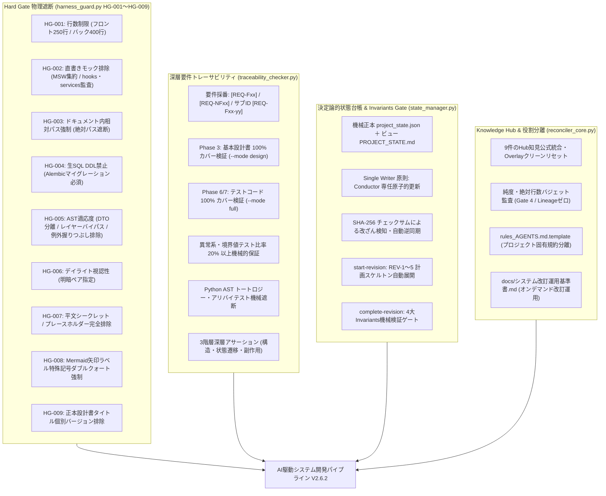
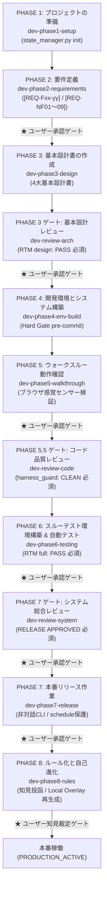
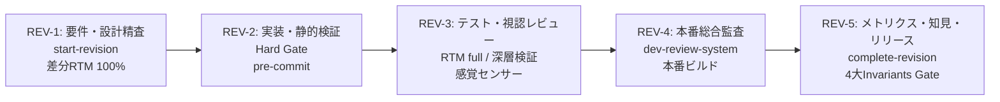

# Antigravity AI-Driven System Dev Pipeline V2.6.2 🚀

Google Antigravity のマルチエージェントオーケストレーション、カスタムスキル（Skills）、およびプラグインアーキテクチャを活用し、**新規プロジェクトの環境準備から要件定義、基本設計、環境構築、感覚センサーウォークスルー、自動テスト、本番リリース、そしてマルチプロジェクト・マルチ環境を跨ぐ自己進化・改訂運用に至る全開発ライフサイクルを自律的に統制・自動化する開発基盤テンプレート**です。

---

## 📌 概要

V1.0（単一エージェント）、V2.0（Conductor ＋ 3エージェント分業）、V2.1（5大エージェント協調、3大レビューゲート、WikiSkill自己進化ループ、定量測定機構）、V2.2（Shift-Left 静的スケルトン基盤、2層構造プロファイル体系 Profile A〜E、画面グランドデザイン、MSWモック制御）、V2.3（Central Knowledge Hub、3段階意味的整合性監査、Immutable Core / Local Overlay 二層プラグイン機構）、V2.4（SemVer 2.0.0 完全準拠、DTO/パーサー物理分離・デイライトUI等の知見統合）、V2.5（Hub蓄積知見本流統合、定量測定エンジン4モジュール分割）、V2.6（次世代AIハーネス強化: Hard Gate 物理遮断・RTMトレーサビリティ・ブラウザ感覚センサー・決定論的状態台帳）を経て、**Version 2.6.2 (V2.6.2)** では実稼働プロジェクトの知見を集約し、**「ライフサイクル終端 Hard Gate・ルール役割分離・Central Knowledge Hub 完全統合」** を実現しました：

1. **Central Knowledge Hub 蓄積知見（9件）の公式 Immutable Core 統合と Overlay リセット**:
   実稼働プロジェクトから投函・検証された 9 件の知見（機能等価性マトリクス監査、5大適合性診断、改訂完了4大Invariants Gate、Profile D 本番モック排除二重防御、サブ要件ID細分化、トートロジー・テストAST機械排除、モックOFF実データE2Eユーザージャーニー検証、一時実ファイルDB UUID分離、開発メトリクス整合性自動同期）をコア規約・スクリプトへ完全昇格。`active_claims/` を `archive/upstreamed/` へ自動退役させ、`LOCAL_FEEDBACK_RULES.md` をクリーンリセット。
2. **ルール文書の役割分離モデル（二重注入ノイズの完全根絶）**:
   プロジェクト初期化時の共通規約コピーを廃止し、プロジェクト固有規約専用テンプレート（`templates/rules_AGENTS.md.template`）を展開する方式へ変更。改訂規約を `docs/システム改訂運用基準書.md` へ移管することで、定常開発時の `<user_rules>` 注入ノイズ（約140行）を恒久排除。
3. **改訂ライフサイクル終端 Hard Gate（`REV-1`〜`REV-5` ＆ Invariants Gate）**:
   自由裁量による終端処理の脱落を防止するため、5段階標準改訂パイプライン（`REV-1`〜`REV-5`）を公式規格化。`state_manager.py start-revision` による計画スケルトン自動展開と、`complete-revision` 実行時の **4大 Invariants 機械検証ゲート**（本番成果物実在、メトリクス集計JSON実在 & `total_score` 算出、未処理 Promotion 原票ゼロ、状態台帳整合性）を実装し、未達時は即座にクローズを物理遮断。
4. **Shift-Left Hard Gate 物理遮断の強化 (`scripts/harness_guard.py` HG-001〜HG-009)**:
   Git `pre-commit` フックおよび CI でアーキテクチャ規約違反（FE 250行/BE 400行制限、直書きモック、ドキュメント相対パス強制、生SQL DDL禁止、AST適応度、デイライト視認性、平文シークレット、Mermaid 特殊記号ダブルクォート強制、正本設計書タイトル個別バージョン排除）をコミット前に機械的に物理遮断。
5. **深層テスト検証 & アリバイテスト排除 (`scripts/traceability_checker.py`)**:
   サブ要件ID（`[REQ-F01-01]` 等）の完全対応と、Python AST 解析による自己完結型トートロジー・テスト（`assert True`、外部呼出のない単独定数比較等）の機械的検出・無効化。構造・状態遷移・副作用の3階層深層アサーションのみを有効カウント。
6. **純度・絶対行数バジェット監査 (`reconciler_core.py audit-budget`)**:
   `rules/AGENTS.md` (上限220行)、エージェント定義 (上限120行)、スキル定義 (上限120行)、`LOCAL_FEEDBACK_RULES.md` (上限80行) の絶対行数制限を機械検査。知見原票ID（`PAT-*`, `CLAIM-*`）の本文混入（Lineage Impurity）をゼロ保証。
7. **`doc_samples/` 全10文書の v2.6.2 全面刷新**:
   フェーズ定義書、ロギング仕様書、APIキー安全管理設計書、4大基本設計書、シナリオテスト計画書、本番適用作業手順書を最新規格へ刷新。

---

## ✨ V2.6.2 の主な新機能と進化ポイント



---

## 👥 エージェント体制と役割分担 (5大エージェント協調モデル V2.6.2)

```
                    ┌────────────────────────────────────────┐
                    │               👤 ユーザー              │
                    │  (要求提示 / 承認ゲート決裁 / 実機検証)│
                    └──────────────────┬─────────────────────┘
                                       │ 対話 / 指示 / 承認
                                       ▼
                    ┌────────────────────────────────────────┐
                    │ 👑 1. プロジェクトコンダクター (Main)    │
                    │      (全体進行 / Single Writer /       │
                    │       標準コマンド統括 / Git・デプロイ)│
                    │      [Model: pro / Workspace: main]    │
                    │      ※ コード・設計書直接編集原則禁止 │
                    └──────────────────┬─────────────────────┘
                                       │ 委譲 (invoke_subagent)
         ┌───────────────┬─────────────┴─────────────┬───────────────┐
         ▼               ▼                           ▼               ▼
┌─────────────────┐ ┌─────────────────┐ ┌─────────────────┐ ┌─────────────────┐
│ 📐 2. 設計立案   │ │ 💻 3. BE実装     │ │ 🎨 4. FE/UI     │ │ 🛡️ 5. 品質監査  │
│    スペシャリスト│ │    スペシャリスト│ │    デザイナー     │ │  & Semantic監査 │
│ (architect)     │ │ (backend-       │ │ (ui-designer)   │ │ (qa-engineer)   │
│                 │ │  engineer)      │ │                 │ │                 │
│ [Model: pro]    │ │ [Model: pro]    │ │ [Model: flash]  │ │ [Model: pro]    │
│ ※ run_command   │ │ ※ コンテナ起動・│ │ ※ UIビルド・   │ │ ※ コード・Core  │
│   完全禁止      │ │   Git操作禁止   │ │   npm限定       │ │   直接改変禁止  │
│                 │ │                 │ │ [MCP Tools 有効]│ │ [MCP Tools 有効]│
└────────┬────────┘ └────────┬────────┘ └────────┬────────┘ └────────┬────────┘
         │                   │                   │                   │
         └───────────────────┴─────────┬─────────┴───────────────────┘
                                       ▼
                         ┌──────────────────────────┐
                         │ ⚙️ 決定論的ツール / スキル │
                         │ ・state_manager.py       │
                         │ ・harness_guard.py       │
                         │ ・traceability_checker.py│
                         │ ・reconciler_core.py     │
                         │ ・dev-metrics-collector  │
                         │ ・Git管理 (dev-git-*)    │
                         │ ・デプロイ (dev-db-*)    │
                         └──────────────────────────┘
```

| ロール | 種別 / 推奨モデル | 主な担当スコープ (V2.6.2) | 権限・ガードレール (`CORE_INVARIANTS.md`) |
| :--- | :--- | :--- | :--- |
| 👑 **Conductor** | メイン / `pro` | 全体進行管理、`state_manager.py` による状態台帳一元更新（**Single Writer 原則**）、スケルトン展開、標準コマンドシーケンス自動実行、Git・デプロイ専任実行、PHASE 8 / REV-5 知見・メトリクス統括 | 全ツール利用可能（**コード・設計書直接編集原則禁止、非対話CLIフラグ強制・`schedule` タイマー保護: `INV-06`**） |
| 📐 **Architect** | サブ / `pro` | 2層プロファイル体系設計（5大適合性診断・2択提案）、要件定義書での `[REQ-Fxx]` / `[REQ-NFxx]` 採番、4大基本設計書作成（要件ID紐付け）、外部API二重キャッシュ・Fail-Fastモック仕様設計、Alembic前提スキーマ設計 | `enable_write_tools: true`（**`run_command` は厳格禁止: `INV-02`**） |
| 💻 **Backend Engineer** | サブ / `pro` | バックエンドAPI、SQLAlchemyモデル（400行制限）、**AST適応度遵守（DTO分離・レイヤーバイパス禁止・例外握りつぶし排除）**、Alembicマイグレーション、IAP JWT署名二重検証ミドルウェア、内部監視エンドポイント実装 | 単体テスト・構文検証のみ許可（**生SQL禁止: `INV-05`、Git/デプロイ/DB上書き/コンテナ起動停止は禁止: `INV-02`**） |
| 🎨 **UI Designer** | サブ / `flash` または `pro` | 画面仕様書（グランドデザイン新規格準拠）、モダンフロントエンド画面実装、**1ファイル最大250行制限（`INV-03`）**、**デイライト視認性明暗ペア担保**、**MSWモックハンドラー構築（`INV-04`）**、**Profile D 二段階ハイブリッド運用** | `enable_mcp_tools: true`、UIビルド・パッケージ導入のみ許可（**Git/デプロイ/DB操作禁止: `INV-02`**） |
| 🛡️ **QA Engineer** | サブ / `pro` | ドキュメント多次元整合性監査（`dev-doc-reviewer`）、**3大レビューゲート監査（基本設計: RTM design PASS / コード品質: harness_guard PASS ＆ 機能等価性マトリクス監査 / システム総合: RTM full PASS ＆ 本番モックOFF）**、ブラウザ感覚センサー検証、障害RCA記録（`wiki-maintainer`） | `enable_mcp_tools: true`、テスト・静的解析・バジェット監査のみ許可（**アプリ本体コードおよび Immutable Core 直接改変禁止: `INV-02`/`INV-09`**） |

---

## 🏗️ 2層構造システムプロファイル体系

| レイヤ | 名称 | 概要・対象 |
| :--- | :--- | :--- |
| **第1層** | **定常的コア設計規範**<br>(Universal Core Specifications) | **全システム・全プロファイル共通の普遍的標準規約（非機能要件 `[REQ-NF01]`〜`[REQ-NF09]` 自動バインド）**<br>1. `[REQ-NF01]` フロント/バック責務分離構造 ＆ Hard Gate 物理遮断 (FE 250行/BE 400行)<br>2. `[REQ-NF02]` 要件トレーサビリティ ＆ 3階層深層アサーション (カバレッジ100%, 異常系20%以上, トートロジー排除)<br>3. `[REQ-NF03]` ブラウザ感覚センサー検証 (Consoleエラー0件, WCAG AA, A11yツリー)<br>4. `[REQ-NF04]` 型定義自動同期パイプライン (OpenAPI ➔ TS Codegen)<br>5. `[REQ-NF05]` シークレット厳格バリデーション ＆ Dual Provisioning (.env.example自動補完)<br>6. `[REQ-NF06]` 統一タイムゾーン運用 (Aware UTC 保存 / JST 表示)<br>7. `[REQ-NF07]` モック制御アダプター層 (案C＋案A & Fail-Fast原則)<br>8. `[REQ-NF08]` 画面グランドデザイン規範 ＆ デイライト視認性 (明暗ペア指定)<br>9. `[REQ-NF09]` CI・静的解析・テスト実行ディレクトリ非依存 |
| **第2層** | **システム展開プロファイル**<br>(Deployment Profiles) | **要件・規模・実行環境に応じたアーキテクチャスタック（非機能要件 `[REQ-NF10]`〜`[REQ-NF13]`）**<br>・**Profile A (ゴールデンパス)**: サーバーレス極小コストWeb型 (Cloud Run `max-instances=1` + Litestream + SQLite WAL + Alembic + IAP JWT 二重防御 + React SPA + MSW)<br>・**Profile B**: Web SSR / フルマネージドRDB型 (FastAPI/Next.js + Cloud SQL + Alembic)<br>・**Profile C**: 静的MPA / 超軽量ツール型 (FastAPI + Jinja2 + HTMX / 単一バイナリCLI)<br>・**Profile D**: PCローカルデスクトップアプリ型 (Tauri v2 + Local SQLite WAL + Frameless TitleBar + 二段階ハイブリッド運用)<br>・**Profile E**: AI Agent Skill / PKM 自動化・CLI型 (Zero-Dependency Python 3 + アトミックI/O + 2系統分離設計) |

---

## 📂 ディレクトリ構成

### 1. ワークスペースおよびプラグイン領域
```text
.
├── .agents/
│   ├── skills/
│   │   └── template-pipeline-sync/      # 🔄 テンプレート改訂専用 Global⇔Workspace 同期スキル
│   └── plugins/
│       └── system-dev-pipeline/         # 🔒 開発自動化プラグイン正本 (Immutable Core v2.6.2)
│           ├── plugin.json              # プラグインマニフェスト（version: 2.6.2）
│           ├── PIPELINE_MANIFEST.json   # 📜 バージョン・公式吸収済みパターンID（計30件）の機械可読正本
│           ├── FEEDBACK_LEDGER.md       # 📖 人間監査用の知見適合履歴・系譜台帳 (V2.3〜V2.6.2 完全記載)
│           ├── scripts/
│           │   ├── harness_guard.py       # 🛡️ AIハーネス Hard Gate 静的物理遮断エンジン (HG-001〜HG-009)
│           │   ├── state_manager.py       # 📊 決定論的状態台帳管理エンジン (start/complete-revision Gate)
│           │   ├── traceability_checker.py # 📋 要件トレーサビリティ検証エンジン (ASTトートロジー遮断)
│           │   ├── pipeline-reconciler.sh # ⚙️ 軽量シェルディスパッチャ (--audit-budget / --upgrade)
│           │   └── reconciler_core.py     # ⚙️ Hub管理・Overlay再生成・Upgrade Reconciler コア
│           ├── agents/                  # 👥 エージェント定義（conductor, architect, backend, ui, qa）
│           ├── rules/                   # 📜 開発プロセス標準規約 (AGENTS.md) & コア不変原則 (CORE_INVARIANTS.md)
│           ├── skeletons/               # 🧱 プロファイル別初期コードスケルトン (common, profile-a, profile-d)
│           │   ├── common/.githooks/pre-commit # 🛡️ Hard Gate pre-commit フック
│           │   ├── common/scripts/        # ⚙️ スケルトン同梱スクリプト (harness_guard, state_manager, etc.)
│           │   ├── common/.github/workflows/ci.yml # CI パイプライン (revision対応 / HGステップ)
│           │   ├── profile-a/backend/tests/conftest.py # WAL一時実ファイルDB動的プロビジョニング (UUID分離)
│           │   └── profile-a/docker/entrypoint.sh # 正規 Litestream スーパーバイザー起動シーケンス
│           ├── skills/                  # ⚙️ カスタムスキル群（全19種）
│           │   └── dev-metrics-collector/scripts/ # 📊 定量測定エンジン (4モジュール構成)
│           └── templates/               # 📄 V2.6.2 標準ドキュメント・設定ファイル雛形
│               ├── .env.template
│               ├── rules_AGENTS.md.template # 🛡️ プロジェクト固有規約専用テンプレート (役割分離)
│               ├── Git運用基準書.md
│               ├── システム改訂運用基準書.md # 🔄 REV-1〜5 標準改訂パイプライン規約 (移管・オンデマンド化)
│               ├── 技術要件定義書.md
│               ├── テーブルスキーマ定義書.md
│               ├── ビジネスロジック仕様書.md
│               ├── 画面仕様書.md
│               ├── 要件定義書.md
│               ├── シナリオテスト計画書.md
│               ├── 本番適用作業手順書.md
│               ├── project_state.schema.json
│               └── レビュー結果報告書雛形3種 (*.template)
├── doc_samples/                         # 📚 V2.6.2 最新規格模範ドキュメントサンプル群 (全10文書)
│   ├── AI駆動システム開発フェーズ定義書.md
│   ├── AI駆動ロギングシステム仕様書.md
│   ├── APIキー安全管理・一元化設計書.md
│   ├── 要件定義書.md
│   ├── 技術要件定義書.md
│   ├── テーブルスキーマ定義書.md
│   ├── ビジネスロジック仕様書.md
│   ├── 画面仕様書.md
│   ├── シナリオテスト計画書.md
│   └── 本番適用作業手順書.md
├── docs/                                # 仕様書・設計書・レポート
│   ├── 設計書/
│   │   ├── Current/                     # ★現在の正本（Single Source of Truth: V2.6.2 正本設計書）
│   │   └── v2.5/ v2.4/ v2.3/ v2.2/ ...  # 過去バージョン設計書アーカイブ
│   ├── 検討課題/                        # バージョン別検討課題・評価レポート群
│   └── plans/                           # RTM、テスト計画、レビュー報告書等の動的成果物
├── metrics/                             # 📊 定量測定成果物集約ディレクトリ
├── rules/
│   └── AGENTS.md                        # ワークスペースローカル開発・改訂規約
└── README.md
```

### 2. PC環境共通 ナレッジハブ領域（`~/.gemini/knowledge-hub/`）
```text
~/.gemini/knowledge-hub/
├── inbox/                               # 📥 全案件から投函された未処理の標準化知見原票 (CLAIM-*.md)
├── pending_approval/                    # 🗂️ バックグラウンド監査時の承認待ちステージング
├── overlay/                             # 🧩 Immutable Core を一切汚さず次案件から即時有効化される拡張層
│   └── LOCAL_FEEDBACK_RULES.md          # active_claims からクリーン再生成される追加規約 (上限 80行)
├── active_claims/                       # 現在 overlay/ に反映されている有効原票の実体保管庫
├── archive/                             # 📦 過去原票アーカイブ
│   ├── upstreamed/                      # 新Ver Upgrade Reconciler で Core 吸収済みと判定され退役した原票
│   └── consolidated/                    # クラスタリング・重複統合により退役した原票
├── suspended/                           # ⏸️ 一時保留された原票
├── rejected/                            # 🚫 意味的監査で棄却された原票の永続記録
└── LOCAL_HUB_STATE.json                 # ベースCoreバージョンと適用中Claim IDの状態マニフェスト
```

---

## 🛠 全19スキル（Skills）一覧

| フェーズ / 用途 | スキル名 | 主担当 | 概要・実行内容 (V2.6.2仕様) |
| :--- | :--- | :--- | :--- |
| **PHASE 1** | `dev-phase1-setup` | 👑 Conductor | **Knowledge Hub 検知**、静的スケルトン基盤展開、`rules_AGENTS.md.template` 配備、`.env`、`state_manager.py init` による台帳決定論的初期化。 |
| **PHASE 2** | `dev-phase2-requirements` | 📐 Architect | 要件定義書策定、**5大適合性診断と2択提案**、`[REQ-Fxx]` / サブ要件ID `[REQ-Fxx-yy]` / 定常コア `[REQ-NF01]`〜`[REQ-NF09]` 自動バインド。 |
| **PHASE 3** | `dev-phase3-design` | 📐 Architect<br>└ 🎨 UI | **4大基本設計書**策定（要件ID紐付け）。グランドデザイン新規格準拠、Alembic前提、二重キャッシュ、デイライト視認性。 |
| **PHASE 3 ゲート** | `dev-review-arch` | 🛡️ QA | **基本設計レビュー**。`traceability_checker.py --mode design` PASS必須、定常コア9項目および展開プロファイル適合監査。 |
| **PHASE 4** | `dev-phase4-env-build` | 👑 Conductor<br>├ 💻 BE<br>└ 🎨 UI | 静的スケルトンを土台にDocker環境構築、💻 BE ＋ 🎨 UI 並行実装、**AST適応度遵守**、**標準コマンドシーケンス**自動実行、Git初期化。 |
| **PHASE 4** | `dev-git-init` | ⚙️ Conductor | `Git運用基準書.md` 配置、`.gitignore` 設定、**Hard Gate pre-commit フック有効化**、Git初期化（`main`）、`feature` ブランチ作成。 |
| **PHASE 5** | `dev-phase5-walkthrough` | 👑 Conductor<br>└ 🛡️ QA | 画面ウォークスルー動作確認統括、**Chrome DevTools MCP によるブラウザ感覚センサー自動検証**、モック切替検証 (Fail-Fast原則)、API仕様書同期。 |
| **PHASE 5.5 ゲート**| `dev-review-code` | 🛡️ QA | **コード品質・整合性レビュー**。`harness_guard.py --all` PASS必須（250/400行、直書きモック排除、AST適応度、デイライト視認性、型同期、平文排除、**機能等価性マトリクス監査・縮退実装即時BLOCKED**）。 |
| **PHASE 6** | `dev-phase6-testing` | 🛡️ QA | シナリオテスト計画書作成、自動テストコード構築、**`traceability_checker.py --mode full` PASS必須（カバレッジ100% ＆ 異常系比率20%以上、トートロジー排除、モックOFF実データE2E検証）**、自動修復ループ（最大5回）。 |
| **PHASE 6 / RCA** | `wiki-maintainer` | 🛡️ QA | **障害時RCA即時記録**。テスト失敗・手戻り発生時に根本原因を分析しカレントプロジェクト配下の `./wiki/patterns/` へ即時記録。 |
| **PHASE 7 ゲート** | `dev-review-system` | 🛡️ QA | **システム総合レビュー**。**本番モックOFF二重防御 & Fail-Fast 監査**、**IAP JWT署名検証有効化**、**Alembic起動保証**、平文排除（`RELEASE APPROVED` 必須）。 |
| **PHASE 7** | `dev-phase7-release` | 👑 Conductor | システム総合レビュー合格確認、本番適用作業手順書作成、**非対話CLIガードレール（`--quiet` 強制・`schedule` タイマー監視）** による安全デプロイ。 |
| **PHASE 8** | `dev-phase8-rules` | 👑 Conductor<br>└ 🛡️ QA | メトリクス集計、`docs/システム改訂運用基準書.md` への移行確認、**知見原票投函 ➔ 3段階意味的監査 ➔ `ask_question` 承認 ➔ Local Overlay 再生成**、Git本番リリース。 |
| **PHASE 8 / 起案** | `wiki-proposer` | 👑 Conductor | **標準化知見原票起案・投函**。Tier 2 知見から行番号非依存の `CLAIM-*.md` を生成して `~/.gemini/knowledge-hub/inbox/` へ投函。 |
| **PHASE 8 / 整理** | `wiki-compactor` | 👑 Conductor | **Wiki整理・原票クラスタリング・Overlay圧縮**。Hub `inbox/` 重複自動クリーンアップおよび `LOCAL_FEEDBACK_RULES.md` 圧縮。 |
| **定量測定** | `dev-metrics-collector` | 👑 Conductor | **定量メトリクス集計**。`--all` による一括出力、英語・日本語エイリアスキー対応、`--sync-state` による `state_manager.py` 台帳即時同期。 |
| **PHASE 8 / リリース** | `dev-git-release` | ⚙️ Conductor | 先頭サニタイズ処理、Gitタグ付与（`vMAJOR.MINOR.PATCH`）、`main` への Squash Merge、Push、次期 `feature` 切り直し。 |
| **保守** | `dev-db-overwrite` | ⚙️ Conductor | 本番適用後DBのローカル同期、DBを含むコンテナの本番上書きデプロイ（二重防御ガードレール保護）。 |
| **共通監査** | `dev-doc-reviewer` | 🛡️ QA | `docs/` 配下の要件定義・設計書間の矛盾、誤植、相対パスリンク切れを多次元クロスチェックし自動修復（除外パス保護）。 |

---

## 🚦 開発および改訂の実行フロー

### 1. 新規開発パイプライン (PHASE 1〜8)


### 2. 標準改訂パイプライン (`REV-1`〜`REV-5`)
初期リリース完了後の機能追加・保守は、[docs/システム改訂運用基準書.md](./docs/システム改訂運用基準書.md) に規定された5段階改訂パイプラインに厳格に従います：



---

## 🛡️ コア不変原則 (Core Invariants: `INV-01` 〜 `INV-10`)

[CORE_INVARIANTS.md](./.agents/plugins/system-dev-pipeline/rules/CORE_INVARIANTS.md) により、いかなる改変や個別案件ルールであっても絶対に緩和・バイパスされない10の不変原則が定義されています。

| ID | 原則名 | 絶対不可侵の制約内容 |
| :--- | :--- | :--- |
| **`INV-01`** | **Single Writer 原則** | 状態管理台帳（`project_state.json` / `PROJECT_STATE.md`）の更新権限は 👑 `conductor` のみが保持し、`state_manager.py` 経由で原子的・決定論的に更新する。サブエージェントによる直接編集や手動改ざんはハッシュ不一致により遮断する。 |
| **`INV-02`** | **責務分離とツール実行制限** | 📐 `architect` の `run_command` 禁止、🛡️ `qa-engineer` のアプリコード直接改変禁止、👑 `conductor` のコード・設計書直接編集原則禁止、サブエージェントの Git/デプロイ/DB上書き/Docker全体起動停止の禁止。 |
| **`INV-03`** | **Anti-God Component / Module 制限** | フロントエンド 1 コンポーネントファイル最大 250 行制限、バックエンド 1 モジュールファイル最大 400 行制限（DTO分離必須）の厳守。`harness_guard.py`（HG-001）によりコミット前物理遮断。 |
| **`INV-04`** | **本番モックOFF・直書きモック禁止** | コンポーネントおよび hooks/services 内のダミーデータ直書き禁止（MSW 集約必須: HG-002）、および本番ビルド時の `VITE_ENABLE_MOCK=false` 二重防御の厳守。 |
| **`INV-05`** | **Alembic 厳格運用・生SQL禁止** | 手動 DDL（生 SQL: HG-004）によるテーブル作成・変更を禁止し、SQLAlchemy ORM と Alembic マイグレーションによる確定管理を徹底する。 |
| **`INV-06`** | **IAP JWT 検証・平文排除・非対話CLI保護** | 本番認証検証の強制、シークレット平文コミット禁止（HG-007）、外部 CLI 実行時の `--quiet` 等非対話フラグ強制・`2>/dev/null` 禁止・バックグラウンド待機時の `schedule` タイマー保護。 |
| **`INV-07`** | **3大レビューゲート & Invariants Gate 必須通過** | 基本設計（RTM design PASS）・コード品質（CLEAN）・システム総合（RELEASE APPROVED）の合格なしに次フェーズへ進行することを禁じる。改訂クローズ時は `complete-revision` 4大Invariants Gate で機械遮断。 |
| **`INV-08`** | **自律修復ループの上限保護** | テスト失敗や不整合の放置を禁じるとともに、無限ループ防止のため自律修復は最大 5 回上限を維持する。 |
| **`INV-09`** | **Context Isolation とナレッジ境界** | Tier 1（案件固有仕様）の環境共通領域への持ち出し禁止、プロンプトへの生 Wiki 履歴注入禁止、およびルール本文（State）への履歴ID（Lineage）混入禁止。純度・行数バジェットの遵守。 |
| **`INV-10`** | **ドキュメント内相対パス強制** | Markdown 設計文書・仕様書内のファイルリンクに絶対パス（`file:///` 等: HG-003）を使用することを禁止し、必ず対象ファイル間の相対パスを使用する。 |

---

## 📚 正本設計ドキュメント一覧（`docs/設計書/Current/`）

開発・適用の唯一の正（Single Source of Truth）として `docs/設計書/Current/` 配下で管理されている設計書群（全11文書）です。

- [AI駆動システム開発フェーズ定義書V2.6.md](./docs/設計書/Current/AI駆動システム開発フェーズ定義書V2.6.md) - ライフサイクルフェーズ定義正本
- [AI駆動システム開発手順書V2.6.md](./docs/設計書/Current/AI駆動システム開発手順書V2.6.md) - ユーザー＆AI協調開発実践手順書
- [エージェント設計書V2.6.md](./docs/設計書/Current/エージェント設計書V2.6.md) - 5大エージェント協調モデル仕様書
- [レビューシステム設計書V2.6.md](./docs/設計書/Current/レビューシステム設計書V2.6.md) - 3大レビュー＆3段階意味的監査仕様書
- [状態管理機構設計書V2.6.md](./docs/設計書/Current/状態管理機構設計書V2.6.md) - 状態管理台帳・インターロック仕様書
- [定量測定・フィードバック設計書V2.6.md](./docs/設計書/Current/定量測定・フィードバック設計書V2.6.md) - 定量測定エンジン・評価指標仕様書
- [ProfileA詳細設計書.md](./docs/設計書/Current/ProfileA詳細設計書.md) - Profile A (Cloud Run + Litestream + SQLite WAL) 設計仕様書
- [ProfileD詳細設計書.md](./docs/設計書/Current/ProfileD詳細設計書.md) - Profile D (Tauri v2 + Desktop + temp_db) 設計仕様書
- [セマンティックバージョニング仕様書.md](./docs/設計書/Current/セマンティックバージョニング仕様書.md) - バージョニング統一仕様書
- [V2.6_次世代AIハーネス強化_設計書.md](./docs/設計書/Current/V2.6_次世代AIハーネス強化_設計書.md) - Hard Gate・RTM・感覚センサー・状態台帳アーキテクチャ設計書
- [V2.6_P1_P2施策実装計画書.md](./docs/設計書/Current/V2.6_P1_P2施策実装計画書.md) - 実装・検証詳細計画書

※過去バージョンの設計文書は `docs/設計書/v2.5/`, `docs/設計書/v2.4/`, `docs/設計書/V2.3/` 配下等にアーカイブ退避されています。

---

## 📄 ライセンス

MIT License
