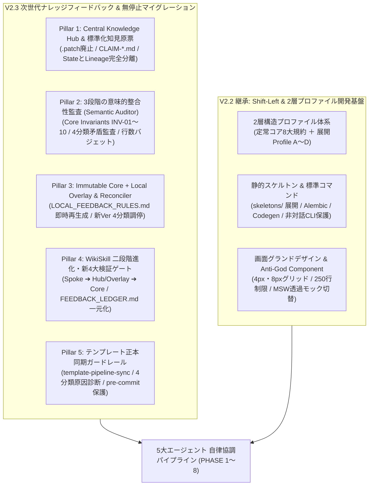
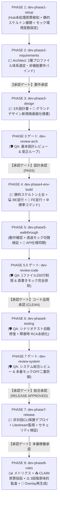
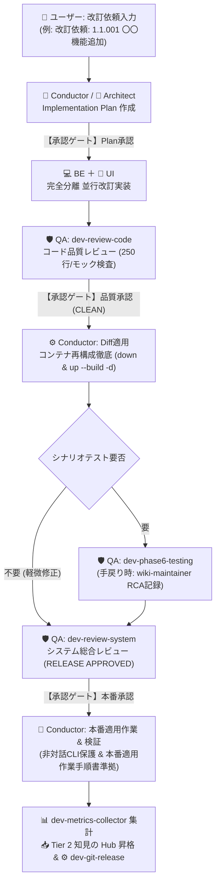

# Antigravity AI-Driven System Dev Pipeline V2.3 🚀

Google Antigravity のマルチエージェントオーケストレーション、カスタムスキル（Skills）、およびプラグインアーキテクチャを活用し、**新規プロジェクトの環境準備から要件定義、基本設計、環境構築、ウォークスルー、自動テスト、本番リリース、そしてマルチプロジェクト・マルチ環境を跨ぐ自己進化・改訂運用に至る全開発ライフサイクルを自律的に統制・自動化する開発基盤テンプレート**です。

---

## 📌 概要

V1.0（単一エージェント）、V2.0（Conductor ＋ 3エージェント分業）、V2.1（5大エージェント協調、3大レビューゲート、WikiSkill自己進化ループ、定量測定機構）、V2.2（Shift-Left 静的スケルトン基盤、2層構造プロファイル体系 Profile A〜D、画面グランドデザイン、MSWモック制御）を経て、**Version 2.3 (V2.3)** では複数の実稼働プロジェクト・複数の開発環境で自己進化機構を長期運用する中で顕在化した「パッチ競合」「新バージョン配布時のローカル知見消失」「ルール間の意味的矛盾」「履歴追記によるプロンプト肥大化」を根本から解決する **次世代ナレッジフィードバック・意味的監査・無停止マイグレーション機構** を統合しました。

V2.2 で確立した **「Shift-Left（品質・標準パターンの前倒し組み込み）」** の開発基盤の上に、V2.3 では環境共通の **`Central Knowledge Hub`（`~/.gemini/knowledge-hub/`）**、行番号に依存しない **「標準化知見原票（Knowledge Claim MD: `CLAIM-*.md`）」**、コア不変原則（`CORE_INVARIANTS.md`）と4分類相互矛盾を判定する **「3段階意味的整合性監査（Semantic Auditor）」**、そして公式プラグインを一切汚さず次案件から知見を即時有効化する **「Immutable Core ＋ Local Overlay 2層構成 ＆ Upgrade Reconciler」** を標準装備しています。

---

## ✨ V2.3 の主な新機能と進化ポイント（5大ピラー ＋ Shift-Left 基盤）



### 🔥 V2.3 新設：マルチプロジェクト・マルチ環境対応の自己進化アーキテクチャ
1. **Patch-Free 標準化知見原票（`CLAIM-*.md`）と Central Knowledge Hub（Pillar 1）**
   - 複数案件からのフィードバック集約時にハンク不一致（Hunk Conflict）を引き起こす `.patch` 出力を完全廃止。
   - 行番号ではなく「対象ファイル名＋セクション見出しアンカー＋統合種別（`SUBSUMPTION` / `SCOPED_BRANCH` / `NEW_RULE`）」を記述した自己完結型 Markdown **「標準化知見原票（`CLAIM-{YYYYMMDD}-{SLUG}-{PAT_ID}.md`）」** に統一し、PC環境共通の `~/.gemini/knowledge-hub/inbox/` へ集約。他環境からの GitHub Issue / PR 還流も同一フォーマットでシームレスに実現。
2. **State（実行規約本文）と Lineage（変更履歴・系譜）の完全分離（Pillar 1-C / 3-C）**
   - 推論エージェントが常時読み込む `rules/AGENTS.md`、`agents/*.md`、`skills/*/SKILL.md`、`LOCAL_FEEDBACK_RULES.md` の本文（State）から、`[PAT-SYS-001]` 等の履歴IDや過去の障害エピソード記述を完全排除し、アテンション希釈（Context Dilution）を防止。
   - 従来各スキル下に分散していた `PURPOSE.md` を廃止し、プラグインルートの **`FEEDBACK_LEDGER.md`**（人間監査用台帳）および **`PIPELINE_MANIFEST.json`**（機械可読マニフェスト）へ一元統合。
3. **3段階の意味的整合性監査「Semantic Auditor」と新・複合検証ゲート（Pillar 2 / Pillar 4）**
   - PHASE 8 で形骸化していた旧検証ゲート（完成済みアプリの Linter / E2E 再実行）を廃止し、🛡️ `qa-engineer` による **「プロンプト・ナレッジ専用 4大関門（3段階意味的監査）」** へ刷新：
     - **New Gate 1 (Stage 1: Core Invariants 監査)**: `rules/CORE_INVARIANTS.md`（`INV-01`〜`INV-10`：Single Writer、250行制限、生SQL禁止、本番モックOFF、非対話CLI保護等）への違反・緩和をゼロ・トレランスで検査（違反時は即座に `rejected/` へ自動棄却）。
     - **New Gate 2 (Stage 2: 相互矛盾4分類監査)**: 既存ルールや他原票との意味的関係を `EQUIVALENT`（重複）、`SUBSUMPTION`（補強統合）、`SCOPED_BRANCH`（条件分岐）、`TRUE_CONTRADICTION`（真の矛盾）に4分類判定。真の矛盾検出時は自動適用をブロックし、`ask_question` モーダルで人間裁定を要求。
     - **New Gate 3 (Stage 3-A: 過剰適合排除 ＆ アンカー実在検証)**: 案件固有のパス・テーブル名等の固有名詞混入ゼロ、および統合先アンカーの実在性を検証。
     - **New Gate 4 (Stage 3-B: コンテキスト純度 ＆ 絶対行数バジェット検証)**: 履歴ID混入ゼロ、およびファイル種別ごとの絶対行数上限（`rules/AGENTS.md`: 220行、`agents/*.md`: 120行、`skills/*/SKILL.md`: 120行、`LOCAL_FEEDBACK_RULES.md`: 80行）を機械的に検査。
   - **3経路起動と非ブロッキング設計**: インライン実行（PHASE 8）および PHASE 1 開始時検知では `ask_question` モーダルUIで即時決裁を行い、`/schedule` バックグラウンド定期実行時は人間入力待ちを行わず `pending_approval/REVIEW-*.md` へステージングして通知終了する安全設計。
4. **「Immutable Core ＋ Local Overlay」2層構成と Upgrade Reconciler（Pillar 3）**
   - 公式プラグイン領域（Immutable Core）は個別案件の PHASE 8 では **1バイトも直接書き換えない**。監査通過・承認された知見原票は `~/.gemini/knowledge-hub/active_claims/` に保管され、**`overlay/LOCAL_FEEDBACK_RULES.md`（上限80行）を原票ベースでクリーン再生成** することで、同一PC内の次案件から即座に有効化。
   - GitHub から新バージョンの Immutable Core を適用する際は、**`scripts/pipeline-reconciler.sh --upgrade`（Upgrade Reconciler）** が新 Core の `PIPELINE_MANIFEST.json` とローカルの `LOCAL_HUB_STATE.json` を照合し、①ID完全一致による自動退役（`archive/upstreamed/` 移動）、②意味的重複時のユーザー承認、③未吸収の独自知見の継続保持、④仕様衝突時の一時保留（`suspended/`）を自動調停。
5. **テンプレート正本同期ガードレール `template-pipeline-sync`（Pillar 5）**
   - 本テンプレートリポジトリ自体の改訂作業において、グローバル環境（`~/.gemini/config/plugins/` & `~/.gemini/knowledge-hub/`）とワークスペース正本（`.agents/plugins/`）のドリフト・知見消失を防ぐ専用スキルおよび Git `pre-commit` ガードを実装。

### 🧱 V2.2 継承・強化：Shift-Left 開発基盤と2層構造プロファイル体系
6. **2層構造システムプロファイル体系 (Two-Tier Profile Architecture)**
   - **第1層: 定常的コア設計規範 (Universal Core Specifications)**: 全プロファイル共通で無条件遵守する8大規約（フロント250行/バック400行制限、OpenAPI➔TS型自動同期、Pydantic Settings 即死検証、Aware UTC保存/JST表示、GitHub Actions CI、構造化ロギング、MSWモック制御、画面グランドデザイン）。
   - **第2層: システム展開プロファイル (Profile A〜D)**:
     - **Profile A (サーバーレス極小コストWeb型 / ゴールデンパス)**: Cloud Run (`max-instances=1`) + Litestream + SQLite(WAL) + Alembic + IAP JWT 二重防御 + React SPA + Tailwind CSS + MSW。
     - **Profile B (Web SSR / フルマネージドRDB型)**: Next.js/Nuxt SSR または FastAPI + Cloud SQL (PostgreSQL) + Alembic。
     - **Profile C (静的MPA / 超軽量ツール型)**: FastAPI + Jinja2 + HTMX / 単一バイナリCLI。
     - **Profile D (PCローカルデスクトップアプリ型)**: Tauri v2 + Local SQLite + Frameless TitleBar + IStorageAdapter。
7. **外部CLIの非対話実行強制とバックグラウンド待機タイムアウト保護（`INV-06` 昇格）**
   - `gcloud`, `npm`, `npx`, `patch` 等の外部CLI実行時における非対話フラグ（`--quiet`, `--yes`, `patch -N` 等）の明示指定強制、`2>/dev/null` による標準エラー破棄の禁止、およびバックグラウンド移行タスク待機時の `schedule` ワンショットタイマー（`DurationSeconds=60`, `TimerCondition="<task-id>"`）併用をコア不変原則として標準装備。

---

## 👥 エージェント体制と役割分担 (5大エージェント協調モデル V2.3)

```
                    ┌────────────────────────────────────────┐
                    │               👤 ユーザー              │
                    │  (要求提示 / ask_question承認 / 検証)  │
                    └──────────────────┬─────────────────────┘
                                       │ 対話 / 指示 / モーダル決裁
                                       ▼
                    ┌────────────────────────────────────────┐
                    │ 👑 1. プロジェクトコンダクター (Main)    │
                    │      (全体進行 / スケルトン展開 /       │
                    │       Single Writer / Hub & Overlay統括)│
                    │      [Model: pro / Workspace: main]    │
                    └──────────────────┬─────────────────────┘
                                       │ 委譲 (invoke_subagent)
         ┌───────────────┬─────────────┴─────────────┬───────────────┐
         ▼               ▼                           ▼               ▼
┌─────────────────┐ ┌─────────────────┐ ┌─────────────────┐ ┌─────────────────┐
│ 📐 2. 設計立案   │ │ 💻 3. BE実装     │ │ 🎨 4. FE/UI     │ │ 🛡️ 5. 品質監査  │
│    スペシャリスト│ │    スペシャリスト│ │    デザイナー     │ │  & Semantic監査 │
│ (architect)     │ │ (backend-       │ │ (ui-designer)   │ │ (qa-engineer)   │
│                 │ │  engineer)      │ │                 │ │                 │
│ [Model: pro]    │ │ [Model: pro]    │ │ [Model: flash]  │ │ [Model: pro]    │
│ [Work: inherit] │ │ [Work: inherit] │ │ [Work: inherit] │ │ [Work: inherit] │
│ ※ run_command   │ │ ※ コンテナ起動・│ │ ※ UIビルド・   │ │ ※ コード・Core  │
│   完全禁止      │ │   Git操作禁止   │ │   npm限定       │ │   直接改変禁止  │
└────────┬────────┘ └────────┬────────┘ └────────┬────────┘ └────────┬────────┘
         │                   │                   │                   │
         └───────────────────┴─────────┬─────────┴───────────────────┘
                                       ▼ 成果物反映・専任操作・Hub調停
                         ┌──────────────────────────┐
                         │ ⚙️ 決定論的ツール / スキル │
                         │ ・Git管理 (dev-git-*)    │
                         │ ・デプロイ (dev-db-*)    │
                         │ ・Hub調停 (reconciler.sh)│
                         │ ・標準コマンド統括実行   │
                         └──────────────────────────┘
```

| ロール | 種別 / 推奨モデル | 主な担当スコープ (V2.3) | 権限・ガードレール (`CORE_INVARIANTS.md`) |
| :--- | :--- | :--- | :--- |
| 👑 **Conductor** | メイン / `pro` | 全体進行管理、`PROJECT_STATE.md` 一元更新（**Single Writer**）、PHASE 1 Hub未処理原票検知、静的スケルトン展開、標準コマンド統括実行、Git・デプロイ専任実行、PHASE 8 原票投函・`ask_question` 承認・Overlay再生成統括 | 全ツール利用可能（**非対話CLIフラグ強制・バックグラウンド `schedule` タイマー保護: `INV-06`**） |
| 📐 **Architect** | サブ / `pro` | 要件定義書（2層プロファイル選定ディシジョンツリー適用）、基本設計4書（技術/スキーマ/ロジック/画面）作成統括、外部API二重キャッシュ・モック仕様設計、Alembic前提スキーマ設計、API仕様書逆同期 | `enable_write_tools: true`（**`run_command` は厳格禁止: `INV-02`**） |
| 💻 **Backend Engineer** | サブ / `pro` | バックエンドAPI、SQLAlchemyモデル（1ファイル400行制限）、Alembicマイグレーション、IAP JWT署名二重検証ミドルウェア、内部監視エンドポイント、Pydantic Settings 即死ガード実装 | 単体テスト・構文検証のみ許可（**生SQL禁止: `INV-05`、Git/デプロイ/DB上書き/コンテナ全体起動停止は禁止: `INV-02`**） |
| 🎨 **UI Designer** | サブ / `flash` または `pro` | 画面仕様書（グランドデザイン新規格準拠）、モダンフロントエンド画面・UI部品実装、**1ファイル最大250行制限厳守（`INV-03`）**、Custom Hooks抽出、**コンポーネント内直書きモック禁止・MSW集約（`INV-04`）** | パッケージ導入・UIビルドのみ許可（**Git/デプロイ/DB操作禁止: `INV-02`**） |
| 🛡️ **QA Engineer** | サブ / `pro` | ドキュメント多次元整合性監査（`dev-doc-reviewer`）、3大レビュー（基本設計/コード品質/システム総合: `INV-07`）、シナリオテスト自動反復・修復（最大5回: `INV-08`）、障害RCA即時記録（`wiki-maintainer`）、**3段階意味的整合性監査（Semantic Auditor：新・複合検証ゲート Gate 1〜4）** | テスト・静的解析・バジェット監査のみ許可（**アプリ本体コードおよび Immutable Core 直接改変禁止: `INV-02`/`INV-09`**） |

---

## 📂 ディレクトリ構成（3つの物理スコープ境界）

### 1. テンプレート正本リポジトリ & 公式プラグイン領域（Immutable Core）
```text
.
├── .agents/
│   ├── skills/
│   │   └── template-pipeline-sync/      # 🔄 テンプレート改訂専用 Global⇔Workspace 同期スキル (V2.3新設)
│   │       ├── SKILL.md
│   │       └── scripts/sync_pipeline.sh # 4領域スキャン・4分類原因診断・Deploy/Backport/Pre-commit保護
│   └── plugins/
│       └── system-dev-pipeline/         # 🔒 開発自動化プラグイン正本 (Immutable Core v2.3.0)
│           ├── plugin.json              # プラグインマニフェスト（agents 5件, skills 19件）
│           ├── PIPELINE_MANIFEST.json   # 📜 [V2.3新設] バージョン・公式吸収済みパターンIDの機械可読正本
│           ├── FEEDBACK_LEDGER.md       # 📖 [V2.3新設] 人間監査用の知見適合履歴・系譜台帳 (旧PURPOSE.md統合)
│           ├── scripts/
│           │   └── pipeline-reconciler.sh # ⚙️ [V2.3新設] Knowledge Hub管理・Overlay再生成・Upgrade Reconciler
│           ├── agents/                  # 👥 エージェント定義（履歴ノイズゼロ・絶対上限 120行）
│           │   ├── conductor.md         # 👑 司令塔・全体進行・Hub統括エージェント定義
│           │   ├── architect.md         # 📐 設計・立案スペシャリスト定義
│           │   ├── backend-engineer.md  # 💻 バックエンド実装スペシャリスト定義
│           │   ├── ui-designer.md       # 🎨 UI/UXデザイナー・FEエンジニア定義
│           │   └── qa-engineer.md       # 🛡️ 品質監査・3大レビュー・RCA・Semantic Auditor定義
│           ├── rules/                   # 📜 開発プロセス標準規約 & コア不変原則
│           │   ├── AGENTS.md            # System Dev Pipeline Rule V2.3 (履歴IDゼロ・上限220行・Overlay参照フック付)
│           │   └── CORE_INVARIANTS.md   # 🛡️ [V2.3新設] Stage 1 意味的監査用 コア不変原則カタログ (INV-01〜10)
│           ├── skeletons/               # 🧱 プロファイル別初期コードスケルトン (Shift-Left基盤)
│           │   ├── common/              # 全プロファイル共通基盤 (.github/workflows/ci.yml, .editorconfig)
│           │   ├── profile-a/           # Profile A基盤 (Alembic, entrypoint.sh, auth.py, MSW, UIベース)
│           │   └── profile-d/           # Profile D基盤 (Tauri v2 デスクトップ雛形)
│           ├── skills/                  # ⚙️ カスタムスキル群（全19種・履歴ノイズゼロ・絶対上限 120行）
│           │   ├── dev-phase1-setup/        # PHASE 1: Hub未処理原票検知・環境初期化・スケルトン展開
│           │   ├── dev-phase2-requirements/ # PHASE 2: 要件定義・2層プロファイル選定
│           │   ├── dev-phase3-design/       # PHASE 3: Shift-Left基本設計4書作成
│           │   ├── dev-review-arch/         # 基本設計レビュー (定常コア ＋ プロファイル適合)
│           │   ├── dev-phase4-env-build/    # PHASE 4: 構築・BE/FE並行実装・標準コマンドシーケンス
│           │   ├── dev-phase5-walkthrough/  # PHASE 5: ウォークスルー・モック透過切替・API仕様同期
│           │   ├── dev-review-code/         # コード品質レビュー (250行制限・直書きモック排除)
│           │   ├── dev-phase6-testing/      # PHASE 6: シナリオテスト自動修復 (モックON/OFF)
│           │   ├── dev-review-system/       # システム総合レビュー (本番モックOFF・IAP・Alembic)
│           │   ├── dev-phase7-release/      # PHASE 7: 本番リリース・非対話CLIガードレールデプロイ
│           │   ├── dev-phase8-rules/        # PHASE 8: メトリクス・Hub原票投函・3段階監査・Overlay再生成
│           │   ├── dev-doc-reviewer/        # ドキュメント相互整合性クロスチェック
│           │   ├── wiki-maintainer/         # 障害・手戻りRCA即時記録 (プロファイル・アンカー情報付)
│           │   ├── wiki-proposer/           # 標準化知見原票 (CLAIM-*.md) 起案・Knowledge Hub Inbox投函
│           │   ├── wiki-compactor/          # Spoke Wiki整理・Hub Inbox原票クラスタリング・Overlay圧縮
│           │   ├── dev-metrics-collector/   # 定量メトリクス集計・健全性診断レポート
│           │   ├── dev-git-init/            # Git初期化・基点コミット・ブランチ作成
│           │   ├── dev-git-release/         # Squash Merge・タグ付与・ブランチ刷新
│           │   └── dev-db-overwrite/        # 本番DB上書き・安全同期
│           └── templates/               # 📄 標準ドキュメント・設定ファイル雛形
│               ├── .env.template
│               ├── code-workspace.template
│               ├── PROJECT_STATE.md.template       # 進行状態管理票雛形 (V2.3 Knowledge Hub追跡対応)
│               ├── TEMPLATE_PROMOTIONS.md.template # 標準化知見原票 (CLAIM-*.md) 提示サマリ雛形
│               ├── 基本設計レビュー結果報告書.md.template
│               ├── コード品質レビュー及びリファクタリング提案書.md.template
│               ├── システム総合レビュー結果報告書.md.template
│               ├── グランドデザイン/              # 画面グランドデザイン標準仕様群
│               └── (要件定義書 / 4大基本設計書 / シナリオテスト計画書 / 本番適用作業手順書 / Git運用基準書 等)
├── docs/                                # 仕様書・設計書アーカイブ
│   ├── 設計書/
│   │   ├── Current/                     # ★現在の正本（Single Source of Truth: V2.3 設計書群 全20文書）
│   │   └── V1.0/ V2.0/ V2.1/ V2.2/      # 過去バージョン設計書アーカイブ
│   └── 検討課題/                        # バージョン別検討課題・評価レポート群
├── rules/
│   └── AGENTS.md                        # ワークスペース共通ルール + 第11節(パイプライン改訂同期規約)
└── README.md
```

### 2. PC環境共通 ナレッジハブ領域（Central Knowledge Hub: `~/.gemini/knowledge-hub/`）
`pipeline-reconciler.sh --init-hub`（または PHASE 1 / PHASE 8）により開発マシンのホームディレクトリ配下に自動構成される環境共通領域です。
```text
~/.gemini/knowledge-hub/
├── inbox/                               # 📥 全案件から投函された未処理の標準化知見原票 (CLAIM-*.md) キュー
├── pending_approval/                    # 🗂️ /schedule バックグラウンド監査時の承認・裁定待ちステージング (REVIEW-*.md)
├── overlay/                             # 🧩 Immutable Core を一切汚さず当該PC環境の次案件から即時有効化される拡張層
│   ├── LOCAL_FEEDBACK_RULES.md          # active_claims からクリーン再生成される追加規約 (絶対上限 80行)
│   └── skills/                          # スキル別補足ガードレール
├── active_claims/                       # 現在 overlay/ に反映されている有効原票の実体保管庫
├── archive/upstreamed/                  # 📦 新Ver Upgrade Reconciler で公式Core吸収済みと判定され自動退役した原票
├── suspended/                           # ⏸️ 新Core仕様と衝突し一時保留された原票
├── rejected/                            # 🚫 3段階意味的監査で棄却された原票と棄却理由の永続記録 (再提案防止)
└── LOCAL_HUB_STATE.json                 # ベースCoreバージョンと適用中Claim IDの対応状態マニフェスト
```

---

## 🛠 全19スキル（Skills）＋ 管理ユーティリティ一覧

| フェーズ / 用途 | スキル / スクリプト名 | 主担当 | 概要・実行内容 (V2.3仕様) |
| :--- | :--- | :--- | :--- |
| **PHASE 1** | `dev-phase1-setup` | 👑 Conductor | **Knowledge Hub 初期化＆未処理原票の起動時検知（`ask_question` 即時決裁）**、ディレクトリ構造展開、静的スケルトン基盤（`skeletons/`）配置、`.env`、`PROJECT_STATE.md`、設計雛形展開。 |
| **PHASE 2** | `dev-phase2-requirements` | 📐 Architect | `docs/要件定義書.md` を精査し、**2層プロファイル体系（Profile A〜D）選定ディシジョンツリー適用**、定常コア8項目の非機能要件自動バインドを実施。 |
| **PHASE 3** | `dev-phase3-design` | 📐 Architect<br>└ 🎨 UI Designer | **Shift-Left基本設計4書**（技術/スキーマ/ロジック/画面仕様）を作成。グランドデザイン新規格準拠、Alembic前提、二重キャッシュ戦略を網羅。完了後、基本設計レビューへ接続。 |
| **PHASE 3 ゲート** | `dev-review-arch` | 🛡️ QA Engineer | **基本設計レビュー**。定常的コア8項目および展開プロファイル別適合アーキテクチャを監査し合否判定（`PASS` 必須）。 |
| **PHASE 4** | `dev-phase4-env-build` | 👑 Conductor<br>├ 💻 BE<br>└ 🎨 UI | 静的スケルトンを土台にDocker環境構築、💻 BE ＋ 🎨 UI 並行委譲実装、**標準コマンドシーケンス（Alembic生成・適用、TypeScript型同期、CI検証）** 自動実行、Git初期化。 |
| **PHASE 4** | `dev-git-init` | ⚙️ Conductor | `Git運用基準書.md` 配置、`.gitignore`（`wiki/`, `metrics/`, `promotions/` 除外）設定、Git初期化（`main`）、`feature` ブランチ作成。 |
| **PHASE 5** | `dev-phase5-walkthrough` | 👑 Conductor<br>└ 📐 Architect | 画面ウォークスルー動作確認統括、**モック透過切替検証（`VITE_ENABLE_MOCK=true/false`）**、不具合修正、実装コードを正としたAPI仕様書の同期更新。 |
| **PHASE 5.5 ゲート**| `dev-review-code` | 🛡️ QA Engineer | **コード品質・整合性レビュー**。**フロント250行/バック400行制限の機械的検査**、**コンポーネント内直書きモックの完全排除**、型同期検証、Unified Diff提示（`CLEAN` 必須）。 |
| **PHASE 6** | `dev-phase6-testing` | 🛡️ QA Engineer | シナリオテスト計画書作成、自動テストコード構築、モック有効/無効双方での結合テスト、自動修復ループ（最大5回、失敗時 RCA即時永続化）。 |
| **PHASE 6 / RCA** | `wiki-maintainer` | 🛡️ QA Engineer | **Wiki知見永続化・RCA**。手戻り・テスト失敗発生時に根本原因を分析し、発生プロファイル・統合候補アンカー付きで `./wiki/patterns/{local,universal}/` へ即時記録。 |
| **PHASE 7 ゲート** | `dev-review-system` | 🛡️ QA Engineer | **システム総合レビュー**。**本番用 `VITE_ENABLE_MOCK=false` 二重防御**、**IAP JWT署名検証有効化**、**`entrypoint.sh` 起動時 Alembic 保証**、平文排除を総合監査（`RELEASE APPROVED` 必須）。 |
| **PHASE 7** | `dev-phase7-release` | 👑 Conductor | システム総合レビュー合格確認、本番適用作業手順書生成、**非対話CLIガードレール（`--quiet` 強制・`schedule` タイマー監視）** に基づく本番デプロイ実行、Litestream・IAP検証。 |
| **PHASE 8** | `dev-phase8-rules` | 👑 Conductor<br>└ 🛡️ QA Engineer | メトリクス集計、原票クラスタリング、**標準化知見原票の Hub 投函 ➔ 3段階意味的整合性監査（New Gate 1〜4）➔ `ask_question` 承認 ➔ `LOCAL_FEEDBACK_RULES.md` クリーン再生成**、Git本番リリース。 |
| **PHASE 8 / 起案** | `wiki-proposer` | 👑 Conductor | **標準化知見原票起案・投函**。`.patch` と個別 `PURPOSE.md` を廃止し、Tier 2 知見から `CLAIM-*.md` を生成して `./promotions/` および `~/.gemini/knowledge-hub/inbox/` へ投函。 |
| **PHASE 8 / 整理** | `wiki-compactor` | 👑 Conductor | **Wiki整理・原票クラスタリング・Overlay圧縮**。案件内 `./wiki/` の整理に加え、Hub `inbox/` 内の類似原票集約および `LOCAL_FEEDBACK_RULES.md`（上限80行）の圧縮を実施。 |
| **定量測定** | `dev-metrics-collector` | 👑 Conductor | **定量メトリクス集計**。ターン別・フェーズ別メトリクスおよびコンテキストバジェット遵守度を集計し、総合健全性診断レポートを出力。 |
| **PHASE 8 / リリース** | `dev-git-release` | ⚙️ Conductor | バージョン番号付与、`main` への Squash Merge、GitHub Push、次期 `feature` ブランチ刷新。 |
| **保守** | `dev-db-overwrite` | ⚙️ Conductor | 本番適用後DBのローカル同期、DBを含むコンテナの本番上書きデプロイ（二重防御ガードレール保護）。 |
| **共通監査** | `dev-doc-reviewer` | 🛡️ QA Engineer | `docs/` 配下の要件定義・設計書間の矛盾、誤植、相対パスリンク切れを多次元クロスチェックし自動修復（`docs/plans/`, `wiki/`, `metrics/` は厳格除外）。 |
| **Hub管理 & 調停** | `pipeline-reconciler.sh` | 👑 Conductor / 👤 User | Knowledge Hub 初期化（`--init-hub`）、状態表示（`--status`）、Overlay再生成（`--rebuild-overlay`）、原票昇格/棄却、純度・行数監査（`--audit-budget`）、新Ver 4分類マイグレーション（`--upgrade`）。 |
| **正本同期 (専用)** | `template-pipeline-sync` | 👑 Conductor | `template` リポジトリ専用。Global ⇔ Workspace 間の差分4分類診断（`--status`）、逆同期（`--backport`）、グローバル反映（`--deploy`）、残骸清掃（`--cleanup`）。 |

---

## 🚦 開発パイプラインの実行フロー (PHASE 1〜8)

新規プロジェクトでシステム開発を開始する場合、Antigravity上で以下のプロンプトを順に投入します。



### 1. プロジェクト初期化・Hub検知・スケルトン展開（PHASE 1）
```text
dev-phase1-setup スキルを実行し、本プロジェクトの環境初期化を行ってください。
```
- `~/.gemini/knowledge-hub/` の未処理原票（`inbox/`・`pending_approval/`）を自動チェックし、存在する場合はその場で `ask_question` モーダル決裁を行って最新知見を `LOCAL_FEEDBACK_RULES.md` に反映してから開発をスタートします。
- ディレクトリ、`wiki/`・`metrics/`・`promotions/` 受皿、**プロファイル別静的スケルトン（`skeletons/`）**、`.env`（`VITE_ENABLE_MOCK=true` 含む）、`PROJECT_STATE.md` (V2.3)、各種設計書・レビュー報告書雛形が展開されます。

### 2. 要件定義・2層プロファイル選定（PHASE 2）
`docs/要件定義書.md` に要求メモを記述した上で実行：
```text
dev-phase2-requirements スキルを実行し、docs/要件定義書.md を精査して展開プロファイルの選定および要件定義書の清書・詳細化を行ってください。
```
- 📐 `architect` が選定ディシジョンツリーを適用し、システム展開プロファイル（Profile A〜D）を決定。第1層の定常的コア設計規範（フロント責務分離、型同期、統一UTC/JST、モック方針等）を自動バインドします。
- **【承認ゲート】「要件定義書の内容を承認します」** とプロンプト入力して次へ。

### 3. Shift-Left基本設計書作成＆基本設計レビュー（PHASE 3）
```text
dev-phase3-design スキルを実行し、基本設計書を作成した上で基本設計レビューを行ってください。
```
- 📐 `architect` が技術要件（プロファイル適合）、テーブルスキーマ（Alembic前提、UTC ISO8601、生SQL禁止）、ビジネスロジック（外部API二重キャッシュ、モック制御、内部監視）を作成。
- 🎨 `ui-designer` が画面仕様書（グランドデザイン新規格: セマンティックカラーHEX/px併記、4px/8pxグリッド、ウィンドウ形態選定）を作成。
- 🛡️ `qa-engineer` が `dev-review-arch` で定常コア8項目およびプロファイル別観点を監査し、`docs/plans/基本設計レビュー結果報告書.md` を作成。
- **【承認ゲート】「基本設計書の内容を承認します」** とプロンプト入力して次へ。

### 4. 責務分離環境構築・並行実装・標準コマンドシーケンス実行（PHASE 4）
```text
dev-phase4-env-build スキルを実行し、docs/配下の設計ドキュメントに基づいて開発環境構築とシステム実装を行ってください。
```
- 👑 コンダクターが `skeletons/` を土台にDocker環境を構築。
- 💻 `backend-engineer` がSQLAlchemyモデル（400行制限）、Alembicマイグレーション、API、IAP認証を実装。
- 🎨 `ui-designer` がグランドデザイン準拠画面を**1ファイル250行制限**および**直書きモック禁止（MSWハンドラー利用）**を徹底して並行実装。
- 標準コマンドシーケンス（Alembicマイグレーション生成・適用、TypeScript型定義自動生成、ローカルCI検証）を順次実行し、`dev-git-init` でGitリポジトリ初期化。

### 5. ウォークスルー・モック透過切替検証＆API仕様同期（PHASE 5）
```text
dev-phase5-walkthrough スキルを実行し、ウォークスルーによる動作確認とモック切替検証、およびコード品質レビューを行ってください。
```
- 実際の画面操作を行い、`VITE_ENABLE_MOCK=true`（MSWモック動作）と `VITE_ENABLE_MOCK=false`（実API通信動作）の双方で透過的に動作することを検証。
- 実装コードを正としてAPI仕様書を同期更新。

### 6. コード品質レビュー（PHASE 5.5 ゲート）
- 🛡️ `qa-engineer` が `dev-review-code` により、**1ファイル最大250行制限**、**コンポーネント内直書きモックの完全排除**、型同期を批判的に監査し、`docs/plans/コード品質レビュー及びリファクタリング提案書.md` (Unified Diff) を提示。
- コンダクターおよび各エンジニアが是正を適用し、判定 `CLEAN` を獲得。
- **【承認ゲート】「コード品質レビュー結果を承認します」** とプロンプト入力して次へ。

### 7. シナリオテスト＆障害時RCA永続化（PHASE 6）
```text
dev-phase6-testing スキルを実行し、シナリオテスト環境の構築とテスト自動反復ループを開始してください。
```
- 🛡️ `qa-engineer` がテストスクリプトを構築し、全テストケース合格まで自律修復ループを実行（最大5回）。
- 手戻りやテスト失敗が発生した場合、`wiki-maintainer` が根本原因分析（RCA）を実施し、`./wiki/patterns/` へ知見を即時永続化。
- **【承認ゲート】「テスト完了・リリース準備移行を承認します」** とプロンプト入力して次へ。

### 8. システム総合レビュー＆本番リリース（PHASE 7）
```text
dev-phase7-release スキルを実行し、システム総合レビューの確認および本番適用作業を行ってください。
```
- 🛡️ `qa-engineer` による `dev-review-system`（システム総合レビュー）を実行。**本番モックOFF（`VITE_ENABLE_MOCK=false`）二重防御**、**IAP JWT署名検証有効化**、**`entrypoint.sh` による起動時 Alembic 実行保証**、Litestream同期監視確認、平文シークレットゼロを検証し `RELEASE APPROVED` を確認。
- 👑 コンダクターが本番適用作業手順書を作成し、非対話フラグ（`--quiet`）と `schedule` タイムアウト保護を用いて本番デプロイを実行。
- **【承認ゲート】「本番稼働確認を承認します」** とプロンプト入力して次へ。

### 9. メトリクス集計・Central Knowledge Hub 知見昇格・Gitリリース（PHASE 8）
```text
dev-phase8-rules スキルを実行し、メトリクス集計、Knowledge Hub 知見昇格、および本番Gitリリースを行ってください。
```
- `dev-metrics-collector` により開発健全性レポート（`metrics/system_health_report.md`）を出力。
- `wiki-compactor` が `./wiki/` および Hub `inbox/` の重複原票を整理・クラスタリング。
- `wiki-proposer` が汎用知見（Tier 2）から **標準化知見原票（`CLAIM-*.md`）** を生成し、`./promotions/` および `~/.gemini/knowledge-hub/inbox/` へ投函。
- 🛡️ `qa-engineer`（Semantic Auditor）が **3段階意味的整合性監査（New Gate 1〜4）** をインライン実行し、👑 コンダクターが **`ask_question` モーダル** でユーザーの承認・裁定を取得。
- 承認された原票は公式プラグイン（Immutable Core）を一切書き換えず、`pipeline-reconciler.sh --activate-claim` により **`~/.gemini/knowledge-hub/overlay/LOCAL_FEEDBACK_RULES.md` へクリーン再生成反映** され、次案件から即座に有効化されます。
- `dev-git-release` により `Release v1.0.0` を本番反映し、運用ルールを適用。

---

## 🔄 システム改訂運用フロー（REVISION LIFECYCLE V2.3）

本番運用中のシステムに対し、機能追加・仕様変更・不具合修正を行う場合の標準プロセスです（[システム改訂ルール.md](./.agents/plugins/system-dev-pipeline/templates/システム改訂ルール.md) 準拠）。



---

## 🛡️ コア不変原則と安全運用ガイドライン（Core Invariants: `INV-01` 〜 `INV-10`）

[CORE_INVARIANTS.md](./.agents/plugins/system-dev-pipeline/rules/CORE_INVARIANTS.md) により、いかなるフィードバックや改訂であっても絶対に緩和・バイパスされない10の不変原則が定義されています。

| ID | 原則名 | 絶対不可侵の制約内容 |
| :--- | :--- | :--- |
| **`INV-01`** | **Single Writer 原則** | `PROJECT_STATE.md` の更新権限は 👑 `conductor` のみが保持し、サブエージェントによる直接編集は理由を問わず禁止する。 |
| **`INV-02`** | **責務分離とツール実行制限** | 📐 `architect` の `run_command` 禁止、🛡️ `qa-engineer` のアプリ本体コード直接改変禁止、サブエージェントの Git/デプロイ/DB上書き/Docker全体起動停止の禁止。 |
| **`INV-03`** | **Anti-God Component / File 制限** | フロントエンド 1 コンポーネントファイル最大 250 行制限、バックエンド 1 モジュールファイル最大 400 行制限の厳守。 |
| **`INV-04`** | **本番モックOFF・直書きモック禁止** | コンポーネント内のダミーデータ直書き禁止（MSW 集約必須）、および本番ビルド時の `VITE_ENABLE_MOCK=false` 二重防御の厳守。 |
| **`INV-05`** | **Alembic 厳格運用・生SQL禁止** | 手動 DDL（生 SQL）によるテーブル作成・変更を禁止し、SQLAlchemy ORM と Alembic マイグレーションによる確定管理を徹底する。 |
| **`INV-06`** | **IAP JWT 検証・平文排除・非対話CLI保護** | 本番認証検証の強制、シークレット平文コミット禁止、外部 CLI 実行時の `--quiet` 等非対話フラグ強制・`2>/dev/null` 禁止・バックグラウンド待機時の `schedule` タイマー保護。 |
| **`INV-07`** | **3大レビューゲート必須通過** | 基本設計（`dev-review-arch`）・コード品質（`dev-review-code`）・システム総合（`dev-review-system`）およびテスト合格なしに次フェーズへ進行することを禁じる。 |
| **`INV-08`** | **自律修復ループの上限保護** | テスト失敗や不整合の放置（スキップ合格化）を禁じるとともに、無限ループ防止のため自律修復は最大 5 回上限を維持する。 |
| **`INV-09`** | **Context Isolation とナレッジ境界** | Tier 1（案件固有仕様）の環境共通領域への持ち出し禁止、推論プロンプトへの生 Wiki 履歴注入禁止、およびルール・スキル本文（State）への履歴ID（Lineage）混入禁止。 |
| **`INV-10`** | **ドキュメント内相対パス強制** | Markdown 設計文書・仕様書内のファイルリンクに絶対パス（`file:///` 等）を使用することを禁止し、必ず対象ファイル間の相対パスを使用する。 |

---

## 📦 セットアップ・導入・アップグレード方法

### 方法 A: 新規プロジェクトのテンプレートとして使用する（ワークスペース単位）
本リポジトリをクローンまたはフォークし、そのままプロジェクトの起点として利用します。`.agents/` ディレクトリが存在するため、Antigravityを開くだけでプラグイン、エージェント定義、スキルが即座に利用可能になります。

### 方法 B: グローバルプラグインとして全プロジェクトで共有する（推奨）
複数のアプリケーション開発プロジェクトで本パイプラインを共通利用し、Central Knowledge Hub（`~/.gemini/knowledge-hub/`）による環境横断の自己進化ループを有効化する場合は、以下のスクリプト（またはコピーコマンド）でグローバル領域へデプロイ・初期化します。

```bash
# 1. グローバルプラグイン領域へのデプロイ & Knowledge Hub 初期化 (Upgrade Reconciler 自動実行)
bash .agents/skills/template-pipeline-sync/scripts/sync_pipeline.sh --deploy

# 2. Central Knowledge Hub の状態確認
bash ~/.gemini/config/plugins/system-dev-pipeline/scripts/pipeline-reconciler.sh --status
```

### 方法 C: GitHub から新バージョン（V2.3 以降）を取得した際のマイグレーション
他の開発環境で既に独自の知見原票が `LOCAL_FEEDBACK_RULES.md`（Local Overlay）に適用されている状態で、GitHub から新バージョンのプラグインを取り込んだ場合は、**Upgrade Reconciler** を実行することでローカルの独自知見を失うことなく安全にマイグレーションできます。

```bash
# 新バージョンの PIPELINE_MANIFEST.json とローカルの active_claims/ を照合し、
# 公式吸収済み原票の自動退役 (archive/upstreamed/) と独自知見の保護・Overlay再生成を実行
bash ~/.gemini/config/plugins/system-dev-pipeline/scripts/pipeline-reconciler.sh --upgrade
```

### 方法 D: 他環境への知見還流（Contribute）
ローカル環境で獲得・検証された未本流化の汎用知見原票（`CLAIM-*.md`）をテンプレート本流リポジトリへ還流させる場合は、以下のコマンドでエクスポートし、GitHub Issue または Pull Request として提出できます。

```bash
bash ~/.gemini/config/plugins/system-dev-pipeline/scripts/pipeline-reconciler.sh --export-claims ./exported-claims
```

---

## 📚 主要設計ドキュメント一覧（`docs/設計書/Current/`）

- [V2.3改変計画書.md](./docs/設計書/Current/V2.3改変計画書.md)
- [V2.3新知見フィードバック機構設計書.md](./docs/設計書/Current/V2.3新知見フィードバック機構設計書.md)
- [パイプラインの改訂時におけるグローバルとワークスペースの同期について.md](./docs/設計書/Current/パイプラインの改訂時におけるグローバルとワークスペースの同期について.md)
- [AI駆動システム開発フェーズ定義書V2.3.md](./docs/設計書/Current/AI駆動システム開発フェーズ定義書V2.3.md)
- [V2.3システムプロファイル構造設計書.md](./docs/設計書/Current/V2.3システムプロファイル構造設計書.md)
- [ProfileA詳細設計書.md](./docs/設計書/Current/ProfileA詳細設計書.md) / [ProfileD詳細設計書.md](./docs/設計書/Current/ProfileD詳細設計書.md)
- [エージェント設計書V2.3.md](./docs/設計書/Current/エージェント設計書V2.3.md)
- [レビューシステム設計書V2.3.md](./docs/設計書/Current/レビューシステム設計書V2.3.md)
- [状態管理機構設計書V2.3.md](./docs/設計書/Current/状態管理機構設計書V2.3.md)
- [WikiSkill統合設計書.md](./docs/設計書/Current/WikiSkill統合設計書.md)
- [テンプレート配置形態およびナレッジ境界設計書.md](./docs/設計書/Current/テンプレート配置形態およびナレッジ境界設計書.md)
- [エージェント間知見蓄積運用基準書V2.3.md](./docs/設計書/Current/エージェント間知見蓄積運用基準書V2.3.md)
- [定量測定・フィードバック設計書.md](./docs/設計書/Current/定量測定・フィードバック設計書.md)

---

## 📄 ライセンス

MIT License
