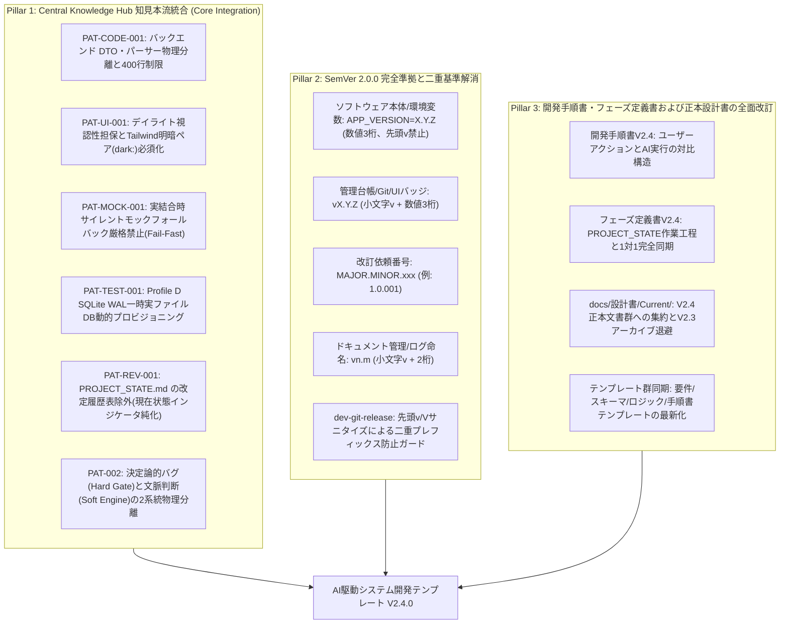
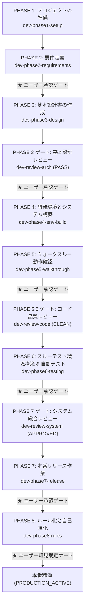

# Antigravity AI-Driven System Dev Pipeline V2.4 🚀

Google Antigravity のマルチエージェントオーケストレーション、カスタムスキル（Skills）、およびプラグインアーキテクチャを活用し、**新規プロジェクトの環境準備から要件定義、基本設計、環境構築、ウォークスルー、自動テスト、本番リリース、そしてマルチプロジェクト・マルチ環境を跨ぐ自己進化・改訂運用に至る全開発ライフサイクルを自律的に統制・自動化する開発基盤テンプレート**です。

---

## 📌 概要

V1.0（単一エージェント）、V2.0（Conductor ＋ 3エージェント分業）、V2.1（5大エージェント協調、3大レビューゲート、WikiSkill自己進化ループ、定量測定機構）、V2.2（Shift-Left 静的スケルトン基盤、2層構造プロファイル体系 Profile A〜E、画面グランドデザイン、MSWモック制御）、V2.3（Central Knowledge Hub、3段階意味的整合性監査、Immutable Core / Local Overlay 二層プラグイン機構）を経て、**Version 2.4 (V2.4)** では実稼働プロジェクトの運用成果を結集し、以下の **3大ピラー** を軸に抜本的な進化を遂げました：

1. **Central Knowledge Hub 蓄積知見の公式本流統合 (Core Integration)**:
   先行運用されてきた 6 件の高品質な汎用知見原票（DTO/パーサー物理分離、デイライトUI視認性、Fail-Fastモック制御、Tauri実ファイルDB動的プロビジョニング、2系統分離、改定履歴表除外）を公式パイプライン（Immutable Core）へ本流統合し、Local Overlay の行数バジェットを完全解放。
2. **公式セマンティックバージョニング（SemVer 2.0.0）への完全準拠**:
   コードエコシステム（SemVer 3桁）とドキュメント・改訂規則（Vn.m 2桁）の二重基準を解消し、システム・Git・改訂番号・ドキュメント命名の一元的な体系化と、Gitタグ二重プレフィックス脆弱性（`vV2.0`）を完全根絶。
3. **開発手順書・フェーズ定義書および正本設計書群の全面再編**:
   `PROJECT_STATE.md` の作業工程に完全同期し、各フェーズにおいて「👤 ユーザーが行うべきこと（User Action）」と「🤖 AIによって行われる作業（AI Execution）」を明確に対比した実践的オペレーション体系を確立。

---

## ✨ V2.4 の主な新機能と進化ポイント（3大ピラー）



### 1. 本流統合された 6 大知見の詳細仕様（Pillar 1）
- **バックエンド DTO・パーサー物理分離と Anti-God Module (400行制限) 遵守 (PAT-CODE-001)**:
  Controller/ハンドラー層から DTO 構造体およびリクエストパーサーを独立モジュール（`schemas/`, `*_dto.rs` 等）へ物理分離。Controller はオーケストレーションに専念させ、直書きモックを排除。
- **デイライトモード視認性担保と Tailwind 明暗ペア指定必須化 (PAT-UI-001)**:
  ダークモード前提の淡色・透過カラー（`text-blue-200` 等）の単独直書きを禁止。セマンティックデザイントークンまたは Tailwind 明暗ペア（`text-blue-800 dark:text-blue-200`）の指定を義務化。
- **実結合モード時のサイレントモックフォールバック厳格禁止 (Fail-Fast原則 / PAT-MOCK-001)**:
  実環境・実結合モード（`VITE_ENABLE_MOCK=false`）において、API/IPC通信エラー発生時にモックデータへサイレントフォールバックすることを禁止。エラー時は例外を即座にスローして UI/ログに顕在化。
- **Profile D 結合テスト時の一時実ファイルDB動的プロビジョニング (PAT-TEST-001)**:
  デスクトップアプリの結合テストにおいて、インメモリDBではなく一時ディレクトリ配下に UUID 付き実ファイルDBを動的プロビジョニングし、マイグレーションとWAL並行性を本番同等に検証後アトミック破棄。
- **`PROJECT_STATE.md` の改定履歴表適用除外 (PAT-REV-001)**:
  現在状態の動的インジケータである `PROJECT_STATE.md` を改定履歴表の対象外とし、作業履歴は `/revise-log/vn.m/` に一元化して台帳の肥大化を防止。
- **決定論的バグ(Hard Gate)と文脈判断(Soft Engine)の2系統物理分離 (PAT-002)**:
  構文不正や型エラー等の機械的バグは自然言語プロンプトに書かず Linter やテストコードへ直接吸収。

### 2. SemVer 2.0.0 統一マッピング（Pillar 2）
- **ソフトウェア本体**: `MAJOR.MINOR.PATCH`（数値3桁、先頭 `v` 禁止。例: `.env` の `APP_VERSION=1.0.0`、`package.json`、`Cargo.toml`）
- **管理台帳・Git・UI**: `vMAJOR.MINOR.PATCH`（小文字 `v` ＋ 3桁。例: `PROJECT_STATE.md`、Gitタグ `v1.0.0`、UIバッジ）
- **改訂依頼番号**: `MAJOR.MINOR.xxx`（例: `1.0.001`、`2.0.001`。4桁化による肥大化を防ぎつつソート性を維持）
- **ドキュメント管理**: `vn.m`（小文字 `v` ＋ 2桁。例: `docs/設計書/v2.4/`、`/revise-log/v1.0/`。大文字 `V` を廃止）
- **リリース保護ガード**: `dev-git-release` により、`.env` に誤って `V2.0` や `v1.0.0` が記載されていても先頭 `v`/`V` を自動サニタイズし、`vV2.0` 等の二重プレフィックスを機械的に完全遮断。

---

## 👥 エージェント体制と役割分担 (5大エージェント協調モデル V2.4)

```
                    ┌────────────────────────────────────────┐
                    │               👤 ユーザー              │
                    │  (要求提示 / 承認ゲート決裁 / 実機検証)│
                    └──────────────────┬─────────────────────┘
                                       │ 対話 / 指示 / 承認
                                       ▼
                    ┌────────────────────────────────────────┐
                    │ 👑 1. プロジェクトコンダクター (Main)    │
                    │      (全体進行 / Single Writer /       │
                    │       標準コマンド統括 / Git・デプロイ)│
                    │      [Model: pro / Workspace: main]    │
                    └──────────────────┬─────────────────────┘
                                       │ 委譲 (invoke_subagent)
         ┌───────────────┬─────────────┴─────────────┬───────────────┐
         ▼               ▼                           ▼               ▼
┌─────────────────┐ ┌─────────────────┐ ┌─────────────────┐ ┌─────────────────┐
│ 📐 2. 設計立案   │ │ 💻 3. BE実装     │ │ 🎨 4. FE/UI     │ │ 🛡️ 5. 品質監査  │
│    スペシャリスト│ │    スペシャリスト│ │    デザイナー     │ │  & Semantic監査 │
│ (architect)     │ │ (backend-       │ │ (ui-designer)   │ │ (qa-engineer)   │
│                 │ │  engineer)      │ │                 │ │                 │
│ [Model: pro]    │ │ [Model: pro]    │ │ [Model: flash]  │ │ [Model: pro]    │
│ ※ run_command   │ │ ※ コンテナ起動・│ │ ※ UIビルド・   │ │ ※ コード・Core  │
│   完全禁止      │ │   Git操作禁止   │ │   npm限定       │ │   直接改変禁止  │
└────────┬────────┘ └────────┬────────┘ └────────┬────────┘ └────────┬────────┘
         │                   │                   │                   │
         └───────────────────┴─────────┬─────────┴───────────────────┘
                                       ▼
                         ┌──────────────────────────┐
                         │ ⚙️ 決定論的ツール / スキル │
                         │ ・Git管理 (dev-git-*)    │
                         │ ・デプロイ (dev-db-*)    │
                         │ ・Hub調停 (reconciler.sh)│
                         │ ・標準コマンド統括実行   │
                         └──────────────────────────┘
```

| ロール | 種別 / 推奨モデル | 主な担当スコープ (V2.4) | 権限・ガードレール (`CORE_INVARIANTS.md`) |
| :--- | :--- | :--- | :--- |
| 👑 **Conductor** | メイン / `pro` | 全体進行管理、`PROJECT_STATE.md` 一元更新（**Single Writer**）、PHASE 1 Hub検知・スケルトン展開、標準コマンド統括実行、Git・デプロイ専任実行、PHASE 8 知見投函・Overlay再生成 | 全ツール利用可能（**非対話CLIフラグ強制・`schedule` タイマー保護: `INV-06`**） |
| 📐 **Architect** | サブ / `pro` | 要件定義書（Profile A〜E選定）、4大基本設計書作成、外部API二重キャッシュ・Fail-Fastモック仕様設計、Alembic前提スキーマ設計、API仕様書同期 | `enable_write_tools: true`（**`run_command` は厳格禁止: `INV-02`**） |
| 💻 **Backend Engineer** | サブ / `pro` | バックエンドAPI、SQLAlchemyモデル（400行制限）、**DTO・パーサー物理分離（PAT-CODE-001）**、Alembicマイグレーション、IAP JWT署名二重検証ミドルウェア、ヘルスチェック実装 | 単体テスト・構文検証のみ許可（**生SQL禁止: `INV-05`、Git/デプロイ/DB上書き/コンテナ起動停止は禁止: `INV-02`**） |
| 🎨 **UI Designer** | サブ / `flash` または `pro` | 画面仕様書（グランドデザイン新規格準拠）、モダンフロントエンド画面実装、**1ファイル最大250行制限（`INV-03`）**、**デイライト視認性明暗ペア担保（PAT-UI-001）**、**MSWモックハンドラー構築（`INV-04`）** | パッケージ導入・UIビルドのみ許可（**Git/デプロイ/DB操作禁止: `INV-02`**） |
| 🛡️ **QA Engineer** | サブ / `pro` | ドキュメント多次元整合性監査（`dev-doc-reviewer`）、3大レビュー（基本設計/コード品質/システム総合: `INV-07`）、**スルーテスト自動修復（Profile D実ファイルDB動的プロビジョニング PAT-TEST-001）**、障害RCA記録（`wiki-maintainer`）、**3段階意味的整合性監査（Semantic Auditor）** | テスト・静的解析・バジェット監査のみ許可（**アプリ本体コードおよび Immutable Core 直接改変禁止: `INV-02`/`INV-09`**） |

---

## 📂 ディレクトリ構成

### 1. ワークスペースおよびプラグイン領域
```text
.
├── .agents/
│   ├── skills/
│   │   └── template-pipeline-sync/      # 🔄 テンプレート改訂専用 Global⇔Workspace 同期スキル
│   └── plugins/
│       └── system-dev-pipeline/         # 🔒 開発自動化プラグイン正本 (Immutable Core v2.4.0)
│           ├── plugin.json              # プラグインマニフェスト（agents 5件, skills 19件）
│           ├── PIPELINE_MANIFEST.json   # 📜 バージョン・公式吸収済みパターンID（6件）の機械可読正本
│           ├── FEEDBACK_LEDGER.md       # 📖 人間監査用の知見適合履歴・系譜台帳
│           ├── scripts/
│           │   └── pipeline-reconciler.sh # ⚙️ Knowledge Hub管理・Overlay再生成・Upgrade Reconciler
│           ├── agents/                  # 👥 エージェント定義（conductor, architect, backend, ui, qa）
│           ├── rules/                   # 📜 開発プロセス標準規約 (AGENTS.md) & コア不変原則 (CORE_INVARIANTS.md)
│           ├── skeletons/               # 🧱 プロファイル別初期コードスケルトン (common, profile-a, profile-d)
│           ├── skills/                  # ⚙️ カスタムスキル群（全19種）
│           └── templates/               # 📄 V2.4 標準ドキュメント・設定ファイル雛形
├── docs/                                # 仕様書・設計書・レポート
│   ├── 設計書/
│   │   ├── Current/                     # ★現在の正本（Single Source of Truth: V2.4 正本設計書 全9文書）
│   │   └── V1.0/ V2.0/ V2.1/ V2.2/ V2.3/# 過去バージョン設計書アーカイブ
│   ├── 検討課題/                        # バージョン別検討課題・評価レポート群
│   └── reports/                         # 各種調査・監査報告書
├── rules/
│   └── AGENTS.md                        # ワークスペース共通ルール + 第11節(パイプライン改訂同期規約)
└── README.md
```

### 2. PC環境共通 ナレッジハブ領域（`~/.gemini/knowledge-hub/`）
```text
~/.gemini/knowledge-hub/
├── inbox/                               # 📥 全案件から投函された未処理の標準化知見原票 (CLAIM-*.md)
├── pending_approval/                    # 🗂️ バックグラウンド監査時の承認待ちステージング
├── overlay/                             # 🧩 Immutable Core を一切汚さず次案件から即時有効化される拡張層
│   └── LOCAL_FEEDBACK_RULES.md          # active_claims からクリーン再生成される追加規約 (上限 80行)
├── active_claims/                       # 現在 overlay/ に反映されている有効原票の実体保管庫
├── archive/upstreamed/                  # 📦 新Ver Upgrade Reconciler で Core 吸収済みと判定され退役した原票
├── suspended/                           # ⏸️ 一時保留された原票
├── rejected/                            # 🚫 意味的監査で棄却された原票の永続記録
└── LOCAL_HUB_STATE.json                 # ベースCoreバージョンと適用中Claim IDの状態マニフェスト
```

---

## 🛠 全19スキル（Skills）一覧

| フェーズ / 用途 | スキル名 | 主担当 | 概要・実行内容 (V2.4仕様) |
| :--- | :--- | :--- | :--- |
| **PHASE 1** | `dev-phase1-setup` | 👑 Conductor | **Knowledge Hub 検知**、ディレクトリ構造展開、静的スケルトン基盤（`skeletons/`）配置、`.env`、`PROJECT_STATE.md`（SemVer 3桁 `v1.0.0`）。 |
| **PHASE 2** | `dev-phase2-requirements` | 📐 Architect | `docs/要件定義書.md` 精査、**2層プロファイル体系（Profile A〜E）選定**、定常コア8項目の非機能要件自動バインド。 |
| **PHASE 3** | `dev-phase3-design` | 📐 Architect<br>└ 🎨 UI | **Shift-Left基本設計4書**（技術/スキーマ/ロジック/画面仕様）策定。グランドデザイン新規格準拠、Alembic前提、二重キャッシュ、デイライト視認性。 |
| **PHASE 3 ゲート** | `dev-review-arch` | 🛡️ QA | **基本設計レビュー**。定常コア8項目および展開プロファイル別適合アーキテクチャ監査（`PASS` 必須）。 |
| **PHASE 4** | `dev-phase4-env-build` | 👑 Conductor<br>├ 💻 BE<br>└ 🎨 UI | 静的スケルトンを土台にDocker環境構築、💻 BE ＋ 🎨 UI 並行実装、**DTO・パーサー物理分離 (PAT-CODE-001)**、**標準コマンドシーケンス**自動実行、Git初期化。 |
| **PHASE 4** | `dev-git-init` | ⚙️ Conductor | `Git運用基準書.md` 配置、`.gitignore` 設定、Git初期化（`main`）、`feature` ブランチ作成。 |
| **PHASE 5** | `dev-phase5-walkthrough` | 👑 Conductor<br>└ 📐 Architect | 画面ウォークスルー動作確認統括、**モック透過切替検証 (Fail-Fast原則 / PAT-MOCK-001)**、不具合修正、最新コードを正としたAPI仕様書同期。 |
| **PHASE 5.5 ゲート**| `dev-review-code` | 🛡️ QA | **コード品質・整合性レビュー**。**250行/400行制限検査**、**直書きモック排除**、**DTO・パーサー分離検査**、**デイライト視認性検査**、型同期（`CLEAN` 必須）。 |
| **PHASE 6** | `dev-phase6-testing` | 🛡️ QA | シナリオテスト計画書作成、自動テストコード構築、**Profile D一時実ファイルDB動的プロビジョニング (PAT-TEST-001)**、自動修復ループ（最大5回）。 |
| **PHASE 6 / RCA** | `wiki-maintainer` | 🛡️ QA | **障害時RCA即時記録**。テスト失敗・手戻り発生時に根本原因を分析し `./wiki/patterns/` へ即時記録。 |
| **PHASE 7 ゲート** | `dev-review-system` | 🛡️ QA | **システム総合レビュー**。**本番モックOFF二重防御 & Fail-Fast 監査**、**IAP JWT署名検証有効化**、**起動時 Alembic 保証**、平文排除（`RELEASE APPROVED` 必須）。 |
| **PHASE 7** | `dev-phase7-release` | 👑 Conductor | システム総合レビュー合格確認、本番適用作業手順書作成、**非対話CLIガードレール（`--quiet` 強制・`schedule` タイマー監視）** による安全デプロイ。 |
| **PHASE 8** | `dev-phase8-rules` | 👑 Conductor<br>└ 🛡️ QA | メトリクス集計、原票クラスタリング、**知見原票投函 ➔ 3段階意味的監査 ➔ `ask_question` 承認 ➔ Local Overlay 再生成**、Git本番リリース。 |
| **PHASE 8 / 起案** | `wiki-proposer` | 👑 Conductor | **標準化知見原票起案・投函**。Tier 2 知見から `CLAIM-*.md` を生成して `inbox/` へ投函。 |
| **PHASE 8 / 整理** | `wiki-compactor` | 👑 Conductor | **Wiki整理・原票クラスタリング・Overlay圧縮**。Hub `inbox/` 原票集約および `LOCAL_FEEDBACK_RULES.md` 圧縮。 |
| **定量測定** | `dev-metrics-collector` | 👑 Conductor | **定量メトリクス集計**。ターン別メトリクスおよびバジェット遵守度を集計し、総合健全性診断レポートを出力。 |
| **PHASE 8 / リリース** | `dev-git-release` | ⚙️ Conductor | **先頭サニタイズ処理**、Gitタグ付与（`vMAJOR.MINOR.PATCH`）、`main` への Squash Merge、Push、次期 `feature` 切り直し。 |
| **保守** | `dev-db-overwrite` | ⚙️ Conductor | 本番適用後DBのローカル同期、DBを含むコンテナの本番上書きデプロイ（二重防御ガードレール保護）。 |
| **共通監査** | `dev-doc-reviewer` | 🛡️ QA | `docs/` 配下の要件定義・設計書間の矛盾、誤植、相対パスリンク切れを多次元クロスチェックし自動修復。 |

---

## 🚦 開発パイプラインの実行フロー (PHASE 1〜8)

開発の具体的な手順、ユーザーが行うべきアクション、およびAIの自律動作の詳細は、[AI駆動システム開発手順書V2.4.md](./docs/設計書/Current/AI駆動システム開発手順書V2.4.md) および [AI駆動システム開発フェーズ定義書V2.4.md](./docs/設計書/Current/AI駆動システム開発フェーズ定義書V2.4.md) を参照してください。



---

## 🛡️ コア不変原則 (Core Invariants: `INV-01` 〜 `INV-10`)

[CORE_INVARIANTS.md](./.agents/plugins/system-dev-pipeline/rules/CORE_INVARIANTS.md) により、いかなる改変や個別案件ルールであっても絶対に緩和・バイパスされない10の不変原則が定義されています。

| ID | 原則名 | 絶対不可侵の制約内容 |
| :--- | :--- | :--- |
| **`INV-01`** | **Single Writer 原則** | `PROJECT_STATE.md` の更新権限は 👑 `conductor` のみが保持し、サブエージェントによる直接編集を禁止する。 |
| **`INV-02`** | **責務分離とツール実行制限** | 📐 `architect` の `run_command` 禁止、🛡️ `qa-engineer` のアプリコード直接改変禁止、サブエージェントの Git/デプロイ/DB上書き/Docker全体起動停止の禁止。 |
| **`INV-03`** | **Anti-God Component / Module 制限** | フロントエンド 1 コンポーネントファイル最大 250 行制限、バックエンド 1 モジュールファイル最大 400 行制限（DTO分離必須）の厳守。 |
| **`INV-04`** | **本番モックOFF・直書きモック禁止** | コンポーネント内のダミーデータ直書き禁止（MSW 集約必須）、および本番ビルド時の `VITE_ENABLE_MOCK=false` 二重防御の厳守。 |
| **`INV-05`** | **Alembic 厳格運用・生SQL禁止** | 手動 DDL（生 SQL）によるテーブル作成・変更を禁止し、SQLAlchemy ORM と Alembic マイグレーションによる確定管理を徹底する。 |
| **`INV-06`** | **IAP JWT 検証・平文排除・非対話CLI保護** | 本番認証検証の強制、シークレット平文コミット禁止、外部 CLI 実行時の `--quiet` 等非対話フラグ強制・`2>/dev/null` 禁止・バックグラウンド待機時の `schedule` タイマー保護。 |
| **`INV-07`** | **3大レビューゲート必須通過** | 基本設計（`dev-review-arch`）・コード品質（`dev-review-code`）・システム総合（`dev-review-system`）の合格なしに次フェーズへ進行することを禁じる。 |
| **`INV-08`** | **自律修復ループの上限保護** | テスト失敗や不整合の放置を禁じるとともに、無限ループ防止のため自律修復は最大 5 回上限を維持する。 |
| **`INV-09`** | **Context Isolation とナレッジ境界** | Tier 1（案件固有仕様）の環境共通領域への持ち出し禁止、プロンプトへの生 Wiki 履歴注入禁止、およびルール本文（State）への履歴ID（Lineage）混入禁止。 |
| **`INV-10`** | **ドキュメント内相対パス強制** | Markdown 設計文書・仕様書内のファイルリンクに絶対パス（`file:///` 等）を使用することを禁止し、必ず対象ファイル間の相対パスを使用する。 |

---

## 📚 正本設計ドキュメント一覧（`docs/設計書/Current/`）

開発・適用の唯一の正（Single Source of Truth）として `docs/設計書/Current/` 配下で管理されている設計書群です。

- [V2.4改変計画書.md](./docs/設計書/Current/V2.4改変計画書.md) - V2.4 正式改訂計画書
- [V2.4セマンティックバージョニング仕様書.md](./docs/設計書/Current/V2.4セマンティックバージョニング仕様書.md) - バージョニング統一仕様書
- [AI駆動システム開発フェーズ定義書V2.4.md](./docs/設計書/Current/AI駆動システム開発フェーズ定義書V2.4.md) - ライフサイクルフェーズ定義正本
- [AI駆動システム開発手順書V2.4.md](./docs/設計書/Current/AI駆動システム開発手順書V2.4.md) - ユーザー＆AI協調開発実践手順書
- [エージェント設計書V2.4.md](./docs/設計書/Current/エージェント設計書V2.4.md) - 5大エージェント協調モデル仕様書
- [レビューシステム設計書V2.4.md](./docs/設計書/Current/レビューシステム設計書V2.4.md) - 3大レビュー＆3段階意味的監査仕様書
- [状態管理機構設計書V2.4.md](./docs/設計書/Current/状態管理機構設計書V2.4.md) - PROJECT_STATE 状態遷移仕様書
- [ProfileA詳細設計書.md](./docs/設計書/Current/ProfileA詳細設計書.md) - Profile A (Cloud Run + Litestream + SQLite) 設計仕様書
- [ProfileD詳細設計書.md](./docs/設計書/Current/ProfileD詳細設計書.md) - Profile D (Tauri v2 + Desktop) 設計仕様書

※過去バージョンの設計文書は `docs/設計書/V2.3/` 配下等にアーカイブ退避されています。

---

## 📄 ライセンス

MIT License
