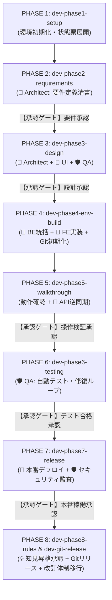

# Antigravity AI-Driven System Dev Pipeline V2 🚀

Google Antigravity のマルチエージェントオーケストレーション、カスタムスキル（Skills）、およびプラグインアーキテクチャを活用し、**新規プロジェクトの環境準備から要件定義、基本設計、環境構築、ウォークスルー、自動テスト、本番リリース、ドキュメント改訂管理に至る全開発ライフサイクルを自律的に統制・自動化する開発基盤テンプレート**です。

---

## 📌 概要

V1.0では「単一エージェントによるスキル実行」を前提としていましたが、複雑なシステム開発ではトークン消費の肥大化やコンテキストの混乱、状態ファイルの破損といった課題が生じていました。

**Version 2.0 (V2.0)** ではアーキテクチャを全面刷新し、**「1名の司令塔（Conductor）＋ 3名の専門サブエージェント（Architect, UI Designer, QA Engineer）」** による専門分業体制を確立しました。
さらに、プロジェクトの進行状況を一元管理する **`PROJECT_STATE.md` (Single Writer原則)**、二重防御ガードレール、そして開発中のエラーや落とし穴をテンプレートへ還元する **知見蓄積（Lessons Learned & ナレッジ昇格）サイクル** を標準装備しています。

---

## ✨ V2.0 の主な特徴

1. **マルチエージェント協調オーケストレーション**
   - 👑 **Conductor (司令塔 / メイン)** が全体進行・BE実装統括・状態管理を担い、📐 **Architect (設計立案)**、🎨 **UI Designer (画面・FE)**、🛡️ **QA Engineer (品質・監査)** にタスクを委譲。コンテキスト消費を隔離・局所化し、長大なライフサイクルでも精度を維持。
2. **プロジェクト状態の一元管理機構 (`PROJECT_STATE.md`)**
   - プロジェクトルート直下の `PROJECT_STATE.md` で全フェーズ・改訂ターン・未決事項（Open Questions）・Git/コンテナ状態を可視化。**Single Writer 原則（コンダクター専任書き込み）** により状態競合・破損を防止。
3. **明示的承認ゲート（Explicit Approval Gates）の義務化**
   - 要件定義、基本設計、ウォークスルー、テスト完了、本番リリースの各マイルストーンで、エージェントは必ず要約サマリを提示し、ユーザーの明示的な承認指示を受けてから次工程へ遷移。
4. **二重防御ガードレールによる安全運用**
   - 各サブエージェントの権限を最適化（`architect` の `run_command` 完全禁止、`ui-designer` のビルド系限定、`qa-engineer` のアプリケーションコード直接改変禁止、全サブエージェントの状態ファイル直接編集禁止）。
5. **知見蓄積・ナレッジフィードバックの二層分離 (Two-Tier Separation)**
   - 開発中の失敗や落とし穴（Lessons Learned）を標準完了サマリで吸い上げ、プロジェクト固有（Tier 1）と全体共通（Tier 2: `./TEMPLATE_PROMOTIONS.md`）に仕分け。PHASE 8 および改訂完了時のユーザー昇格レビューを経てテンプレート（`.agents/plugins/system-dev-pipeline/`）へ安全に自己進化・反映。
6. **動的登録フォールバック（Dynamic Fallback）機構**
   - ランタイムでサブエージェントが未認識の場合でも、コンダクターが自律的にエージェント定義 Markdown（Frontmatter）を読み取って `define_subagent` を実行し、パイプラインを停止させずに継続。

---

## 👥 エージェント体制と役割分担

```
                    ┌────────────────────────────────────────┐
                    │               👤 ユーザー              │
                    │      (要求提示 / ゲート承認 / 操作検証) │
                    └──────────────────┬─────────────────────┘
                                       │ 対話 / 指示 / 明示的承認
                                       ▼
                    ┌────────────────────────────────────────┐
                    │ 👑 1. プロジェクトコンダクター (Main)    │
                    │      (全体進行 / BE統括 / 状態一元管理) │
                    │      [Model: pro / Workspace: inherit] │
                    └──────────────────┬─────────────────────┘
                                       │ 委譲 (invoke_subagent)
         ┌─────────────────────────────┼─────────────────────────────┐
         ▼                             ▼                             ▼
┌──────────────────────────┐  ┌──────────────────────────┐  ┌──────────────────────────┐
│ 📐 2. 設計・立案          │  │ 🎨 3. UI/UX              │  │ 🛡️ 4. 品質・テスト       │
│    スペシャリスト        │  │    デザイナー / FE       │  │    & QA (監査・検証)     │
│ (architect)              │  │ (ui-designer)            │  │ (qa-engineer)            │
│ [Model: pro]             │  │ [Model: flash / pro]     │  │ [Model: pro]             │
│ [Workspace: inherit]     │  │ [Workspace: inherit]     │  │ [Workspace: inherit]     │
│ ※ run_command 禁止      │  │ ※ UIビルド/npm限定      │  │ ※ コード直接改変禁止    │
└────────────┬─────────────┘  └────────────┬─────────────┘  └────────────┬─────────────┘
             │                             │                             │
             └─────────────────────────────┼─────────────────────────────┘
                                           ▼ 成果物反映
                               ┌──────────────────────────┐
                               │ ⚙️ 決定論的ツール / スキル │
                               │ ・Git管理 (dev-git-*)    │
                               │ ・デプロイ (dev-db-*)    │
                               └──────────────────────────┘
```

| ロール | 種別 / 推奨モデル | 主な担当スコープ | 権限・ガードレール |
| :--- | :--- | :--- | :--- |
| 👑 **Conductor** | メイン / `pro` | 全体統括、対話窓口、`PROJECT_STATE.md` 更新、BE/Docker統括、Git・デプロイ実行 | 全ツール利用可能（Single Writer専任） |
| 📐 **Architect** | サブ / `pro` | 要件定義書、基本設計3書（技術/スキーマ/ロジック）、API同期、改訂設計 | `enable_write_tools: true`（**`run_command` は厳格禁止**） |
| 🎨 **UI Designer** | サブ / `flash` or `pro` | 画面仕様書、モダンフロントエンド画面・コンポーネント実装、UI微調整 | パッケージ導入・UIローカルビルドのみ許可 |
| 🛡️ **QA Engineer** | サブ / `pro` | ドキュメント相互監査（`dev-doc-reviewer`）、シナリオテスト計画・実行・修復 | テスト実行のみ許可（**プログラムコード本体改変は禁止**） |

---

## 📂 ディレクトリ構成

```text
.
├── .agents/
│   └── plugins/
│       └── system-dev-pipeline/         # 開発自動化プラグイン本体 (v1.1.0)
│           ├── plugin.json              # プラグインマニフェスト（agents 登録済み）
│           ├── agents/                  # 👥 サブエージェント定義
│           │   ├── architect.md         # 📐 設計・立案スペシャリスト定義
│           │   ├── ui-designer.md       # 🎨 UI/UXデザイナー定義
│           │   └── qa-engineer.md       # 🛡️ 品質・テスト & QA定義
│           ├── rules/                   # 📜 開発プロセス標準規約
│           │   └── dev-process-standards.md
│           ├── skills/                  # ⚙️ フェーズ別カスタムスキル群（12種）
│           │   ├── dev-phase1-setup/
│           │   ├── dev-phase2-requirements/
│           │   ├── dev-phase3-design/
│           │   ├── dev-phase4-env-build/
│           │   ├── dev-phase5-walkthrough/
│           │   ├── dev-phase6-testing/
│           │   ├── dev-phase7-release/
│           │   ├── dev-phase8-rules/
│           │   ├── dev-git-init/
│           │   ├── dev-git-release/
│           │   ├── dev-db-overwrite/
│           │   └── dev-doc-reviewer/
│           └── templates/               # 📄 標準ドキュメント・設定ファイル雛形
│               ├── .env.template
│               ├── code-workspace.template
│               ├── PROJECT_STATE.md.template       # [新設] 進行状態管理票雛形
│               ├── TEMPLATE_PROMOTIONS.md.template # [新設] 知見昇格候補一時バッファ雛形
│               ├── AI駆動システム開発フェーズ定義書.md
│               ├── AI駆動システム開発手順書V2.md
│               ├── AI駆動ロギングシステム仕様書.md
│               ├── APIキー安全管理・一元化設計書.md
│               ├── Git運用基準書.md
│               ├── システム改訂ルール.md
│               ├── シナリオテスト計画書.md
│               ├── テーブルスキーマ定義書.md
│               ├── ビジネスロジック仕様書.md
│               ├── 技術要件定義書.md
│               ├── 本番適用作業手順書.md
│               ├── 画面仕様書.md
│               └── 要件定義書.md
├── docs/                                # 仕様書・設計書アーカイブ
│   └── V2.0/                            # V2.0 設計書・運用基準書群
├── rules/                               # プロジェクト共通ルール
│   └── dev-process-standards.md
├── PROJECT_STATE.md                     # プロジェクト進行状態管理票（初期化時生成）
├── TEMPLATE_PROMOTIONS.md               # 知見昇格候補バッファ（初期化時生成）
├── template.code-workspace              # VS Code / Antigravity ワークスペース設定
└── README.md
```

---

## 🛠 スキル（Skills）一覧

| フェーズ / 用途 | スキル名 | 主担当 | 概要・実行内容 |
| :--- | :--- | :--- | :--- |
| **PHASE 1** | `dev-phase1-setup` | 👑 Conductor | ディレクトリ構造、`.env`、`PROJECT_STATE.md`、`TEMPLATE_PROMOTIONS.md`、設計雛形展開。 |
| **PHASE 2** | `dev-phase2-requirements` | 📐 Architect | `docs/要件定義書.md` を精査し、機能・非機能要件の構造化と仕様の洗練を実施。サマリを親へ返送。 |
| **PHASE 3** | `dev-phase3-design` | 📐 Architect | 3大設計書（技術/スキーマ/ロジック）を生成。（※画面仕様書は 🎨 UI Designer へ独立委譲） |
| **PHASE 4** | `dev-phase4-env-build` | 👑 Conductor<br>└ 🎨 UI Designer | Docker開発環境構築、BE実装統括、FE画面コンポーネント実装、コンテナ起動疎通検証。 |
| **PHASE 4** | `dev-git-init` | ⚙️ ツール/スキル | `Git運用基準書.md` 配置、Git初期化（`main`）、SSHリモート設定、基点コミット作成、`feature` 作成。 |
| **PHASE 5** | `dev-phase5-walkthrough` | 👑 Conductor<br>└ 📐 Architect | ウォークスルー動作確認・デバッグ統括、実装コードを正としたAPI仕様同期・ドキュメント整合。 |
| **PHASE 6** | `dev-phase6-testing` | 🛡️ QA Engineer | シナリオテスト計画書作成、自動テストコード構築、テスト反復・ログ解析・自動修復ループ。 |
| **PHASE 7** | `dev-phase7-release` | 👑 Conductor<br>└ 🛡️ QA Engineer | 本番適用作業手順書生成、本番デプロイ実行、Cloud Run / IAP / IAM セキュリティ検証。 |
| **PHASE 8** | `dev-phase8-rules` | 👑 Conductor | 知見昇格レビュー実施、運用ルール（`rules/システム改訂ルール.md`, `AGENTS.md`）適用。 |
| **PHASE 8 / 改訂** | `dev-git-release` | ⚙️ ツール/スキル | バージョン番号付与、`main` への Squash Merge、GitHub Push、`feature` ブランチ刷新。 |
| **保守** | `dev-db-overwrite` | ⚙️ ツール/スキル | 本番適用後DBのローカル同期、DBを含むコンテナの本番上書きデプロイ。 |
| **共通監査** | `dev-doc-reviewer` | 🛡️ QA Engineer | `docs/` 配下の全ドキュメント間の矛盾、誤植、説明不足を多次元クロスチェックし自動修復。 |

---

## 🚦 開発パイプラインの実行フロー (PHASE 1〜8)

新規プロジェクトでシステム開発を開始する場合、Antigravity上で以下のプロンプトを順に投入します。



### 1. プロジェクト初期化（PHASE 1）
```text
dev-phase1-setup スキルを実行し、本プロジェクトの環境初期化を行ってください。
```
- ディレクトリ、`.env`、`PROJECT_STATE.md`、`TEMPLATE_PROMOTIONS.md`、設計雛形が展開されます。

### 2. 要件定義の確定（PHASE 2）
`docs/要件定義書.md` に背景や要求のメモを記述した上で実行：
```text
dev-phase2-requirements スキルを実行し、docs/要件定義書.md を精査して要件定義書の清書と詳細化を行ってください。
```
- 📐 `architect` が精査を行い、コンダクター経由でサマリを提示。
- **【承認ゲート】「要件定義書の内容を承認します」** とプロンプト入力して次へ。

### 3. 基本設計書作成＆クロスレビュー（PHASE 3）
```text
dev-phase3-design スキルを実行し、基本設計書を作成した上でドキュメント相互の整合性チェックを行ってください。
```
- 📐 `architect` が技術/スキーマ/ロジックを作成、🎨 `ui-designer` が画面仕様を作成、🛡️ `qa-engineer` が多次元相互監査・修復を実行。
- **【承認ゲート】「基本設計書の内容を承認します」** とプロンプト入力して次へ。

### 4. 環境構築・BE/FE並行実装・Git管理開始（PHASE 4）
```text
dev-phase4-env-build スキルを実行し、docs/配下の設計ドキュメントに基づいて開発環境構築とシステム実装を行ってください。
```
- 👑 コンダクターがBE/Dockerを構築、🎨 `ui-designer` がFE画面を実装、`dev-git-init` でGitリポジトリを初期化。

### 5. ウォークスルー＆ドキュメント再同期（PHASE 5）
```text
dev-phase5-walkthrough スキルを実行し、ウォークスルーによる動作確認とドキュメントの同期を行ってください。
```
- 実際の画面操作を行い、不具合修正統括および最新コードを正としたAPI仕様同期を実施。
- **【承認ゲート】「ウォークスルー動作確認を承認します」** とプロンプト入力して次へ。

### 6. シナリオテスト＆自動修復（PHASE 6）
```text
dev-phase6-testing スキルを実行し、シナリオテスト環境の構築とテスト自動反復ループを開始してください。
```
- 🛡️ `qa-engineer` がテストスクリプトを構築し、全テスト合格まで自律修復ループを実行。
- **【承認ゲート】「テスト完了・リリース準備移行を承認します」** とプロンプト入力して次へ。

### 7. 本番リリース＆セキュリティ検証（PHASE 7）
```text
dev-phase7-release スキルを実行し、本番適用作業手順書の作成とリリース検証を行ってください。
```
- 👑 コンダクターが手順書作成・本番デプロイを実行し、🛡️ `qa-engineer` がIAM/IAPセキュリティを検証。
- **【承認ゲート】「本番稼働確認を承認します」** とプロンプト入力して次へ。

### 8. 知見昇格レビュー・Gitリリース・改訂運用移行（PHASE 8）
```text
dev-phase8-rules スキルを実行し、知見昇格レビューとドキュメント改訂運用ルールを適用してください。
```
- `./TEMPLATE_PROMOTIONS.md` の汎用知見レビューを承認後、`dev-git-release` により `Release v1.0.0` を本番反映し、運用ルールを適用。

---

## 🛡️ 安全運用ガイドライン（Guards & Rules）

1. **二重防御ガードレール (Double-Defense Guardrail)**
   - プロンプトとツールの両面で制限をかけ、`architect` によるコマンド誤実行や `qa-engineer` による本体コード誤改変を確実に防止。
2. **修正後のDockerコンテナ再構成徹底ルール**
   - PHASE 4 以降、コードや設定ファイルを変更した際は、確実に変更を反映させるため **`docker compose down` および `docker compose up --build -d`** を徹底。
3. **自律修復ループ上限**
   - 自律修復（ドキュメント、テストコード、環境設定）は **最大5回まで**。5回で解消しない場合は直ちに停止しログをレポート。
4. **セキュリティと認証**
   - APIキーや秘密情報はコードに含めず `.env` で管理。Cloud Run / IAP / IAM のアクセス制御を自動検証。

---

## 📦 セットアップ・導入方法

### 方法 A: 新規プロジェクトのテンプレートとして使用する（ワークスペース単位）
本リポジトリをクローンまたはフォークし、そのままプロジェクトの起点として利用します。`.agents/` ディレクトリが存在するため、Antigravityを開くだけでプラグイン、エージェント定義、スキルが即座に利用可能になります。

### 方法 B: グローバルプラグインとして全プロジェクトで共有する
他のプロジェクトでも本スキル・エージェント群を共通利用したい場合は、Antigravityのグローバルプラグインディレクトリへ配置します。

```bash
mkdir -p ~/.gemini/config/plugins/
cp -r .agents/plugins/system-dev-pipeline ~/.gemini/config/plugins/
```

---

## 📄 ライセンス

MIT License
