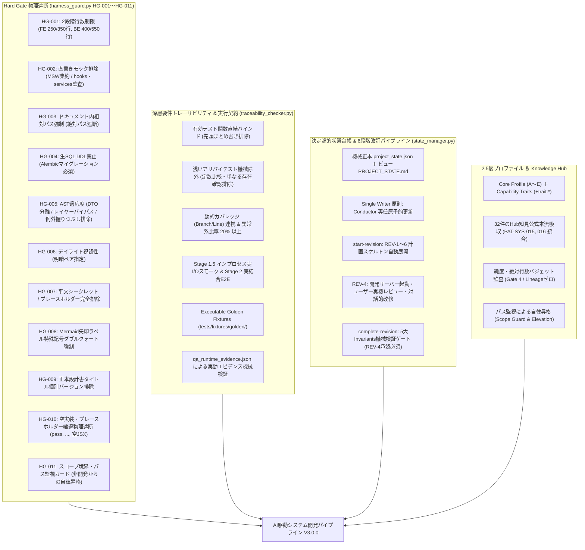
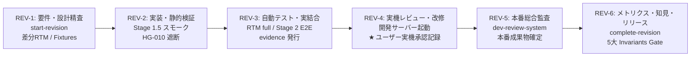

# Antigravity AI-Driven System Dev Pipeline V3.0.0 🚀

Google Antigravity のマルチエージェントオーケストレーション、カスタムスキル（Skills）、およびプラグインアーキテクチャを活用し、**新規プロジェクトの環境準備から要件定義、基本設計、環境構築、感覚センサーウォークスルー、自動テスト、本番リリース、そしてマルチプロジェクト・マルチ環境を跨ぐ自己進化・改訂運用に至る全開発ライフサイクルを自律的に統制・自動化する開発基盤テンプレート**です。

---

## 📌 概要

V1.0（単一エージェント）、V2.0（Conductor ＋ 3エージェント分業）、V2.1（5大エージェント協調、3大レビューゲート、WikiSkill自己進化ループ、定量測定機構）、V2.2（Shift-Left 静的スケルトン基盤、2層構造プロファイル体系 Profile A〜E、画面グランドデザイン、MSWモック制御）、V2.3（Central Knowledge Hub、3段階意味的整合性監査、Immutable Core / Local Overlay 二層プラグイン機構）、V2.4（SemVer 2.0.0 完全準拠、DTO/パーサー物理分離・デイライトUI等の知見統合）、V2.5（Hub蓄積知見本流統合、定量測定エンジン4モジュール分割）、V2.6（次世代AIハーネス強化: Hard Gate 物理遮断・RTMトレーサビリティ・ブラウザ感覚センサー・決定論的状態台帳）を経て、**Version 3.0.0 (V3.0.0)** では「見せかけの合格（Green Illusion）」の根絶と人間中心の実機品質保証を実現する **「軽量・実行契約駆動パイプライン（Executable Contract-Driven Pipeline）」** を全面導入しました：

1. **実行契約駆動（Dual-Stage Testing Gate ＆ Stage 1.5 スモークテスト）**:
   単なるモックのパスに甘んじる「見せかけの合格」を排除するため、MSWモック（Stage 1）➔ FastAPI `TestClient` 等によるインプロセス実I/O・物理ファイル生成スモーク（Stage 1.5）➔ モックOFF実サーバー結合E2E（Stage 2）の多段階実行契約ゲートを確立。期待入出力は **Executable Golden Fixtures (`tests/fixtures/golden/`)** に実体化し、**`metrics/qa_runtime_evidence.json`** による実動エビデンスを機械検証。
2. **2.5層プロファイル体系（Core Profile A〜E ＋ Capability Traits `+trait:*`）**:
   48通りの組み合わせ爆発を招く直交合成を避け、実証済みの Core Profile（Profile A〜E）を維持した上で、複合アプリ固有の物理検証要件を Capability Trait（`+trait:local-api`, `+trait:media-export`, `+trait:frame-render`, `+trait:external-cli`, `+trait:dual-mode-workspace`）として柔軟に追加バインド。
3. **AIハーネス V3 ＆ 弾力的行数ガード（HG-001 緩衝帯 ＆ HG-010 空実装遮断）**:
   行数超過を恐れて業務ロジックを削ぎ落とすAIの縮退実装インセンティブを断つため、行数制限を2段階緩衝帯（FE 250 WARN / 350 BLOCK、BE 400 WARN / 550 BLOCK）へ移行。さらに、中身が `pass`、`...`、`raise NotImplementedError` のみの空実装やダミーコメント返却、空JSXハンドラを決定論的に物理遮断する **HG-010** を配備。
4. **深層要件トレーサビリティ V3 (`traceability_checker.py`)**:
   ファイル先頭へのまとめ書きや浅いアリバイテスト（定数比較、単なる要素存在確認のみ）を機械除外。AST解析により **「有効テスト関数直結バインド」** を実現し、動的カバレッジ（Branch/Line Coverage）連携および異常系比率20%以上を機械的に保証。
5. **6段階標準改訂パイプライン（`REV-1`〜`REV-6` ＆ 5大 Invariants Gate）**:
   改訂プロセスにおいて欠落しがちだった「ユーザーによる実機テストレビューと対話的改修」を公式フェーズ **`REV-4`** として独立新設。改訂クローズ時には、**5大 Invariants Gate**（成果物実在、メトリクス算出、未処理知見ゼロ、**REV-4 ユーザー承認記録**、**qa_runtime_evidence 検証済**）により未達時の完了を機械遮断。
6. **パス監視によるスコープ境界自律昇格（Scope Guard & Elevation）**:
   PKM Vault やコンテンツ制作環境などの非開発モード適用時であっても、システム本体コード領域への編集操作を検知した瞬間に自律昇格（Elevation）し、システム改訂パイプラインおよび Hard Gate を即時強制適用。
7. **Central Knowledge Hub 蓄積知見公式統合（計32件本流吸収 ＆ Overlay クリーンリセット）**:
   実稼働プロジェクトから投函された知見（動的レンダリング O(1) キャッシュ規約 `PAT-SYS-015`、パス監視自律昇格 `PAT-SYS-016`）を Immutable Core へ完全昇格。累計 32 件の知見を本流化し、`LOCAL_FEEDBACK_RULES.md` をクリーンリセット。
8. **正本設計書タイトルの SemVer 一元化**:
   正本設計書タイトルから個別バージョン番号サフィックス（`V2.6` 等）を排除し、システム全体の `APP_VERSION`（SemVer）で決定論的に一元管理。

---

## ✨ V3.0.0 の主な新機能と進化ポイント



---

## 👥 エージェント体制と役割分担 (5大エージェント協調モデル V3.0.0)

```
                    ┌────────────────────────────────────────┐
                    │               👤 ユーザー              │
                    │  (要求提示 / 承認ゲート決裁 / 実機検証)│
                    └──────────────────┬─────────────────────┘
                                       │ 対話 / 指示 / 承認
                                       ▼
                    ┌────────────────────────────────────────┐
                    │ 👑 1. プロジェクトコンダクター (Main)    │
                    │      (全体進行 / Single Writer /       │
                    │       標準コマンド統括 / Git・デプロイ │
                    │       REV-4 実機レビュー・改修オーケスト)│
                    │      [Model: pro / Workspace: main]    │
                    │      ※ コード・設計書直接編集原則禁止 │
                    └──────────────────┬─────────────────────┘
                                       │ 委譲 (invoke_subagent)
         ┌───────────────┬─────────────┴─────────────┬───────────────┐
         ▼               ▼                           ▼               ▼
┌─────────────────┐ ┌─────────────────┐ ┌─────────────────┐ ┌─────────────────┐
│ 📐 2. 設計立案   │ │ 💻 3. BE実装     │ │ 🎨 4. FE/UI     │ │ 🛡️ 5. 品質監査  │
│    スペシャリスト│ │    スペシャリスト│ │    デザイナー     │ │  & Semantic監査 │
│ (architect)     │ │ (backend-       │ │ (ui-designer)   │ │ (qa-engineer)   │
│                 │ │  engineer)      │ │                 │ │                 │
│ [Model: pro]    │ │ [Model: pro]    │ │ [Model: flash]  │ │ [Model: pro]    │
│ ※ run_command   │ │ ※ コンテナ起動・│ │ ※ UIビルド・   │ │ ※ コード・Core  │
│   完全禁止      │ │   Git操作禁止   │ │   npm限定       │ │   直接改変禁止  │
│                 │ │                 │ │ [MCP Tools 有効]│ │ [MCP Tools 有効]│
└────────┬────────┘ └────────┬────────┘ └────────┬────────┘ └────────┬────────┘
         │                   │                   │                   │
         └───────────────────┴─────────┬─────────┴───────────────────┘
                                       ▼
                         ┌──────────────────────────┐
                         │ ⚙️ 決定論的ツール / スキル │
                         │ ・state_manager.py       │
                         │ ・harness_guard.py       │
                         │ ・traceability_checker.py│
                         │ ・pipeline-reconciler.sh │
                         │ ・reconciler_core.py     │
                         │ ・dev-metrics-collector  │
                         │ ・Git管理 (dev-git-*)    │
                         │ ・デプロイ (dev-db-*)    │
                         └──────────────────────────┘
```

| ロール | 種別 / 推奨モデル | 主な担当スコープ (V3.0.0) | 権限・ガードレール (`CORE_INVARIANTS.md`) |
| :--- | :--- | :--- | :--- |
| 👑 **Conductor** | メイン / `pro` | 全体進行管理、`state_manager.py` による状態台帳一元更新（**Single Writer 原則**）、スケルトン展開、標準コマンドシーケンス自動実行、Git・デプロイ専任実行、**`REV-4` 実機レビュー要請・改修統括・承認記録**、PHASE 8 / REV-6 知見・メトリクス統括 | 全ツール利用可能（**コード・設計書直接編集原則禁止、非対話CLIフラグ強制・`schedule` タイマー保護: `INV-06`**） |
| 📐 **Architect** | サブ / `pro` | 2.5層プロファイル体系設計（Core Profile A〜E ＋ Capability Traits 選定）、要件定義書での `[REQ-Fxx]` / `[REQ-NFxx]` 採番、4大基本設計書作成、**Executable Golden Fixtures (`tests/fixtures/golden/`) 設計**、外部API二重キャッシュ仕様設計 | `enable_write_tools: true`（**`run_command` は厳格禁止: `INV-02`**） |
| 💻 **Backend Engineer** | サブ / `pro` | バックエンドAPI、SQLAlchemyモデル（2段階行数制限: 400 WARN / 550 BLOCK）、**空実装・縮退実装排除（`HG-010`）**、AST適応度遵守（DTO分離・レイヤーバイパス禁止）、Alembicマイグレーション、**Stage 1.5 インプロセス実I/Oスモークテスト実装**、IAP JWT署名二重検証ミドルウェア | 単体テスト・構文検証のみ許可（**生SQL禁止: `INV-05`、Git/デプロイ/DB上書き/コンテナ起動停止は禁止: `INV-02`**） |
| 🎨 **UI Designer** | サブ / `flash` または `pro` | 画面仕様書（グランドデザイン新規格準拠）、モダンフロントエンド画面実装（2段階行数制限: 250 WARN / 350 BLOCK）、**空イベントハンドラ排除（`HG-010`）**、**Contract-First MSW（OpenAPI生成型拘束）**、**動的レンダリング O(1) インメモリキャッシュ配備** | `enable_mcp_tools: true`、UIビルド・パッケージ導入のみ許可（**Git/デプロイ/DB操作禁止: `INV-02`**） |
| 🛡️ **QA Engineer** | サブ / `pro` | ドキュメント多次元整合性監査（`dev-doc-reviewer`）、**3大レビューゲート監査（基本設計: RTM design PASS / コード品質: harness_guard PASS ＆ 空実装排除 / システム総合: RTM full PASS ＆ 本番モックOFF）**、**Active QA プロトコル（実動テスト永続化 ＆ `qa_runtime_evidence.json` 発行・検証）**、ブラウザ感覚センサー検証、障害RCA記録（`wiki-maintainer`） | `enable_mcp_tools: true`、テスト・静的解析・バジェット監査のみ許可（**アプリ本体コードおよび Immutable Core 直接改変禁止: `INV-02`/`INV-09`**） |

---

## 🏗️ 2.5層構造システムプロファイル体系 ＆ Capability Traits

| レイヤ | 名称 | 概要・対象 |
| :--- | :--- | :--- |
| **第1層** | **定常的コア設計規範**<br>(Universal Core Specifications) | **全システム・全プロファイル共通の普遍的標準規約（非機能要件 `[REQ-NF01]`〜`[REQ-NF09]` 自動バインド）**<br>1. `[REQ-NF01]` 責務分離構造 ＆ Hard Gate 物理遮断 (FE 250/350行, BE 400/550行, 空実装遮断)<br>2. `[REQ-NF02]` 要件トレーサビリティ ＆ 有効テスト関数直結バインド (カバレッジ100%, 異常系20%以上, アリバイ排除)<br>3. `[REQ-NF03]` ブラウザ感覚センサー検証 (Consoleエラー0件, WCAG AA, A11yツリー)<br>4. `[REQ-NF04]` 型定義自動同期パイプライン (OpenAPI ➔ TS Codegen)<br>5. `[REQ-NF05]` シークレット厳格バリデーション ＆ Dual Provisioning (.env.example自動補完)<br>6. `[REQ-NF06]` 統一タイムゾーン運用 (Aware UTC 保存 / JST 表示)<br>7. `[REQ-NF07]` Dual-Stage Testing Gate (MSW ➔ Stage 1.5 実I/Oスモーク ➔ Stage 2 実結合E2E)<br>8. `[REQ-NF08]` 画面グランドデザイン規範 ＆ 動的レンダリング O(1) キャッシュ<br>9. `[REQ-NF09]` CI・静的解析・テスト実行ディレクトリ非依存 |
| **第2層** | **システム展開プロファイル**<br>(Core Profiles) | **要件・規模・実行環境に応じたアーキテクチャスタック（非機能要件 `[REQ-NF10]`〜`[REQ-NF13]`）**<br>・**Profile A (ゴールデンパス)**: サーバーレス極小コストWeb型 (Cloud Run `max-instances=1` + Litestream + SQLite WAL + Alembic + IAP JWT 二重防御 + React SPA + MSW)<br>・**Profile B**: Web SSR / フルマネージドRDB型 (FastAPI/Next.js + Cloud SQL + Alembic)<br>・**Profile C**: 静的MPA / 超軽量ツール型 (FastAPI + Jinja2 + HTMX / 単一バイナリCLI)<br>・**Profile D**: PCローカルデスクトップアプリ型 (Tauri v2 + Local SQLite WAL + Frameless TitleBar + 二段階ハイブリッド運用)<br>・**Profile E**: AI Agent Skill / PKM 自動化・CLI型 (Zero-Dependency Python 3 + アトミックI/O + 2系統分離設計) |
| **第2.5層** | **Capability Traits**<br>(機能トレイト `+trait:*`) | **複合構成固有の追加物理検証ガード（Gate / Evidence 要件）**<br>・**`+trait:local-api`**: ローカルAPIサーバー同梱（Stage 1.5 実疎通 ＆ Stage 2 実ポート結合E2E必須）<br>・**`+trait:media-export`**: 構造化ファイル・メディア出力（Golden Fixture 配置 ＆ 出力実在・パーサー構造一致検証必須）<br>・**`+trait:frame-render`**: フレーム駆動アニメーション・動的SVG連続描画（描画状態キー O(1) キャッシュ必須: `PAT-SYS-015`）<br>・**`+trait:external-cli`**: 外部プロセス呼出（非対話フラグ・タイムアウト保護・Graceful Degradation必須）<br>・**`+trait:dual-mode-workspace`**: システム開発とコンテンツ制作同居（操作パス監視・Scope Guard自律昇格必須: `PAT-SYS-016`） |

---

## 📂 ディレクトリ構成

### 1. ワークスペースおよびプラグイン領域
```text
.
├── .agents/
│   ├── skills/
│   │   └── template-pipeline-sync/      # 🔄 テンプレート改訂専用 Global⇔Workspace 同期スキル
│   └── plugins/
│       └── system-dev-pipeline/         # 🔒 開発自動化プラグイン正本 (Immutable Core v3.0.0)
│           ├── plugin.json              # プラグインマニフェスト（version: 3.0.0）
│           ├── PIPELINE_MANIFEST.json   # 📜 バージョン・公式吸収済みパターンID（計32件）の機械可読正本
│           ├── FEEDBACK_LEDGER.md       # 📖 人間監査用の知見適合履歴・系譜台帳 (V2.3〜V3.0.0 完全記載)
│           ├── scripts/
│           │   ├── harness_guard.py       # 🛡️ AIハーネス Hard Gate 静的物理遮断エンジン (HG-001〜HG-011)
│           │   ├── state_manager.py       # 📊 決定論的状態台帳管理エンジン (start/complete-revision 5大Gate)
│           │   ├── traceability_checker.py # 📋 要件トレーサビリティ検証エンジン (テスト関数直結RTM)
│           │   ├── pipeline-reconciler.sh # ⚙️ 軽量シェルディスパッチャ (--audit-budget / --upgrade)
│           │   └── reconciler_core.py     # ⚙️ Hub管理・Overlay再生成・Upgrade Reconciler コア
│           ├── agents/                  # 👥 エージェント定義（conductor, architect, backend, ui, qa）
│           ├── rules/                   # 📜 開発プロセス標準規約 (AGENTS.md) & コア不変原則 (CORE_INVARIANTS.md)
│           ├── skeletons/               # 🧱 プロファイル別初期コードスケルトン (common, profile-a, profile-d)
│           │   ├── common/.githooks/pre-commit # 🛡️ Hard Gate pre-commit フック
│           │   ├── common/scripts/        # ⚙️ スケルトン同梱スクリプト (harness_guard, state_manager, etc.)
│           │   ├── common/.github/workflows/ci.yml # CI パイプライン (revision対応 / HGステップ)
│           │   ├── profile-a/backend/tests/conftest.py # WAL一時実ファイルDB動的プロビジョニング (UUID分離)
│           │   └── profile-a/docker/entrypoint.sh # 正規 Litestream スーパーバイザー起動シーケンス
│           ├── skills/                  # ⚙️ カスタムスキル群（全19種）
│           │   └── dev-metrics-collector/scripts/ # 📊 定量測定エンジン (4モジュール構成)
│           └── templates/               # 📄 V3.0.0 標準ドキュメント・設定ファイル雛形
│               ├── .env.template
│               ├── rules_AGENTS.md.template # 🛡️ プロジェクト固有規約専用テンプレート (役割分離)
│               ├── Git運用基準書.md
│               ├── システム改訂運用基準書.md # 🔄 REV-1〜6 標準改訂パイプライン規約 (REV-4実機レビュー)
│               ├── 技術要件定義書.md
│               ├── テーブルスキーマ定義書.md
│               ├── ビジネスロジック仕様書.md
│               ├── 画面仕様書.md
│               ├── 要件定義書.md
│               ├── シナリオテスト計画書.md
│               ├── 本番適用作業手順書.md
│               ├── project_state.schema.json
│               └── レビュー結果報告書雛形3種 (*.template)
├── doc_samples/                         # 📚 V3.0.0 最新規格模範ドキュメントサンプル群 (全10文書)
│   ├── AI駆動システム開発フェーズ定義書.md
│   ├── AI駆動ロギングシステム仕様書.md
│   ├── APIキー安全管理・一元化設計書.md
│   ├── 要件定義書.md
│   ├── 技術要件定義書.md
│   ├── テーブルスキーマ定義書.md
│   ├── ビジネスロジック仕様書.md
│   ├── 画面仕様書.md
│   ├── シナリオテスト計画書.md
│   └── 本番適用作業手順書.md
├── docs/                                # 仕様書・設計書・レポート
│   ├── 設計書/
│   │   ├── Current/                     # ★現在の正本（Single Source of Truth: V3.0.0 正本設計書）
│   │   └── v2.6/ v2.5/ v2.4/ v2.3/ ...  # 過去バージョン設計書アーカイブ
│   ├── 検討課題/                        # バージョン別検討課題・評価レポート群 (v3.0.0改訂計画等)
│   └── plans/                           # RTM、テスト計画、レビュー報告書等の動的成果物
├── metrics/                             # 📊 定量測定成果物集約ディレクトリ
├── rules/
│   └── AGENTS.md                        # ワークスペースローカル開発・改訂規約
└── README.md
```

### 2. PC環境共通 ナレッジハブ領域（`~/.gemini/knowledge-hub/`）
```text
~/.gemini/knowledge-hub/
├── inbox/                               # 📥 全案件から投函された未処理の標準化知見原票 (CLAIM-*.md)
├── pending_approval/                    # 🗂️ バックグラウンド監査時の承認待ちステージング
├── overlay/                             # 🧩 Immutable Core を一切汚さず次案件から即時有効化される拡張層
│   └── LOCAL_FEEDBACK_RULES.md          # active_claims からクリーン再生成される追加規約 (上限 80行)
├── active_claims/                       # 現在 overlay/ に反映されている有効原票の実体保管庫
├── archive/                             # 📦 過去原票アーカイブ
│   ├── upstreamed/                      # 新Ver Upgrade Reconciler で Core 吸収済みと判定され退役した原票 (計31件)
│   └── consolidated/                    # クラスタリング・重複統合により退役した原票
├── suspended/                           # ⏸️ 一時保留された原票
├── rejected/                            # 🚫 意味的監査で棄却された原票の永続記録
└── LOCAL_HUB_STATE.json                 # ベースCoreバージョンと適用中Claim IDの状態マニフェスト
```

---

## 🛠 全19スキル（Skills）一覧

| フェーズ / 用途 | スキル名 | 主担当 | 概要・実行内容 (V3.0.0仕様) |
| :--- | :--- | :--- | :--- |
| **PHASE 1** | `dev-phase1-setup` | 👑 Conductor | **Knowledge Hub 検知**、静的スケルトン基盤展開、`rules_AGENTS.md.template` 配備、`.env`、`state_manager.py init` による台帳決定論的初期化。 |
| **PHASE 2** | `dev-phase2-requirements` | 📐 Architect | 要件定義書策定、**2.5層プロファイル選定（Core Profile A〜E ＋ Capability Traits）**、`[REQ-Fxx]` / サブ要件ID `[REQ-Fxx-yy]` / 定常コア `[REQ-NF01]`〜`[REQ-NF09]` 自動バインド。 |
| **PHASE 3** | `dev-phase3-design` | 📐 Architect<br>└ 🎨 UI | **4大基本設計書**策定（要件ID紐付け）。**Executable Golden Fixtures 設計**、グランドデザイン新規格準拠、Alembic前提、二重キャッシュ、動的レンダリング O(1) キャッシュ。 |
| **PHASE 3 ゲート** | `dev-review-arch` | 🛡️ QA | **基本設計レビュー**。`traceability_checker.py --mode design` PASS必須、定常コア9項目および展開プロファイル・Trait適合監査。 |
| **PHASE 4** | `dev-phase4-env-build` | 👑 Conductor<br>├ 💻 BE<br>└ 🎨 UI | 静的スケルトンを土台にDocker環境構築、💻 BE ＋ 🎨 UI 並行実装、**2段階行数制限（250/350行, 400/550行）**、**空実装遮断（`HG-010`）**、**Stage 1.5 スモークテスト**、標準コマンドシーケンス自動実行、Git初期化。 |
| **PHASE 4** | `dev-git-init` | ⚙️ Conductor | `Git運用基準書.md` 配置、`.gitignore` 設定、**Hard Gate pre-commit フック有効化**、Git初期化（`main`）、`feature` ブランチ作成。 |
| **PHASE 5** | `dev-phase5-walkthrough` | 👑 Conductor<br>└ 🛡️ QA | 画面ウォークスルー動作確認統括、**Chrome DevTools MCP によるブラウザ感覚センサー自動検証**、モック切替検証 (Fail-Fast原則)、API仕様書同期。 |
| **PHASE 5.5 ゲート**| `dev-review-code` | 🛡️ QA | **コード品質・整合性レビュー**。`harness_guard.py --all` PASS必須（2段階行数制限、直書きモック排除、空実装・縮退実装排除 `HG-010`、AST適応度、デイライト視認性、型同期、平文排除）。 |
| **PHASE 6** | `dev-phase6-testing` | 🛡️ QA | シナリオテスト計画書作成、**Active QA プロトコル**、**`traceability_checker.py --mode full` PASS必須（有効テスト関数直結RTM、浅いアリバイ排除、動的カバレッジ連携、異常系比率20%以上、Stage 2 実結合E2E検証、`qa_runtime_evidence.json` 検証）**、自動修復ループ（最大5回）。 |
| **PHASE 6 / RCA** | `wiki-maintainer` | 🛡️ QA | **障害時RCA即時記録**。テスト失敗・手戻り発生時に根本原因を分析しカレントプロジェクト配下の `./wiki/patterns/` へ即時記録。 |
| **PHASE 7 ゲート** | `dev-review-system` | 🛡️ QA | **システム総合レビュー**。**本番モックOFF二重防御 & Fail-Fast 監査**、**IAP JWT署名検証有効化**、**Alembic起動保証**、平文排除（`RELEASE APPROVED` 必須）。 |
| **PHASE 7** | `dev-phase7-release` | 👑 Conductor | システム総合レビュー合格確認、本番適用作業手順書作成、**非対話CLIガードレール（`--quiet` 強制・`schedule` タイマー監視）** による安全デプロイ。 |
| **PHASE 8** | `dev-phase8-rules` | 👑 Conductor<br>└ 🛡️ QA | メトリクス集計、`docs/システム改訂運用基準書.md` への移行確認、**知見原票投函 ➔ 3段階意味的監査 ➔ `ask_question` 承認 ➔ Local Overlay 再生成**、Git本番リリース。 |
| **PHASE 8 / 起案** | `wiki-proposer` | 👑 Conductor | **標準化知見原票起案・投函**。Tier 2 知見から行番号非依存の `CLAIM-*.md` を生成して `~/.gemini/knowledge-hub/inbox/` へ投函。 |
| **PHASE 8 / 整理** | `wiki-compactor` | 👑 Conductor | **Wiki整理・原票クラスタリング・Overlay圧縮**。Hub `inbox/` 重複自動クリーンアップおよび `LOCAL_FEEDBACK_RULES.md` 圧縮。 |
| **定量測定** | `dev-metrics-collector` | 👑 Conductor | **定量メトリクス集計**。`--all` による一括出力、英語・日本語エイリアスキー対応、`--sync-state` による `state_manager.py` 台帳即時同期。 |
| **PHASE 8 / リリース** | `dev-git-release` | ⚙️ Conductor | 先頭サニタイズ処理、Gitタグ付与（`vMAJOR.MINOR.PATCH`）、`main` への Squash Merge、Push、次期 `feature` 切り直し。 |
| **保守** | `dev-db-overwrite` | ⚙️ Conductor | 本番適用後DBのローカル同期、DBを含むコンテナの本番上書きデプロイ（二重防御ガードレール保護）。 |
| **共通監査** | `dev-doc-reviewer` | 🛡️ QA | `docs/` 配下の要件定義・設計書間の矛盾、誤植、相対パスリンク切れを多次元クロスチェックし自動修復（除外パス保護）。 |

---

## 🚦 開発および改訂の実行フロー

### 1. 新規開発パイプライン (PHASE 1〜8)

```mermaid
flowchart TD
    P1["PHASE 1: プロジェクトの準備<br/>dev-phase1-setup<br/>(state_manager.py init)"] --> P2["PHASE 2: 要件定義<br/>dev-phase2-requirements<br/>(2.5層プロファイル選定 / [REQ-Fxx-yy])"]
    P2 -->|"★ ユーザー承認ゲート"| P3["PHASE 3: 基本設計書の作成<br/>dev-phase3-design<br/>(4大基本設計書 / Golden Fixtures)"]
    P3 --> R3["PHASE 3 ゲート: 基本設計レビュー<br/>dev-review-arch<br/>(RTM design: PASS 必須)"]
    R3 -->|"★ ユーザー承認ゲート"| P4["PHASE 4: 開発環境とシステム構築<br/>dev-phase4-env-build<br/>(Stage 1.5 スモーク / HG-010 空実装遮断)"]
    P4 --> P5["PHASE 5: ウォークスルー動作確認<br/>dev-phase5-walkthrough<br/>(ブラウザ感覚センサー検証)"]
    P5 -->|"★ ユーザー承認ゲート"| R5["PHASE 5.5 ゲート: コード品質レビュー<br/>dev-review-code<br/>(harness_guard: CLEAN 必須)"]
    R5 --> P6["PHASE 6: スルーテスト環境構築 & 自動テスト<br/>dev-phase6-testing<br/>(Active QA / Stage 2 実結合E2E / evidence検証)"]
    P6 -->|"★ ユーザー承認ゲート"| R7["PHASE 7 ゲート: システム総合レビュー<br/>dev-review-system<br/>(RELEASE APPROVED 必須)"]
    P7["PHASE 7: 本番リリース作業<br/>dev-phase7-release<br/>(非対話CLI / schedule保護)"]
    R7 -->|"★ ユーザー承認ゲート"| P7
    P7 -->|"★ ユーザー承認ゲート"| P8["PHASE 8: ルール化と自己進化<br/>dev-phase8-rules<br/>(知見投函 / Local Overlay 再生成)"]
    P8 -->|"★ ユーザー知見裁定ゲート"| ACTIVE["本番稼働 (PRODUCTION_ACTIVE)"]
```


### 2. 6段階標準改訂パイプライン (`REV-1`〜`REV-6`)
初期リリース完了後の機能追加・保守は、[docs/システム改訂運用基準書.md](./.agents/plugins/system-dev-pipeline/templates/システム改訂運用基準書.md) に規定された6段階改訂パイプラインに厳格に従います：



---

## 🛡️ コア不変原則 (Core Invariants: `INV-01` 〜 `INV-10`)

[CORE_INVARIANTS.md](./.agents/plugins/system-dev-pipeline/rules/CORE_INVARIANTS.md) により、いかなる改変や個別案件ルールであっても絶対に緩和・バイパスされない10の不変原則が定義されています。

| ID | 原則名 | 絶対不可侵の制約内容 |
| :--- | :--- | :--- |
| **`INV-01`** | **Single Writer 原則** | 状態管理台帳（`project_state.json` / `PROJECT_STATE.md`）の更新権限は 👑 `conductor` のみが保持し、`state_manager.py` 経由で原子的・決定論的に更新する。サブエージェントによる直接編集や手動改ざんはハッシュ不一致により遮断する。 |
| **`INV-02`** | **責務分離とツール実行制限** | 📐 `architect` の `run_command` 禁止、🛡️ `qa-engineer` のアプリコード直接改変禁止、👑 `conductor` のコード・設計書直接編集原則禁止、サブエージェントの Git/デプロイ/DB上書き/Docker全体起動停止の禁止。 |
| **`INV-03`** | **Anti-God Component / Module 制限** | フロントエンド 1 コンポーネントファイル（250 WARN / 350 BLOCK）、バックエンド 1 モジュールファイル（400 WARN / 550 BLOCK）の厳守（DTO分離必須）。`harness_guard.py`（HG-001）によりコミット前物理遮断。 |
| **`INV-04`** | **本番モックOFF・直書きモック禁止** | コンポーネントおよび hooks/services 内のダミーデータ直書き禁止（MSW 集約必須: HG-002）、および本番ビルド時の `VITE_ENABLE_MOCK=false` 二重防御の厳守。 |
| **`INV-05`** | **Alembic 厳格運用・生SQL禁止** | 手動 DDL（生 SQL: HG-004）によるテーブル作成・変更を禁止し、SQLAlchemy ORM と Alembic マイグレーションによる確定管理を徹底する。 |
| **`INV-06`** | **IAP JWT 検証・平文排除・非対話CLI保護** | 本番認証検証の強制、シークレット平文コミット禁止（HG-007）、外部 CLI 実行時の `--quiet` 等非対話フラグ強制・`2>/dev/null` 禁止・バックグラウンド待機時の `schedule` タイマー保護。 |
| **`INV-07`** | **3大レビューゲート & Invariants Gate 必須通過** | 基本設計（RTM design PASS）・コード品質（CLEAN）・システム総合（RELEASE APPROVED）の合格なしに次フェーズへ進行することを禁じる。改訂クローズ時は `complete-revision` 5大Invariants Gate で機械遮断。 |
| **`INV-08`** | **自律修復ループの上限保護** | テスト失敗や不整合の放置を禁じるとともに、無限ループ防止のため自律修復は最大 5 回上限を維持する。 |
| **`INV-09`** | **Context Isolation とナレッジ境界** | Tier 1（案件固有仕様）の環境共通領域への持ち出し禁止、プロンプトへの生 Wiki 履歴注入禁止、およびルール本文（State）への履歴ID（Lineage）混入禁止。純度・行数バジェットの遵守。 |
| **`INV-10`** | **ドキュメント内相対パス強制** | Markdown 設計文書・仕様書内のファイルリンクに絶対パス（`file:///` 等: HG-003）を使用することを禁止し、必ず対象ファイル間の相対パスを使用する。 |

---

## 📚 正本設計ドキュメント一覧（`docs/設計書/Current/`）

開発・適用の唯一の正（Single Source of Truth）として `docs/設計書/Current/` 配下で管理されている設計書群（全9文書）です。正本設計書タイトルからは個別バージョン番号サフィックスを排除し、システム全体の SemVer（`APP_VERSION`）で一元管理されています。

- [AI駆動システム開発フェーズ定義書.md](./docs/設計書/Current/AI駆動システム開発フェーズ定義書.md) - ライフサイクルフェーズ定義正本
- [AI駆動システム開発手順書.md](./docs/設計書/Current/AI駆動システム開発手順書.md) - ユーザー＆AI協調開発実践手順書
- [エージェント設計書.md](./docs/設計書/Current/エージェント設計書.md) - 5大エージェント協調モデル仕様書
- [レビューシステム設計書.md](./docs/設計書/Current/レビューシステム設計書.md) - 3大レビュー＆3段階意味的監査仕様書
- [状態管理機構設計書.md](./docs/設計書/Current/状態管理機構設計書.md) - 状態管理台帳・インターロック仕様書
- [定量測定・フィードバック設計書.md](./docs/設計書/Current/定量測定・フィードバック設計書.md) - 定量測定エンジン・評価指標仕様書
- [ProfileA詳細設計書.md](./docs/設計書/Current/ProfileA詳細設計書.md) - Profile A (Cloud Run + Litestream + SQLite WAL) 設計仕様書
- [ProfileD詳細設計書.md](./docs/設計書/Current/ProfileD詳細設計書.md) - Profile D (Tauri v2 + Desktop + temp_db) 設計仕様書
- [セマンティックバージョニング仕様書.md](./docs/設計書/Current/セマンティックバージョニング仕様書.md) - バージョニング統一仕様書

※過去バージョンの設計文書は `docs/設計書/v2.6/`, `docs/設計書/v2.5/`, `docs/設計書/v2.4/` 配下等にアーカイブ退避されています。

---

## 📄 ライセンス

MIT License
