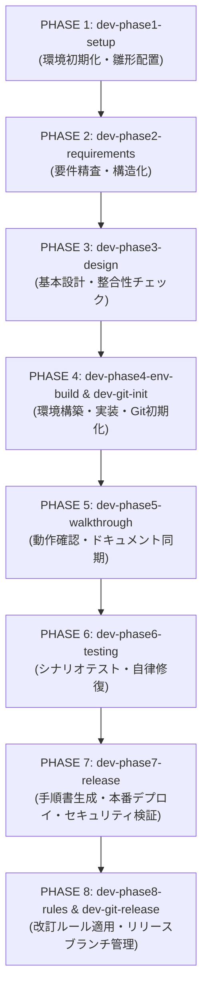

# Antigravity AI-Driven System Dev Pipeline 🚀

Google Antigravity のカスタムスキル（Skills）およびプラグインアーキテクチャを活用し、**新規プロジェクトの環境準備から要件定義、基本設計、環境構築、ウォークスルー、自動テスト、本番リリース、ドキュメント改訂管理に至る全開発ライフサイクルを自律的に進行・自動化する開発基盤テンプレート**です。

---

## 📌 概要

従来のAIコーディングでは、プロジェクトごとに手順書やプロンプトを手動コピーしたり、ドキュメントとコードの相互矛盾を人間が逐一レビューしたりする必要がありました。

本リポジトリ（`system-dev-pipeline`）は、それらの課題を解決し、**Antigravityエージェントが各フェーズの仕様・ルール・テンプレートを自律的にロード・実行・修復する仕組み**を提供します。

### ✨ 主な特徴

1. **開発ライフサイクルの全フェーズ標準化（PHASE 1〜8）**
   - プロジェクト初期化、要件定義、基本設計4種（技術/ビジネスロジック/画面/テーブルスキーマ）、実装、自動テスト、リリース、改訂運用までを12の専用スキルで統制。
2. **自律修復ループ（Self-Healing Loop）**
   - `dev-doc-reviewer` や `dev-phase6-testing` による自動クロスチェック＆修復機構を搭載。ドキュメント間の矛盾やテスト失敗をAIが自律的に検知・修正（最大5回の安全リトライ上限付き）。
3. **高品質な設計・運用テンプレートを内包**
   - 業界標準の設計書雛形（要件定義書、技術要件定義書、ロギング仕様書、APIキー安全管理設計書、本番適用作業手順書など）を完備。
4. **Git・Docker運用基準の自動化**
   - Git初期化、featureブランチ作成、バージョン管理付きSquash Mergeリリース、Dockerコンテナの再ビルドルールをスキル化。
5. **ポータブルなプラグイン構成**
   - ワークスペース固有（`.agents/plugins/`）としても、ユーザー共通環境（`~/.gemini/config/plugins/`）としても展開可能。

---

## 📂 ディレクトリ構成

```text
.
├── .agents/
│   └── plugins/
│       └── system-dev-pipeline/         # 開発自動化プラグイン本体
│           ├── plugin.json              # プラグイン定義マニフェスト
│           ├── rules/                   # 開発プロセス標準規約
│           │   └── dev-process-standards.md
│           ├── skills/                  # フェーズ別カスタムスキル群（12種）
│           │   ├── dev-phase1-setup/
│           │   ├── dev-phase2-requirements/
│           │   ├── dev-phase3-design/
│           │   ├── dev-phase4-env-build/
│           │   ├── dev-phase5-walkthrough/
│           │   ├── dev-phase6-testing/
│           │   ├── dev-phase7-release/
│           │   ├── dev-phase8-rules/
│           │   ├── dev-git-init/
│           │   ├── dev-git-release/
│           │   ├── dev-db-overwrite/
│           │   └── dev-doc-reviewer/
│           └── templates/               # 標準ドキュメント・設定ファイル雛形
│               ├── .env.template
│               ├── code-workspace.template
│               ├── AI駆動システム開発フェーズ定義書.md
│               ├── AI駆動システム開発手順書_スキル活用版.md
│               ├── AI駆動ロギングシステム仕様書.md
│               ├── APIキー安全管理・一元化設計書.md
│               ├── Git運用基準書.md
│               ├── システム改訂ルール.md
│               ├── シナリオテスト計画書.md
│               ├── テーブルスキーマ定義書.md
│               ├── ビジネスロジック仕様書.md
│               ├── 技術要件定義書.md
│               ├── 本番適用作業手順書.md
│               ├── 画面仕様書.md
│               └── 要件定義書.md
├── docs/                                # 各種仕様・提案ドキュメント
│   └── Antigravity共通化および開発自動化提案書.md
├── template.code-workspace              # VS Code / Antigravity ワークスペース設定
└── README.md
```

---

## 🛠 スキル（Skills）一覧

本パイプラインで提供される12のスキル一覧です。Antigravityのチャットから直接スキル名を呼び出すか、開発フェーズに合わせて実行を指示します。

| フェーズ / 用途 | スキル名 | 概要・実行内容 |
| :--- | :--- | :--- |
| **PHASE 1** | `dev-phase1-setup` | ディレクトリ構造（`docs/`, `rules/` 等）、`.env`、`.code-workspace` の自動生成、設計雛形配置、IDE設定案内。 |
| **PHASE 2** | `dev-phase2-requirements` | `docs/要件定義書.md` を精査し、機能・非機能要件の構造化と仕様の洗練を実施。 |
| **PHASE 3** | `dev-phase3-design` | 基本設計書4種（技術/ロジック/画面/DB）の自動生成、`dev-doc-reviewer` と連携した多次元整合性検証。 |
| **PHASE 4** | `dev-phase4-env-build` | ローカル開発環境の構築、パッケージインストール、ソースコード初期実装。 |
| **PHASE 4** | `dev-git-init` | `Git運用基準書.md` の配置、Git初期化（`main`）、SSHリモート設定、基点コミット作成、`feature` ブランチ作成。 |
| **PHASE 5** | `dev-phase5-walkthrough` | システム動作確認、API仕様書生成、コード変更に伴う設計書不整合の自動バックポート修復。 |
| **PHASE 6** | `dev-phase6-testing` | 自動テストコード生成、シナリオテスト計画書作成、テスト自動反復・ログ解析・自動修復ループ。 |
| **PHASE 7** | `dev-phase7-release` | `本番適用作業手順書.md` の自動生成、リリース実行、Cloud Run / IAP / IAM セキュリティ検証。 |
| **PHASE 8** | `dev-phase8-rules` | 本番リリース後の運用ルール（`rules/システム改訂ルール.md`, `AGENTS.md`, `GEMINI.md`）の適用。 |
| **PHASE 8 / 改訂** | `dev-git-release` | 未コミット確定、バージョン番号付与、`main` への Squash Merge、GitHub Push、`feature` ブランチ刷新。 |
| **保守** | `dev-db-overwrite` | 本番適用後のDBをローカルへ上書き同期、改修後のコンテナ本番デプロイ。 |
| **共通品質管理** | `dev-doc-reviewer` | `docs/` 配下の全ドキュメント間の矛盾、誤植、説明不足を多次元クロスチェックし自動修復。 |

---

## 🚦 開発パイプラインの実行フロー

新規プロジェクトでシステム開発を開始する場合、Antigravity上で以下のプロンプトを順に投入していきます。



### 1. プロジェクト初期化（PHASE 1）
```text
dev-phase1-setup スキルを実行し、本プロジェクトの環境初期化を行ってください。
```

### 2. 要件定義の確定（PHASE 2）
`docs/要件定義書.md` に作りたいシステムの概要をメモ書きした上で実行：
```text
dev-phase2-requirements スキルを実行し、docs/要件定義書.md を精査して要件定義書の清書と詳細化を行ってください。
```

### 3. 基本設計書作成＆クロスレビュー（PHASE 3）
```text
dev-phase3-design スキルを実行し、基本設計書を作成した上でドキュメント相互の整合性チェックを行ってください。
```

### 4. 環境構築・初期実装・Git管理開始（PHASE 4）
```text
dev-phase4-env-build スキルを実行し、ローカル開発環境の構築とシステムの初版実装を行ってください。
```
※完了後、`dev-git-init` でGitリポジトリを初期化し `feature` ブランチへ切り替えます。

### 5. ウォークスルー＆ドキュメント再同期（PHASE 5）
```text
dev-phase5-walkthrough スキルを実行し、ウォークスルーによる動作確認とドキュメントの同期を行ってください。
```

### 6. シナリオテスト＆自動修復（PHASE 6）
```text
dev-phase6-testing スキルを実行し、シナリオテスト環境の構築とテスト自動反復ループを開始してください。
```

### 7. 本番リリース＆セキュリティ検証（PHASE 7）
```text
dev-phase7-release スキルを実行し、本番適用作業手順書の作成とリリース検証を行ってください。
```

### 8. 改訂管理ルール適用＆Gitリリース（PHASE 8）
```text
dev-phase8-rules スキルを実行し、ドキュメント改訂運用ルールを適用してください。
```
※リリース確定時は `dev-git-release` スキルを実行し、Squash Merge とブランチのローテーションを行います。

---

## 🛡️ 安全運用ガイドライン（Self-Healing Loop & Security）

本パイプラインでは、AIの暴走を防ぎ安全かつ予測可能な開発を担保するため、[dev-process-standards.md](file:///.agents/plugins/system-dev-pipeline/rules/dev-process-standards.md) に基づく厳格なガードレールを設けています。

### 1. 自律修復ループ（Self-Healing Loop）の適用範囲
- **自律修復の対象**: **「ドキュメント」**、**「テストスクリプト」**、および**「開発環境設定ファイル」**に限定されます。
- **プログラムコード保護**: システムのソースコードに起因する不具合が発生した場合、AIが勝手にコードを書き換えることは禁止されており、調査結果を Artifacts に明記してユーザーの判断を仰ぎます。
- **リトライ上限**: 自律修復の反復回数は**最大5回まで**です。5回で解決しない場合は中断し、詳細ログをレポートします。

### 2. Dockerコンテナ再ビルドルール
- PHASE 4 以降のシステム修正時は、コードや設定変更を確実に反映させるため、**`docker compose down` および `docker compose up --build -d` による再構成**を徹底します。

### 3. セキュリティと認証
- APIキー等の機密情報はソースコードに直接記述せず、必ず `.env` 経由で管理します（[APIキー安全管理・一元化設計書](file:///.agents/plugins/system-dev-pipeline/templates/APIキー安全管理・一元化設計書.md) 準拠）。
- Cloud Run / IAP / IAM の認証・認可ポリシーをデプロイ前後に検証します。

---

## 📦 セットアップ・導入方法

### 方法 A: 新規プロジェクトのテンプレートとして使用する（ワークスペース単位）
本リポジトリをクローンまたはフォークし、そのままプロジェクトの起点として利用します。`.agents/` ディレクトリが存在するため、Antigravityを開くだけでプラグインとスキルが即座に利用可能になります。

### 方法 B: グローバルプラグインとして全プロジェクトで共有する
他の任意のプロジェクトでも本スキル群を共通利用したい場合は、Antigravityのグローバルプラグインディレクトリへシンボリックリンクまたはコピーします。

```bash
# グローバルプラグインディレクトリへ配置
mkdir -p ~/.gemini/config/plugins/
cp -r .agents/plugins/system-dev-pipeline ~/.gemini/config/plugins/
```
これにより、新規作成するどのディレクトリからでも `dev-phase1-setup` などのスキルを直接呼び出すことができます。

---

## 📄 ライセンス

MIT License
