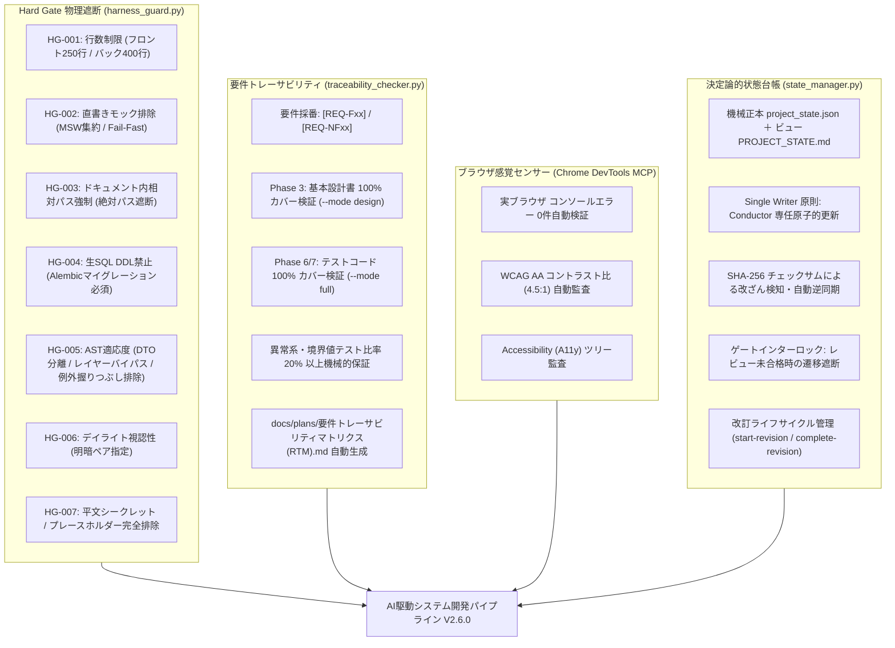
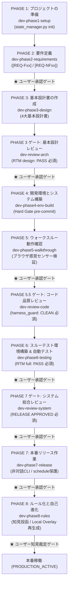

# Antigravity AI-Driven System Dev Pipeline V2.6 🚀

Google Antigravity のマルチエージェントオーケストレーション、カスタムスキル（Skills）、およびプラグインアーキテクチャを活用し、**新規プロジェクトの環境準備から要件定義、基本設計、環境構築、感覚センサーウォークスルー、自動テスト、本番リリース、そしてマルチプロジェクト・マルチ環境を跨ぐ自己進化・改訂運用に至る全開発ライフサイクルを自律的に統制・自動化する開発基盤テンプレート**です。

---

## 📌 概要

V1.0（単一エージェント）、V2.0（Conductor ＋ 3エージェント分業）、V2.1（5大エージェント協調、3大レビューゲート、WikiSkill自己進化ループ、定量測定機構）、V2.2（Shift-Left 静的スケルトン基盤、2層構造プロファイル体系 Profile A〜E、画面グランドデザイン、MSWモック制御）、V2.3（Central Knowledge Hub、3段階意味的整合性監査、Immutable Core / Local Overlay 二層プラグイン機構）、V2.4（SemVer 2.0.0 完全準拠、開発手順書・設計書群再編、DTO/パーサー物理分離・デイライトUI等の6大知見本流統合）、V2.5（Hub蓄積知見本流統合、定量測定エンジン4モジュール分割、全域多次元総点検）を経て、**Version 2.6 (V2.6)** では実稼働プロジェクトの運用成果を結集し、**「次世代AIハーネス強化（Hard Gate 静的物理遮断・機械的RTMトレーサビリティ・ブラウザ感覚センサー・決定論的状態台帳）」** を軸に抜本的な進化を遂げました：

1. **Shift-Left Hard Gate 物理遮断エンジン (`scripts/harness_guard.py`)**:
   事後的なレビュー指摘や修正ではなく、Git `pre-commit` フックおよび CI でアーキテクチャ規約違反（HG-001〜HG-007: フロント250行/バック400行制限、直書きモック、生SQL DDL、AST適応度、平文シークレット）をコミット前に機械的に物理遮断。
2. **要件トレーサビリティ機械検証 (RTM: `scripts/traceability_checker.py`)**:
   要件定義書（`[REQ-Fxx]`, `[REQ-NFxx]`）から基本設計書群、テストコードまでの 100% カバレッジと、異常系・境界値テスト比率（20%以上）を機械検証。孤立要件（Orphan Req）を根絶。
3. **ブラウザ感覚センサー自動検証 (Chrome DevTools MCP)**:
   Chrome DevTools MCP により実ブラウザのコンソールエラー 0件、WCAG AA コントラスト比（4.5:1）、A11yツリーを自動計測・検証。
4. **決定論的状態台帳管理エンジン (`scripts/state_manager.py`)**:
   機械正本 `project_state.json` と自動生成ビュー `PROJECT_STATE.md` を SHA-256 チェックサムで1対1同期。👑 Conductor 専任の Single Writer 原則を機械的に保証し、手動直接改ざんを遮断。レビュー未合格時の次フェーズ遷移をブロックするゲートインターロックを実装。
5. **パイプライン全域の純化・不要テンプレート削除と V2.6 全面同期**:
   スキルやルールから使用されなくなった旧文書（V2.4手順書/定義書、旧ログ/APIキー仕様書、旧MD雛形）を完全削除し、必須テンプレート（Git基準書、改訂ルール、4大基本設計書、レビュー報告書3種、.env）を V2.6 規格へ全面刷新。

---

## ✨ V2.6 の主な新機能と進化ポイント（次世代AIハーネス強化）



---

## 👥 エージェント体制と役割分担 (5大エージェント協調モデル V2.6)

```
                    ┌────────────────────────────────────────┐
                    │               👤 ユーザー              │
                    │  (要求提示 / 承認ゲート決裁 / 実機検証)│
                    └──────────────────┬─────────────────────┘
                                       │ 対話 / 指示 / 承認
                                       ▼
                    ┌────────────────────────────────────────┐
                    │ 👑 1. プロジェクトコンダクター (Main)    │
                    │      (全体進行 / Single Writer /       │
                    │       標準コマンド統括 / Git・デプロイ)│
                    │      [Model: pro / Workspace: main]    │
                    └──────────────────┬─────────────────────┘
                                       │ 委譲 (invoke_subagent)
         ┌───────────────┬─────────────┴─────────────┬───────────────┐
         ▼               ▼                           ▼               ▼
┌─────────────────┐ ┌─────────────────┐ ┌─────────────────┐ ┌─────────────────┐
│ 📐 2. 設計立案   │ │ 💻 3. BE実装     │ │ 🎨 4. FE/UI     │ │ 🛡️ 5. 品質監査  │
│    スペシャリスト│ │    スペシャリスト│ │    デザイナー     │ │  & Semantic監査 │
│ (architect)     │ │ (backend-       │ │ (ui-designer)   │ │ (qa-engineer)   │
│                 │ │  engineer)      │ │                 │ │                 │
│ [Model: pro]    │ │ [Model: pro]    │ │ [Model: flash]  │ │ [Model: pro]    │
│ ※ run_command   │ │ ※ コンテナ起動・│ │ ※ UIビルド・   │ │ ※ コード・Core  │
│   完全禁止      │ │   Git操作禁止   │ │   npm限定       │ │   直接改変禁止  │
└────────┬────────┘ └────────┬────────┘ └────────┬────────┘ └────────┬────────┘
         │                   │                   │                   │
         └───────────────────┴─────────┬─────────┴───────────────────┘
                                       ▼
                         ┌──────────────────────────┐
                         │ ⚙️ 決定論的ツール / スキル │
                         │ ・state_manager.py       │
                         │ ・harness_guard.py       │
                         │ ・traceability_checker.py│
                         │ ・dev-metrics-collector  │
                         │ ・Git管理 (dev-git-*)    │
                         │ ・デプロイ (dev-db-*)    │
                         └──────────────────────────┘
```

| ロール | 種別 / 推奨モデル | 主な担当スコープ (V2.6) | 権限・ガードレール (`CORE_INVARIANTS.md`) |
| :--- | :--- | :--- | :--- |
| 👑 **Conductor** | メイン / `pro` | 全体進行管理、`state_manager.py` による状態台帳一元更新（**Single Writer 原則**）、PHASE 1 Hub検知・スケルトン展開、標準コマンドシーケンス自動実行、Git・デプロイ専任実行、PHASE 8 知見統括 | 全ツール利用可能（**非対話CLIフラグ強制・`schedule` タイマー保護: `INV-06`**） |
| 📐 **Architect** | サブ / `pro` | 2層プロファイル選定、要件定義書での `[REQ-Fxx]` / `[REQ-NFxx]` 採番、4大基本設計書作成（要件ID紐付け）、外部API二重キャッシュ・Fail-Fastモック仕様設計、Alembic前提スキーマ設計 | `enable_write_tools: true`（**`run_command` は厳格禁止: `INV-02`**） |
| 💻 **Backend Engineer** | サブ / `pro` | バックエンドAPI、SQLAlchemyモデル（400行制限）、**AST適応度遵守（DTO分離・レイヤーバイパス禁止・例外握りつぶし排除）**、Alembicマイグレーション、IAP JWT署名二重検証ミドルウェア、内部監視エンドポイント実装 | 単体テスト・構文検証のみ許可（**生SQL禁止: `INV-05`、Git/デプロイ/DB上書き/コンテナ起動停止は禁止: `INV-02`**） |
| 🎨 **UI Designer** | サブ / `flash` または `pro` | 画面仕様書（グランドデザイン新規格準拠）、モダンフロントエンド画面実装、**1ファイル最大250行制限（`INV-03`）**、**デイライト視認性明暗ペア担保（PAT-UI-001）**、**MSWモックハンドラー構築（`INV-04`）**、**Profile D 二段階ハイブリッド運用** | パッケージ導入・UIビルドのみ許可（**Git/デプロイ/DB操作禁止: `INV-02`**） |
| 🛡️ **QA Engineer** | サブ / `pro` | ドキュメント多次元整合性監査（`dev-doc-reviewer`）、**3大レビューゲート監査（基本設計: RTM design PASS / コード品質: harness_guard PASS / システム総合: RTM full PASS & 本番モックOFF）**、ブラウザ感覚センサー検証、障害RCA記録（`wiki-maintainer`）、**3段階意味的整合性監査** | テスト・静的解析・バジェット監査のみ許可（**アプリ本体コードおよび Immutable Core 直接改変禁止: `INV-02`/`INV-09`**） |

---

## 🏗️ 2層構造システムプロファイル体系

| レイヤ | 名称 | 概要・対象 |
| :--- | :--- | :--- |
| **第1層** | **定常的コア設計規範**<br>(Universal Core Specifications) | **全システム・全プロファイル共通の普遍的標準規約（非機能要件 `[REQ-NFxx]` 自動バインド）**<br>1. Anti-God Component 250行/400行制限 ＆ Hard Gate 物理遮断<br>2. 型定義自動同期パイプライン (OpenAPI ➔ TS Codegen)<br>3. Pydantic Settings による環境変数・シークレット起動時即死ガード<br>4. 統一タイムゾーン運用 (Aware UTC 保存 / JST 表示)<br>5. GitHub Actions 自動CI (Lint/型チェック/Harness Guard/テスト)<br>6. 構造化ロギング (JST日時 / UUIDv4 log_id)<br>7. モック制御アダプター層 (案C＋案A & Fail-Fast原則)<br>8. 画面グランドデザイン新規格 & ブラウザ感覚センサー自動検証 |
| **第2層** | **システム展開プロファイル**<br>(Deployment Profiles) | **要件・規模・実行環境に応じたアーキテクチャスタック**<br>・**Profile A (ゴールデンパス)**: サーバーレス極小コストWeb型 (Cloud Run `max-instances=1` + Litestream + SQLite WAL + FastAPI + React SPA + MSW)<br>・**Profile B**: Web SSR / フルマネージドRDB型 (FastAPI/Next.js + Cloud SQL + Alembic)<br>・**Profile C**: 静的MPA / 超軽量ツール型 (FastAPI + Jinja2 + HTMX / 単一バイナリCLI)<br>・**Profile D**: PCローカルデスクトップアプリ型 (Tauri v2 + Local SQLite + Frameless TitleBar + 二段階ハイブリッド運用)<br>・**Profile E**: AI Agent Skill / PKM 自動化・CLI型 (Zero-Dependency Python 3 + アトミックI/O + 2系統分離設計) |

---

## 📂 ディレクトリ構成

### 1. ワークスペースおよびプラグイン領域
```text
.
├── .agents/
│   ├── skills/
│   │   └── template-pipeline-sync/      # 🔄 テンプレート改訂専用 Global⇔Workspace 同期スキル
│   └── plugins/
│       └── system-dev-pipeline/         # 🔒 開発自動化プラグイン正本 (Immutable Core v2.6.0)
│           ├── plugin.json              # プラグインマニフェスト（agents 5件, skills 19件）
│           ├── PIPELINE_MANIFEST.json   # 📜 バージョン・公式吸収済みパターンIDの機械可読正本
│           ├── FEEDBACK_LEDGER.md       # 📖 人間監査用の知見適合履歴・系譜台帳
│           ├── scripts/
│           │   ├── harness_guard.py       # 🛡️ AIハーネス Hard Gate 静的物理遮断エンジン (Profile E)
│           │   ├── state_manager.py       # 📊 決定論的状態台帳管理エンジン (Profile E)
│           │   ├── traceability_checker.py # 📋 要件トレーサビリティマトリクス (RTM) 検証エンジン (Profile E)
│           │   ├── pipeline-reconciler.sh # ⚙️ 軽量シェルディスパッチャ
│           │   └── reconciler_core.py     # ⚙️ Hub管理・Overlay再生成・Upgrade Reconciler コア
│           ├── agents/                  # 👥 エージェント定義（conductor, architect, backend, ui, qa）
│           ├── rules/                   # 📜 開発プロセス標準規約 (AGENTS.md) & コア不変原則 (CORE_INVARIANTS.md)
│           ├── skeletons/               # 🧱 プロファイル別初期コードスケルトン (common, profile-a, profile-d)
│           │   ├── common/.githooks/pre-commit # 🛡️ Hard Gate pre-commit フック
│           │   ├── common/scripts/        # ⚙️ スケルトン同梱スクリプト (harness_guard, state_manager, etc.)
│           │   ├── profile-a/docker/entrypoint.sh # Litestream スーパーバイザー起動シーケンス
│           │   └── profile-d/backend/tests/conftest.py # temp_db 一時実ファイル動的プロビジョニング
│           ├── skills/                  # ⚙️ カスタムスキル群（全19種）
│           │   └── dev-metrics-collector/scripts/ # 📊 定量測定エンジン (4モジュール構成)
│           └── templates/               # 📄 V2.6 標準ドキュメント・設定ファイル雛形
│               ├── .env.template
│               ├── Git運用基準書.md
│               ├── システム改訂ルール.md
│               ├── 技術要件定義書.md
│               ├── テーブルスキーマ定義書.md
│               ├── ビジネスロジック仕様書.md
│               ├── 画面仕様書.md
│               ├── 要件定義書.md
│               ├── シナリオテスト計画書.md
│               ├── 本番適用作業手順書.md
│               ├── project_state.schema.json
│               └── レビュー結果報告書雛形3種 (*.template)
├── docs/                                # 仕様書・設計書・レポート
│   ├── 設計書/
│   │   ├── Current/                     # ★現在の正本（Single Source of Truth: V2.6 正本設計書 全11文書）
│   │   └── v2.5/ v2.4/ v2.3/ v2.2/ ...  # 過去バージョン設計書アーカイブ
│   ├── 検討課題/                        # バージョン別検討課題・評価レポート群
│   └── plans/                           # RTM、テスト計画、レビュー報告書等の動的成果物
├── metrics/                             # 📊 定量測定成果物集約ディレクトリ
│   ├── system_health_report.md          # 総合健全性診断レポート
│   ├── development_phase_report.md      # フェーズ・改訂推移レポート
│   └── development-metrics-summary.json # 定量サマリJSON
├── rules/
│   └── AGENTS.md                        # ワークスペース共通ルール + 第11節(パイプライン改訂同期規約)
└── README.md
```

### 2. PC環境共通 ナレッジハブ領域（`~/.gemini/knowledge-hub/`）
```text
~/.gemini/knowledge-hub/
├── inbox/                               # 📥 全案件から投函された未処理の標準化知見原票 (CLAIM-*.md)
├── pending_approval/                    # 🗂️ バックグラウンド監査時の承認待ちステージング
├── overlay/                             # 🧩 Immutable Core を一切汚さず次案件から即時有効化される拡張層
│   └── LOCAL_FEEDBACK_RULES.md          # active_claims からクリーン再生成される追加規約 (上限 80行)
├── active_claims/                       # 現在 overlay/ に反映されている有効原票の実体保管庫
├── archive/upstreamed/                  # 📦 新Ver Upgrade Reconciler で Core 吸収済みと判定され退役した原票
├── suspended/                           # ⏸️ 一時保留された原票
├── rejected/                            # 🚫 意味的監査で棄却された原票の永続記録
└── LOCAL_HUB_STATE.json                 # ベースCoreバージョンと適用中Claim IDの状態マニフェスト
```

---

## 🛠 全19スキル（Skills）一覧

| フェーズ / 用途 | スキル名 | 主担当 | 概要・実行内容 (V2.6仕様) |
| :--- | :--- | :--- | :--- |
| **PHASE 1** | `dev-phase1-setup` | 👑 Conductor | **Knowledge Hub 検知**、静的スケルトン基盤（`skeletons/`）配置、`.env`、`state_manager.py init` による台帳決定論的初期化。 |
| **PHASE 2** | `dev-phase2-requirements` | 📐 Architect | `docs/設計書/Current/要件定義書.md` 精査、**2層プロファイル体系選定**、`[REQ-Fxx]` / `[REQ-NFxx]` 採番標準、定常コア8項目の非機能要件自動バインド。 |
| **PHASE 3** | `dev-phase3-design` | 📐 Architect<br>└ 🎨 UI | **4大基本設計書**策定（要件ID紐付け）。グランドデザイン新規格準拠、Alembic前提、二重キャッシュ、デイライト視認性。 |
| **PHASE 3 ゲート** | `dev-review-arch` | 🛡️ QA | **基本設計レビュー**。`traceability_checker.py --mode design` PASS必須、定常コア8項目および展開プロファイル適合監査。 |
| **PHASE 4** | `dev-phase4-env-build` | 👑 Conductor<br>├ 💻 BE<br>└ 🎨 UI | 静的スケルトンを土台にDocker環境構築、💻 BE ＋ 🎨 UI 並行実装、**AST適応度遵守**、**標準コマンドシーケンス**自動実行、Git初期化。 |
| **PHASE 4** | `dev-git-init` | ⚙️ Conductor | `Git運用基準書.md` 配置、`.gitignore` 設定、**Hard Gate pre-commit フック有効化**、Git初期化（`main`）、`feature` ブランチ作成。 |
| **PHASE 5** | `dev-phase5-walkthrough` | 👑 Conductor<br>└ 🛡️ QA | 画面ウォークスルー動作確認統括、**Chrome DevTools MCP によるブラウザ感覚センサー自動検証**、モック切替検証 (Fail-Fast原則)、API仕様書同期。 |
| **PHASE 5.5 ゲート**| `dev-review-code` | 🛡️ QA | **コード品質・整合性レビュー**。`harness_guard.py --all` PASS必須（250/400行制限、直書きモック排除、AST適応度、デイライト視認性、型同期、平文排除）。 |
| **PHASE 6** | `dev-phase6-testing` | 🛡️ QA | シナリオテスト計画書作成、自動テストコード構築、**`traceability_checker.py --mode full` PASS必須（要件カバレッジ100% ＆ 異常系比率20%以上）**、自動修復ループ（最大5回）。 |
| **PHASE 6 / RCA** | `wiki-maintainer` | 🛡️ QA | **障害時RCA即時記録**。テスト失敗・手戻り発生時に根本原因を分析しカレントプロジェクト配下の `./wiki/patterns/` へ即時記録。 |
| **PHASE 7 ゲート** | `dev-review-system` | 🛡️ QA | **システム総合レビュー**。**本番モックOFF二重防御 & Fail-Fast 監査**、**IAP JWT署名検証有効化**、**Alembic起動保証**、平文排除（`RELEASE APPROVED` 必須）。 |
| **PHASE 7** | `dev-phase7-release` | 👑 Conductor | システム総合レビュー合格確認、本番適用作業手順書作成、**非対話CLIガードレール（`--quiet` 強制・`schedule` タイマー監視）** による安全デプロイ。 |
| **PHASE 8** | `dev-phase8-rules` | 👑 Conductor<br>└ 🛡️ QA | メトリクス集計、原票クラスタリング、**知見原票投函 ➔ 3段階意味的監査 ➔ `ask_question` 承認 ➔ Local Overlay 再生成**、Git本番リリース。 |
| **PHASE 8 / 起案** | `wiki-proposer` | 👑 Conductor | **標準化知見原票起案・投函**。Tier 2 知見から行番号非依存の `CLAIM-*.md` を生成して `~/.gemini/knowledge-hub/inbox/` へ投函。 |
| **PHASE 8 / 整理** | `wiki-compactor` | 👑 Conductor | **Wiki整理・原票クラスタリング・Overlay圧縮**。Hub `inbox/` 原票集約および `LOCAL_FEEDBACK_RULES.md` 圧縮。 |
| **定量測定** | `dev-metrics-collector` | 👑 Conductor | **定量メトリクス集計**。`--all` による一括出力、`--sync-state` による `state_manager.py` 台帳即時同期。 |
| **PHASE 8 / リリース** | `dev-git-release` | ⚙️ Conductor | 先頭サニタイズ処理、Gitタグ付与（`vMAJOR.MINOR.PATCH`）、`main` への Squash Merge、Push、次期 `feature` 切り直し。 |
| **保守** | `dev-db-overwrite` | ⚙️ Conductor | 本番適用後DBのローカル同期、DBを含むコンテナの本番上書きデプロイ（二重防御ガードレール保護）。 |
| **共通監査** | `dev-doc-reviewer` | 🛡️ QA | `docs/` 配下の要件定義・設計書間の矛盾、誤植、相対パスリンク切れを多次元クロスチェックし自動修復（除外パス保護）。 |

---

## 🚦 開発パイプラインの実行フロー (PHASE 1〜8)

開発の具体的な手順、ユーザーが行うべきアクション、およびAIの自律動作の詳細は、[AI駆動システム開発手順書V2.6.md](./docs/設計書/Current/AI駆動システム開発手順書V2.6.md) および [AI駆動システム開発フェーズ定義書V2.6.md](./docs/設計書/Current/AI駆動システム開発フェーズ定義書V2.6.md) を参照してください。



---

## 🛡️ コア不変原則 (Core Invariants: `INV-01` 〜 `INV-10`)

[CORE_INVARIANTS.md](./.agents/plugins/system-dev-pipeline/rules/CORE_INVARIANTS.md) により、いかなる改変や個別案件ルールであっても絶対に緩和・バイパスされない10の不変原則が定義されています。

| ID | 原則名 | 絶対不可侵の制約内容 |
| :--- | :--- | :--- |
| **`INV-01`** | **Single Writer 原則** | 状態管理台帳（`project_state.json` / `PROJECT_STATE.md`）の更新権限は 👑 `conductor` のみが保持し、`state_manager.py` 経由で原子的・決定論的に更新する。サブエージェントによる直接編集や手動改ざんはハッシュ不一致により遮断する。 |
| **`INV-02`** | **責務分離とツール実行制限** | 📐 `architect` の `run_command` 禁止、🛡️ `qa-engineer` のアプリコード直接改変禁止、サブエージェントの Git/デプロイ/DB上書き/Docker全体起動停止の禁止。 |
| **`INV-03`** | **Anti-God Component / Module 制限** | フロントエンド 1 コンポーネントファイル最大 250 行制限、バックエンド 1 モジュールファイル最大 400 行制限（DTO分離必須）の厳守。`harness_guard.py`（HG-001）によりコミット前物理遮断。 |
| **`INV-04`** | **本番モックOFF・直書きモック禁止** | コンポーネント内のダミーデータ直書き禁止（MSW 集約必須: HG-002）、および本番ビルド時の `VITE_ENABLE_MOCK=false` 二重防御の厳守。 |
| **`INV-05`** | **Alembic 厳格運用・生SQL禁止** | 手動 DDL（生 SQL: HG-004）によるテーブル作成・変更を禁止し、SQLAlchemy ORM と Alembic マイグレーションによる確定管理を徹底する。 |
| **`INV-06`** | **IAP JWT 検証・平文排除・非対話CLI保護** | 本番認証検証の強制、シークレット平文コミット禁止（HG-007）、外部 CLI 実行時の `--quiet` 等非対話フラグ強制・`2>/dev/null` 禁止・バックグラウンド待機時の `schedule` タイマー保護。 |
| **`INV-07`** | **3大レビューゲート必須通過** | 基本設計（`dev-review-arch`: RTM design PASS）・コード品質（`dev-review-code`: CLEAN）・システム総合（`dev-review-system`: RELEASE APPROVED）の合格なしに次フェーズへ進行することを禁じる。`state_manager.py` のインターロックにより機械遮断。 |
| **`INV-08`** | **自律修復ループの上限保護** | テスト失敗や不整合の放置を禁じるとともに、無限ループ防止のため自律修復は最大 5 回上限を維持する。 |
| **`INV-09`** | **Context Isolation とナレッジ境界** | Tier 1（案件固有仕様）の環境共通領域への持ち出し禁止、プロンプトへの生 Wiki 履歴注入禁止、およびルール本文（State）への履歴ID（Lineage）混入禁止。 |
| **`INV-10`** | **ドキュメント内相対パス強制** | Markdown 設計文書・仕様書内のファイルリンクに絶対パス（`file:///` 等: HG-003）を使用することを禁止し、必ず対象ファイル間の相対パスを使用する。 |

---

## 📚 正本設計ドキュメント一覧（`docs/設計書/Current/`）

開発・適用の唯一の正（Single Source of Truth）として `docs/設計書/Current/` 配下で管理されている設計書群（全11文書）です。

- [V2.6改変計画書.md](./docs/設計書/Current/V2.6改変計画書.md) - V2.6 正式改訂計画書
- [V2.6_次世代AIハーネス強化_設計書.md](./docs/設計書/Current/V2.6_次世代AIハーネス強化_設計書.md) - Hard Gate・RTM・感覚センサー・状態台帳アーキテクチャ設計書
- [V2.6_P1_P2施策実装計画書.md](./docs/設計書/Current/V2.6_P1_P2施策実装計画書.md) - 実装・検証詳細計画書
- [セマンティックバージョニング仕様書.md](./docs/設計書/Current/セマンティックバージョニング仕様書.md) - バージョニング統一仕様書
- [AI駆動システム開発フェーズ定義書V2.6.md](./docs/設計書/Current/AI駆動システム開発フェーズ定義書V2.6.md) - ライフサイクルフェーズ定義正本
- [AI駆動システム開発手順書V2.6.md](./docs/設計書/Current/AI駆動システム開発手順書V2.6.md) - ユーザー＆AI協調開発実践手順書
- [エージェント設計書V2.6.md](./docs/設計書/Current/エージェント設計書V2.6.md) - 5大エージェント協調モデル仕様書
- [レビューシステム設計書V2.6.md](./docs/設計書/Current/レビューシステム設計書V2.6.md) - 3大レビュー＆3段階意味的監査仕様書
- [状態管理機構設計書V2.6.md](./docs/設計書/Current/状態管理機構設計書V2.6.md) - 状態管理台帳・インターロック仕様書
- [定量測定・フィードバック設計書V2.6.md](./docs/設計書/Current/定量測定・フィードバック設計書V2.6.md) - 定量測定エンジン・評価指標仕様書
- [ProfileA詳細設計書.md](./docs/設計書/Current/ProfileA詳細設計書.md) - Profile A (Cloud Run + Litestream + SQLite WAL) 設計仕様書
- [ProfileD詳細設計書.md](./docs/設計書/Current/ProfileD詳細設計書.md) - Profile D (Tauri v2 + Desktop + temp_db) 設計仕様書

※過去バージョンの設計文書は `docs/設計書/v2.5/`, `docs/設計書/v2.4/`, `docs/設計書/V2.3/` 配下等にアーカイブ退避されています。

---

## 📄 ライセンス

MIT License
