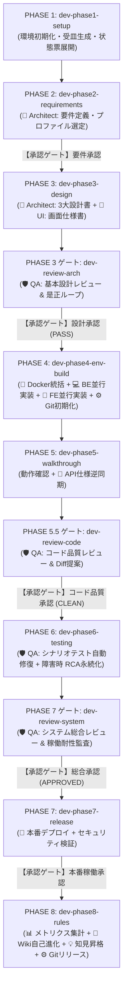
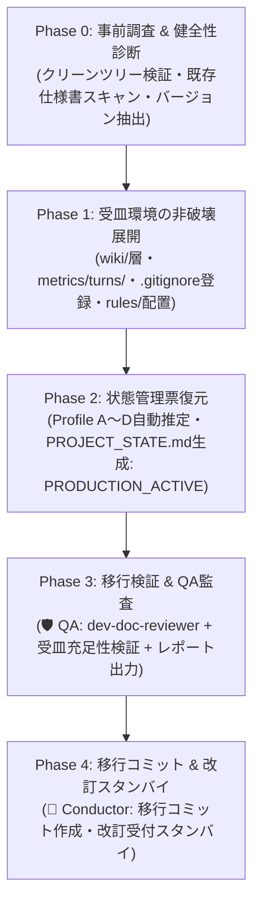
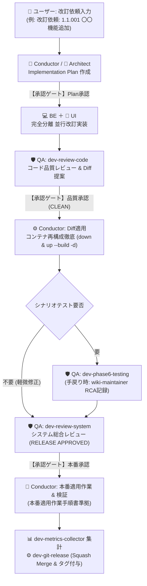

# Antigravity AI-Driven System Dev Pipeline V2.1 🚀

Google Antigravity のマルチエージェントオーケストレーション、カスタムスキル（Skills）、およびプラグインアーキテクチャを活用し、**新規プロジェクトの環境準備から要件定義、基本設計、環境構築、ウォークスルー、自動テスト、本番リリース、自己進化・改訂運用に至る全開発ライフサイクルを自律的に統制・自動化する開発基盤テンプレート**です。

---

## 📌 概要

V1.0（単一エージェント）、V2.0（Conductor ＋ 3エージェント分業）を経て、**Version 2.1 (V2.1)** では、大規模・実用開発における「設計・実装品質の保証」「障害知見の再利用（自己進化）」「定量的な開発健全性評価」を実現するため、アーキテクチャを全面刷新・強化しました。

V2.1では、新たに **Backend Engineer（BE実装専任）** を追加した **「5大エージェント協調体制」** を確立。
さらに、品質の妥協を許さない **「3大厳格レビューゲート」**、手戻り・障害から自律的にスキルを進化させる **「WikiSkill自己進化ループ（二層分離ナレッジ）」**、開発効率と安定性を可視化する **「定量測定・ヘルスモニタリング機構」** を標準装備しています。

---

## ✨ V2.1 の主な新機能と進化ポイント

1. **5大エージェント協調モデル（BE専任新設・責務完全分離）**
   - 👑 **Conductor (司令塔 / メイン)** が全体進行と状態一元管理を担い、実装工程では 💻 **Backend Engineer (BE・DB実装)** と 🎨 **UI Designer (FE・画面実装)** が完全分離して並行実装。
   - 📐 **Architect (要件・設計・API逆同期)** と 🛡️ **QA Engineer (品質監査・3大レビュー・Wiki知見永続化)** が独立して品質を客観担保。
2. **3大厳格レビューゲート（品質妥協ゼロのフェーズ移行）**
   - **PHASE 3 完了ゲート**: `dev-review-arch` による **基本設計レビュー**（定常コア観点 ＋ プロファイル別観点）。
   - **PHASE 5.5 完了ゲート**: `dev-review-code` による **コード品質・整合性レビュー**（DRY原則、SRP、ファイル行数制限、デッドコード排除、型安全性、Unified Diff提示）。
   - **PHASE 7 直前ゲート**: `dev-review-system` による **システム総合レビュー**（本番稼働耐性、平文シークレットゼロ、IAM/IAPポリシー、ロールバック計画）。
   - 全て合否判定（PASS / CONDITIONAL PASS / REJECT / CLEAN / APPROVED 等）が義務付けられ、不合格時の是正ループを自動制御。
3. **WikiSkill統合による自己進化ループ & ナレッジ境界（二層分離）**
   - テスト失敗や手戻り発生時に、🛡️ QA Engineer（`wiki-maintainer`）が根本原因分析（RCA）を行い、プロジェクトローカルの `./wiki/patterns/` へ即時永続化。
   - 知見を **Tier 1（プロジェクト固有: `docs/` へ逆同期・正本化）** と **Tier 2（全体汎用: `PAT-{CAT}-xxx.md`）** に厳格分離。
   - PHASE 8 において 👑 Conductor（`wiki-proposer`）が Tier 2 パターンから `SKILL.md` / `rules/` の改善パッチ（Patch）と `PURPOSE.md` を自動立案。QA Engineer による複合検証ゲートを経て、安全にテンプレートへ自己進化・反映。
   - 蓄積パターンの重複排除・枝刈りを担う `wiki-compactor` を新設。
4. **定量測定・開発ヘルスモニタリング機構 (`dev-metrics-collector`)**
   - ターン別（`metrics/turns/`）およびフェーズ別（`metrics/phases/`）のトークン消費、試行回数、自律修復回数、手戻り回数を自動集計。
   - 全体統合サマリ（`development-metrics-summary.json`）と総合健全性診断レポート（`metrics/system_health_report.md`）を出力し、開発プロセスの改善度を定量可視化。
5. **システム展開プロファイル (Deployment Profile A〜D) の導入**
   - 要件定義段階で、対象システムに応じた最適な展開プロファイル（Profile A: クラウド公開 / Profile B: ローカル常駐 / Profile C: 個人小規模 / Profile D: モバイル）を選定し、設計・レビュー・デプロイ手順を最適化。
6. **動作モード対応（`GLOBAL_PLUGIN` vs `LOCAL_STANDALONE`）**
   - プロジェクト初期化時に動作モードを自動判定し、`PROJECT_STATE.md` に記録。
   - グローバルプラグイン実行時は、グローバル資産を汚染せず `./promotions/*.patch` にエクスポートしてユーザーへ昇格案内する二重安全設計。
7. **Single Writer 原則の厳格化と二重防御ガードレール**
   - `PROJECT_STATE.md` への書き込みは Conductor 専任。
   - 各サブエージェントのコマンド権限・コード改変権限をプロンプトおよびツール設定の双方で厳格制御（Architectのコマンド禁止、QAのアプリコード直接改変禁止、Git/デプロイ/DB上書きのConductor専任化）。
8. **V1.0からのシームレス・非破壊アップグレード機構 (`dev-upgrade-v1-to-v2`)**
   - V1.0環境で本番リリースされた既存プロジェクトのソースコードや仕様書資産を一切損なわず、非破壊でV2.1の受皿（`wiki/`, `metrics/`, `rules/`, `PROJECT_STATE.md`, `TEMPLATE_PROMOTIONS.md`）を自動展開。
   - 既存資産からシステム展開プロファイル（Profile A〜D）を自動推定し、ステータスを `PRODUCTION_ACTIVE` として復元。次期システム改訂サイクル（REVISION LIFECYCLE）へ即座に合流可能。

---

## 👥 エージェント体制と役割分担 (5大エージェント)

```
                    ┌────────────────────────────────────────┐
                    │               👤 ユーザー              │
                    │      (要求提示 / ゲート承認 / 操作検証) │
                    └──────────────────┬─────────────────────┘
                                       │ 対話 / 指示 / 明示的承認
                                       ▼
                    ┌────────────────────────────────────────┐
                    │ 👑 1. プロジェクトコンダクター (Main)    │
                    │      (全体進行 / BE統括 / 状態一元管理) │
                    │      [Model: pro / Workspace: main]    │
                    └──────────────────┬─────────────────────┘
                                       │ 委譲 (invoke_subagent)
         ┌───────────────┬─────────────┴─────────────┬───────────────┐
         ▼               ▼                           ▼               ▼
┌─────────────────┐ ┌─────────────────┐ ┌─────────────────┐ ┌─────────────────┐
│ 📐 2. 設計立案   │ │ 💻 3. BE実装     │ │ 🎨 4. FE/UI     │ │ 🛡️ 5. 品質監査  │
│    スペシャリスト│ │    スペシャリスト│ │    デザイナー     │ │    & レビュー   │
│ (architect)     │ │ (backend-       │ │ (ui-designer)   │ │ (qa-engineer)   │
│                 │ │  engineer)      │ │                 │ │                 │
│ [Model: pro]    │ │ [Model: pro]    │ │ [Model: flash]  │ │ [Model: pro]    │
│ [Work: inherit] │ │ [Work: inherit] │ │ [Work: inherit] │ │ [Work: inherit] │
│ ※ run_command   │ │ ※ コンテナ起動・│ │ ※ UIビルド・   │ │ ※ コード直接   │
│   完全禁止      │ │   Git操作禁止   │ │   npm限定       │ │   改変禁止      │
└────────┬────────┘ └────────┬────────┘ └────────┬────────┘ └────────┬────────┘
         │                   │                   │                   │
         └───────────────────┴─────────┬─────────┴───────────────────┘
                                       ▼ 成果物反映・専任操作
                         ┌──────────────────────────┐
                         │ ⚙️ 決定論的ツール / スキル │
                         │ ・Git管理 (dev-git-*)    │
                         │ ・デプロイ (dev-db-*)    │
                         │ ・状態更新 (Single Writer│
                         └──────────────────────────┘
```

| ロール | 種別 / 推奨モデル | 主な担当スコープ | 権限・ガードレール |
| :--- | :--- | :--- | :--- |
| 👑 **Conductor** | メイン / `pro` | 全体統括、ユーザー窓口、`PROJECT_STATE.md` 更新、BE統括、Git・デプロイ・DB操作実行、知見昇格統括 | 全ツール利用可能（**Single Writer 専任**） |
| 📐 **Architect** | サブ / `pro` | 要件定義書、展開プロファイル選定、基本設計3書（技術/スキーマ/ロジック）、API逆同期 | `enable_write_tools: true`（**`run_command` は厳格禁止**） |
| 💻 **Backend Engineer** | サブ / `pro` | バックエンドAPI、DBモデル・マイグレーション、ビジネスロジック実装、BE不具合修正 | 単体テスト・構文検証のみ許可（**Git/デプロイ/DB上書き/コンテナ起動停止は禁止**） |
| 🎨 **UI Designer** | サブ / `flash` | 画面仕様書、モダンフロントエンド画面・UIコンポーネント実装、行数制限（1ファイル300行以下）遵守 | パッケージ導入・UIビルドのみ許可（**Git/デプロイ/DB操作禁止**） |
| 🛡️ **QA Engineer** | サブ / `pro` | ドキュメント監査（`dev-doc-reviewer`）、3大レビュー（設計/コード/システム）、シナリオテスト自動反復、障害RCA永続化（`wiki-maintainer`） | テスト実行のみ許可（**プログラム本体コード直接改変禁止、Wiki記録先は `./wiki/` 限定**） |

---

## 📂 ディレクトリ構成

```text
.
├── .agents/
│   └── plugins/
│       └── system-dev-pipeline/         # 開発自動化プラグイン本体 (v2.1.0)
│           ├── plugin.json              # プラグインマニフェスト（agents 5件, skills 20件）
│           ├── agents/                  # 👥 サブエージェント定義
│           │   ├── conductor.md         # 👑 司令塔・全体進行管理エージェント定義
│           │   ├── architect.md         # 📐 設計・立案スペシャリスト定義
│           │   ├── backend-engineer.md  # 💻 バックエンド実装スペシャリスト定義
│           │   ├── ui-designer.md       # 🎨 UI/UXデザイナー・FEエンジニア定義
│           │   └── qa-engineer.md       # 🛡️ 品質監査・3大レビュー・Wiki担当定義
│           ├── rules/                   # 📜 開発プロセス標準規約
│           │   └── dev-process-standards.md
│           ├── skills/                  # ⚙️ カスタムスキル群（全20種）
│           │   ├── dev-phase1-setup/        # PHASE 1: 環境初期化・受皿生成
│           │   ├── dev-phase2-requirements/ # PHASE 2: 要件定義・プロファイル選定
│           │   ├── dev-phase3-design/       # PHASE 3: 基本設計3書作成
│           │   ├── dev-review-arch/         # [新設] 基本設計レビュー
│           │   ├── dev-phase4-env-build/    # PHASE 4: 環境構築・BE/FE並行実装
│           │   ├── dev-phase5-walkthrough/  # PHASE 5: ウォークスルー・API仕様逆同期
│           │   ├── dev-review-code/         # [新設] コード品質・整合性レビュー
│           │   ├── dev-phase6-testing/      # PHASE 6: シナリオテスト・自動修復
│           │   ├── dev-review-system/       # [新設] システム総合レビュー
│           │   ├── dev-phase7-release/      # PHASE 7: 本番リリース・デプロイ
│           │   ├── dev-phase8-rules/        # PHASE 8: メトリクス・知見昇格・運用移行
│           │   ├── dev-doc-reviewer/        # ドキュメント相互整合性クロスチェック
│           │   ├── wiki-maintainer/         # [新設] 障害・手戻りRCA即時永続化 (./wiki/)
│           │   ├── wiki-proposer/           # [新設] スキル改善パッチ立案・PURPOSE.md生成
│           │   ├── wiki-compactor/          # [新設] Wiki枝刈り・重複整理
│           │   ├── dev-metrics-collector/   # [新設] 定量メトリクス集計・診断レポート
│           │   ├── dev-git-init/            # Git初期化・基点コミット・ブランチ作成
│           │   ├── dev-git-release/         # Squash Merge・タグ付与・ブランチ刷新
│           │   ├── dev-db-overwrite/        # 本番DB上書き・安全同期
│           │   └── dev-upgrade-v1-to-v2/    # [新設] V1.0プロジェクト環境アップグレード
│           └── templates/               # 📄 標準ドキュメント・設定ファイル雛形
│               ├── .env.template
│               ├── code-workspace.template
│               ├── PROJECT_STATE.md.template       # 進行状態管理票雛形 (V2.1)
│               ├── TEMPLATE_PROMOTIONS.md.template # 知見昇格候補提示バッファ雛形
│               ├── 基本設計レビュー結果報告書.md.template      # [新設]
│               ├── コード品質レビュー及びリファクタリング提案書.md.template # [新設]
│               ├── システム総合レビュー結果報告書.md.template  # [新設]
│               ├── AI駆動システム開発フェーズ定義書V2.1.md     # [改訂] フェーズ定義・5大分業・3大ゲート
│               ├── AI駆動システム開発手順書V2.1.md         # [改訂] 実践運用フロー・プロンプト集
│               ├── システム改訂ルール.md                   # [改訂] 改訂ターン・コードレビュー・コンテナ再構成
│               ├── 技術要件定義書.md                       # [改訂] 展開プロファイル別・1ファイル300行以下
│               ├── テーブルスキーマ定義書.md               # [改訂] BE主担当明記
│               ├── ビジネスロジック仕様書.md               # [改訂] BE主担当明記
│               ├── シナリオテスト計画書.md                 # [改訂] Wiki RCA即時記録基準
│               ├── 本番適用作業手順書.md                   # [改訂] PHASE 0 総合レビュー必須化
│               ├── Git運用基準書.md                       # [改訂] turns除外・Squash Merge基準
│               ├── 要件定義書.md                          # 展開プロファイル A〜D 対応
│               └── 画面仕様書.md
├── docs/                                # 仕様書・設計書アーカイブ
│   ├── V2.1/                            # V2.1 設計書・運用基準書群・移行計画書
│   │   └── V1.0プロジェクトアップグレードスキル策定および移行計画書.md
│   └── plans/                           # レビュー報告書・テスト計画書・実行手順書
├── wiki/                                # 🧠 プロジェクトローカルWiki層 (V2.1新設)
│   ├── patterns/
│   │   ├── local/                       # Tier 1: プロジェクト固有パターン (PAT-LOC-*)
│   │   ├── universal/                   # Tier 2: 全体汎用パターン (PAT-{CAT}-*)
│   │   └── rejected/                    # 棄却パターン
│   ├── archive/                         # 枝刈り・アーカイブパターン
│   ├── logs.md                          # Wiki操作・知見登録ログ
│   └── skill-impact.md                  # スキル進化影響度台帳
├── metrics/                             # 📊 定量測定・メトリクス層 (V2.1新設)
│   ├── turns/                           # ターン別集計ログ (Git除外)
│   ├── phases/                          # フェーズ別集計ログ
│   └── system_health_report.md          # PHASE 8 総合健全性診断レポート
├── rules/                               # プロジェクト共通ルール
│   └── dev-process-standards.md
├── PROJECT_STATE.md                     # プロジェクト進行状態管理票（初期化時生成）
├── TEMPLATE_PROMOTIONS.md               # 知見昇格候補提示バッファ（初期化時生成）
├── template.code-workspace              # VS Code / Antigravity ワークスペース設定
└── README.md
```

---

## 🛠 全20スキル（Skills）一覧

| フェーズ / 用途 | スキル名 | 主担当 | 概要・実行内容 |
| :--- | :--- | :--- | :--- |
| **アップグレード** | `dev-upgrade-v1-to-v2` | 👑 Conductor<br>(協調: 🛡️ QA) | **【新設】V1.0プロジェクト環境アップグレード**。既存コード・ドキュメントを非破壊保護し、V2.1のWiki層・メトリクス・状態管理票（`PROJECT_STATE.md`）を展開。 |
| **PHASE 1** | `dev-phase1-setup` | 👑 Conductor | ディレクトリ構造、`wiki/` 層、`metrics/` 受皿、`.env`、`PROJECT_STATE.md`、`TEMPLATE_PROMOTIONS.md`、設計雛形展開。 |
| **PHASE 2** | `dev-phase2-requirements` | 📐 Architect | `docs/要件定義書.md` を精査し、システム展開プロファイル（Profile A〜D）選定、機能・非機能要件の構造化を実施。 |
| **PHASE 3** | `dev-phase3-design` | 📐 Architect<br>└ 🎨 UI Designer | 3大設計書（技術/スキーマ/ロジック）および画面仕様書を生成。完了後、基本設計レビューゲートへ接続。 |
| **PHASE 3 ゲート** | `dev-review-arch` | 🛡️ QA Engineer | **【新設】基本設計レビュー**。定常コア観点および展開プロファイル別観点から網羅的監査を実施し合否判定。 |
| **PHASE 4** | `dev-phase4-env-build` | 👑 Conductor<br>├ 💻 BE<br>└ 🎨 UI | Docker開発環境構築、💻 BE ＋ 🎨 UI の並行委譲実装、疎通検証、および `dev-git-init` によるGit初期化。 |
| **PHASE 4** | `dev-git-init` | ⚙️ Conductor | `Git運用基準書.md` 配置、Git初期化（`main`）、初期構成コミット作成、`feature` ブランチ作成。 |
| **PHASE 5** | `dev-phase5-walkthrough` | 👑 Conductor<br>└ 📐 Architect | 画面ウォークスルー動作確認・デバッグ統括、実装コードを正としたAPI仕様書の同期更新。 |
| **PHASE 5.5 ゲート**| `dev-review-code` | 🛡️ QA Engineer | **【新設】コード品質・整合性レビュー**。DRY原則、SRP、ファイル行数制限、型安全性を批判的監査し Unified Diff 提示。 |
| **PHASE 6** | `dev-phase6-testing` | 🛡️ QA Engineer | シナリオテスト計画書作成、自動テストコード構築、テスト反復・ログ解析・自動修復ループ（失敗時 RCA即時永続化）。 |
| **PHASE 6 / RCA** | `wiki-maintainer` | 🛡️ QA Engineer | **【新設】Wiki知見永続化・RCA**。テスト失敗・手戻り発生時に根本原因を分析し、`./wiki/patterns/` へ仕分け即時記録。 |
| **PHASE 7 ゲート** | `dev-review-system` | 🛡️ QA Engineer | **【新設】システム総合レビュー**。本番稼働耐性、平文シークレット排除、IAM/IAPポリシー、ロールバック計画の完全性監査。 |
| **PHASE 7** | `dev-phase7-release` | 👑 Conductor | システム総合レビュー合格確認、本番適用作業手順書生成、本番デプロイ実行、セキュリティ検証。 |
| **PHASE 8** | `dev-phase8-rules` | 👑 Conductor | メトリクス集計、Wiki進化提案、複合検証ゲート、知見昇格レビュー、`EXECUTION_MODE` 別ルーティング、運用ルール適用。 |
| **PHASE 8 / 進化** | `wiki-proposer` | 👑 Conductor | **【新設】スキル進化提案**。Tier 2 汎用知見からスキル・ルール改善パッチ立案、`PURPOSE.md` 生成、昇格サマリ更新。 |
| **PHASE 8 / 整理** | `wiki-compactor` | 👑 Conductor | **【新設】Wiki枝刈り・整理**。パターンの重複排除、陳腐化パターンのアーカイブ (`./wiki/archive/`)、台帳整合性修復。 |
| **定量測定** | `dev-metrics-collector` | 👑 Conductor | **【新設】定量メトリクス集計**。ターン別・フェーズ別メトリクスを集計し、総合健全性スコアおよび診断レポートを出力。 |
| **PHASE 8 / リリース** | `dev-git-release` | ⚙️ Conductor | バージョン番号付与、`main` への Squash Merge、GitHub Push、次期 `feature` ブランチ刷新。 |
| **保守** | `dev-db-overwrite` | ⚙️ Conductor | 本番適用後DBのローカル同期、DBを含むコンテナの本番上書きデプロイ（二重防御ガードレール保護）。 |
| **共通監査** | `dev-doc-reviewer` | 🛡️ QA Engineer | `docs/` 配下の要件定義・設計書間の矛盾、誤植、説明不足を多次元クロスチェックし自動修復（`docs/plans/`, `wiki/` は厳格除外）。 |

---

## 🚦 開発パイプラインの実行フロー (PHASE 1〜8)

新規プロジェクトでシステム開発を開始する場合、Antigravity上で以下のプロンプトを順に投入します。



### 1. プロジェクト初期化（PHASE 1）
```text
dev-phase1-setup スキルを実行し、本プロジェクトの環境初期化を行ってください。
```
- ディレクトリ、`wiki/` 層受皿、`metrics/` 受皿、`.env`、`PROJECT_STATE.md` (V2.1)、`TEMPLATE_PROMOTIONS.md`、各種設計書・レビュー報告書雛形が展開され、動作モード（`EXECUTION_MODE`）が自動記録されます。

### 2. 要件定義・プロファイル選定（PHASE 2）
`docs/要件定義書.md` に背景や要求メモを記述した上で実行：
```text
dev-phase2-requirements スキルを実行し、docs/要件定義書.md を精査して展開プロファイルの選定および要件定義書の清書・詳細化を行ってください。
```
- 📐 `architect` が精査を行い、システム展開プロファイル（Profile A〜D）を選定し、コンダクター経由でサマリを提示。
- **【承認ゲート】「要件定義書の内容を承認します」** とプロンプト入力して次へ。

### 3. 基本設計書作成＆基本設計レビュー（PHASE 3）
```text
dev-phase3-design スキルを実行し、基本設計書を作成した上で基本設計レビューを行ってください。
```
- 📐 `architect` が技術/スキーマ/ロジックを作成、🎨 `ui-designer` が画面仕様を作成。
- 🛡️ `qa-engineer` が `dev-review-arch` で定常コア観点および展開プロファイル別観点から監査し、`docs/plans/基本設計レビュー結果報告書.md` を作成。
- **【承認ゲート】「基本設計書の内容を承認します」** とプロンプト入力して次へ。

### 4. 環境構築・BE/FE完全分離並行実装・Git管理開始（PHASE 4）
```text
dev-phase4-env-build スキルを実行し、docs/配下の設計ドキュメントに基づいて開発環境構築とシステム実装を行ってください。
```
- 👑 コンダクターがDocker環境を構築、💻 `backend-engineer` がBE/DB/ロジックを実装、🎨 `ui-designer` がFE画面を並行実装。
- `dev-git-init` でGitリポジトリ初期化および `feature` ブランチを作成。

### 5. ウォークスルー・API仕様逆同期＆コード品質レビュー（PHASE 5 & 5.5）
```text
dev-phase5-walkthrough スキルを実行し、ウォークスルーによる動作確認とAPI仕様同期、およびコード品質レビューを行ってください。
```
- 実際の画面操作を行い、不具合修正と実装コードを正としたAPI仕様同期を実施。
- 🛡️ `qa-engineer` が `dev-review-code` でコード全域の品質・整合性・行数制限を監査し、`docs/plans/コード品質レビュー及びリファクタリング提案書.md` (Unified Diff) を提示。
- **【承認ゲート】「コード品質レビュー結果を承認します」** とプロンプト入力して次へ。

### 6. シナリオテスト＆障害時RCA永続化（PHASE 6）
```text
dev-phase6-testing スキルを実行し、シナリオテスト環境の構築とテスト自動反復ループを開始してください。
```
- 🛡️ `qa-engineer` がテストスクリプトを構築し、全テスト合格まで自律修復ループを実行。
- エラーや手戻りが発生した場合、`wiki-maintainer` が即座に根本原因分析（RCA）を行い、`./wiki/patterns/` へ知見を仕分け記録。
- **【承認ゲート】「テスト完了・リリース準備移行を承認します」** とプロンプト入力して次へ。

### 7. システム総合レビュー＆本番リリース（PHASE 7）
```text
dev-phase7-release スキルを実行し、システム総合レビューの確認および本番適用作業を行ってください。
```
- 🛡️ `qa-engineer` による `dev-review-system`（システム総合レビュー）の合格判定（`RELEASE APPROVED`）を確認。
- 👑 コンダクターが本番適用作業手順書を作成してデプロイを実行し、セキュリティ検証を実施。
- **【承認ゲート】「本番稼働確認を承認します」** とプロンプト入力して次へ。

### 8. メトリクス集計・Wiki自己進化・知見昇格・Gitリリース（PHASE 8）
```text
dev-phase8-rules スキルを実行し、メトリクス集計、知見昇格レビュー、および本番Gitリリースを行ってください。
```
- `dev-metrics-collector` により開発健全性レポート（`metrics/system_health_report.md`）を出力。
- `wiki-proposer` が汎用知見からスキル改善パッチを立案し、複合検証ゲートを経て `./TEMPLATE_PROMOTIONS.md` に提示。
- ユーザーによる昇格承認後、`EXECUTION_MODE` に応じたルーティング（パッチ出力または直接反映）を実行。
- `dev-git-release` により `Release v1.0.0` を本番反映し、運用ルールを適用。

---

## 🔄 V1.0運用プロジェクトのV2.1アップグレードフロー (`dev-upgrade-v1-to-v2`)

V1.0テンプレート（グローバルプラグイン運用前提）で開発・本番リリースが完了した既存プロジェクトに対して、ソースコードやドキュメント資産を損なうことなく、V2.1の**「ナレッジ自己進化ループ（WikiSkill）」**、**「3大レビューゲート」**、および**「状態管理機構（`PROJECT_STATE.md`）」**を非破壊で導入し、次期改訂プロセスへ接続します。

詳細仕様および移行妥当性分析は [V1.0プロジェクトアップグレードスキル策定および移行計画書.md](./docs/V2.1/V1.0プロジェクトアップグレードスキル策定および移行計画書.md) を参照してください。



### アップグレード実行プロンプト
```text
dev-upgrade-v1-to-v2 スキルを実行し、本プロジェクトをV2.1パイプラインへアップグレードしてください。
```

- **自動実行ステップ**:
  1. **Phase 0: 事前調査 & 健全性診断**: `git status` によるクリーン検証、既存 `docs/` 配下の仕様書スキャン、`.env` からのバージョン抽出。
  2. **Phase 1: 受皿環境の非破壊展開**: `./wiki/patterns/{local,universal,rejected}`、`./metrics/turns/`、`.gitignore` への `metrics/turns/` 自動追記、`wiki/logs.md`、`wiki/skill-impact.md`、`TEMPLATE_PROMOTIONS.md`、最新 `rules/` の配置。
  3. **Phase 2: 状態管理票のリバースエンジニアリング**: 既存仕様書からシステム展開プロファイル（Profile A〜D）を高精度に自動推定し、ステータス `PRODUCTION_ACTIVE`（全フェーズ完了済み・改訂待機中）の `PROJECT_STATE.md` を自動生成。
  4. **Phase 3: 移行検証 & 整合性ゲート**: 🛡️ `qa-engineer` が `dev-doc-reviewer` によりドキュメント整合性・受皿充足性を客観監査し、`docs/plans/v1_to_v2_upgrade_report.md` を作成。
  5. **Phase 4: 移行コミット & 改訂スタンバイ**: 新設受皿ファイルをコミットし、即座に次期システム改訂を受け付け可能な状態へ移行。

---

## 🔄 システム改訂運用フロー（REVISION LIFECYCLE V2.1）

本番運用中のシステムに対し、機能追加・仕様変更・不具合修正を行う場合の標準プロセスです（[システム改訂ルール.md](./.agents/plugins/system-dev-pipeline/templates/システム改訂ルール.md) 準拠）。



### 改訂実行プロンプト例
```text
改訂依頼: 1.1.001 ユーザー検索機能のページネーション対応を実施してください。
```

- **改訂ターンの重要規約**:
  - **コード品質レビュー (PHASE 5.5)**: 改訂コード差分に対して 🛡️ `qa-engineer` が `dev-review-code` を実行。DRY原則、SRP、1ファイル300行以下、デッドコード排除を批判的監査。
  - **コンテナ再構成の徹底**: 実装修正後は必ず `docker compose down` および `docker compose up --build -d` を実行して反映を保証。
  - **Wiki RCA 即時記録**: 改訂中の手戻りやテスト失敗は、🛡️ `qa-engineer` が `wiki-maintainer` により `./wiki/patterns/` へ即座に根本原因分析を永続化。
  - **本番適用ゲート**: デプロイ前に必ず `dev-review-system` の判定 `RELEASE APPROVED` を確認。

---

## 🛡️ 安全運用ガイドライン（Guards & Rules）

1. **二重防御ガードレール (Double-Defense Guardrail)**
   - プロンプトとツールの両面で制限をかけ、`architect` によるコマンド誤実行や `qa-engineer` によるアプリケーション本体コード直接改変を確実に防止。
2. **ナレッジ境界とローカル・ファースト蓄積原則**
   - 開発中の試行錯誤・RCA はすべてプロジェクトローカルの `./wiki/` に蓄積。
   - プロジェクト固有の知見（Tier 1）がグローバル領域を汚染することを厳格禁止し、`docs/` への逆同期で正本化。
   - 汎用知見（Tier 2）は PHASE 8 承認ゲートと複合検証ゲートを通過したパッチのみ昇格。
3. **Single Writer 原則の厳守**
   - `PROJECT_STATE.md` への書き込みは Conductor 専任。サブエージェントは標準完了サマリの返却のみを行い、状態競合・破損を防止。
4. **修正後のDockerコンテナ再構成徹底ルール**
   - PHASE 4 以降、コードや設定ファイルを変更した際は、変更を確実に反映させるため **`docker compose down` および `docker compose up --build -d`** を徹底。
5. **自律修復ループ上限**
   - ドキュメントやテストコードの自律修復は **最大5回まで**。5回で解消しない場合は直ちに停止しログをレポート。
6. **セキュリティと認証**
   - APIキーや秘密情報はコードに含めず `.env` で管理。Cloud Run / IAP / IAM のアクセス制御を自動検証。
7. **ドキュメント内相対パスリンク強制ルール (Global Dev Rule)**
   - 設計文書や仕様書などのMarkdownファイル内で他のファイルへリンクを記述する場合は、環境依存を防ぎプロジェクトの可搬性・移植性を担保するため、**絶対パス（`file:///` 等）を禁止し、必ず対象ファイル間の相対パス（例: `../設計書.md`, `./sub/仕様書.md`）を使用**。
8. **フロントエンド行数制限厳守ルール (DRY & SRP)**
   - フロントエンドコンポーネントは可読性・保守性向上のため、**1コンポーネント（1ファイル）あたり300行以下**の設計・実装を厳守。

---

## 📦 セットアップ・導入方法

### 方法 A: 新規プロジェクトのテンプレートとして使用する（ワークスペース単位・推奨）
本リポジトリをクローンまたはフォークし、そのままプロジェクトの起点として利用します。`.agents/` ディレクトリが存在するため、Antigravityを開くだけでプラグイン、エージェント定義、スキルが即座に利用可能になります。

### 方法 B: グローバルプラグインとして全プロジェクトで共有する
他のプロジェクトでも本スキル・エージェント群を共通利用したい場合は、Antigravityのグローバルプラグインディレクトリへ配置します。

```bash
mkdir -p ~/.gemini/config/plugins/
cp -r .agents/plugins/system-dev-pipeline ~/.gemini/config/plugins/
```

### 方法 C: 既存のV1.0本番運用プロジェクトをV2.1へアップグレードする
グローバルプラグインとして配置された環境下で、V1.0プロジェクトのワークスペースを開き、以下のプロンプトを実行するだけで非破壊アップグレードが完了します。

```text
dev-upgrade-v1-to-v2 スキルを実行し、本プロジェクトをV2.1パイプラインへアップグレードしてください。
```

---

## 📄 ライセンス

MIT License
