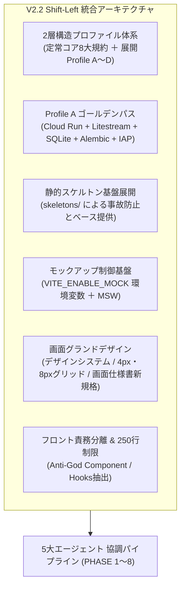
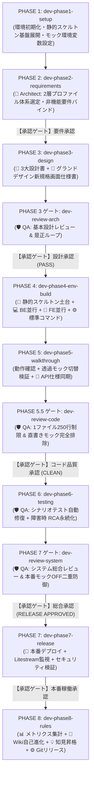
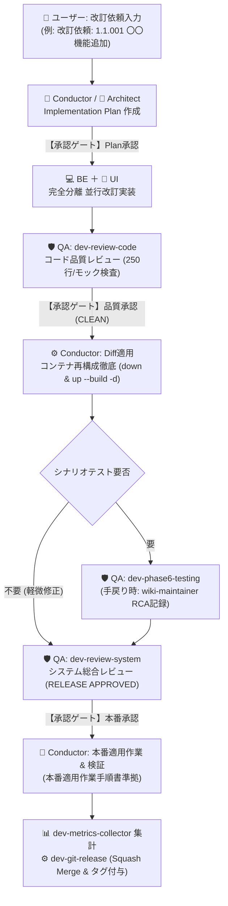

# Antigravity AI-Driven System Dev Pipeline V2.2 🚀

Google Antigravity のマルチエージェントオーケストレーション、カスタムスキル（Skills）、およびプラグインアーキテクチャを活用し、**新規プロジェクトの環境準備から要件定義、基本設計、環境構築、ウォークスルー、自動テスト、本番リリース、自己進化・改訂運用に至る全開発ライフサイクルを自律的に統制・自動化する開発基盤テンプレート**です。

---

## 📌 概要

V1.0（単一エージェント）、V2.0（Conductor ＋ 3エージェント分業）、V2.1（5大エージェント協調、3大レビューゲート、WikiSkill自己進化ループ、定量測定機構）を経て、**Version 2.2 (V2.2)** では実稼働Webシステム4案件の運用知見を全面的にフィードバックし、思想レベルでの大規模な進化を遂げました。

従来は「事後レビューによる手戻り修正」に頼っていた構造的負債（フロントエンドのGod Component化、生SQLやマイグレーション不備、セキュリティ・認可層の形骸化、野良直書きモックの混入）を根絶するため、V2.2では**「Shift-Left（品質・標準パターンの前倒し組み込み）」**を基本思想として採用。

初期スケルトン展開段階から堅牢なベースコードを配置する **「ハイブリッド方式（静的スケルトン ＋ 可変ドメイン生成）」**、全システム共通規約と適合アーキテクチャを構造化した **「2層構造システムプロファイル体系」**、サーバーレス極小コスト運用の決定版 **「Profile A（ゴールデンパス）」**、デザインシステムを標準化した **「画面グランドデザイン」**、環境変数による透過的切替を実現する **「外部API・モックアップ制御アーキテクチャ」** を標準装備しています。

---

## ✨ V2.2 の主な新機能と進化ポイント



1. **Shift-Left思想への全面転換（品質の前倒し組み込み）**
   - 不具合やアーキテクチャの破綻を事後レビューで直すのではなく、PHASE 1（スケルトン展開）、PHASE 2（プロファイル選定）、PHASE 3（基本設計）の初期段階から堅牢な標準パターンを自動注入。手戻り工数を劇的に削減。
2. **2層構造システムプロファイル体系 (Two-Tier Profile Architecture)**
   - **第1層: 定常的コア設計規範 (Universal Core Specifications)**: 全システム・全プロファイル共通で無条件遵守する8大普遍的規約（フロント責務分離250行制限、型定義自動同期、環境変数厳格検証、統一UTC/JST運用、自動CIワークフロー、モック制御ハイブリッド、画面グランドデザイン基礎、外部API二重キャッシュ＆内部監視）。
   - **第2層: 可変的システム展開プロファイル (Deployment Profiles A〜D)**: 要件定義段階でディシジョンツリーに基づき選定され、アーキテクチャ・設計・スケルトン・監査を一気通貫で決定。
     - **Profile A (サーバーレス極小コストWeb型 / 最優先ゴールデンパス)**: Cloud Run (`max-instances=1`) + Litestream + SQLite(WAL) + Alembic + IAP JWT 二重防御 + React SPA + MSW。
     - **Profile B (Web SSR / フルマネージドRDB型)**: Next.js/Nuxt SSR または FastAPI + Cloud SQL (PostgreSQL) + Alembic。
     - **Profile C (静的MPA / 超軽量ツール型)**: FastAPI + Jinja2 + HTMX / 単一バイナリCLI。
     - **Profile D (PCローカルデスクトップアプリ型)**: Tauri v2 + Local SQLite + Frameless TitleBar + IStorageAdapter。
3. **最優先リファレンススタック「Profile A（ゴールデンパス）」の完全整備**
   - 実稼働4プロジェクト（`bicycle-log`, `Movie Log`, `Gardening Log`, `bicycle-maintenance`）の実績に基づき、月額数十円〜数百円のサーバーレス極小コスト運用構成を標準化。
   - Alembic標準統合による生SQL排除、`entrypoint.sh` による起動時マイグレーション自動実行、Litestream同期監視（`/api/internal/litestream/status`）、IAP JWT署名検証ミドルウェア（`DEBUG=True` 時のみ安全なモック切替）を同梱。
4. **ハイブリッド方式の採用（静的スケルトン基盤 ＋ 可変ドメイン生成）**
   - 事故が起きやすい共通基盤（Alembic環境一式、Docker/entrypoint.sh、GitHub Actions CI、SQLite WALセッション、認証ミドルウェア、共通フック、MSWモック基盤）を `skeletons/` から初期展開。エージェントはドメイン設計と業務ロジックの自律生成に専念。
5. **標準コマンドシーケンスの事前定義**
   - 実行環境差異（Docker内 vs ホスト）によるエージェントの迷走を防ぐため、Alembicマイグレーション生成・適用、TypeScript型同期、コミット前CIローカル検証のコマンドシーケンスをスキルへ明示定義。
6. **外部システム・APIモックアップ制御アーキテクチャ（案C＋案Aの統合）**
   - **案C（環境変数制御）**: `.env` の `VITE_ENABLE_MOCK=true/false` により、MSWモックと実バックエンドAPI通信を透過的に切替。
   - **案A（直書きモック禁止）**: コンポーネント内の未認可ハードコードダミーデータ配列やローカル擬似ステートを原則禁止。
   - **二重防御レビュー**: `dev-review-code` (PHASE 5.5) で直書きモックを機械的検知・排除、`dev-review-system` (PHASE 7) で本番用 `VITE_ENABLE_MOCK=false` を二重検証。
7. **画面グランドデザインの全面標準採用（Design System Base）**
   - `doc_samples/グランドデザイン/` の規格を全面統合。セマンティックカラー（HEX/px絶対値とTailwindクラス併記）、4px/8pxグリッド体系、ウィンドウ形態選定基準（モーダル / ドロワー / フルページ / デスクトップ用サブウィンドウ）、UIコンポーネントカタログ（`components/ui/`）、画面仕様書新規格を標準化。
8. **フロントエンド Anti-God Component の徹底（1ファイル最大250行制限）**
   - 従来の300行制限からさらに厳格化し、**1コンポーネントファイル最大250行制限**を機械的検査。
   - `components/ui/`, `components/[domain]/`, `hooks/`, `services/`, `types/` への物理分割を義務化。
9. **5大エージェント協調 ＆ 3大厳格レビューゲート ＆ WikiSkill自己進化ループ（V2.1継承・強化）**
   - 👑 Conductor, 📐 Architect, 💻 Backend Engineer, 🎨 UI Designer, 🛡️ QA Engineer の責務完全分離。
   - 基本設計レビュー (`dev-review-arch`)、コード品質レビュー (`dev-review-code`)、システム総合レビュー (`dev-review-system`) の合否判定。
   - 障害・手戻りRCA即時永続化 (`wiki-maintainer`)、Tier 1（プロジェクト固有: `docs/` 逆同期）とTier 2（全体汎用: スキル改善パッチ立案 `wiki-proposer`）のナレッジ二層分離。
   - ターン・フェーズ別定量メトリクス集計（`dev-metrics-collector`）。

---

## 👥 エージェント体制と役割分担 (5大エージェント協調モデル V2.2)

```
                    ┌────────────────────────────────────────┐
                    │               👤 ユーザー              │
                    │      (要求提示 / ゲート承認 / 操作検証) │
                    └──────────────────┬─────────────────────┘
                                       │ 対話 / 指示 / 明示的承認
                                       ▼
                    ┌────────────────────────────────────────┐
                    │ 👑 1. プロジェクトコンダクター (Main)    │
                    │      (全体進行 / スケルトン展開 /       │
                    │       状態一元管理 Single Writer)       │
                    │      [Model: pro / Workspace: main]    │
                    └──────────────────┬─────────────────────┘
                                       │ 委譲 (invoke_subagent)
         ┌───────────────┬─────────────┴─────────────┬───────────────┐
         ▼               ▼                           ▼               ▼
┌─────────────────┐ ┌─────────────────┐ ┌─────────────────┐ ┌─────────────────┐
│ 📐 2. 設計立案   │ │ 💻 3. BE実装     │ │ 🎨 4. FE/UI     │ │ 🛡️ 5. 品質監査  │
│    スペシャリスト│ │    スペシャリスト│ │    デザイナー     │ │    & レビュー   │
│ (architect)     │ │ (backend-       │ │ (ui-designer)   │ │ (qa-engineer)   │
│                 │ │  engineer)      │ │                 │ │                 │
│ [Model: pro]    │ │ [Model: pro]    │ │ [Model: flash]  │ │ [Model: pro]    │
│ [Work: inherit] │ │ [Work: inherit] │ │ [Work: inherit] │ │ [Work: inherit] │
│ ※ run_command   │ │ ※ コンテナ起動・│ │ ※ UIビルド・   │ │ ※ コード直接   │
│   完全禁止      │ │   Git操作禁止   │ │   npm限定       │ │   改変禁止      │
└────────┬────────┘ └────────┬────────┘ └────────┬────────┘ └────────┬────────┘
         │                   │                   │                   │
         └───────────────────┴─────────┬─────────┴───────────────────┘
                                       ▼ 成果物反映・専任操作
                         ┌──────────────────────────┐
                         │ ⚙️ 決定論的ツール / スキル │
                         │ ・Git管理 (dev-git-*)    │
                         │ ・デプロイ (dev-db-*)    │
                         │ ・状態更新 (Single Writer│
                         │ ・標準コマンド統括実行   │
                         └──────────────────────────┘
```

| ロール | 種別 / 推奨モデル | 主な担当スコープ (V2.2) | 権限・ガードレール |
| :--- | :--- | :--- | :--- |
| 👑 **Conductor** | メイン / `pro` | 全体進行管理、`PROJECT_STATE.md` 一元更新（**Single Writer**）、静的スケルトン展開統括、Docker環境構築、標準コマンドシーケンス統括実行、Git・デプロイ・DB操作実行、知見昇格統括 | 全ツール利用可能（**専任操作ガードレール保護**） |
| 📐 **Architect** | サブ / `pro` | 要件定義書（プロファイル選定ディシジョンツリー適用）、基本設計4書（技術/スキーマ/ロジック/画面）作成統括、外部APIキャッシュ・モック方針設計、Alembic前提スキーマ設計、API仕様書逆同期 | `enable_write_tools: true`（**`run_command` は厳格禁止**） |
| 💻 **Backend Engineer** | サブ / `pro` | バックエンドAPI、SQLAlchemyモデル、Alembicマイグレーション生成・適用、ビジネスロジック、IAP JWT署名二重検証ミドルウェア、内部監視エンドポイント実装 | 単体テスト・構文検証のみ許可（**生SQL禁止、Git/デプロイ/DB上書き/コンテナ起動停止は禁止**） |
| 🎨 **UI Designer** | サブ / `flash` または `pro` | 画面仕様書（グランドデザイン新規格準拠）、モダンフロントエンド画面・UI部品実装、**1ファイル最大250行制限厳守**、Custom Hooks抽出、**コンポーネント内直書きモック禁止（MSWへ外出し）** | パッケージ導入・UIビルドのみ許可（**Git/デプロイ/DB操作禁止**） |
| 🛡️ **QA Engineer** | サブ / `pro` | ドキュメント多次元整合性監査（`dev-doc-reviewer`）、3大レビュー（基本設計/コード品質/システム総合）、シナリオテスト自動反復・修復（`dev-phase6-testing`）、障害RCA即時永続化（`wiki-maintainer`）、複合検証ゲート判定 | テスト実行のみ許可（**プログラム本体コード直接改変禁止、Wiki記録先は `./wiki/` 限定**） |

---

## 📂 ディレクトリ構成

```text
.
├── .agents/
│   └── plugins/
│       └── system-dev-pipeline/         # 開発自動化プラグイン本体 (v2.2.0)
│           ├── plugin.json              # プラグインマニフェスト（agents 5件, skills 19件）
│           ├── agents/                  # 👥 サブエージェント定義
│           │   ├── conductor.md         # 👑 司令塔・全体進行管理エージェント定義
│           │   ├── architect.md         # 📐 設計・立案スペシャリスト定義
│           │   ├── backend-engineer.md  # 💻 バックエンド実装スペシャリスト定義
│           │   ├── ui-designer.md       # 🎨 UI/UXデザイナー・FEエンジニア定義
│           │   └── qa-engineer.md       # 🛡️ 品質監査・3大レビュー・Wiki担当定義
│           ├── rules/                   # 📜 開発プロセス標準規約
│           │   └── AGENTS.md            # System Dev Pipeline Rule V2.2
│           ├── skeletons/               # 🧱 プロファイル別初期コードスケルトン (V2.2新設)
│           │   ├── common/              # 全プロファイル共通基盤 (.github/workflows/ci.yml 等)
│           │   ├── profile-a/           # Profile A基盤 (Alembic, entrypoint.sh, auth.py, MSW, UIベース)
│           │   └── profile-d/           # Profile D基盤 (デスクトップ雛形)
│           ├── skills/                  # ⚙️ カスタムスキル群（全19種）
│           │   ├── dev-phase1-setup/        # PHASE 1: 環境初期化・スケルトン展開
│           │   ├── dev-phase2-requirements/ # PHASE 2: 要件定義・2層プロファイル選定
│           │   ├── dev-phase3-design/       # PHASE 3: Shift-Left基本設計4書作成
│           │   ├── dev-review-arch/         # 基本設計レビュー (定常コア ＋ プロファイル適合)
│           │   ├── dev-phase4-env-build/    # PHASE 4: 構築・BE/FE並行実装・標準コマンド
│           │   ├── dev-phase5-walkthrough/  # PHASE 5: ウォークスルー・モック透過切替・API同期
│           │   ├── dev-review-code/         # コード品質レビュー (250行制限・直書きモック排除)
│           │   ├── dev-phase6-testing/      # PHASE 6: シナリオテスト自動修復 (モックON/OFF)
│           │   ├── dev-review-system/       # システム総合レビュー (本番モックOFF・IAP・Alembic)
│           │   ├── dev-phase7-release/      # PHASE 7: 本番リリース・デプロイ
│           │   ├── dev-phase8-rules/        # PHASE 8: メトリクス・知見昇格・自己進化
│           │   ├── dev-doc-reviewer/        # ドキュメント相互整合性クロスチェック
│           │   ├── wiki-maintainer/         # 障害・手戻りRCA即時永続化 (./wiki/)
│           │   ├── wiki-proposer/           # スキル改善パッチ立案・PURPOSE.md生成
│           │   ├── wiki-compactor/          # Wiki枝刈り・重複整理
│           │   ├── dev-metrics-collector/   # 定量メトリクス集計・健全性診断レポート
│           │   ├── dev-git-init/            # Git初期化・基点コミット・ブランチ作成
│           │   ├── dev-git-release/         # Squash Merge・タグ付与・ブランチ刷新
│           │   └── dev-db-overwrite/        # 本番DB上書き・安全同期
│           └── templates/               # 📄 標準ドキュメント・設定ファイル雛形
│               ├── .env.template                   # モック環境変数 (VITE_ENABLE_MOCK) 同梱
│               ├── code-workspace.template
│               ├── PROJECT_STATE.md.template       # 進行状態管理票雛形 (V2.2 2層プロファイル対応)
│               ├── TEMPLATE_PROMOTIONS.md.template # 知見昇格候補提示バッファ雛形
│               ├── 基本設計レビュー結果報告書.md.template
│               ├── コード品質レビュー及びリファクタリング提案書.md.template
│               ├── システム総合レビュー結果報告書.md.template
│               ├── AI駆動システム開発フェーズ定義書V2.2.md
│               ├── AI駆動システム開発手順書V2.2.md
│               ├── システム改訂ルール.md
│               ├── グランドデザイン/              # 画面グランドデザイン標準仕様群
│               ├── 要件定義書.md                   # 2層プロファイル選定設問・チェックリスト付き
│               ├── 技術要件定義書.md               # プロファイル別・フロント責務分離・250行制限
│               ├── テーブルスキーマ定義書.md       # Alembic前提・UTC ISO8601・生SQL禁止
│               ├── ビジネスロジック仕様書.md       # 外部APIキャッシュ・モック仕様・内部監視
│               ├── 画面仕様書.md                   # グランドデザイン新規格テンプレート
│               ├── シナリオテスト計画書.md
│               ├── 本番適用作業手順書.md
│               └── Git運用基準書.md
├── doc_samples/                         # 設計書・グランドデザインサンプル群
├── docs/                                # 仕様書・設計書アーカイブ
│   ├── 設計書/
│   │   ├── Current/                     # ★現在の正本（Single Source of Truth）
│   │   │   ├── AI駆動システム開発フェーズ定義書V2.2.md
│   │   │   ├── V2.2システムプロファイル構造設計書.md
│   │   │   ├── ProfileA詳細設計書.md
│   │   │   ├── V2.2改変計画書.md
│   │   │   ├── レビューシステム設計書V2.2.md
│   │   │   ├── エージェント設計書V2.2.md
│   │   │   ├── 状態管理機構設計書V2.2.md
│   │   │   └── WikiSkill統合設計書.md
│   │   └── V2.1/                        # V2.1 アーカイブ文書群
│   └── 検討課題/                        # 検討課題・評価レポート群
├── wiki/                                # 🧠 プロジェクトローカルWiki層 (Two-Tier Separation)
│   ├── patterns/
│   │   ├── local/                       # Tier 1: プロジェクト固有パターン (PAT-LOC-*)
│   │   ├── universal/                   # Tier 2: 全体汎用パターン (PAT-{CAT}-*)
│   │   └── rejected/                    # 棄却パターン
│   ├── archive/                         # 枝刈り・アーカイブパターン
│   ├── logs.md                          # Wiki操作・知見登録ログ
│   └── skill-impact.md                  # スキル進化影響度台帳
├── metrics/                             # 📊 定量測定・メトリクス層
│   ├── turns/                           # ターン別集計ログ (Git除外)
│   ├── phases/                          # フェーズ別集計ログ
│   └── system_health_report.md          # PHASE 8 総合健全性診断レポート
├── rules/                               # プロジェクト共通ルール
│   └── AGENTS.md                        # System Dev Pipeline Rule V2.2
├── PROJECT_STATE.md                     # プロジェクト進行状態管理票（初期化時生成）
├── TEMPLATE_PROMOTIONS.md               # 知見昇格候補提示バッファ（初期化時生成）
├── template.code-workspace              # VS Code / Antigravity ワークスペース設定
└── README.md
```

---

## 🛠 全19スキル（Skills）一覧

| フェーズ / 用途 | スキル名 | 主担当 | 概要・実行内容 (V2.2仕様) |
| :--- | :--- | :--- | :--- |
| **PHASE 1** | `dev-phase1-setup` | 👑 Conductor | ディレクトリ構造展開、**静的スケルトン基盤（`skeletons/`）配置**、`wiki/` 層、`metrics/` 受皿、`.env`（`VITE_ENABLE_MOCK=true` 含む）、`PROJECT_STATE.md`、設計雛形展開。 |
| **PHASE 2** | `dev-phase2-requirements` | 📐 Architect | `docs/要件定義書.md` を精査し、**2層プロファイル体系（Profile A〜D）選定ディシジョンツリー適用**、定常コア8項目の非機能要件自動バインドを実施。 |
| **PHASE 3** | `dev-phase3-design` | 📐 Architect<br>└ 🎨 UI Designer | **Shift-Left基本設計4書**（技術/スキーマ/ロジック/画面仕様）を作成。グランドデザイン新規格準拠、Alembic前提、キャッシュ戦略を網羅。完了後、基本設計レビューへ接続。 |
| **PHASE 3 ゲート** | `dev-review-arch` | 🛡️ QA Engineer | **基本設計レビュー**。定常的コア8項目および展開プロファイル別適合アーキテクチャを監査し合否判定（PASS 必須）。 |
| **PHASE 4** | `dev-phase4-env-build` | 👑 Conductor<br>├ 💻 BE<br>└ 🎨 UI | 静的スケルトンを土台にDocker環境構築、💻 BE ＋ 🎨 UI 並行委譲実装、**標準コマンドシーケンス（Alembicマイグレーション生成・適用、TypeScript型同期、CI検証）** 自動実行、Git初期化。 |
| **PHASE 4** | `dev-git-init` | ⚙️ Conductor | `Git運用基準書.md` 配置、Git初期化（`main`）、初期構成コミット作成、`feature` ブランチ作成。 |
| **PHASE 5** | `dev-phase5-walkthrough` | 👑 Conductor<br>└ 📐 Architect | 画面ウォークスルー動作確認統括、**モック透過切替検証（`VITE_ENABLE_MOCK=true/false`）**、不具合修正、実装コードを正としたAPI仕様書の同期更新。 |
| **PHASE 5.5 ゲート**| `dev-review-code` | 🛡️ QA Engineer | **コード品質・整合性レビュー**。**1ファイル最大250行制限の機械的検査**、**コンポーネント内直書きモックの完全排除**、型同期検証、Unified Diff提示（CLEAN 必須）。 |
| **PHASE 6** | `dev-phase6-testing` | 🛡️ QA Engineer | シナリオテスト計画書作成、自動テストコード構築、モック有効/無効双方での結合テスト、自動修復ループ（失敗時 RCA即時永続化）。 |
| **PHASE 6 / RCA** | `wiki-maintainer` | 🛡️ QA Engineer | **Wiki知見永続化・RCA**。テスト失敗・手戻り発生時に根本原因を分析し、`./wiki/patterns/` へ仕分け即時記録。 |
| **PHASE 7 ゲート** | `dev-review-system` | 🛡️ QA Engineer | **システム総合レビュー**。**本番用 `VITE_ENABLE_MOCK=false` 二重防御**、**IAP JWT署名検証有効化**、**`entrypoint.sh` 起動時 Alembic 保証**、平文排除を総合監査（RELEASE APPROVED 必須）。 |
| **PHASE 7** | `dev-phase7-release` | 👑 Conductor | システム総合レビュー合格確認、本番適用作業手順書生成、本番デプロイ実行、Litestream同期監視確認、セキュリティ検証。 |
| **PHASE 8** | `dev-phase8-rules` | 👑 Conductor | メトリクス集計、Wiki進化提案、複合検証ゲート、知見昇格レビュー、`EXECUTION_MODE` 別ルーティング、運用ルール適用。 |
| **PHASE 8 / 進化** | `wiki-proposer` | 👑 Conductor | **スキル進化提案**。Tier 2 汎用知見からスキル・ルール改善パッチ立案、`PURPOSE.md` 生成、昇格サマリ更新。 |
| **PHASE 8 / 整理** | `wiki-compactor` | 👑 Conductor | **Wiki枝刈り・整理**。パターンの重複排除、陳腐化パターンのアーカイブ (`./wiki/archive/`)、台帳整合性修復。 |
| **定量測定** | `dev-metrics-collector` | 👑 Conductor | **定量メトリクス集計**。ターン別・フェーズ別メトリクスを集計し、総合健全性スコアおよび診断レポートを出力。 |
| **PHASE 8 / リリース** | `dev-git-release` | ⚙️ Conductor | バージョン番号付与、`main` への Squash Merge、GitHub Push、次期 `feature` ブランチ刷新。 |
| **保守** | `dev-db-overwrite` | ⚙️ Conductor | 本番適用後DBのローカル同期、DBを含むコンテナの本番上書きデプロイ（二重防御ガードレール保護）。 |
| **共通監査** | `dev-doc-reviewer` | 🛡️ QA Engineer | `docs/` 配下の要件定義・設計書間の矛盾、誤植、説明不足を多次元クロスチェックし自動修復（`docs/plans/`, `wiki/` は厳格除外）。 |

---

## 🚦 開発パイプラインの実行フロー (PHASE 1〜8)

新規プロジェクトでシステム開発を開始する場合、Antigravity上で以下のプロンプトを順に投入します。



### 1. プロジェクト初期化・スケルトン展開（PHASE 1）
```text
dev-phase1-setup スキルを実行し、本プロジェクトの環境初期化を行ってください。
```
- ディレクトリ、`wiki/` 受皿、`metrics/` 受皿、**プロファイル別静的スケルトン（`skeletons/`）**、`.env`（`VITE_ENABLE_MOCK=true` 含む）、`PROJECT_STATE.md` (V2.2)、各種設計書・レビュー報告書雛形が展開されます。

### 2. 要件定義・2層プロファイル選定（PHASE 2）
`docs/要件定義書.md` に要求メモを記述した上で実行：
```text
dev-phase2-requirements スキルを実行し、docs/要件定義書.md を精査して展開プロファイルの選定および要件定義書の清書・詳細化を行ってください。
```
- 📐 `architect` が選定ディシジョンツリーを適用し、システム展開プロファイル（Profile A〜D）を決定。第1層の定常的コア設計規範（フロント責務分離、型同期、統一UTC/JST、モック方針等）を自動バインドします。
- **【承認ゲート】「要件定義書の内容を承認します」** とプロンプト入力して次へ。

### 3. Shift-Left基本設計書作成＆基本設計レビュー（PHASE 3）
```text
dev-phase3-design スキルを実行し、基本設計書を作成した上で基本設計レビューを行ってください。
```
- 📐 `architect` が技術要件（プロファイル適合）、テーブルスキーマ（Alembic前提、UTC ISO8601、生SQL禁止）、ビジネスロジック（外部APIキャッシュ、モック制御、内部監視）を作成。
- 🎨 `ui-designer` が画面仕様書（グランドデザイン新規格: セマンティックカラーHEX/px併記、グリッド、ウィンドウ形態選定、ショートカット）を作成。
- 🛡️ `qa-engineer` が `dev-review-arch` で定常コア8項目およびプロファイル別観点を監査し、`docs/plans/基本設計レビュー結果報告書.md` を作成。
- **【承認ゲート】「基本設計書の内容を承認します」** とプロンプト入力して次へ。

### 4. 責務分離環境構築・並行実装・標準コマンドシーケンス実行（PHASE 4）
```text
dev-phase4-env-build スキルを実行し、docs/配下の設計ドキュメントに基づいて開発環境構築とシステム実装を行ってください。
```
- 👑 コンダクターが `skeletons/` を土台にDocker環境を構築。
- 💻 `backend-engineer` がSQLAlchemyモデル、Alembicマイグレーション、API、IAP認証を実装。
- 🎨 `ui-designer` がグランドデザイン準拠画面を**1ファイル250行制限**および**直書きモック禁止（MSWハンドラー利用）**を徹底して並行実装。
- 標準コマンドシーケンス（Alembicマイグレーション生成・適用、TypeScript型定義自動生成、ローカルCI検証）を順次実行し、`dev-git-init` でGitリポジトリ初期化。

### 5. ウォークスルー・モック透過切替検証＆API仕様同期（PHASE 5）
```text
dev-phase5-walkthrough スキルを実行し、ウォークスルーによる動作確認とモック切替検証、およびコード品質レビューを行ってください。
```
- 実際の画面操作を行い、`VITE_ENABLE_MOCK=true`（MSWモック動作）と `VITE_ENABLE_MOCK=false`（実API通信動作）の双方で透過的に動作することを検証。
- 実装コードを正としてAPI仕様書を同期更新。

### 6. コード品質レビュー（PHASE 5.5 ゲート）
- 🛡️ `qa-engineer` が `dev-review-code` により、**1ファイル最大250行制限**、**コンポーネント内直書きモックの完全排除**、型同期を批判的に監査し、`docs/plans/コード品質レビュー及びリファクタリング提案書.md` (Unified Diff) を提示。
- コンダクターおよび各エンジニアが是正を適用し、判定 `CLEAN` を獲得。
- **【承認ゲート】「コード品質レビュー結果を承認します」** とプロンプト入力して次へ。

### 7. シナリオテスト＆障害時RCA永続化（PHASE 6）
```text
dev-phase6-testing スキルを実行し、シナリオテスト環境の構築とテスト自動反復ループを開始してください。
```
- 🛡️ `qa-engineer` がテストスクリプトを構築し、全テストケース合格まで自律修復ループを実行（最大5回）。
- 手戻りやテスト失敗が発生した場合、`wiki-maintainer` が根本原因分析（RCA）を実施し、`./wiki/patterns/` へ知見を即時永続化。
- **【承認ゲート】「テスト完了・リリース準備移行を承認します」** とプロンプト入力して次へ。

### 8. システム総合レビュー＆本番リリース（PHASE 7）
```text
dev-phase7-release スキルを実行し、システム総合レビューの確認および本番適用作業を行ってください。
```
- 🛡️ `qa-engineer` による `dev-review-system`（システム総合レビュー）を実行。**本番モックOFF（`VITE_ENABLE_MOCK=false`）二重防御**、**IAP JWT署名検証有効化**、**`entrypoint.sh` による起動時 Alembic 実行保証**、Litestream同期監視確認、平文シークレットゼロを検証し `RELEASE APPROVED` を確認。
- 👑 コンダクターが本番適用作業手順書を作成して本番デプロイを実行。
- **【承認ゲート】「本番稼働確認を承認します」** とプロンプト入力して次へ。

### 9. メトリクス集計・Wiki自己進化・知見昇格・Gitリリース（PHASE 8）
```text
dev-phase8-rules スキルを実行し、メトリクス集計、知見昇格レビュー、および本番Gitリリースを行ってください。
```
- `dev-metrics-collector` により開発健全性レポート（`metrics/system_health_report.md`）を出力。
- `wiki-proposer` が汎用知見（Tier 2）からスキル改善パッチを立案し、複合検証ゲートを経て `./TEMPLATE_PROMOTIONS.md` に提示。
- ユーザー承認後、`EXECUTION_MODE` に応じたルーティング（差分パッチ出力または直接反映）を実行。
- `dev-git-release` により `Release v1.0.0` を本番反映し、運用ルールを適用。

---

## 🔄 既存プロジェクトのアップグレード方針について

テンプレートV2.2への大幅なグレードアップ（2層プロファイル体系、静的スケルトン基盤、グランドデザイン規格、Alembic標準統合、IAP二重防御、MSWモック制御、250行制限等）に伴い、既存プロジェクトの移行はプロジェクトソースの全面刷新と再検証を伴うため、定型スキル（旧 `dev-upgrade-v1-to-v2`）は**正式に廃止**されました。

既存プロジェクト（`bicycle-log`, `Movie Log` 等）のアップグレードに関しては、各プロジェクトのアーキテクチャ特性や差分規模に応じた **「個別アップグレード計画」を別途策定** して段階的に実施する方針へ移行しています。

### 予見される移行フェージング骨子（プロジェクト別計画の標準モデル）
1. **Phase M-1: データベース・インフラ基盤移行**
   - 既存DBダンプ保護、Alembic環境初期化、既存スキーマへの `stamp head` 適用、`entrypoint.sh` 確定シーケンス刷新。
2. **Phase M-2: バックエンドAPI・認証層移行**
   - IAP JWT署名検証依存性の導入、内部ヘルスチェック・Litestream監視エンドポイントの追加。
3. **Phase M-3: フロントエンド責務分離・グランドデザイン移行**
   - ディレクトリ責務分離（Hooks/Services）、共通フック適用、250行制限コンポーネント分割、MSWモックアダプター化。
4. **Phase M-4: スルーテスト・ステージング再デプロイ検証**
   - 回帰テスト実行、Cloud Run ステージング環境へのデプロイ、WAL同期ラグ確認、本番切替。

> [!NOTE]
> 当時のアップグレード仕様および移行計画書の記録は、アーカイブとして以下に保管されています：
> - 移行計画書: [V1.0プロジェクトアップグレードスキル策定および移行計画書.md](./docs/設計書/V2.1/V1.0プロジェクトアップグレードスキル策定および移行計画書.md)
> - スキル文書アーカイブ: [dev-upgrade-v1-to-v2-SKILL.md](./docs/設計書/V2.1/dev-upgrade-v1-to-v2-SKILL.md)

---

## 🔄 システム改訂運用フロー（REVISION LIFECYCLE V2.2）

本番運用中のシステムに対し、機能追加・仕様変更・不具合修正を行う場合の標準プロセスです（[システム改訂ルール.md](./.agents/plugins/system-dev-pipeline/templates/システム改訂ルール.md) 準拠）。



### 改訂実行プロンプト例
```text
改訂依頼: 1.1.001 ユーザー検索機能のページネーション対応を実施してください。
```

- **改訂ターンの重要規約**:
  - **コード品質レビュー (PHASE 5.5)**: 改訂コード差分に対して 🛡️ `qa-engineer` が `dev-review-code` を実行。**1ファイル250行制限**、**直書きモック排除**、DRY原則、SRPを批判的監査。
  - **コンテナ再構成の徹底**: 実装修正後は必ず `docker compose down` および `docker compose up --build -d` を実行して反映を保証。
  - **Wiki RCA 即時記録**: 改訂中の手戻りやテスト失敗は、🛡️ `qa-engineer` が `wiki-maintainer` により `./wiki/patterns/` へ即座に根本原因分析を永続化。
  - **本番適用ゲート**: デプロイ前に必ず `dev-review-system` の判定 `RELEASE APPROVED`（本番モックOFF二重防御、IAP検証）を確認。

---

## 🛡️ 安全運用ガイドライン（Guards & Rules）

1. **2層構造プロファイル体系の遵守**
   - 第1層の定常的コア設計規範（フロント責務分離・250行制限、型同期、タイムゾーン、モック方針等）はすべての開発で無条件に遵守。第2層展開プロファイル仕様に基づき環境を構築。
2. **二重防御ガードレール (Double-Defense Guardrail)**
   - プロンプトとツールの両面で制限をかけ、`architect` によるコマンド誤実行や `qa-engineer` によるアプリケーション本体コード直接改変を確実に防止。
3. **ナレッジ境界とローカル・ファースト蓄積原則 (Two-Tier Separation)**
   - 開発中の試行錯誤・RCA はすべてプロジェクトローカルの `./wiki/` に蓄積。
   - プロジェクト固有の知見（Tier 1）は `docs/` への逆同期で正本化。
   - 汎用知見（Tier 2）は PHASE 8 承認ゲートと複合検証ゲートを通過したパッチのみ昇格。
4. **Single Writer 原則の厳守**
   - `PROJECT_STATE.md` への書き込みは Conductor 専任。サブエージェントは標準完了サマリの返却のみを行い、状態競合・破損を防止。
5. **修正後のDockerコンテナ再構成徹底ルール**
   - PHASE 4 以降、コードや設定ファイルを変更した際は、変更を確実に反映させるため **`docker compose down` および `docker compose up --build -d`** を徹底。
6. **データベース運用規約（生SQL禁止・Alembic厳格運用）**
   - 手動生SQL DDLを完全排除。SQLAlchemyモデルとAlembicマイグレーションによる確定追跡を行い、起動シーケンスで確実に自動適用。
7. **フロントエンド Anti-God Component 規約**
   - **1コンポーネントファイル最大250行制限**を厳守。コンポーネント内の直書きモックを禁止し、MSWモックハンドラーへ分離。
8. **自律修復ループ上限**
   - ドキュメントやテストコードの自律修復は **最大5回まで**。5回で解消しない場合は直ちに停止しログをレポート。
9. **セキュリティと認証**
   - APIキーや秘密情報はコードに含めず `.env` で管理。FastAPI側でのIAP JWT署名二重検証を必須化し、平文キーをゼロ化。
10. **ドキュメント内相対パスリンク強制ルール (Global Dev Rule)**
    - Markdownファイル内で他のファイルへリンクを記述する場合は、環境依存を防ぎプロジェクトの可搬性・移植性を担保するため、**絶対パス（`file:///` 等）を禁止し、必ず対象ファイル間の相対パス（例: `../設計書.md`, `./sub/仕様書.md`）を使用**。

---

## 📦 セットアップ・導入方法

### 方法 A: 新規プロジェクトのテンプレートとして使用する（ワークスペース単位・推奨）
本リポジトリをクローンまたはフォークし、そのままプロジェクトの起点として利用します。`.agents/` ディレクトリが存在するため、Antigravityを開くだけでプラグイン、エージェント定義、スキルが即座に利用可能になります。

### 方法 B: グローバルプラグインとして全プロジェクトで共有する
他のプロジェクトでも本スキル・エージェント群を共通利用したい場合は、Antigravityのグローバルプラグインディレクトリへ配置します。

```bash
mkdir -p ~/.gemini/config/plugins/
cp -r .agents/plugins/system-dev-pipeline ~/.gemini/config/plugins/
```

### 方法 C: 既存運用プロジェクトのアップグレード
V2.2への進化に伴い定型アップグレードスキルは廃止されたため、既存プロジェクトの移行については各プロジェクトの個別計画書を別途策定し、段階的に実施します。詳細は [docs/設計書/V2.1/V1.0プロジェクトアップグレードスキル策定および移行計画書.md](./docs/設計書/V2.1/V1.0プロジェクトアップグレードスキル策定および移行計画書.md) を参照してください。

---

## 📄 ライセンス

MIT License
