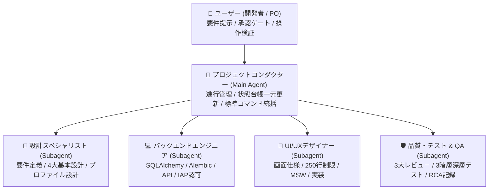

# AI駆動システム開発フェーズ定義書（2層プロファイル体系・Hard Gate・Live Sensor・RTM完全準拠版）

文書バージョン: 2.6.2  
作成日: 2026-11-05  
対象バージョン: AI駆動システム開発ライフサイクルテンプレート V2.6.2  
ステータス: 正式改訂版 (Shift-Left & 2層プロファイル・Hybrid Ledger 統合版)  
関連文書:
- システム開発パイプライン基本設計書群（Profile A詳細設計書、Profile D詳細設計書、レビューシステム設計書、エージェント設計書、状態管理機構設計書）
- [01_グランドデザイン基本仕様書.md](./グランドデザイン/01_グランドデザイン基本仕様書.md)
- [02_UIコンポーネントカタログ及び実装パターン.md](./グランドデザイン/02_UIコンポーネントカタログ及び実装パターン.md)
- [03_画面仕様書テンプレート.md](./グランドデザイン/03_画面仕様書テンプレート.md)

---

## 1. 目的と位置付け

本文書は、Antigravity環境におけるAI駆動システム開発ライフサイクル（新規開発 PHASE 1〜8、および本番リリース後の継続的システム改訂プロセス）において、**メインエージェント（コンダクター）、4つの専門サブエージェント（architect, backend-engineer, ui-designer, qa-engineer）、決定論的スクリプト群、およびユーザー（開発者/PO）** が協調して開発・改訂を完遂するためのフェーズ定義と役割分担を規定するものである。

本ライフサイクルにおいては、事後レビューでの検知・手戻り修正を排除し、**「要件定義・基本設計・初期スケルトン展開段階からの堅牢な標準パターンの前倒し組み込み（Shift-Left）」**を徹底するため、以下の設計体系を標準統合する：

1. **2層構造システムプロファイル体系**:
   - **第1層: 定常的コア設計規範（Universal Core Specifications）**: 全システム・全プロファイル共通で初期配置・遵守する定常コア9大規約（フロント250行/バック400行制限・Hard Gate遮断、要件トレーサビリティ & 3階層深層アサーション、ブラウザ感覚センサー、型定義自動同期、シークレット厳格バリデーション & Dual Provisioning、統一UTC/JST、モック制御案C+案A、画面グランドデザイン規範、CI・ディレクトリ非依存）。
   - **第2層: 可変的システム展開プロファイル（Deployment Profiles）**: PHASE 2で選定され、PHASE 1〜7の設計・実装・監査を一気通貫で決定する適合プロファイル（Profile A〜E）。
2. **最優先リファレンススタック「Profile A（ゴールデンパス）」の完全整備**:
   - Cloud Run + Litestream + SQLite(WAL) + Alembic標準統合 + IAP JWT署名二重検証 + React SPA + MSW。
3. **ハイブリッド方式の採用（静的スケルトン vs 可変ドメイン生成）**:
   - 事故が起きやすい基盤コード（Alembic環境、コンテナ起動シーケンス、CIワークフロー、認証ミドルウェア、モック基盤等）を `skeletons/` として初期展開し、エージェントは業務ドメインの自律生成に専念。
4. **標準コマンドシーケンスの事前定義**:
   - Alembicマイグレーション自動生成/適用、TypeScript型同期、CI同等検証などの実行手順を標準化。
5. **外部システム・APIモックアップ制御アーキテクチャの確立**:
   - 案C（環境変数 `VITE_ENABLE_MOCK` による明示的切替）と案A（コンポーネント内直書きモックの原則禁止）のハイブリッド統合。実結合モードでのサイレントモックフォールバック厳格禁止。
6. **画面グランドデザインの全面標準採用**:
   - デザインシステム基盤（4px/8pxグリッド、HEX/px絶対値併記）、UIコンポーネントカタログ、画面仕様書新規格を強制適用。
7. **構造化状態台帳と Single Writer 原則**:
   - 機械正本 `project_state.json` と自動生成ビュー `PROJECT_STATE.md` を1対1同期。コンダクターが `state_manager.py` 経由で原子的・決定論的に更新。

---

## 2. 採用された基本方針

| 検討項目 | 採択方針 | 詳細内容 |
| :--- | :--- | :--- |
| **1. 開発思想** | **Shift-Left（品質・標準の前倒し組み込み）** | 事後レビューによる手戻りを防ぐため、PHASE 1（スケルトン展開）、PHASE 2（プロファイル選定）、PHASE 3（基本設計）から標準パターンを組み込む。 |
| **2. システムプロファイル** | **2層構造プロファイル体系** | 「第1層: 定常的コア設計規範（定常コア9大規約）」と「第2層: 展開プロファイル（Profile A〜E）」に構造化し、初期スケルトンからレビューゲートまで一気通貫でバインドする。 |
| **3. 基盤実装方式** | **ハイブリッド方式（静的スケルトン ＋ 可変ドメイン生成）** | `skeletons/` から検証済み基盤（Alembic, entrypoint.sh, CI, 共通フック等）を展開し、エージェントはドメイン設計・ロジック実装に専念する。 |
| **4. 画面デザイン** | **グランドデザイン全面標準採用** | セマンティックカラー（HEX/px併記）、4px/8pxグリッド、ウィンドウ形態選定基準、画面仕様書新規格を強制適用。デイライト視認性の明暗ペア指定を必須化。 |
| **5. コード品質管理** | **責務分離 & 行数制限 Hard Gate** | フロントエンド1ファイル最大250行、バックエンド1ファイル最大400行制限。ASTレイヤーバイパス禁止、直書きモック排除をコミット前・CIで機械遮断。 |
| **6. モック制御** | **環境変数切替 (案C) ＋ 直書きモック禁止 (案A)** | `.env` の `VITE_ENABLE_MOCK` で実APIとモックを透過切替。実結合モードにおけるサイレントモックフォールバックを厳格禁止（Fail-Fast原則）。 |
| **7. データベース運用** | **Alembic標準統合 & SQLite WAL運用** | 生SQL手動DDLを完全排除。起動シーケンス（`entrypoint.sh`）で Litestreamリストア ➔ Alembicマイグレーション ➔ アプリ起動を確定実行する。 |
| **8. セキュリティ・認可** | **IAP JWT署名二重検証** | 前段プロキシ依存による認証バイパスを防止するため、FastAPIバックエンド側でJWT署名を検証し、モックの安全なローカル切替を実現する。 |
| **9. 状態管理** | **Single Writer 原則 & Hybrid Ledger** | コンダクター専任で `scripts/state_manager.py` により `project_state.json` / `PROJECT_STATE.md` を原子的・決定論的一元更新。 |
| **10. 品質ゲート** | **3大レビュー品質ゲート** | PHASE 3（基本設計: `dev-review-arch`）、PHASE 5.5（コード品質: `dev-review-code`）、PHASE 7（システム総合: `dev-review-system`）の合格とユーザー明示承認を必須とする。 |

---

## 3. エージェントおよびユーザーの役割体系

---

## 4. 新規システム開発フェーズ（PHASE 1〜8）詳細フロー

### 4.1 PHASE 1: プロジェクト初期化・環境構築
- **目的**: 開発ディレクトリの展開、初期スケルトンの配備、状態台帳の初期化。
- **主担当**: 👑 コンダクター（スキル: `dev-phase1-setup`）
- **完了条件**: スケルトン展開、`project_state.json` 初期化、`.env` / `.env.example` 配備完了。

### 4.2 PHASE 2: 要件定義とプロファイル選定
- **目的**: 業務要件の抽出、プロファイル（Profile A〜E）の選定ディシジョン、非機能要件バインド。
- **主担当**: 📐 `architect`（スキル: `dev-phase2-requirements`）
- **完了条件**: `docs/設計書/Current/要件定義書.md` の作成、ユーザーによる明示的承認。

### 4.3 PHASE 3: 4大基本設計と基本設計レビュー
- **目的**: 技術要件定義書、テーブルスキーマ定義書、ビジネスロジック仕様書、画面仕様書の策定。
- **主担当**: 📐 `architect`（スキル: `dev-phase3-design`）、🎨 `ui-designer`（画面仕様書）
- **レビューゲート**: 🛡️ `qa-engineer`（スキル: `dev-review-arch`）
- **完了条件**: 基本設計レビュー合格（PASS / CONDITIONAL PASS）、ユーザーによる明示的承認。

### 4.4 PHASE 4: 開発環境構築と並行実装
- **目的**: バックエンド・フロントエンドの初期実装、Alembicマイグレーション、TypeScript型同期。
- **主担当**: 👑 コンダクター（統括・スキル: `dev-phase4-env-build`）、💻 `backend-engineer`、🎨 `ui-designer`
- **完了条件**: コンテナ正常起動、Hard Gate pre-commit フック通過、初期ビルド成功。

### 4.5 PHASE 5: ウォークスルー検証とモック切替確認
- **目的**: UI画面とAPIの結合確認、モック透過切替（`VITE_ENABLE_MOCK=true/false`）の検証。
- **主担当**: 👑 コンダクター（統括・スキル: `dev-phase5-walkthrough`）、ユーザー
- **完了条件**: ウォークスルー完了、モック/実API両モードでの動作確認、ユーザー承認。

### 4.6 PHASE 5.5: コード品質レビューとリファクタリング
- **目的**: 行数制限（FE 250行/BE 400行）、直書きモック排除、AST適応度、型安全性の機械的監査。
- **主担当**: 🛡️ `qa-engineer`（スキル: `dev-review-code`）、💻 BE / 🎨 UI（是正）
- **完了条件**: `harness_guard.py --all` PASS、判定 `CLEAN`、ユーザー承認。

### 4.7 PHASE 6: スルーテスト環境の構築と自律修復ループ
- **目的**: 網羅的E2Eシナリオテストの実行、3階層深層アサーション、自律修復ループ。
- **主担当**: 🛡️ `qa-engineer`（スキル: `dev-phase6-testing`）
- **完了条件**: シナリオテスト成功率 100%、トレーサビリティカバレッジ 100%、異常系比率 20% 以上、ユーザー承認。

### 4.8 PHASE 7: システム総合レビューと本番リリース
- **目的**: 本番適用作業手順書の策定、本番稼働耐性総合監査（`dev-review-system`）、本番デプロイ。
- **主担当**: 👑 コンダクター（スキル: `dev-phase7-release`）、🛡️ `qa-engineer`（レビュー）
- **完了条件**: システム総合レビュー合格（RELEASE APPROVED）、ユーザー承認、本番稼働確認。

### 4.9 PHASE 8: 本番公開確定・知見昇格・保守移行
- **目的**: GitHub 本番反映（Squash Merge）、定量メトリクス集計、知見昇格、改訂運用基準書への移行。
- **主担当**: 👑 コンダクター（スキル: `dev-git-release`, `dev-metrics-collector`, `dev-phase8-rules`）
- **完了条件**: `main` ブランチ Squash Merge & タグ付与、メトリクス集計、`docs/システム改訂運用基準書.md` への移行。

---

## 5. 運用保守・システム改訂サイクル（`REV-1`〜`REV-6`）

初期リリース完了後の改訂・保守は、[docs/システム改訂運用基準書.md](../システム改訂運用基準書.md) に規定された6段階標準改訂パイプラインに厳格に従う：
- `REV-1`: 要件・設計・契約フィクスチャ精査（`state_manager.py start-revision`）
- `REV-2`: 実装・静的検証・Stage 1.5 スモーク（2段階行数制限、OpenAPI型同期）
- `REV-3`: 自動テスト・実結合E2E・感覚センサー検証（`qa_runtime_evidence.json` 発行）
- `REV-4`: 開発サーバー起動・ユーザー実機レビュー・改修（実結合確認・ユーザー承認記録）
- `REV-5`: 本番総合監査・成果物ビルド（コード/システム総合レビュー合格、本番成果物ビルド）
- `REV-6`: メトリクス・知見昇格・リリース（`state_manager.py complete-revision` Invariants Gate）

---

## 6. ドキュメント改定履歴

| 改訂依頼番号 | 対象バージョン | ターン | 改定者 | 改定概要 | 完了日 |
| :--- | :--- | :---: | :--- | :--- | :--- |
| - | v1.0.0 | - | 👑 conductor | 初期フェーズ定義策定（定常コア9大規約・Hybrid Ledger・REV-1〜5準拠） | 2026-11-05 |
