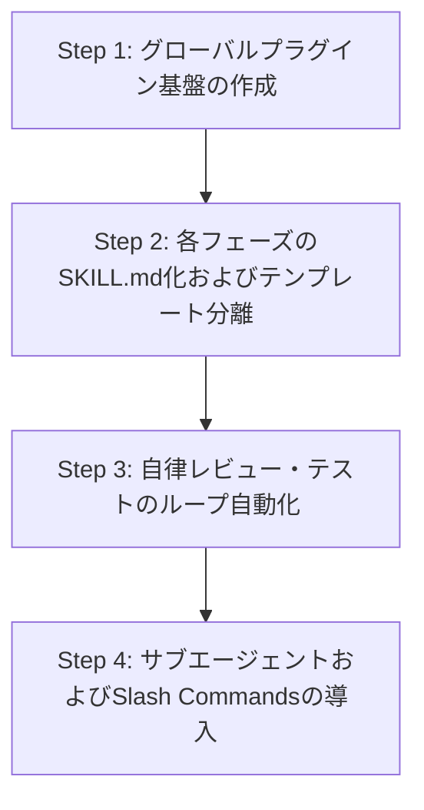

# Antigravity共通化およびシステム開発自動化 提案書

## 1. 概要・目的

本文書は、Antigravityの拡張機構（カスタムスキル、プラグイン、サブエージェント、バックグラウンド処理等）を活用して共通化・自動化するための構想および具体的な実装方針を定義するものである。

新規開発プロジェクトの立ち上げから、要件定義、基本設計、環境構築、ウォークスルー、自動テスト、本番リリース、ドキュメント改訂管理に至る開発ライフサイクル全体を、AI駆動で自律的かつ効率的に進行させる仕組みを確立する。

---

## 2. 現状課題と共通化・自動化の狙い

### 2.1 現状の課題

1. **手動ファイルコピーの発生**: 新規プロジェクト開始ごとに `手順書/` や `prompts/` ディレクトリを手動でコピー・配置する必要がある。
2. **ハードコードと手動指示の負担**: プロンプト内の固定パス（例: `<プロジェクト名>`）の書き換えや、プロンプトファイルの手動読み込み指示が必要である。
3. **判定・反復作業の人的依存**: ドキュメント間の相互整合性チェックやテスト実行時の修正・リトライ判定がユーザー主導で行われている。

### 2.2 共通化・自動化の狙い

1. **プロジェクト間共通化**: `~/.gemini/config/plugins/` による一元管理により、新規プロジェクトでの手順書コピー作業を完全撤廃。
2. **コンテキスト連動と自律発動**: Antigravityがプロジェクトのステータスやディレクトリ状態を自動識別し、適切なスキル（`SKILL.md`）を自律的にロード・実行。
3. **自律修正ループ（Self-Healing Loop）の導入**: ドキュメント相互整合性チェックや自動テスト時のエラー修正・再検証を、AIがArtifactsを活用しながら自己完結型ループとして実行。

---

## 3. 全体アーキテクチャ（Antigravity Plugin 構成案）

開発手順書とプロンプト群をAntigravityプラグイン（`system-dev-pipeline`）としてパッケージ化し、グローバルまたは共有環境で管理する。

### 3.1 ディレクトリ構造

```text
~/.gemini/config/plugins/system-dev-pipeline/
├── plugin.json                          # プラグイン定義マニフェスト
├── rules/
│   └── dev-process-standards.md         # 全フェーズ共通の品質・運用規約
├── skills/                              # 各フェーズを独立したAIスキルとして定義
│   ├── dev-phase1-setup/                # PHASE 1: プロジェクト初期化
│   │   ├── SKILL.md                     #  - 指示書（YAML frontmatter + Markdown）
│   │   └── templates/                   #  - .env などのテンプレート
│   ├── dev-phase2-requirements/         # PHASE 2: 要件定義
│   │   └── SKILL.md
│   ├── dev-phase3-design/               # PHASE 3: 基本設計
│   │   └── SKILL.md
│   ├── dev-phase4-env-build/            # PHASE 4: 開発環境構築・初期実装
│   │   └── SKILL.md
│   ├── dev-phase5-walkthrough/          # PHASE 5: ウォークスルー動作確認
│   │   └── SKILL.md
│   ├── dev-phase6-testing/              # PHASE 6: 自動テスト＆スルーテスト
│   │   └── SKILL.md
│   ├── dev-phase7-release/              # PHASE 7: 本番リリース
│   │   └── SKILL.md
│   ├── dev-phase8-rules/                # PHASE 8: ドキュメント改訂管理設定
│   │   └── SKILL.md
│   ├── dev-git-init/                    # PHASE 4: Git初期化＆ブランチ作成
│   │   └── SKILL.md
│   ├── dev-git-release/                 # PHASE 8/改訂: 本番リリース＆ブランチ刷新
│   │   └── SKILL.md
│   ├── dev-db-overwrite/                # 保守: DB上書き＆コンテナデプロイ
│   │   └── SKILL.md
│   └── dev-doc-reviewer/                # 共通: ドキュメント相互整合性チェッカー
│       └── SKILL.md
└── templates/                           # ドキュメント・設定雛形
    ├── 要件定義書.md
    ├── 技術要件定義書.md
    ├── ビジネスロジック仕様書.md
    ├── 画面仕様書.md
    ├── テーブルスキーマ定義書.md
    ├── Git運用基準書.md
    └── 本番適用作業手順書.md
```

---

## 4. フェーズ別 Antigravity スキル（Skills）設計

各開発フェーズのプロンプトを `SKILL.md` 形式に落とし込み、動的なコンテキスト参照に変換する。

| フェーズ    | スキル名                  | 主な自動化内容                                                                                  |
| :---------- | :------------------------ | :---------------------------------------------------------------------------------------------- |
| **PHASE 1** | `dev-phase1-setup`        | ディレクトリ作成、`.env` 生成、`docs/` 雛形ファイルの自動配置。                                 |
| **PHASE 2** | `dev-phase2-requirements` | 要件定義書の構造化補ファイル出力、AIによる要件精書。                                            |
| **PHASE 3** | `dev-phase3-design`       | 基本設計書4種の雛形配置と要件からの自動生成、`dev-doc-reviewer` 連携による自動チェック。        |
| **PHASE 4** | `dev-phase4-env-build`    | ローカル開発環境の構築、必要ライブラリのインストール、初期ビルド・起動確認、Git運用基準書の配置、Git管理初期化。 |
| **PHASE 4** | `dev-git-init`            | `docs/Git運用基準書.md` の配置確認、Git初期化（`main`）、SSHリモート設定、基点コミット作成、`feature` ブランチ作成。 |
| **PHASE 5** | `dev-phase5-walkthrough`  | システム動作確認、デバッグ・修正、修正後の設計書不整合自動レビュー。                            |
| **PHASE 6** | `dev-phase6-testing`      | 自動テストコード生成、シナリオテスト計画書作成、テスト自動実行およびエラー自動修正ループ。      |
| **PHASE 7** | `dev-phase7-release`      | `本番適用作業手順書.md` の自動生成、リリース実行、Cloud Run / IAP / IAMセキュリティ設定の検証。 |
| **PHASE 8** | `dev-phase8-rules`        | リポジトリルートへの `AGENTS.md`、`GEMINI.md`、`.agents/rules/system-revision.md` の自動適用。  |
| **PHASE 8** | `dev-git-release`         | 未コミット確定、バージョン取得、`main` への Squash Merge、GitHub Push、旧 `feature` 削除と新 `feature` 再作成。 |
| **保守**    | `dev-db-overwrite`        | 本番DBのローカル上書き、改修後のコンテナ本番デプロイ。                                          |
| **共通**    | `dev-doc-reviewer`        | `docs/` 配下の全ドキュメント間の整合性チェック、不整合箇所のArtifacts化と自動補正。             |

---

## 5. 自動化レベル向上のための要素技術・活用アイデア

### 5.1 自律修正ループ（Self-Healing Review Loop）とその適用範囲・上限

`dev_review_documents.txt` で定義された「矛盾がなくなるまで繰り返す」ステップを、AI自身がArtifacts（`implementation_plan.md` 等）と判定ロジックを活用して自動反復修正する。

1. **適用範囲の限定**:
   - 自律修復の対象は**「ドキュメント」**、**「テストスクリプト」**、および**「開発環境設定ファイル」**に関わるものに限定。
   - **「システムのプログラムコード（アプリケーションのソースコード）」**に起因する不具合については、勝手にコード修正を行わず、原因調査結果を Artifacts に明記してユーザーの指示を仰ぐ。
2. **反復上限回数（最大5回）**:
   - 自律修復ループの連続実行回数は**最大5回まで**とし、5回を超えて解消されない場合は処理を中断して現状の分析結果を Artifacts に詳細レポートする。

### 5.2 サブエージェント（Subagents）による役割分担

タスクの専門性に応じてサブエージェントを使い分けるマルチエージェント構成を導入する。

- **`Architect-Subagent`**: 要件定義・設計書作成・ドキュメント整合性レビュー専門
- **`DevOps-Subagent`**: 開発環境構築、リリース作業、Cloud Run Functions / IAM / IAP 設定チェック専門
- **`Tester-Subagent`**: 自動テストコード作成、テスト実行、ログ解析・デバッグ専門

### 5.3 バックグラウンドタスク & タイマー監視の統合

- **`run_command`（非同期実行）**: ローカル開発サーバーやテストスイートをバックグラウンドで実行。
- **`schedule`（タイマー監視）**: バックグラウンド実行中のタスクを定期ポーリング監視し、エラーログ検出時に即座に修正・リトライ処理へ移行。

### 5.4 カスタム Slash Commands 連携

ユーザーがチャットUIから即座に特定のフェーズや検証を起動できるUIショートカットを提供する。

- `/phase1-init` : プロジェクトの初期構築を実行
- `/phase3-review` : 設計ドキュメント相互チェックを実行
- `/phase6-test` : 自動テスト環境構築とテストシナリオ実行を開始
- `/release-check` : リリース準備およびセキュリティ設定検証を実行

---

## 6. 実装ロードマップ



1. **Step 1: プラグイン基盤の作成**
   `~/.gemini/config/plugins/system-dev-pipeline/` を作成し、マニフェスト（`plugin.json`）および共有ルール・テンプレートを整理。
2. **Step 2: プロンプトの `SKILL.md` 化**
   `手順書/prompts/` の内容を、動的パラメータに対応した `SKILL.md` に移植。
3. **Step 3: 自動判定・ループ機構の組み込み**
   `dev-doc-reviewer` および `dev-phase6-testing` に「検証→エラー判定→自動修復→再検証」のループ制御を組み込み。
4. **Step 4: 実証実験と運用展開**
   テストプロジェクトを用いて全フェーズの自動進行を検証し、フィードバックに基づきプロンプトとスキル定義をチューニング。
