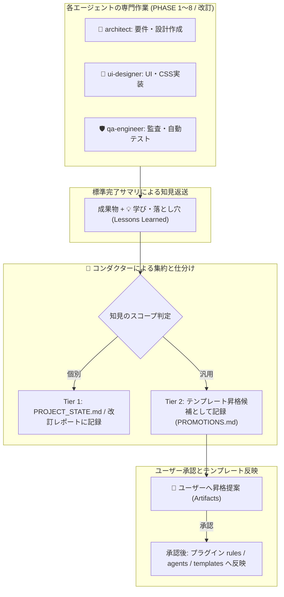

# サブエージェント間ナレッジ蓄積・運用基準書

本ドキュメントは、[サブエージェント活用の検討課題.md](template/docs/検討課題/V2.0/サブエージェント活用の検討課題.md) の **「課題4: エージェント間の知見蓄積（ナレッジフィードバック）の運用方法」** に基づき、新規開発ライフサイクル（PHASE 1〜8）および本番運用・改訂プロセスを通じて得られた「失敗からの学び（エラー事例・落とし穴）」や「成功パターン」を、エージェント間およびプロジェクト横断で継続的に還元・昇格させるための運用基準を規定するものである。

---

## 1. 目的と基本思想

### 1.1 目的
AI駆動のマルチエージェント開発体制（`conductor`, `architect`, `ui-designer`, `qa-engineer`）において、以下の課題を恒久的に解決する：
1. **車輪の再発明と同一失敗の撲滅**: あるエージェント・あるプロジェクトで遭遇したエラー（ライブラリの非互換、Dockerキャッシュ問題、UIレイアウト崩れ、セキュリティ設定漏れ等）を形式知化し、二度と同じトラップを踏まないようにする。
2. **ナレッジの適切なスコープ分離**: プロジェクト固有のビジネスロジックや個別実装の都合をテンプレートに混入させず、全プロジェクトで恩恵を受けるべき「汎用的知見」のみをテンプレートへ昇格させる。
3. **運用の持続可能性（負担最小化）**: 開発者が手動で膨大なナレッジベースを書く負担を排し、エージェントの作業フロー（フェーズ完了時、改訂完了時、自律修復時）に知見の抽出・集約をビルトインする。

### 1.2 知見蓄積の2大原則

| 原則 | 内容 |
| :--- | :--- |
| **二層分離の原則 (Two-Tier Separation)** | 知見を **「プロジェクト固有知見（Tier 1: Project-Specific）」** と **「全体共通知見（Tier 2: Universal / Template）」** に明確に仕分け、格納場所と昇格ライフサイクルを完全に分離する。 |
| **アクション指向の原則 (Actionable Knowledge)** | 単なる事象のメモや感想ではなく、「**どのような状況で（Condition）**」「**何が起きるか（Trap/Outcome）**」「**どう対処・記述すべきか（Prescription/Rule）**」の3つが揃った、エージェントが直ちに行動判断できる形式でのみ記録する。 |

---

## 2. 知見の二層構造と仕分け基準

エージェントによって生成・蓄積される知見は、以下の仕分けマトリクスに従って厳密に分類・配置される。

```
                    ┌────────────────────────────────────────┐
                    │     🛠️ エージェントの実行・試行錯誤     │
                    │   (エラー遭遇・自律修復・成功パターン) │
                    └──────────────────┬─────────────────────┘
                                       │ 抽出・分類
            ┌──────────────────────────┴──────────────────────────┐
            ▼                                                     ▼
┌──────────────────────────────────────┐  ┌──────────────────────────────────────┐
│  Tier 1: プロジェクト固有知見 (Local)  │  │  Tier 2: 全体共通知見 (Universal)   │
├──────────────────────────────────────┤  ├──────────────────────────────────────┤
│ ・個別業務ドメインロジック           │  │ ・共通ライブラリ・フレームワーク挙動 │
│ ・画面ごとの特殊UI/CSS仕様           │  │ ・Docker / GCP / IAP / IAM 汎用設定  │
│ ・個別DBスキーマ・外部API仕様        │  │ ・エージェントプロンプト・ガードレール│
│ ・当該プロダクト固有の設計判断ログ   │  │ ・Git運用・パイプライン手順の共通改善│
├──────────────────────────────────────┤  ├──────────────────────────────────────┤
│ 📁 格納先:                           │  │ 📁 格納先 (テンプレート側):          │
│  - ./PROJECT_STATE.md (未決・決定ログ)│  │  - .agents/plugins/system-dev-pipeline│
│  - docs/Vn.m改訂レポート.md          │  │    ├ rules/dev-process-standards.md │
│  - docs/ (各仕様書の補足・改定履歴)  │  │    ├ agents/<role>.md (システムプロンプト)│
│                                      │  │    └ templates/ (各ドキュメント雛形) │
└──────────────────────────────────────┘  └──────────────────────────────────────┘
```

### 2.1 仕分け判定マトリクス

| 評価軸 | Tier 1: プロジェクト固有知見 (Local) | Tier 2: 全体共通知見 (Universal / 昇格候補) |
| :--- | :--- | :--- |
| **再現性 (Reproducibility)** | 当該プロジェクトのドメインやデータ構造に依存する | 別の言語・類似FW・別システムでも同様に再現する |
| **依存先 (Dependency)** | 特定の顧客要件、自社業務ルール、特定エンドポイント | Next.js, Fastify, Docker, Cloud Run, Antigravity API等 |
| **影響範囲 (Impact)** | 当該システムのコード・ドキュメント内にとどまる | 全プロジェクトのエージェント推論精度・安全性に波及する |
| **記述先 (Destination)** | `PROJECT_STATE.md` / `docs/` / 改訂レポート | プラグインの `rules/`, `agents/*.md`, `templates/` |
| **主な例** | ・会員ランク判定の例外条件<br>・特定帳票のレイアウト制約<br>・特定顧客APIの独自タイムアウト値 | ・Dockerのマルチステージビルド時のキャッシュ破棄手順<br>・`qa-engineer` がコードを直接改変しないガードレール<br>・CSS Grid/Flexboxでの共通崩れパターンと回避策 |

---

## 3. 知見のフォーマット標準 (Actionable Knowledge Format)

知見を記録する際は、後続のエージェント（あるいは人間）が即座にプロンプトやルールとして解釈できるよう、以下の統一Markdownスキーマを採用する。

```markdown
### [ナレッジID]: [簡潔なタイトル] (例: K-ARCH-001: FastifyとCORSのプリフライト競合回避)

- **種別**: [失敗・落とし穴 (Pitfall) / 成功パターン (Best Practice)]
- **関連ロール**: [👑 conductor / 📐 architect / 🎨 ui-designer / 🛡️ qa-engineer / 共通]
- **発生状況 (Context & Condition)**:
  - どのような技術スタック、フェーズ、またはコマンド実行時に発生するか
- **現象・落とし穴 (Problem / Trap)**:
  - どのようなエラーや不整合が発生したか（エラーメッセージ概要、誤動作内容）
- **根本原因 (Root Cause)**:
  - なぜその問題が生じたか（エージェントの推論癖、仕様の曖昧さ、ライブラリ仕様）
- **処方箋・ルール化 (Prescription / Prevention Rule)**:
  - 次回からエージェントはどう行動・記述すべきか（具体的な指示文、コード例、回避手順）
- **適用先スコープ**: [Tier 1: プロジェクト固有 / Tier 2: テンプレート昇格推奨]
```

---

## 4. エージェント別知見フィードバック・サイクル

各エージェントは、通常タスク実行中およびフェーズ完了時に、以下のメカニズムで知見を吸い上げ・集約する。



### 4.1 各エージェントからの収集フロー（完了サマリの拡張）

[エージェント設計書.md](template/docs/V2.0/エージェント設計書.md) で定義された「標準完了サマリ」のフォーマットに、**`💡 獲得した知見・落とし穴 (Lessons Learned)`** フィールドを正式に追加する。

#### 拡張されたサブエージェント返却サマリ形式
```markdown
## 作業完了サマリ
- **担当エージェント**: [architect / ui-designer / qa-engineer]
- **実施フェーズ / タスク**: [例: PHASE 6 シナリオテスト実行]
- **ステータス**: [SUCCESS / PENDING_USER_INPUT / FAILED]
- **生成・更新ファイル一覧**:
  - `path/to/file1`
- **💡 獲得した知見・落とし穴 (Lessons Learned)**:
  - **事象**: テスト実行コンテナ立ち上げ時、DBのマイグレーション完了前にテストが発火し接続エラーが発生した。
  - **対策**: テスト実行スクリプトの先頭に `wait-for-it.sh` またはヘルスチェック待機ポーリングを必須とする手順を追加。
  - **仕分け推奨**: Tier 2 (全プロジェクト共通)
- **残課題 / Open Questions**: なし
```

### 4.2 ロール別知見の特性と還元先

| エージェント | 主に発生する知見・落とし穴の種別 | 典型的な還元先 |
| :--- | :--- | :--- |
| **📐 architect** | ・ドキュメント間の用語不一致パターン<br>・DB制約やリレーションの考慮漏れ<br>・APIバージョン管理・破壊的変更の検知 | ・`templates/技術要件定義書.md`<br>・`agents/architect.md` プロンプト<br>・`docs/要件定義書.md` (Local) |
| **🎨 ui-designer** | ・レスポンシブ崩れ・CSSコンフリクト<br>・モーダルやポップオーバーのフォーカス制御<br>・コンポーネント分割粒度の過不足 | ・`agents/ui-designer.md` プロンプト<br>・`templates/画面仕様書.md`<br>・UIコンポーネントライブラリ (Local) |
| **🛡️ qa-engineer** | ・テストのフレーキー（Flaky）要因<br>・`dev-doc-reviewer` の正規表現・検出パターン漏れ<br>・コンテナ環境依存のテスト失敗 | ・`rules/dev-process-standards.md`<br>・`agents/qa-engineer.md` プロンプト<br>・`docs/plans/シナリオテスト計画書.md` |
| **👑 conductor** | ・オーケストレーション時のトークン溢れ<br>・Dockerビルドキャッシュ事故<br>・Gitマージ競合・デプロイ環境変数設定漏れ | ・`rules/dev-process-standards.md`<br>・`templates/本番適用作業手順書.md`<br>・`PROJECT_STATE.md` (Local) |

---

## 5. テンプレート側への知見昇格（アップデート）運用フロー

プロジェクト固有の枠を超えてテンプレート（全プロジェクト共通）へ知見をフィードバック・アップデートするプロセスは、以下の4ステップで運用する。

### 5.1 ステップ 1: 一時バッファへの記録 (`./TEMPLATE_PROMOTIONS.md`)
プロジェクト進行中、Tier 2（共通候補）と判定された知見が発生した際、コンダクターはプロジェクト直下の `./TEMPLATE_PROMOTIONS.md`（テンプレート昇格候補ログ）に順次追記する。
※ `PROJECT_STATE.md` と同様にプロジェクトルート直下に配置することで、`docs/` 配下のドキュメント一括監査スキル（`dev-doc-reviewer`）による誤検知・干渉を根本から防止する。
これにより、開発進行中にプラグイン本体を勝手に書き換えて開発が不安定化するのを防ぐ。

### 5.2 ステップ 2: 昇格レビューゲート（PHASE 8 & 改訂完了時）
以下の2つのタイミングで、コンダクターは `./TEMPLATE_PROMOTIONS.md` を集約し、ユーザーに明示的な昇格レビューを提案する。
1. **新規開発完了時 (PHASE 8 本番リリース直前・直後)**
2. **システム改訂完了時 (改訂レポート作成および `dev-git-release` 実行前後)**

### 5.3 ステップ 3: ユーザーの明示的承認
コンダクターは昇格候補知見を Artifacts で提示し、以下の判断をユーザーに仰ぐ：
- **承認 (Approve)**: テンプレートへ即時反映する。
- **保留 (Hold)**: もう少し別プロジェクトでの実績を見てから判断する。
- **却下 (Reject)**: 当該プロジェクト特有の事情とみなし、Tier 1に留める。

### 5.4 ステップ 4: テンプレート（プラグイン資産）への安全な反映
承認された知見は、コンダクターまたはユーザーによってテンプレートリポジトリ（`.agents/plugins/system-dev-pipeline/`）へ反映される。

1. **ルールの追加・更新**:
   - 普遍的な開発規範・禁止事項の場合 → `.agents/plugins/system-dev-pipeline/rules/dev-process-standards.md` へ追記。
2. **エージェントプロンプトの更新**:
   - 特定ロールの思考癖や回避策の場合 → `.agents/plugins/system-dev-pipeline/agents/<role>.md` の `system_prompt`（Guidelines / Prohibited Actions）へ追記。
3. **ドキュメント雛形の更新**:
   - 設計項目やテスト項目の標準化の場合 → `.agents/plugins/system-dev-pipeline/templates/<doc>.md` へチェック項目を追記。
4. **プラグインバージョンの改定**:
   - `plugin.json` のバージョン（例: `1.1.0` → `1.1.1`）をインクリメントし、Gitコミットする。

---

## 6. 知見の風化・肥大化防止（メンテナンス基準）

知見やルールを無制限に追加し続けると、エージェントのシステムプロンプトが肥大化し、コンテキストトークンの圧迫や指示相反（プロンプト同士の衝突）を招く。これを防止するため、以下のメンテナンス基準を設ける。

1. **文字数・項目数上限のガイドライン**:
   - 各エージェント定義（`agents/*.md`）のプロンプト追加は、**「本当に致命的な失敗パターン Top 5〜10」** に絞り込む。
   - 枝葉の Tips はエージェントプロンプトに直接書かず、`docs/` や `rules/` の参照ファイルに逃がす。
2. **ルールの統合と定期棚卸し**:
   - 類似のルールが複数できた場合、上位の原則（例: 「ステートレス設計の徹底」など）に統合する。
   - フレームワークやツールのバージョンアップによって不要となった過去のワークアラウンドは、プラグイン改訂時に削除する。

---

## 7. 採択された運用方針（ユーザー決定事項）

本運用基準書の策定にあたり、以下の運用方針が正式に決定された。

| 検討論点 | 採択方針 | 詳細内容 |
| :--- | :--- | :--- |
| **論点 1: 昇格タイミング** | **【選択肢 A】マイルストーン集約方式** | 開発中は一時バッファ（`./TEMPLATE_PROMOTIONS.md`）に蓄積し、**PHASE 8（初回リリース時）** または **システム改訂（Vn.m）の完了時** にコンダクターから一括提案・承認を経てテンプレートへ反映する。 |
| **論点 2: 昇格バッファ配置** | **【選択肢 A】独立ファイル管理 (ルート直下配置)** | `./TEMPLATE_PROMOTIONS.md` としてプロジェクトルート直下に独立管理し、`dev-doc-reviewer` の監査干渉を回避するとともに、テンプレート昇格候補のレビュー・監査を明確化する。 |
| **論点 3: プロンプト肥大化対策** | **【選択肢 A】二段構え方式** | システムプロンプトには「致命的失敗を回避する重要ルール（Top 5〜10項目程度）」のみを厳選記載し、詳細事例・Tipsは `rules/` や参照ファイルへ逃がして推論精度を最大化する。 |

---

## 8. まとめ

本運用基準により、
- サブエージェントの試行錯誤やエラーは「完了サマリ」を通じて漏れなく吸い上げられ、
- プロジェクト固有の事情（Tier 1）とテンプレートへの共通フィードバック（Tier 2）が明確に選別され、
- ユーザーの明示的承認ゲートを通じて安全かつ高品質にテンプレート（`.agents/plugins/system-dev-pipeline/`）が自己進化する
ループが完成する。

