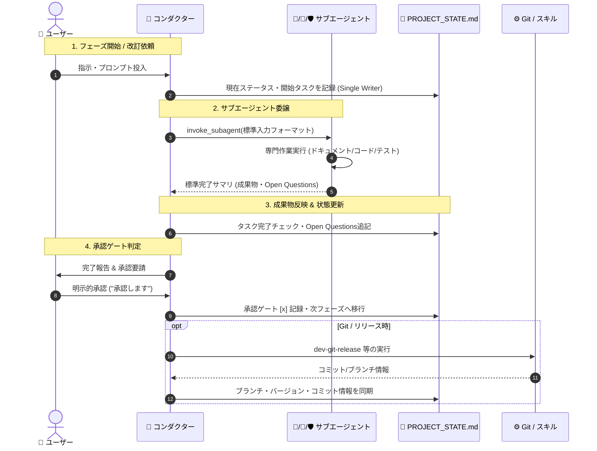

# プロジェクト状態管理機構設計書

本ドキュメントは、AI駆動システム開発ライフサイクル（PHASE 1〜8）および本番運用・改訂プロセスにおいて、システム全体の進行状態、各エージェントの作業状況、未決事項（Open Questions）、インフラ・Git状態を一元管理するための機構仕様書である。

---

## 1. 目的と基本思想

### 1.1 目的
サブエージェント（`architect`, `ui-designer`, `qa-engineer`）およびメインエージェント（`conductor`）が協調して自律開発を推進するにあたり、以下の課題を解決する：
1. **文脈の断絶防止**: コンテキスト長過大によるリセットやセッション再開時にも、現在のフェーズ・残タスク・決定事項を即座に復元できること。
2. **作業競合の排除**: 複数エージェントが同時に作業状態を更新することによるコンフリクトや破損を完全に防ぐこと。
3. **監査性と透明性**: 人間（ユーザー）がいつでも現在の進行状況、Gitブランチ状態、未決事項を直感的に把握・指示できること。

### 1.2 設計基本原則
| 原則 | 内容 |
| :--- | :--- |
| **配置場所の分離** | `PROJECT_STATE.md` は **プロジェクトルート直下（`./PROJECT_STATE.md`）** に配置する。`docs/` 配下の一般仕様書・ドキュメント群と物理的に分離し、サブエージェントによるドキュメント一括監査時のノイズ・誤判定を根本から排除する。 |
| **Single Writer 原則** | `PROJECT_STATE.md` への書き込み・更新権限は **👑 プロジェクトコンダクター（メインエージェント）のみ** が保持する。サブエージェントは親へ標準完了サマリを返すのみとし、状態ファイルを直接編集しない。 |
| **人間可読・直接編集性** | 状態管理ファイルは GitHub Flavored Markdown 形式を採用。ユーザーがプロジェクト直下でVSCode等により直接メモやチェックを更新することも許容する。 |
| **明示的承認ゲートの記録** | ユーザーが承認を与えた日時、コミット、承認ステータスを状態ファイルに明記する。 |
| **Git / バージョン連動** | `Git運用基準書.md` および `.env`（`APP_VERSION`）と同期し、ブランチ名（`main` / `feature`）、改訂依頼番号（`n.m.xxx`）を常時反映する。 |


---

## 2. 状態ファイル詳細フォーマット仕様（`PROJECT_STATE.md`）

`PROJECT_STATE.md` は以下のセクション構成を持つ。

### 2.1 構成セクション一覧
1. **基本メタデータ（Header Metadata）**: プロジェクト名、現行ステータス、現行バージョン、Gitブランチ、最終更新日時
2. **新規開発フェーズ進捗一覧（PHASE 1〜8）**: チェックボックス、完了日、各サブエージェント分担タスク、明示的承認ゲート
3. **システム改訂管理（PHASE 8以降）**: 進行中の改訂依頼番号（`n.m.xxx`）、ターン数、テスト結果、改訂履歴テーブル
4. **未決事項・確認事項（Open Questions & Decisions）**: ユーザー判断待ち事項、決定済みログ
5. **システム・インフラ・Git状態**: ローカルコンテナ状態、最新リビジョン、本番URL、Gitリモート・最新コミット

### 2.2 詳細テンプレート

```markdown
# プロジェクト進行状態管理票 (PROJECT_STATE)

- **プロジェクト名**: [プロジェクト名]
- **現在のステータス**: [PHASE_1_SETUP / PHASE_2_REQUIREMENTS / ... / PRODUCTION_ACTIVE / REVISION_IN_PROGRESS]
- **現行バージョン**: v[APP_VERSION] (例: v1.0.0)
- **現在の作業ブランチ**: [main / feature]
- **最終更新日時**: YYYY-MM-DD HH:MM
- **最終更新者**: 👑 プロジェクトコンダクター (または 👤 ユーザー)

---

## 1. 開発フェーズ進捗一覧 (新規開発 PHASE 1〜8)

- [ ] **PHASE 1: プロジェクトの準備** (完了日: YYYY-MM-DD)
  - [ ] ディレクトリ・環境設定展開 (`dev-phase1-setup`)
  - [ ] `PROJECT_STATE.md` 初期化
- [ ] **PHASE 2: 要件定義**
  - [ ] 📐 `architect`: `docs/要件定義書.md` 作成・精査
  - [ ] 👤 ユーザー: Open Questions 回答
  - [ ] **【承認ゲート】👤 ユーザー: 要件定義完了の明示的承認** (承認日: YYYY-MM-DD)
- [ ] **PHASE 3: 基本設計書の作成と整合性チェック**
  - [ ] 📐 `architect`: `技術要件定義書.md` 作成
  - [ ] 📐 `architect`: `テーブルスキーマ定義書.md` 作成
  - [ ] 📐 `architect`: `ビジネスロジック仕様書.md` 作成
  - [ ] 🎨 `ui-designer`: `画面仕様書.md` 作成
  - [ ] 🛡️ `qa-engineer`: `dev-doc-reviewer` 整合性多次元クロスチェック (エラー0件確認)
  - [ ] **【承認ゲート】👤 ユーザー: 基本設計完了の明示的承認** (承認日: YYYY-MM-DD)
- [ ] **PHASE 4: 開発環境とシステム構築**
  - [ ] 👑 コンダクター: Docker環境構築・バックエンドAPI/ロジック実装
  - [ ] 🎨 `ui-designer`: フロントエンド画面・コンポーネント実装
  - [ ] ⚙️ `dev-git-init`: Gitリポジトリ初期化 (`main` 初回コミット、`feature` 作成・チェックアウト)
  - [ ] 👑 コンダクター: コンテナ初回ビルド・疎通確認 (`docker compose up --build -d`)
- [ ] **PHASE 5: ウォークスルー動作確認とデバッグ**
  - [ ] 👤 ユーザー: 画面操作・機能検証
  - [ ] 👑 コンダクター: 指摘不具合修正・コンテナ再構成
  - [ ] 📐 `architect`: 最新コードを正としたAPI仕様同期
  - [ ] 🛡️ `qa-engineer`: ドキュメント整合性再確認
  - [ ] **【承認ゲート】👤 ユーザー: ウォークスルー完了の明示的承認** (承認日: YYYY-MM-DD)
- [ ] **PHASE 6: スルーテスト環境の構築と実施**
  - [ ] 🛡️ `qa-engineer`: `docs/plans/シナリオテスト計画書.md` 作成
  - [ ] 🛡️ `qa-engineer`: 自動テスト実行・修復ループ (成功率100%達成)
  - [ ] **【承認ゲート】👤 ユーザー: リリース準備移行の明示的承認** (承認日: YYYY-MM-DD)
- [ ] **PHASE 7: 本番リリース**
  - [ ] 👑 コンダクター: `docs/plans/本番適用作業手順書.md` 作成
  - [ ] 👑 コンダクター: 本番環境（Cloud Run等）初回デプロイ実行
  - [ ] 🛡️ `qa-engineer`: IAM / IAP セキュリティ設定監査
  - [ ] **【承認ゲート】👤 ユーザー: 本番稼働確認の明示的承認** (承認日: YYYY-MM-DD)
- [ ] **PHASE 8: ドキュメント改訂管理の開始**
  - [ ] **【承認ゲート】👤 ユーザー: 知見昇格レビューの明示的承認 (./TEMPLATE_PROMOTIONS.md)** (承認日: YYYY-MM-DD)
  - [ ] ⚙️ `dev-git-release`: `feature` を `main` へ Squash Merge (`Release v1.0.0`)、Push、次期 `feature` 切り直し
  - [ ] ⚙️ `dev-phase8-rules`: 改訂運用ルールファイル群の配置
  - [ ] 👑 コンダクター: ステータスを `PRODUCTION_ACTIVE` へ移行

---

## 2. システム改訂管理 (PHASE 8完了以降)

- **現在の改訂ステータス**: [IDLE / PLANNING / EXECUTING / TESTING / DEPLOYED]
- **進行中の改訂依頼番号**: [なし / n.m.xxx]
- **現行改訂ターン番号**: [xxx]
- **知見昇格ステータス**: [未昇格 / レビュー待ち (./TEMPLATE_PROMOTIONS.md) / 承認済み]
- **直近の改訂レポート**: [なし / docs/Vn.m改訂レポート.md]

### 改訂履歴テーブル
| 改訂依頼番号 | 対象バージョン | ターン | ステータス | 主担当 | 概要 | 完了日 |
| :--- | :--- | :--- | :--- | :--- | :--- | :--- |
| - | - | - | - | - | - | - |

---

## 3. 未決事項および決定事項ログ (Open Questions & Decisions)

### 3.1 未決事項 (Open Questions: ユーザー確認待ち)
- [ ] Q-001: [質問内容と選択肢] (起票日: YYYY-MM-DD / 起票者: 📐 architect)

### 3.2 決定済み事項ログ (Decided)
- [x] D-001: [決定内容] (決定日: YYYY-MM-DD / 決定者: 👤 ユーザー)

---

## 4. システム・インフラ・Git状態

- **Git状態**:
  - 現在のブランチ: `feature` (または `main`)
  - 直近コミット: `[commit-hash] [commit-message]`
  - リモートURL: `git@github.com:[User]/[Repo].git`
- **コンテナ状態**:
  - ステータス: [未構築 / Running (Healthy) / Stopped]
  - 最終ビルド日時: YYYY-MM-DD HH:MM
- **本番環境状態**:
  - 本番URL: [URL]
  - 最新リビジョン: [Revision ID]
  - リージョン: [Region]
```

---

## 3. 状態更新ロジックとライフサイクル

### 3.1 更新トリガーと実行フロー



### 3.2 フェーズ別更新ロジック

| フェーズ | 更新タイミング | 更新内容 | 更新主体 |
| :--- | :--- | :--- | :--- |
| **PHASE 1** | 初期セットアップ完了直後 | `PROJECT_STATE.md` を初期生成。ステータスを `PHASE_1_SETUP` → `PHASE_2_REQUIREMENTS` へ更新。 | 👑 コンダクター |
| **PHASE 2** | ① `architect` 完了時<br>② ユーザー承認時 | ① 要件定義ドラフト完了チェック、Open Questions 追記。<br>② 承認ゲートを `[x]` に更新、ステータスを `PHASE_3_DESIGN` へ更新。 | 👑 コンダクター |
| **PHASE 3** | ① 各設計書作成時<br>② `qa-engineer` 監査完了時<br>③ ユーザー承認時 | ① 各設計書の完了チェック。<br>② 整合性チェック結果（エラー0件）記録。<br>③ 承認ゲート更新、ステータスを `PHASE_4_BUILD` へ更新。 | 👑 コンダクター |
| **PHASE 4** | ① `dev-git-init` 実行時<br>② コンテナ初回起動時 | ① 作業ブランチ（`feature`）、Gitリモート情報、初回コミット記録。<br>② コンテナ状態（Running/Healthy）記録。ステータスを `PHASE_5_WALKTHROUGH` へ。 | 👑 コンダクター |
| **PHASE 5** | ① 不具合改修・コンテナ再構成時<br>② ユーザー承認時 | ① 修正内容とコンテナ最終ビルド日時更新。<br>② ウォークスルー承認ゲート更新、ステータスを `PHASE_6_TESTING` へ。 | 👑 コンダクター |
| **PHASE 6** | ① テスト実行完了時<br>② ユーザー承認時 | ① テスト成否・合格率（100%）記録。<br>② リリース承認ゲート更新、ステータスを `PHASE_7_RELEASE` へ。 | 👑 コンダクター |
| **PHASE 7** | ① 本番デプロイ時<br>② セキュリティ監査完了時<br>③ ユーザー承認時 | ① 本番URL、リビジョンID、リージョン記録。<br>② セキュリティ監査合格記録。<br>③ 本番稼働承認ゲート更新、ステータスを `PHASE_8_RULES` へ。 | 👑 コンダクター |
| **PHASE 8** | `dev-git-release` 完了後 | ① バージョン `v1.0.0`、Squash Merge コミット、最新 `feature` ブランチ記録。<br>② ステータスを `PRODUCTION_ACTIVE` へ更新。 | 👑 コンダクター |

### 3.3 システム改訂時の更新ロジック（REVISION LIFECYCLE 連動）

本番運用移行後は、`templates/システム改訂ルール.md` および `templates/Git運用基準書.md` に基づき以下のロジックで状態を更新する。

1. **改訂依頼開始**:
   - ユーザーから改訂指示を受け取った直後、`.env` の `APP_VERSION` を確認（指定があれば更新）。
   - 改訂ターン番号 `xxx`（001〜）および改訂依頼番号 `n.m.xxx` を採番。
   - `PROJECT_STATE.md` の「システム改訂管理」に新規行を追加、ステータスを `PLANNING` に更新。
2. **改訂実行中**:
   - Implementation Plan 承認後、ステータスを `EXECUTING` に更新。
   - コード修正・コンテナ再構成完了後、最終ビルド日時を更新。
3. **シナリオテスト実施**:
   - 🛡️ `qa-engineer` のテスト完了後、テストレポート結果（PASS/FAIL）を記録し、ステータスを `TESTING` に更新。
4. **本番デプロイ**:
   - 本番デプロイ成功後、最新リビジョン番号を更新し、ステータスを `DEPLOYED` に更新。
5. **完了・Git本番公開（`dev-git-release`）**:
   - `dev-git-release` 実行により `feature` を `main` へ Squash Merge し、タグ付きPush。
   - 新規作成された `feature` ブランチ情報を同期。
   - 改訂履歴テーブルの該当行を「完了」にし、現在の改訂ステータスを `IDLE`（待機中）に戻す。

---

## 4. Git運用基準書（`templates/Git運用基準書.md`）との整合仕様

### 4.1 ブランチ状態の同期
- `Git運用基準書.md` で規定された「`main`（本番保護ブランチ）」と「`feature`（単一開発・作業ブランチ）」の2ブランチモデルに完全準拠する。
- `PROJECT_STATE.md` は常に「現在チェックアウトされているブランチ」を明示する。
  - 通常開発・改訂作業中: `feature`
  - 本番リリース・マージ瞬間: `main`（`dev-git-release` 実行時の一時チェックアウト）
  - リリース直後: 新たに切り直された `feature`

### 4.2 コミットハッシュおよびバージョンの同期
- `dev-git-init` 実行時: 初期コミットハッシュを記録。
- `dev-git-release` 実行時: `.env` から取得した `APP_VERSION` と、生成された `Release v${APP_VERSION}` のコミットハッシュを状態管理ファイルに即時記録する。

---

## 5. エラーリカバリおよびコンフリクト防止

1. **Single Writer の強制**:
   - サブエージェント（`architect`, `ui-designer`, `qa-engineer`）のシステムプロンプトにおいて、「`PROJECT_STATE.md` を直接変更してはならない。進捗や完了報告は必ずコンダクター（親）へのメッセージで返却すること」を明記する。
2. **手動編集の競合検知**:
   - ユーザーがVSCode等で直接 `PROJECT_STATE.md` を編集した場合、コンダクターは上書き前に状態ファイルを読み込み（`view_file`）、ユーザーの入力内容（Open Questionsへの回答やチェック）を尊重してマージする。
3. **セッション再開時の整合性チェック**:
   - 新規セッション開始時、コンダクターは最初に `PROJECT_STATE.md` を読み込み、Gitの実ブランチ状態（`git branch --show-current`）およびDockerコンテナ状態（`docker compose ps`）と実態が一致しているかを検証する。

---

## 6. 採用された運用方針（ユーザー決定事項）

本設計書の策定にあたり、以下の運用方針が正式に決定された。

| 検討論点 | 採択方針 | 詳細内容 |
| :--- | :--- | :--- |
| **論点1: 初期展開タイミング** | **案A: PHASE 1 で初期化生成** | PHASE 1（`dev-phase1-setup`）実行時に、テンプレートから `PROJECT_STATE.md` を自動展開し、初期ステータス（`PHASE_1_SETUP`）を埋め込む。 |
| **論点2: Git 情報の記録粒度** | **案A: 主要イベント時のみ記録（シンプル運用）** | 現在のブランチ名（`main` / `feature`）、直近リリースバージョン、および直近のリリース・初期化コミットハッシュのみを追跡。開発中の細かなコミットハッシュは追跡せず可読性を維持する。 |
| **論点3: ユーザー手動編集時** | **案A: 差分検知＆ユーザー変更尊重（マージ型）** | コンダクターは状態ファイル更新前に必ず最新内容を読み込み、ユーザーが手動で更新したチェックボックス（`- [x]`）や回答内容を保護・マージする。 |
| **論点4: テンプレート一括更新** | **案B: 全検討課題完了後に一括更新** | 残る検討課題（課題3: 既存スキルの改修・バインド、課題4: ナレッジ蓄積機構）の仕様設計をすべて完了した後に、`.agents/plugins/system-dev-pipeline/` 配下をまとめて一括更新する。 |


