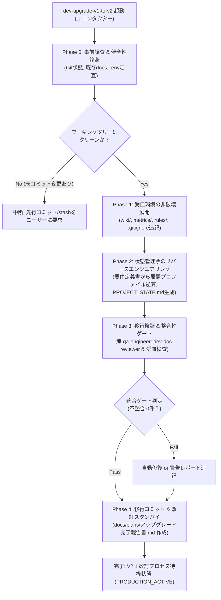
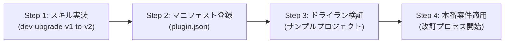

# V1.0プロジェクトアップグレードスキル策定および移行計画書
(V1.0 to V2.1 Project Upgrade Skill Specification & Migration Plan)

文書バージョン: 1.0  
作成日: 2026-10-11  
対象バージョン: AI駆動システム開発ライフサイクルテンプレート V2.1  
ステータス: 正式計画書  

---

## 1. エグゼクティブサマリ (Executive Summary)

### 1.1 背景と目的
AI駆動システム開発ライフサイクルテンプレート V1.0（[Antigravity共通化および開発自動化提案書.md](../V1.0/Antigravity共通化および開発自動化提案書.md) 準拠）を用いて開発され、すでに本番リリースを完了している複数のプロジェクトが存在する。これらのプロジェクトは今後、機能追加や保守運用に伴う**システム改訂プロセス（REVISION LIFECYCLE）**の段階へ順次突入する。

最新のテンプレート V2.1 では、以下の3大アーキテクチャが実装されている：
1. **WikiSkill型 永続ナレッジ自己進化ループ**: 失敗・試行錯誤を恒久的に記録する3層ストレージモデル（`wiki/patterns/`、`TEMPLATE_PROMOTIONS.md`、Context Isolation）
2. **二層型 3大レビューシステム**: 基本設計、コード品質（PHASE 5.5 / 改訂ターン内）、システム総合レビュー
3. **状態管理機構（`PROJECT_STATE.md`）**: Single Writer原則に基づき、開発・改訂の進行状態、選択プロファイル、メトリクスを一元管理する中核基盤

本計画書は、**「グローバルプラグイン運用（`GLOBAL_PLUGIN`）」**を前提として開発されたV1.0プロジェクトに対して、既存の運用資産やコードを損なうことなく、V2.1のナレッジフィードバック機構およびレビューシステムを安全に適用するための**「専用アップグレードスキル（仮称: `dev-upgrade-v1-to-v2`）」の妥当性を評価し、その設計仕様および移行計画を策定**することを目的とする。

### 1.2 主要な結論
* **専用スキルの新設は極めて妥当かつ不可欠である**:
  手動によるディレクトリ作成やテンプレートコピーでは、状態ファイルのメタデータ不整合、システム展開プロファイルの誤設定、`.gitignore` 漏れによるターンログのGit混入、ナレッジ境界（Tier 1 / Tier 2）の破壊が発生するリスクが高い。決定論的な専用スキルとして提供することで、わずか数分で非破壊的かつ完全な環境アップグレードが実現可能となる。
* **実行エージェントは 👑 コンダクター（主担当）＋ 🛡️ QAエンジニア（監査）の協調体制が最適**:
  プロジェクトルート直下の破壊的変更抑止および Single Writer 原則を遵守するため、スキルの実行主体は **👑 コンダクター (`conductor`)** が担当し、既存ドキュメントの網羅性診断およびV2.1適合性の静的検証は **🛡️ QAエンジニア (`qa-engineer`)** が担当する。
* **プロジェクトローカルへの `.agents/` 複製は一切行わない（純粋グローバル運用の維持）**:
  [テンプレート配置形態およびナレッジ境界設計書.md](./テンプレート配置形態およびナレッジ境界設計書.md) に定義された「モード A: グローバルプラグイン運用」に則り、プロジェクト配下には受皿（`wiki/`, `metrics/`, `rules/`, `PROJECT_STATE.md`, `TEMPLATE_PROMOTIONS.md`）のみを整備し、スキル実体やテンプレートはグローバル環境（`~/.gemini/config/plugins/system-dev-pipeline/`）から供給する。

---

## 2. スキルおよび実行エージェントの妥当性評価 (Feasibility & Validity Assessment)

### 2.1 専用スキル（`dev-upgrade-v1-to-v2`）新設の妥当性

| 評価観点 | 手動移行時のリスク / 課題 | 専用スキル導入による解決・効果 | 判定 |
| :--- | :--- | :--- | :--- |
| **状態管理の連続性** | V1.0には `PROJECT_STATE.md` が存在しないため、改訂プロセスに入った際にコンダクターが「現行ステータス」「展開プロファイル」「バージョン」を認識できず停止または暴走する。 | 既存の `docs/要件定義書.md` や `.env`、Gitタグを自動走査し、フェーズ完了チェック済みかつ改訂待機状態（`PRODUCTION_ACTIVE`）の `PROJECT_STATE.md` を自動リバースエンジニアリング生成する。 | **極めて妥当** |
| **ナレッジ受皿の完全性** | `wiki/patterns/{local,universal,rejected}` や `wiki/logs.md`、`wiki/skill-impact.md` の階層が不完全だと、改訂時のテスト失敗・レビュー指摘のRCA（根本原因分析）記録先が見失われエラーとなる。 | V2.1で要求されるWikiLayerの全ディレクトリおよびインデックスファイルを非破壊的に一括展開する。 | **極めて妥当** |
| **メトリクスログの汚染防止** | `metrics/turns/` の作成漏れや、`.gitignore` への除外登録漏れにより、改訂時の大量のターン別JSONがGitコミット履歴を汚染する。 | ディレクトリ生成と同時に `.gitignore` へ `metrics/turns/` を自動追記し、コミット汚染を未然に防止する。 | **極めて妥当** |
| **既存資産の非破壊保護** | 誤ったテンプレート上書きにより、本番稼働中の既存コード、`.env`、`docs/` 配下の仕様書が初期雛形にリセットされる危険性がある。 | スキル内部に「追記・新規配置のみを許可し、既存ファイルを上書き・削除しない」厳格なガードレールを実装する。 | **極めて妥当** |

### 2.2 グローバルプラグイン運用（`GLOBAL_PLUGIN`）との整合性

ユーザーの現行運用形態は「テンプレートをプロジェクトフォルダ内に含まず、すべてグローバルプラグインとして実行」である。この運用形態に対する妥当性は以下の通りである。

```
┌────────────────────────────────────────────────────────────────────────────────────────┐
│                              グローバルプラグイン運用のアップグレード境界               │
├─────────────────────────────────────────────────┬──────────────────────────────────────┤
│   【個別プロジェクト領域 (Project Workspace)】     │   【グローバルプラグイン領域 (Global)】│
│    ※ V1.0本番リリース済みリポジトリ            │    ~/.gemini/config/plugins/         │
│                                                 │      system-dev-pipeline/            │
├─────────────────────────────────────────────────┼──────────────────────────────────────┤
│  [既存資産 (完全維持・保護)]                     │  [V2.1 プラグイン本体 (共有)]        │
│   ・既存ソースコード, docker-compose.yml        │   ├ agents/ (5大エージェント定義)     │
│   ・docs/ (要件定義書, 設計書 7種)              │   ├ skills/ (V2.1スキル群 ＋         │
│   ・.env (本番/ステージング設定)                │   │          dev-upgrade-v1-to-v2)   │
│   ・.git/ (mainブランチ, リリースタグ)          │   ├ templates/ (各雛形ファイル)      │
│                                                 │   └ rules/ (プロセス標準規約)        │
│  [新設受皿 (本スキルにより非破壊自動配置)]       │                                      │
│   ├ wiki/ (patterns/{local,universal}, etc.)    │                                      │
│   ├ metrics/turns/ (.gitignore自動除外)         │                                      │
│   ├ rules/dev-process-standards.md (V2.1最新)   │                                      │
│   ├ PROJECT_STATE.md (GLOBAL_PLUGIN記録)        │                                      │
│   └ TEMPLATE_PROMOTIONS.md                      │                                      │
└─────────────────────────────────────────────────┴──────────────────────────────────────┘
```

1. **プロジェクトの軽量性と可搬性維持**:
   プロジェクト内に `.agents/` ディレクトリを置く必要がないため、リポジトリの容量を圧迫せず、V1.0プロジェクトのGitリポジトリ構成の美しさをそのまま維持できる。
2. **ナレッジ境界（Tier 1 / Tier 2）の順守**:
   改訂中に発生するプロジェクト固有の知見（Tier 1）は `./wiki/patterns/local/` に閉じ込められ、共通知見（Tier 2）は `./TEMPLATE_PROMOTIONS.md` を経由してグローバルプラグインへ昇格申請されるため、[テンプレート配置形態およびナレッジ境界設計書.md](./テンプレート配置形態およびナレッジ境界設計書.md) の原則1〜3に完全合致する。

### 2.3 実行エージェントの割り当て妥当性

| エージェント | 役割・権能 | 本移行における妥当性 |
| :--- | :--- | :--- |
| **👑 コンダクター (`conductor`)**<br>(主担当) | ・プロジェクトルート直下のファイル操作<br>・`PROJECT_STATE.md` 作成（Single Writer）<br>・Git状態確認および環境変数読み込み<br>・全体統括とユーザー承認受領 | **最適**: ルート直下への状態ファイル配置権限を持ち、破壊的変更を抑止できる唯一のエージェントであるため。 |
| **🛡️ QAエンジニア (`qa-engineer`)**<br>(監査・検証担当) | ・既存 `docs/` 配下の相互整合性チェック (`dev-doc-reviewer`)<br>・アップグレード後のディレクトリ受皿充足性検証<br>・移行診断レポートの作成 | **最適**: コードや設定を直接書き換えない監査専門エージェントであり、移行前後の完全性を客観的に評価できるため。 |
| **📐 アーキテクト (`architect`)**<br>(仕様分析担当) | ・既存 `docs/要件定義書.md` からのシステム展開プロファイル（Profile A〜D）の抽出・推定 | **適切**: コンダクターからの委譲により、要件定義書の内容から「Profile A（クラウド公開）」等を高精度に推定可能。 |

---

## 3. V1.0プロジェクトとV2.1環境のギャップ分析 (Gap Analysis)

V1.0で開発完了したプロジェクトと、V2.1改訂プロセスが前提とするプロジェクト構造との差分は以下の通りである。

| 領域 | V1.0 プロジェクトの現状 | V2.1 改訂プロセスでの要求 | アップグレードスキルでの処方箋 |
| :--- | :--- | :--- | :--- |
| **状態管理** | `PROJECT_STATE.md` なし | プロジェクトルートに必須。<br>`EXECUTION_MODE: GLOBAL_PLUGIN`<br>ステータス: `PRODUCTION_ACTIVE`<br>システム展開プロファイルの確定 | 既存ドキュメント・Gitタグからリバースエンジニアリングして `PROJECT_STATE.md` を自動生成。 |
| **ナレッジ層 (Wiki)** | `wiki/` なし（知見はチャットログに散在・消失） | `wiki/patterns/{local,universal,rejected}`<br>`wiki/archive/`<br>`wiki/logs.md`<br>`wiki/skill-impact.md` | `wiki/` 構造を一括生成。初期インデックス（空テンプレート）を配置。既存知見の喪失を防ぐ受皿を確保。 |
| **知見昇格** | 昇格バッファなし | `TEMPLATE_PROMOTIONS.md` がプロジェクト直下に必須 | `TEMPLATE_PROMOTIONS.md.template` を展開・配置。 |
| **メトリクス集計** | `metrics/` なし | `metrics/turns/`（`.gitignore` 必須）<br>`docs/plans/metrics/` | ディレクトリ生成と `.gitignore` への自動登録（追記）。 |
| **レビュー計画書受皿** | `docs/plans/` 未整備 | `docs/plans/` 配下にコードレビュー、総合レビュー、シナリオテスト結果を格納 | `docs/plans/` およびサブディレクトリを自動生成。 |
| **運用ルール** | V1.0用の `rules/` または `system-revision.md` | V2.1最新の `rules/dev-process-standards.md`<br>（3大レビュー、Single Writer、RCA記録義務を含む） | `rules/dev-process-standards.md` を配置・最新化。 |
| **Git状態** | `main` または `master` ブランチ、本番タグ（例: `v1.0.0`） | クリーンなワーキングツリー、改訂作業用ブランチの準備 | 未コミット変更の有無をチェックし、安全な移行コミットを促す。 |

---

## 4. アップグレードスキル設計仕様 (`dev-upgrade-v1-to-v2`)

### 4.1 スキル基本情報
* **スキル識別名**: `dev-upgrade-v1-to-v2`
* **配置場所**: `~/.gemini/config/plugins/system-dev-pipeline/skills/dev-upgrade-v1-to-v2/SKILL.md`（グローバルプラグイン配下）
* **主担当エージェント**: 👑 コンダクター (`conductor`)
* **前提条件**:
  - 対象プロジェクトがGit管理下にあること（ワーキングツリーがクリーンであること）
  - `docs/` 配下に最低限の仕様書（`要件定義書.md` 等）が存在すること
* **生成成果物**:
  - `PROJECT_STATE.md`（リバースエンジニアリング生成）
  - `TEMPLATE_PROMOTIONS.md`（初期配置）
  - `wiki/`（3層ストレージ受皿）
  - `metrics/turns/`（メトリクス受皿）
  - `rules/dev-process-standards.md`（V2.1改訂規約）
  - `docs/plans/v1_to_v2_upgrade_report.md`（移行診断・完了レポート）

---

### 4.2 4フェーズ移行パイプライン詳細



#### Phase 0: 事前調査 & 健全性診断 (Inspection & Health Check)
1. **Git状態の検証**:
   - `git status` を実行し、未コミットの変更が存在しないことを確認。
   - 変更がある場合は「作業中の変更をコミットまたは stash してください」と警告して安全に中断。
   - 現在のブランチ（`main` / `master`）および最新のタグ（例: `v1.0.0`）を取得。
2. **既存仕様資産の走査**:
   - `docs/要件定義書.md`, `技術要件定義書.md`, `テーブルスキーマ定義書.md`, `ビジネスロジック仕様書.md`, `画面仕様書.md` の存在をスキャン。
   - `.env` から `APP_VERSION` を抽出（存在しない場合は Git タグまたは `1.0.0` をデフォルト採用）。
3. **プラグイン配置モードの確認**:
   - プロジェクト直下に `./.agents/plugins/` が存在しないことを確認し、`EXECUTION_MODE: GLOBAL_PLUGIN` を確定。

#### Phase 1: 受皿環境の非破壊展開 (Scaffolding)
1. **ディレクトリ構造の自動生成 (`mkdir -p`)**:
   - `wiki/patterns/local/`
   - `wiki/patterns/universal/`
   - `wiki/patterns/rejected/`
   - `wiki/archive/`
   - `metrics/turns/`
   - `docs/plans/scenario-test/`
   - `docs/plans/metrics/`
   - `rules/`
2. **初期インデックス・規約ファイルの配置**:
   - `wiki/logs.md`: 初期採否ログヘッダーを配置。
   - `wiki/skill-impact.md`: 初期因果マップヘッダーを配置。
   - `TEMPLATE_PROMOTIONS.md`: グローバルプラグインの `TEMPLATE_PROMOTIONS.md.template` から初期配置。
   - `rules/dev-process-standards.md`: グローバルプラグインの `rules/dev-process-standards.md` を最新同期。
3. **`.gitignore` の自動更新**:
   - `.gitignore` を読み込み、`metrics/turns/` が含まれていない場合、末尾に追記。

#### Phase 2: 状態管理票のリバースエンジニアリング (State Reconstruction)
1. **システム展開プロファイル（Profile A〜D）の自動推定**:
   - `docs/要件定義書.md` および `docs/技術要件定義書.md` を走査。
   - クラウドサービス（Cloud Run, GCP, AWS）、常駐デーモン、CLI、モバイル等の記述から、以下の4プロファイルから最適候補を自動判定（迷う場合はユーザーへ事前提示）：
     - `Profile A: クラウド公開 (Cloud-Native Web Service)`
     - `Profile B: ローカル常駐 (Local Daemon / Agent)`
     - `Profile C: 個人・小規模 (Solo Tool / CLI)`
     - `Profile D: モバイル・クライアント (Mobile / Client App)`
2. **`PROJECT_STATE.md` の生成**:
   - グローバルプラグインの `PROJECT_STATE.md.template` を元に、以下の値を自動埋め込み：
     - **現在のステータス**: `PRODUCTION_ACTIVE` (本番稼働中 / 改訂待機)
     - **システム展開プロファイル**: 判定されたプロファイル
     - **現行バージョン**: 取得したバージョン（例: `v1.0.0`）
     - **EXECUTION_MODE**: `GLOBAL_PLUGIN`
     - **TEMPLATE_SOURCE**: `~/.gemini/config/plugins/system-dev-pipeline`
     - **新規開発フェーズ（PHASE 1〜8）**: すべて完了チェック済み（`[x]`）として初期化。
     - **システム改訂管理**: ステータス `IDLE`（改訂待機中）として初期化。

#### Phase 3: 移行検証 & 整合性ゲート (Validation & Gating)
1. **🛡️ QAエンジニア (`qa-engineer`) への委譲**:
   - コンダクターは `qa-engineer` を呼び出し、適合性監査を依頼。
2. **監査内容**:
   - `dev-doc-reviewer` を実行し、既存 `docs/` 配下の仕様書間に重大な不整合やリンク切れ（絶対パス混入等）がないかをチェック。
   - 新設された `wiki/`, `metrics/`, `rules/`, `PROJECT_STATE.md` が正しく配置され、パーミッションや構文に異常がないかを検証。
3. **診断レポートの出力**:
   - `docs/plans/v1_to_v2_upgrade_report.md` を作成し、適合性スコア、検出された軽微な警告、および完了ステータスを記録。

#### Phase 4: 移行コミット & 改訂スタンバイ (Finalization)
1. **移行コミットの作成（👑 コンダクター専任）**:
   - 新規追加された受皿ディレクトリ・ファイルを `git add`。
   - `git commit -m "chore: upgrade project environment to V2.1 pipeline standard (GLOBAL_PLUGIN)"` を実行。
2. **ユーザーへの完了報告**:
   - 移行完了サマリを表示し、次回改訂依頼（`n.m.xxx`）をいつでも受け付けられる状態であることをアナウンス。

---

## 5. 安全ガードレールとロールバック設計 (Safety & Rollback)

### 5.1 非破壊原則 (Non-Destructive Principle)
本スキルは、既存の稼働中資産に対する安全性を最優先とするため、以下の厳格なガードレールを課す：
* **既存ソースコードへの不介入**:
  アプリケーションコード（BE/FE/コンテナ構成等）には一切触れない。変更対象は設定受皿（`wiki/`, `metrics/`, `rules/`, `PROJECT_STATE.md`, `.gitignore`）のみに限定する。
* **既存ドキュメントの上書き禁止**:
  `docs/` 直下の仕様書（要件定義書、設計書等）をテンプレートで上書きすることは厳禁とする。既存の記述を「正本」として尊重する。
* **既存 `.env` の保護**:
  既存の `.env` は本番/ステージング環境のシークレットを含むため、決して上書き・改変しない。

### 5.2 ロールバック手順 (Rollback Strategy)
万が一、移行フェーズ中にエラーが発生した場合、またはユーザーが移行前の状態に戻したい場合の安全手順：
1. **コミット前の安全中断**:
   Phase 0〜3 の途中で失敗した場合、Git の未追跡ファイル（`wiki/`, `metrics/` 等）を `git clean -fd` で削除し、変更された `.gitignore` を `git checkout .gitignore` で復元すれば、1秒で移行直前の状態へ完全復帰できる。
2. **コミット後の切り戻し**:
   移行コミットが作成された後でも、`git revert HEAD` または `git reset --hard HEAD~1` により安全に直前コミットへロールバック可能。

---

## 6. 実装・展開ロードマップ (Implementation Roadmap)



### Step 1: スキル定義の実装
* グローバルプラグイン（`.agents/plugins/system-dev-pipeline/skills/dev-upgrade-v1-to-v2/`）を作成。
* `SKILL.md` に上述のPhase 0〜4の詳細手順、Single Writerガードレール、非破壊チェックロジックを実装。

### Step 2: プラグインマニフェストへの登録
* `.agents/plugins/system-dev-pipeline/plugin.json` の `"skills"` 配列に `"dev-upgrade-v1-to-v2"` を追加。

### Step 3: パイロット検証（ドライラン）
* V1.0相当のディレクトリ構成を持つ検証用プロジェクトを作成し、`dev-upgrade-v1-to-v2` を実行。
* `PROJECT_STATE.md` の生成精度、`wiki/` 受皿の健全性、`.gitignore` 追記、Gitコミットの成否を検証。

### Step 4: 実案件への適用と改訂フロー合流
* V1.0で開発完了した実プロジェクトにて本スキルを実行。
* アップグレード完了後、通常の改訂依頼（例: 「改訂依頼: 1.1.001 〇〇機能の追加」）を発行し、V2.1のコード品質レビュー（PHASE 5.5）およびRCAナレッジフィードバック（`wiki/patterns/`）が正常に機能することを確認。

---

## 7. 関連ドキュメントおよびクロスリファレンス

本計画書は、以下のV2.1基本設計および関連規約と整合している：
* [AI駆動システム開発フェーズ定義書V2.1.md](./AI駆動システム開発フェーズ定義書V2.1.md) - 改訂ライフサイクルおよび各フェーズ定義
* [テンプレート配置形態およびナレッジ境界設計書.md](./テンプレート配置形態およびナレッジ境界設計書.md) - グローバルプラグイン運用とTier 1/2ナレッジ境界
* [状態管理機構設計書V2.1.md](./状態管理機構設計書V2.1.md) - `PROJECT_STATE.md` フォーマットおよびSingle Writer原則
* [レビューシステム設計書.md](./レビューシステム設計書.md) - 定常コア＋可変プロファイルの二層型3大レビュー体系
* [WikiSkill統合設計書.md](./WikiSkill統合設計書.md) - 3層ストレージモデルとContext Isolation
* [パイプライン統合およびテンプレート再編集における配慮事項まとめV2.1.md](./パイプライン統合およびテンプレート再編集における配慮事項まとめV2.1.md) - 配慮事項6（既存プロジェクトからの段階的移行）
* [Antigravity共通化および開発自動化提案書.md](../V1.0/Antigravity共通化および開発自動化提案書.md) - V1.0パイプラインの元設計
