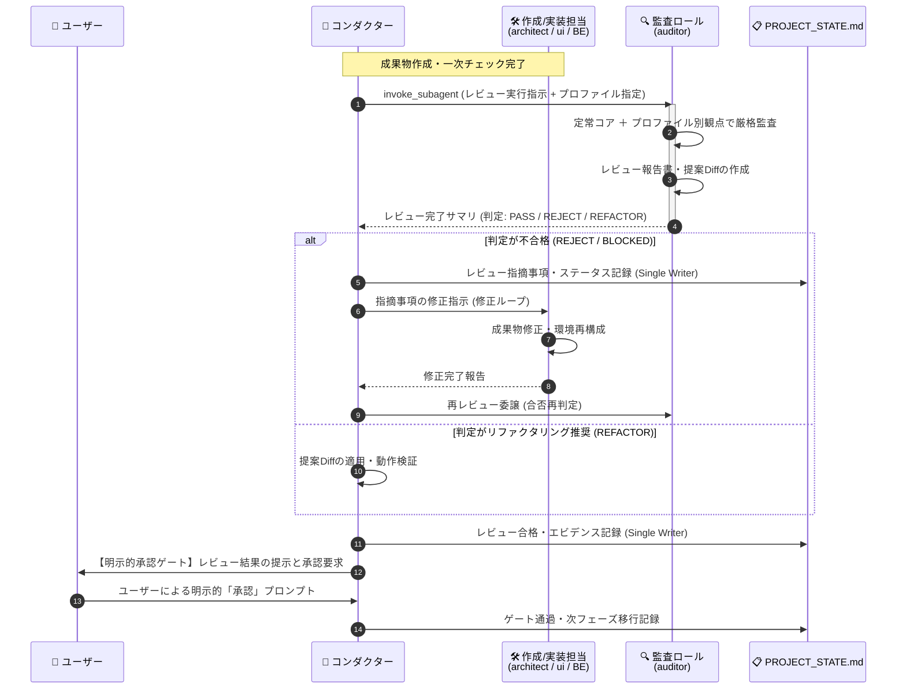

# レビューシステム設計書 (Review System Design Specification)

文書バージョン: 1.1  
作成日: 2026-10-10  
改定日: 2026-10-10  
対象バージョン: AI駆動システム開発ライフサイクルテンプレート V2.1  
ステータス: 策定完了 (Step 1 改訂版)  

---

## 1. はじめに

### 1.1 背景と目的
AI駆動システム開発ライフサイクル V2.0 においては、コンダクター（Main）、設計（architect）、UI（ui-designer）、QA（qa-engineer）の協調体制と状態一元管理（`PROJECT_STATE.md`）により、高い自律性と開発スピードが実現された。

しかし、[V2.1へ向けた検討課題.md](../検討課題/V2.1/V2.1へ向けた検討課題.md) および [V2.1検討方針書.md](./V2.1検討方針書.md) に示されている通り、AI主導の開発には特有の品質劣化パターンと認知バイアスが存在する：
1. **AI特有の局所最適パッチ**: 試行錯誤の反復に伴い、重複コードの増殖（DRY原則違反）、デッドコードの残留、命名の揺らぎ、モジュール肥大化が発生し、技術的負債が加速度的に蓄積する。
2. **全体俯瞰的な弱点と過剰設計（YAGNI違反）の二面性**: 作成担当エージェントは「仕様の実装（前進）」に集中するあまり、マクロな脆弱性（SPOF、認可境界、リソース枯渇）を見落とすか、逆に小規模・ローカルツールに対して不要に複雑な分散アーキテクチャや過剰な抽象化を持ち込む傾向がある。
3. **本番・運用環境リスクの見落とし**: セキュリティ設定（IAM/IAP/ファイル権限）、平文シークレット、ロールバック計画の不備、OSポータビリティ欠如など、稼働環境への投入直前における総合的ゲートキーパーが手薄になりやすい。

本文書は、これら3つの構造的弱点を解決するため、開発ライフサイクルの重要節目に配置する **「3大レビューシステム」** を定義し、その対象、観点、実施ロール、評価基準、パイプライン実行タイミングを規定するものである。

特に、システムの規模・稼働形態（クラウド公開、ローカル常駐、個人利用、モバイル等）に応じた適切な評価を行うため、**「定常的観点（普遍的コア）」** と **「可変的観点（規模・環境・目的適応型プロファイル）」** の二層アーキテクチャを採用する。

---

## 2. レビューシステムの全体アーキテクチャ

### 2.1 3大レビューの配置マップ

```
┌───────────────────────────────────────────────────────────────────────────────┐
│                        AI駆動開発ライフサイクル 3大レビュー体系               │
├───────────────────────────────────────────────────────────────────────────────┤
│                                                                               │
│  [PHASE 2: 要件定義] ──► システム展開プロファイル (Profile A〜D) を確定       │
│        │                                                                      │
│        ▼                                                                      │
│  [PHASE 3: 基本設計] ──────────────────────────┐                              │
│        │                                      ▼                              │
│        │                     【1. 基本設計レビュー (PHASE 3完了ゲート)】       │
│        │                       ・定常コア: データ保全、例外制御、過剰設計抑止 │
│        │                       ・可変適応: 選択プロファイルに応じた要件監査   │
│        ▼                                                                      │
│  [PHASE 4: 環境・実装]                                                        │
│        │                                                                      │
│        ▼                                                                      │
│  [PHASE 5: ウォークスルー]                                                     │
│        │                                                                      │
│        ▼                                                                      │
│  [PHASE 5.5: コード品質] ─────────────────────┐                              │
│        │                                      ▼                              │
│        │                     【2. コードクオリティ・整合性レビュー】           │
│        │                       ・ミクロ視点: DRY原則、SRP、デッドコード排除     │
│        │                       ・コード規約・型安全性・ファイル行数整流化     │
│        ▼                                                                      │
│  [PHASE 6: スルーテスト]                                                      │
│        │                                                                      │
│        ▼                                                                      │
│  [PHASE 7: 本番リリース] ─────────────────────┐                              │
│        │                                      ▼                              │
│        │                     【3. システム総合レビュー (リリース直前ゲート)】 │
│        ▼                       ・プロファイル別稼働耐性、シークレット、切戻し │
│  [PHASE 8: 保守改訂運用]                                                      │
│                                                                               │
└───────────────────────────────────────────────────────────────────────────────┘
```

### 2.2 二層型レビューアーキテクチャ (Two-Layer Review Model)
レビュー観点を単一の固定基準とせず、以下の二層に分離して合成する：

1. **第1層: 定常的観点 (Universal Core Criteria)**:
   - 規模（個人1名〜エンタープライズ万名）、環境（クラウド、ローカルPC、モバイル）、目的に関わらず、**いかなるソフトウェアでも妥協してはならない普遍的品質基準**。
2. **第2層: 可変的観点 (Context-Adaptive Profiles)**:
   - PHASE 2（要件定義）で定義された **システム展開プロファイル（Deployment Profile）** に基づき、重み付けや合否判定項目を動的に切り替える適合基準。

```
┌────────────────────────────────────────────────────────────────────────┐
│                      基本設計レビュー観点の二層構造                    │
├────────────────────────────────────────────────────────────────────────┤
│                                                                        │
│   【第1層: 定常的観点 (Universal Core Criteria)】                      │
│     どんな規模・稼働環境でも妥協してはならない普遍的品質              │
│     ・データ保全・破壊防止  ・入力検証・境界値防御                     │
│     ・リソースリーク防止    ・設定とロジックの分離                     │
│     ・例外・クラッシュ制御  ・過剰設計抑止 (YAGNI)                     │
│                                                                        │
│                                   ▼ 動的合成                           │
│                                                                        │
│   【第2層: 可変的観点 (Context-Adaptive Profiles)】                    │
│     PHASE 2 要件定義書で指定された「展開プロファイル」に応じて動的適用 │
│                                                                        │
│   ┌───────────────┬───────────────┬───────────────┬────────────────┐  │
│   │ Profile A     │ Profile B     │ Profile C     │ Profile D      │  │
│   │ クラウド公開  │ ローカル常駐  │ 個人・小規模  │ モバイル・     │  │
│   │ Webサービス   │ 閉鎖スタンド  │ ツール/検証   │ クライアント   │  │
│   │               │ アローン      │               │                │  │
│   ├───────────────┼───────────────┼───────────────┼────────────────┤  │
│   │ ・SPOF排除    │ ・メモリ/CPU  │ ・ゼロコスト  │ ・バッテリー   │  │
│   │ ・IAM/IAP認可 │   極小化      │ ・依存極小    │   消費抑制     │  │
│   │ ・オートスケ  │ ・OS依存排除  │ ・コード単一  │ ・電波切断耐性 │  │
│   │   ール・N+1   │ ・オフライン  │   ファイル性  │ ・ローカル容量 │  │
│   │ ・Secret Mgr  │   完全動作    │ ・過剰抽象化  │   制約         │  │
│   │               │ ・単一DB整合  │   の完全排除  │                │  │
│   └───────────────┴───────────────┴───────────────┴────────────────┘  │
│                                                                        │
└────────────────────────────────────────────────────────────────────────┘
```

### 2.3 設計の基本原則
1. **批判的検証の分離 (Independent Critique)**:
   - 成果物を作成したエージェント自身（Self-Review）だけに頼らず、独立した批判的視点（Red Team的アプローチ）を持つロールが監査を実施する。
2. **提案型安全ガードレール (Non-Destructive Review)**:
   - レビュアーはプログラムコードや設計書を直接勝手に書き換えない（破壊的変更の禁止）。指摘事項と改善案（Diff / Action Items）をレポートとして出力し、コンダクターおよびユーザーの承認を経て反映する。
3. **明示的承認ゲートとの連動 (Gate-Aligned)**:
   - レビュー結果は単なる参考情報ではなく、フェーズ完了および次フェーズ移行の必須前提条件（品質ゲート）として機能する。
4. **コンテキスト隔離の徹底 (Context Isolation)**:
   - レビューの試行錯誤や膨大な静的解析ログはサブエージェント内で完結させ、親（コンダクター）には構造化された判定サマリのみを返却してトークン浪費を防ぐ。
5. **過剰設計（YAGNI）の抑止**:
   - 小規模・ローカルツールに対して不要なマイクロサービス化や過剰な抽象レイヤー、不相応なクラウド連携が提案された場合、レビュアーはこれを積極的に棄却・簡略化させる。

---

## 3. 3大レビュー詳細設計

---

### 3.1 レビュー 1: 基本設計レビュー (Basic Design Review)

#### 1. レビュー対象
- `docs/要件定義書.md`（特に「システム展開プロファイル」）
- `docs/技術要件定義書.md`
- `docs/テーブルスキーマ定義書.md`
- `docs/ビジネスロジック仕様書.md`
- `docs/画面仕様書.md`

#### 2. レビュー観点（二層構造）

##### 【第1層: 定常的観点 (Universal Core Criteria - 全システム共通)】
いかなる規模・環境のシステムであっても、**クラッシュせず安全にデータを扱い続けるための普遍的チェック項目**。

| 観点 | 目的 | 具体的なチェック内容 |
| :--- | :--- | :--- |
| **データ保全・破壊防止**<br>(Data Integrity & Safety) | 突然の停止やエラーによるデータ喪失・破損を防ぐ | ・SQLite/ファイル書き込み時のアトミック性（書き込み途中の強制終了で破損しないか）<br>・トランザクション制御または安全なリプレイス書き込み<br>・破壊的操作前のバックアップ・復旧手段の考慮 |
| **入力検証・境界値防御**<br>(Input Validation) | 想定外データによる異常動作を防ぐ | ・不正なファイルパス（パストラバーサル等）の正規化<br>・極端なサイズ（巨大ファイル、無限長文字列）の境界チェック<br>・型チェックとデフォルト値の妥当性 |
| **リソースリーク防止**<br>(Resource Management) | 稼働中のリソース枯渇を防ぐ | ・ファイルディスクリプタ、DB接続、プロセスの確実なクローズ（`with` 句等の徹底）<br>・メモリリークや孤立スレッド/プロセスの防止 |
| **設定とコードの分離**<br>(Configuration Decoupling) | 環境変化や再利用に対応する | ・パスや設定値、ポート番号のハードコード排除<br>・設定ファイル（`.env`, `config.json` 等）への外出し |
| **例外制御とクラッシュ防止**<br>(Graceful Error Handling) | 予期せぬクラッシュで作業内容が吹き飛ぶのを防ぐ | ・捕捉されない未処理例外（Unhandled Exception）の根絶<br>・エラー時のわかりやすいメッセージ表示とログ出力 |
| **過剰設計の抑止 (YAGNI)**<br>(Anti-Overengineering) | AI特有の「無駄に高度な設計」を排除する | ・要求仕様に対して不要に複雑な層（多重インターフェース、不要なマイクロサービス化、過剰な抽象化）の排除<br>・現在の要件を満たす最小限で堅牢な構造の選択 |

##### 【第2層: 可変的観点 (Context-Adaptive Profiles - プロファイル別)】
PHASE 2 要件定義書で指定された「適用プロファイル」に基づき、重み付けと合否判定項目を動的に適用する。

###### Profile A: クラウド公開・Webサービス型 (Cloud / Public Web)
- **可用性・耐障害性**: 単一障害点（SPOF）の排除、タイムアウトと指数バックオフ、コネクションプール枯渇対策。
- **セキュリティ・認可**: IAM/IAP認証境界、IDOR（オブジェクト参照改ざん）防止、テナント間データ分離、Secret Manager活用。
- **スケーラビリティ・性能**: N+1クエリ排除、インデックス設計、キャッシュ戦略、Cloud Runオートスケール耐性。

###### Profile B: ローカル常駐・閉鎖環境型 (Local / Standalone / Closed)
- **リソースフットプリント極小化**: メモリ使用量・常駐時のCPU使用率を極限まで抑制（不要な常駐ポーリングの排除）。
- **OS・環境ポータビリティ**: パス区切り文字（Windows `\` vs Mac/Linux `/`）、改行コード、エンコーディング（UTF-8/CP932）の差異吸収。
- **完全オフライン動作**: 外部インターネット接続を前提としない設計（ローカルフォールバック、ローカルフォント/ライブラリ同梱）。
- **ローカルストレージ整合性**: SQLite等の単一ファイルDBのロック競合防止、プロセス間排他制御。
- **クリーンな初期化/アンインストール**: 作業用一時ディレクトリの配置規約（XDG Base Directory準拠等）とクリーンアップ。

###### Profile C: 個人利用・小規模・プロトタイプ型 (Personal / Small-Scale / Prototype)
- **ゼロ運用コスト**: 追加インフラ費用ゼロ、Free Tierまたは完全ローカル完結の維持。
- **コード・構成の簡潔性**: 1ファイル〜数ファイルで完結する素朴な構成の尊重、不要なORマッパーや多重ディレクトリ階層の排除。
- **自己完結性と起動の容易さ**: 複雑なDockerセットアップや外部ミドルウェア（Redis, PostgreSQL等）を要求せず、`uv run` や単一コンテナで即座に動くこと。

###### Profile D: モバイル・エッジクライアント型 (Mobile / Edge Client)
- **省電力・バッテリー保護**: バックグラウンドタスクの頻度制御、無駄なGPS・センサー取得の抑制。
- **ネットワーク断続耐性**: オフライン・低速回線時のリトライキューイング、ローカルキャッシュファースト（Local-First）設計。
- **端末ストレージ制約**: キャッシュ自動パージ、ローカルDBのサイズ肥大化防止。

#### 3. レビューを実施するロールとその性質
- **ロール名**: 🏛️ **システムアーキテクチャ監査役 (`system-architect-auditor`)**
- **性質・スタンス**:
  - **Red Team的アプローチ**: 「どこから壊れるか」「どこが無駄に複雑か」を冷徹に探索する批判的立場。
  - **プロファイル適応力**: プロファイルを無視した画一的チェック（例: ローカルツールにIAMを要求する、大規模WebにYAGNIを誤適用してSPOFを容認するなど）を排し、ターゲット環境に最適化された判定を下す。
- **実行モデル**: `pro`（高度な多角的推論と潜在リスク検知を行うため）
- **操作権限**:
  - ドキュメント読み取り専用（Read-Only）。
  - 指摘事項は `docs/plans/基本設計レビュー結果報告書.md` に集約して出力する（直接の設計書修正は禁止）。

#### 4. 実行フェーズ
- **フェーズ**: **PHASE 3 完了直前（設計完了ゲート前）**
- **位置づけ**:
  - `dev-doc-reviewer`（qa-engineer）による**ドキュメント相互整合性チェック（エラー0件）**が完了した直後、ユーザーの「基本設計完了承認ゲート」の直前に実行する。
  - 設計の不備をコード実装（PHASE 4）前に摘出することで、手戻りコストを最小化する。

#### 5. 評価基準と合否判定指標

##### 重大度判定基準
- **CRITICAL（致命的）**: 定常コア（データ破損、クラッシュ、リソースリーク）の違反、選択プロファイルにおける致命的弱点（Profile Aでの認可バイパス、Profile BでのOSクラッシュ、Profile Cでの過剰インフラ課金発生等）。
- **MAJOR（警告）**: タイムアウト未定義、不要に複雑な多層アーキテクチャ（YAGNI違反）、ポータビリティ阻害要因。
- **MINOR（推奨）**: 軽微な命名揺らぎ、ドキュメント補足推奨、将来的な拡張性改善案。

##### 合否判定ゲート
| 判定 | 条件 | アクション |
| :--- | :--- | :--- |
| **PASS (合格)** | CRITICAL: 0件 かつ MAJOR: 0件 | ユーザーへ基本設計完了承認ゲートを提示。 |
| **CONDITIONAL PASS (条件付き合格)** | CRITICAL: 0件 かつ MAJOR: 1〜2件（回避策・簡略化案明記） | ユーザーへリスクを開示し、承認を得られれば進行可。 |
| **REJECT (不合格)** | CRITICAL >= 1件 または MAJOR >= 3件 | PHASE 3設計手戻り。`architect` に修正を指示。 |

---

### 3.2 レビュー 2: コードクオリティ・整合性レビュー (Code Quality & Consistency Review)

#### 1. レビュー対象
- バックエンド実装ソースコード（API、サービス層、リポジトリ層、設定ファイル）
- フロントエンド実装ソースコード（画面、コンポーネント、状態管理、スタイル）
- スクリプト・ツールコード（CLI、ユーティリティ）
- Dockerfile、環境定義ファイル、依存パッケージ定義（`pyproject.toml`, `package.json` 等）

#### 2. レビュー観点
「コードが仕様通り動くか」ではなく、「**コードベースが保守可能で、無駄がなく、美しく整流化されているか**」というミクロ視点から監査する。

| 大分類 | 監査観点 | 具体的なチェック内容 |
| :--- | :--- | :--- |
| **DRY原則**<br>(重複排除) | ロジックの共通化 | 複数ファイル・関数間に存在する類似コード、コピペロジックの検出。 |
| | 定数・バリデーション重複 | ステータスコード、エラーメッセージ、正規表現等の重複定義排除。 |
| **単一責任・凝集度**<br>(SRP & Cohesion) | モジュール肥大化の抑制 | 単一ファイル行数の肥大化（推奨: 400行以下、画面コンポーネントは 300行以下）、超巨大関数の検知。 |
| | 責務の分離 | ハンドラ内に直接書かれたDBクエリや重いビジネスロジックの抽出。 |
| **不要コード排除**<br>(Dead Code Cleanup) | 未使用リソースの検知 | 使われていないインポート、宣言のみで未呼出の関数・変数・コンポーネント。 |
| | デバッグログ・残存コメント | 開発時の一時的 `console.log`、`print`、コメントアウトされた廃止コードの根絶。 |
| **一貫性・型安全性**<br>(Consistency & Typing) | 命名・ディレクトリ規約 | キャメルケース/スネークケースの混在、命名揺らぎの統一。 |
| | 型定義の厳格性 | TypeScript の `any` 多用、Python の型ヒント欠落の是正。 |
| | エラーハンドリング統一 | try-catchの粒度、エラーレスポンス形式（JSON構造）の統一。 |

#### 3. レビューを実施するロールとその性質
- **ロール名**: 🧹 **コード品質・リファクタリング監査役 (`code-quality-auditor`)**
- **性質・スタンス**:
  - **静的解析・整流化スペシャリスト**: ソースコードのエントロピー（乱雑さ）を客観的に測定し、最小の差分で最大の保守性を引き出す職人的立場。
  - **非破壊的リファクタリング**: 既存の外部インターフェースや振る舞いを変更せず、内部構造のみを純化する。
- **実行モデル**: `pro`（依存関係の正確な把握と、安全なリファクタリングDiff立案のため）
- **操作権限**:
  - ソースコード読み取りおよび静的解析実行権限。
  - **直接のコード置換は禁止**。リファクタリング提案書（`docs/plans/コード品質レビュー及びリファクタリング提案書.md`）と Unified Diff を作成し、コンダクターに反映を委ねる。

#### 4. 実行フェーズ
- **フェーズ**:
  - **新規開発時**: **PHASE 5.5（コードクオリティレビュー & リファクタリング工程）**
    - PHASE 5（ウォークスルー動作確認完了・ユーザー機能Fix）の後、PHASE 6（シナリオテストコード構築・自動実行）の直前に配置。
    - テストコードを構築・固定化する前にソースコードを美しく整流化することで、テストコード側の手戻りや無駄な修正を防ぐ。
  - **システム改訂時**: **改訂ターン（Revision Turn）実装完了直後**
    - パッチ当てが完了した段階で即座にレビューを実施し、小刻みな改訂によるコード腐敗を防止する。

#### 5. 評価基準と合否判定指標

##### 定量メトリクス評価基準
| 項目 | 許容基準 (Threshold) | 判定 |
| :--- | :--- | :--- |
| **ファイル行数** | 1ファイルあたり原則 400行以内 (画面コンポーネントは 300行以内) | 超過時は分割提案 |
| **関数行数** | 1関数あたり原則 50行以内 | 超過時は抽出提案 |
| **デッドコード・未使用インポート** | 0件 | 検出時は即時削除 |
| **一時的デバッグ出力** | 0件 (`print`, `console.log` 等の残存) | 検出時は即時削除 |
| **重大な重複ブロック (DRY)** | 同一・類似ロジックの3箇所以上の多重実装: 0件 | 検出時は共通化必須 |

##### 合否判定ゲート
| 判定 | 条件 | アクション |
| :--- | :--- | :--- |
| **CLEAN (合格)** | 指摘事項 0件、または軽微な可読性コメントのみ | PHASE 6（テスト構築）へ即時進行。 |
| **REFACTOR RECOMMENDED (提案あり)** | 重複排除、デッドコード削除、関数分割等の安全なDiffが存在 | コンダクターが提案Diffを適用し、コンテナ/実行環境再ビルド・疎通確認の上で進行。 |
| **BLOCKED (要修正)** | 設計を脅かす深刻なスパゲッティ化、型破壊、大規模ファイル肥大化 | リファクタリング完了まで PHASE 6 への移行をブロック。 |

---

### 3.3 レビュー 3: システム総合レビュー (System Comprehensive Review)

#### 1. レビュー対象
- 展開・配布設定（Cloud Run設定、Dockerfile、インストーラー、起動スクリプト、ビルド成果物）
- セキュリティ・権限設定（IAMロール、IAP、ファイルアクセス権限、実行ユーザー権限）
- 環境変数・設定管理（`.env`, `.env.production`, Secret Manager設定）
- テスト結果・品質エビデンス（`docs/plans/シナリオテスト計画書.md`、テスト実行ログ）
- 手順書・運用文書（`docs/plans/本番適用作業手順書.md` または `docs/plans/配布・セットアップ手順書.md`、ロールバック手順）

#### 2. レビュー観点（プロファイル適応型）
「システムが単に動くか」ではなく、「**対象環境において安全・堅牢に稼働し、万一の障害時にも迅速に原状復旧できるか**」という運用耐性・ガバナンス視点から監査する。

##### 【全プロファイル共通必須項目】
1. **平文シークレットの完全排除**: ソースコード、公開設定、ビルド成果物内に平文のAPIキーや秘密鍵が存在しないこと。
2. **テスト網羅性の達成**: PHASE 6 のシナリオテスト成功率が100%であり、未解決の重大不具合が0件であること。
3. **原状復旧・ロールバック性**: 異常発生時に直前の正常状態へ戻す手段（リビジョンロールバック、DBバックアップ復元、アンインストール/再セットアップ等）が具体的に実証されていること。

##### 【プロファイル別適合監査】
- **Profile A (クラウド公開)**:
  - Cloud Runの `allUsers` 権限排除（認証・認可境界の厳格性）。
  - 最小権限サービスアカウントの適用。
  - Cloud Loggingによる構造化ログ追跡可能性。
- **Profile B (ローカル常駐/閉鎖)**:
  - 実行環境（Windows, Mac, Linux）での依存ライブラリ完結性（仮想環境の閉じ込め、パス依存排除）。
  - 一般ユーザー権限（非管理者権限）での正常動作確認。
  - 終了時のプロセス残存（ゾンビプロセス）ゼロ。
- **Profile C (個人/小規模)**:
  - 追加コスト発生要素（有料リソースの誤設定等）がないことの確認。
  - 依存環境構築手順（README/セットアップコマンド）の極小・明瞭さ。
- **Profile D (モバイル/エッジ)**:
  - バックグラウンド実行権限、バッテリー最適化設定の遵守。
  - ローカルストレージ上限超過時のフェイルセーフ確認。

#### 3. レビューを実施するロールとその性質
- **ロール名**: 🛡️ **本番リリース統括監査役 (`release-governance-auditor`)**
- **性質・スタンス**:
  - **冷徹なゲートキーパー**: リリーススケジュールや開発者の都合に妥協せず、セキュリティ基準・環境適合性・ロールバック可能性を最優先で死守する監査責任者。
- **実行モデル**: `pro`（環境設定の複雑な依存関係とリスク連鎖を網羅的に検証するため）
- **操作権限**:
  - 全設定ファイル・テストログ・作業手順書の読み取り権限。
  - 監査結果判定書（`docs/plans/システム総合レビュー結果報告書.md`）の作成。リリース実行権限は持たず、コンダクターへのリリース認可（Approval / Block）のみを宣告する。

#### 4. 実行フェーズ
- **フェーズ**: **PHASE 7 本番リリース（または配布・デプロイ）直前ゲート**
- **位置づけ**:
  - PHASE 6 のスルーテストが成功率100%で完了し、コンダクターが手順書を策定した直後に実行。
  - 本監査の合格判定（RELEASE APPROVED）を受けて初めて、ユーザーへ最終リリース承認プロンプトを提示できる。

#### 5. 評価基準と合否判定指標

##### 必須検証チェックリスト（Zero Tolerance Items）
以下に1項目でも違反がある場合、即時 **RELEASE BLOCKED（デプロイ/配布凍結）** とする：
- [ ] 1. ソースコード、環境設定、ビルド成果物内に平文のパスワード・秘密鍵が一切存在しないこと。
- [ ] 2. プロファイル別のセキュリティ境界（Cloudなら不要なパブリックアクセス排除、Localなら不要な管理者権限要求排除）が遵守されていること。
- [ ] 3. 直前バージョンの状態への巻き戻し手順（ロールバックコマンド等）が手順書に明記されていること。
- [ ] 4. PHASE 6 におけるシナリオテストのパス率が100%であり、未解決の重大不具合が0件であること。

##### 合否判定ゲート
| 判定 | 条件 | アクション |
| :--- | :--- | :--- |
| **RELEASE APPROVED (承認)** | 必須検証チェックリスト全件適合 かつ 残存リスクなし | ユーザーへ「本番リリース実行承認ゲート」を提示。コンダクターがデプロイ/配布実行。 |
| **RELEASE BLOCKED (凍結)** | 必須検証チェックリストに1件でも不適合あり | リリース中止。セキュリティ/設定を修正し、再監査を実施。 |

---

## 4. レビュー実行フローとパイプライン統合

### 4.1 レビュー実行シーケンス



### 4.2 不合格時のフィードバックループと収束保証
1. **修正ループ上限回数**:
   - 同一レビューにおける自動修正・再レビューのループ上限は **最大3回** とする。
2. **Open Questionsへのエスカレーション**:
   - 3回以内に合格基準に達しない場合、コンダクターは問題を `PROJECT_STATE.md` の「未決事項（Open Questions）」へ昇格させ、ユーザーへトレードオフ（仕様簡略化、要件見直し、リスク受容など）の判断を仰ぐ。

### 4.3 プロジェクト状態管理 (`PROJECT_STATE.md`) 連携仕様
Single Writer原則に基づき、レビュー結果の記録はコンダクターが一元管理する：
- レビュー開始時: ステータスを `IN_REVIEW` へ更新。
- レビュー完了時:
  - 判定結果（`PASS` / `REJECT`）、重大度別指摘件数、エビデンスファイルパスを記録。
  - 次フェーズへの移行チェックボックスを更新。

---

## 5. レビュー実施ロールの体系とエージェント配置

### 5.1 ロール配置の設計方針
V2.0 の「コンテキスト隔離」「責務の純化」を維持しつつ、レビュアー機能を既存の監査特化エージェント `qa-engineer` に対して **3つの専門レビュアースキル** として装備させ、呼び出し時に役割・コンテキストを完全分離して実行する構成を標準とする：

| レビュー種別 | 実行サブエージェント | 適用スキル名 | モデル | 主な責務・性質 |
| :--- | :--- | :--- | :---: | :--- |
| **基本設計レビュー** | 🛡️ `qa-engineer` (監査モード) | `dev-review-arch` | `pro` | 定常コア ＋ プロファイル適応型アーキテクチャ監査（YAGNI抑止含む） |
| **コードレビュー** | 🛡️ `qa-engineer` (品質モード) | `dev-review-code` | `pro` | DRY、SRP、デッドコード、型安全性の整流化監査 |
| **システム総合レビュー** | 🛡️ `qa-engineer` (リリース監査モード) | `dev-review-system` | `pro` | プロファイル別稼働耐性、シークレット、ロールバック監査 |

---

## 6. レビュー成果物の標準フォーマット

### 6.1 基本設計レビュー結果報告書 (`docs/plans/基本設計レビュー結果報告書.md`)

```markdown
# 基本設計レビュー結果報告書

- **レビュー実施日**: YYYY-MM-DD HH:MM
- **実施ロール**: 🏛️ システムアーキテクチャ監査役 (qa-engineer)
- **対象プロファイル**: [Profile A: クラウド公開 / Profile B: ローカル常駐 / Profile C: 個人小規模 / Profile D: モバイル]
- **対象ドキュメント**: 要件定義書、技術要件定義書、テーブルスキーマ定義書、ビジネスロジック仕様書、画面仕様書
- **総合判定**: [PASS / CONDITIONAL PASS / REJECT]

## 1. 総合評価サマリ
[定常コア（データ保全、クラッシュ防止、過剰設計抑止）および選択プロファイル適合性に関する総評]

## 2. 指摘事項一覧
| ID | 観点分類 (定常/プロファイル) | 重大度 | 対象設計書 / 項目 | 指摘内容・潜在リスク | 推奨対策・改善案 |
| :--- | :---: | :---: | :--- | :--- | :--- |
| ARCH-001 | 定常コア (データ保全) | CRITICAL | スキーマ (local.db) | 異常終了時のDB破損対策なし | WALモードの有効化とトランザクション明示 |
| ARCH-002 | 定常コア (YAGNI) | MAJOR | 技術要件 (キャッシュ) | 個人利用ツールにRedisを導入しており過剰設計 | インメモリ辞書またはキャッシュ層削除を推奨 |
| ARCH-003 | Profile B (OS依存) | MAJOR | ロジック (パス操作) | Windows環境でパス区切りが壊れるハードコード | `pathlib.Path` の利用徹底 |

## 3. 次のアクション
- [ ] 📐 architect による指摘事項の修正反映
- [ ] 👑 コンダクターによる整合性再確認
```

### 6.2 コード品質レビュー及びリファクタリング提案書 (`docs/plans/コード品質レビュー及びリファクタリング提案書.md`)

```markdown
# コード品質レビュー及びリファクタリング提案書

- **レビュー実施日**: YYYY-MM-DD HH:MM
- **実施ロール**: 🧹 コード品質・リファクタリング監査役 (qa-engineer)
- **対象ソース**: フロントエンド / バックエンド / スクリプト全域
- **総合判定**: [CLEAN / REFACTOR RECOMMENDED / BLOCKED]

## 1. 静的解析・健全性メトリクス
- 最大ファイル行数: XXX 行 (`src/path/to/file.py`)
- デッドコード検出数: X 件
- 一時的デバッグログ残存数: X 件
- 重複コードブロック検出数: X 件

## 2. リファクタリング提案とDiff
### 改善 1: [重複ロジックの共通化 (DRY)]
- **対象ファイル**: `src/api/auth.py`, `src/api/user.py`
- **改善概要**: トークン検証ロジックを `src/utils/security.py` へ共通化
- **Unified Diff**:
```diff
--- a/src/api/auth.py
+++ b/src/api/auth.py
@@ -10,15 +10,3 @@
-    # 重複していたトークン検証
-    token = request.headers.get("Authorization")
-    ...
+    token_data = verify_token(request)
```

## 3. 適用判断
- [ ] 👑 コンダクターによるDiff適用確認
- [ ] 実行環境/コンテナ再構成 及び 疎通テスト
```

### 6.3 システム総合レビュー結果報告書 (`docs/plans/システム総合レビュー結果報告書.md`)

```markdown
# システム総合レビュー結果報告書 (旧称: 本番リリース総合判定書)

- **レビュー実施日**: YYYY-MM-DD HH:MM
- **実施ロール**: 🛡️ 本番リリース統括監査役 (qa-engineer)
- **対象プロファイル**: [Profile A / B / C / D]
- **対象バージョン**: vX.Y.Z
- **総合判定**: [RELEASE APPROVED / RELEASE BLOCKED]

## 1. 必須検証チェックリスト (Zero Tolerance)
- [x] 1. 平文パスワード・APIキーの完全排除
- [x] 2. プロファイル別セキュリティ境界の遵守 (不要権限排除)
- [x] 3. 直前状態への巻き戻し/ロールバック手順の検証完了
- [x] 4. スルーテスト成功率100% (未解決不具合 0件)

## 2. 環境稼働耐性評価
- リソースフットプリント / コンテナ設定: 妥当性確認
- ログ・エラー追跡性: 正常設定確認

## 3. 最終リリース可否判定
- **判定結果**: RELEASE APPROVED
- **リリース条件**: ユーザーの明示的最終承認を経てデプロイ/配布を実行すること。
```

---

## 7. フェーズ定義（V2.1）への反映仕様

本レビューシステムの導入に伴い、`docs/V2.1/AI駆動システム開発フェーズ定義書V2.1.md` に以下の変更を反映する：

1. **PHASE 2 でのプロファイル決定**:
   - `docs/要件定義書.md` 冒頭に「システム展開プロファイル（Profile A〜D）」を明記することを必須化。
2. **PHASE 3 の完了条件更新**:
   - 「基本設計レビューの合格（PASS）」および「`基本設計レビュー結果報告書.md` の作成」を必須完了条件に追加。
3. **新規フェーズ PHASE 5.5 の追加**:
   - フェーズ名: **PHASE 5.5: コード品質レビューとリファクタリング**
   - 目的: テストコード構築前にコードのエントロピーを除去し、重複排除・整流化を完了する。
   - 主担当: 🛡️ `qa-engineer`（スキル: `dev-review-code`）、反映: 👑 コンダクター
   - ゲート条件: コード健全性メトリクスのクリアおよびリファクタリング後の正常動作確認。
4. **PHASE 7 の完了条件更新**:
   - 「システム総合レビューの合格（RELEASE APPROVED）」をデプロイ/配布実行の前提ゲートとして明文化。
5. **システム改訂プロセス（REVISION）の改訂ターン内組み込み**:
   - 改訂ターン（Revision Turn）の実装完了直後に、コードレビュー（差分対象）を標準実行するフローを規定。

---

## 8. 関連ドキュメント・リンク

- [テンプレート配置形態およびナレッジ境界設計書.md](./テンプレート配置形態およびナレッジ境界設計書.md) - テンプレート配置形態（グローバル/ローカル）とTier 1/2ナレッジ境界設計書
- [エージェント設計書V2.1.md](./エージェント設計書V2.1.md) - V2.1 5大エージェント協調・権限設計書
- [状態管理機構設計書V2.1.md](./状態管理機構設計書V2.1.md) - V2.1 Single Writer状態管理詳細設計書
- [動的登録フォールバック仕様書V2.1.md](./動的登録フォールバック仕様書V2.1.md) - コンダクター動的エージェントロード仕様書
- [エージェント推論モデル仕様および運用基準書V2.1.md](./エージェント推論モデル仕様および運用基準書V2.1.md) - モデル選定・運用基準書
- [パイプライン統合およびテンプレート再編集における配慮事項まとめV2.1.md](./パイプライン統合およびテンプレート再編集における配慮事項まとめV2.1.md) - 統合・再編集7大配慮事項
- [エージェント・スキル・テンプレート再構成設計計画書.md](./エージェント・スキル・テンプレート再構成設計計画書.md) - 再構成全体計画書
- [定量測定・フィードバック設計書.md](./定量測定・フィードバック設計書.md) - V2.1 開発支援システム定量測定・フィードバック詳細設計書
- [V2.1検討方針書.md](./V2.1検討方針書.md) - 本レビューシステムの上位方針書
- [AI駆動システム開発フェーズ定義書V2.1.md](./AI駆動システム開発フェーズ定義書V2.1.md) - 本設計を反映した最新フェーズ定義書
- [WikiSkill統合設計書.md](./WikiSkill統合設計書.md) - V2.1 WikiSkill型永続ナレッジ自己進化ループの統合設計書
- [エージェント間知見蓄積運用基準書V2.1.md](./エージェント間知見蓄積運用基準書V2.1.md) - V2.1 知見蓄積・運用基準書 (Tier 1/2 二層分離・評価適正化)
- [V2.1へ向けた検討課題.md](../検討課題/V2.1/V2.1へ向けた検討課題.md) - V2.1に向けた6大課題の詳細検討書
- [AI駆動システム開発フェーズ定義書V2.md](../V2.0/AI駆動システム開発フェーズ定義書V2.md) - 旧V2.0のフェーズ定義
- [エージェント設計書.md](../V2.0/エージェント設計書.md) - 旧V2.0のエージェント体系定義
- [エージェント間知見蓄積運用基準書.md](../V2.0/エージェント間知見蓄積運用基準書.md) - 旧V2.0の知見蓄積ルール
