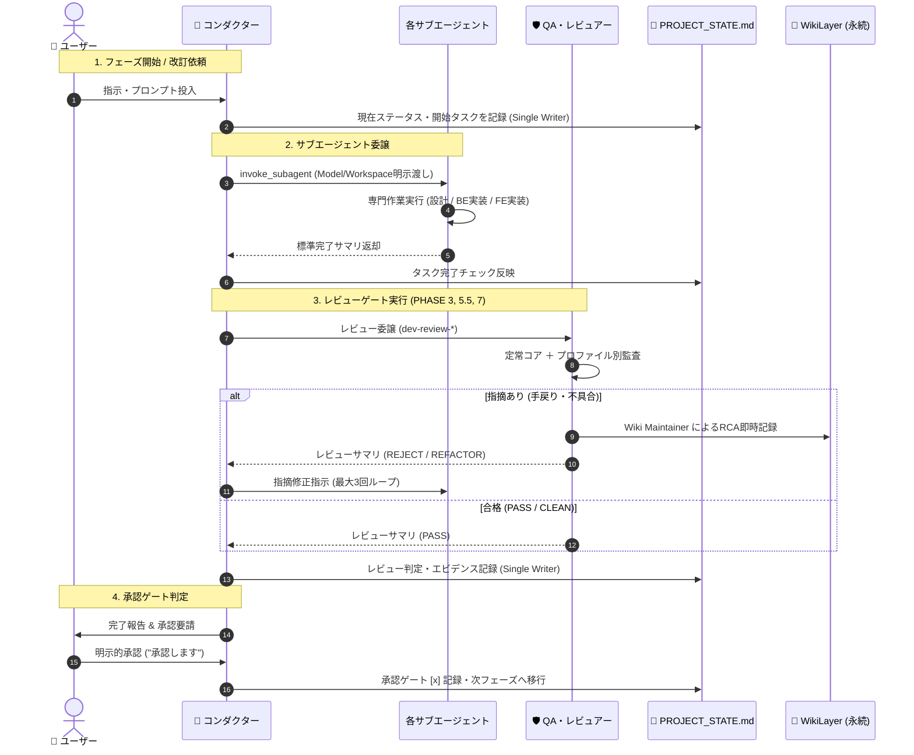

# プロジェクト状態管理機構設計書 V2.1

文書バージョン: 2.1  
作成日: 2026-10-10  
改定日: 2026-10-10  
対象バージョン: AI駆動システム開発ライフサイクルテンプレート V2.1  
ステータス: 正式改訂版  

---

## 1. 目的と基本思想

### 1.1 目的
サブエージェント（`architect`, `backend-engineer`, `ui-designer`, `qa-engineer`）およびメインエージェント（`conductor`）が協調して自律開発を推進するにあたり、以下の課題を解決する：
1. **文脈の断絶防止**: コンテキスト長過大によるリセットやセッション再開時にも、現在のフェーズ・残タスク・決定事項・選択プロファイルを即座に復元できること。
2. **作業競合の排除**: 複数エージェントが同時に作業状態を更新することによるコンフリクトや破損を完全に防ぐこと。
3. **客観的品質ゲートの可視化**: 3大レビュー（基本設計、コード品質、システム総合）の合否判定、重大度別指摘件数、改善アクションを確実に記録・追跡できること。
4. **WikiSkillナレッジ・定量メトリクスの追跡**: 蓄積された知見（Tier 1/2）の件数、自己進化ループの成否、およびトークン消費・リードタイム等のメトリクスを一元把握できること。

### 1.2 設計基本原則
| 原則 | 内容 |
| :--- | :--- |
| **配置場所の分離** | `PROJECT_STATE.md` は **プロジェクトルート直下（`./PROJECT_STATE.md`）** に配置する。`docs/` 配下の一般仕様書・ドキュメント群と物理的に分離し、サブエージェントによるドキュメント一括監査時のノイズ・誤判定を根本から排除する。 |
| **Single Writer 原則** | `PROJECT_STATE.md` への書き込み・更新権限は **👑 プロジェクトコンダクター（メインエージェント）のみ** が保持する。サブエージェント（`architect`, `backend-engineer`, `ui-designer`, `qa-engineer`）は親へ標準完了サマリを返すのみとし、状態ファイルを直接編集しない。 |
| **人間可読・直接編集性** | 状態管理ファイルは GitHub Flavored Markdown 形式を採用。ユーザーがプロジェクト直下でVSCode等により直接メモやチェックを更新することも許容する。 |
| **明示的承認ゲートの記録** | ユーザーが承認を与えた日時、コミット、承認ステータスを状態ファイルに明記する。 |
| **Git / バージョン連動** | `Git運用基準書.md` および `.env`（`APP_VERSION`）と同期し、ブランチ名（`main` / `feature`）、改訂依頼番号（`n.m.xxx`）を常時反映する。 |

---

## 2. 状態ファイル詳細フォーマット仕様（`PROJECT_STATE.md` V2.1）

`PROJECT_STATE.md` は以下のセクション構成を持つ。

### 2.1 構成セクション一覧
1. **基本メタデータ（Header Metadata）**: プロジェクト名、現行ステータス、展開プロファイル (Profile A〜D)、現行バージョン、動作モード (EXECUTION_MODE)、テンプレートソース (TEMPLATE_SOURCE)、Gitブランチ、最終更新日時
2. **新規開発フェーズ進捗一覧（PHASE 1〜8）**: チェックボックス、完了日、各サブエージェント分担タスク、3大レビューゲート、明示的承認ゲート
3. **システム改訂管理（PHASE 8以降）**: 進行中の改訂依頼番号（`n.m.xxx`）、ターン数、コードレビュー判定、テスト結果、改訂履歴テーブル
4. **WikiSkill & ナレッジ自己進化ステータス**: Tier 1 / Tier 2 パターン件数、自己進化サイクル実行結果 (`[Adopted]` / `[Rejected]`)
5. **プロジェクト定量メトリクスサマリ**: メインコンテキスト寿命、テスト初回合格率、重複コード削減率、リードタイム
6. **未決事項・確認事項（Open Questions & Decisions）**: ユーザー判断待ち事項、決定済みログ
7. **システム・インフラ・Git状態**: ローカルコンテナ状態、最新リビジョン、本番URL、Gitリモート・最新コミット

### 2.2 詳細テンプレート (`PROJECT_STATE.md.template` V2.1)

```markdown
# プロジェクト進行状態管理票 (PROJECT_STATE)

- **プロジェクト名**: [プロジェクト名]
- **現在のステータス**: [PHASE_1_SETUP / PHASE_2_REQUIREMENTS / ... / PRODUCTION_ACTIVE / REVISION_IN_PROGRESS]
- **システム展開プロファイル**: [Profile A: クラウド公開 / Profile B: ローカル常駐 / Profile C: 個人小規模 / Profile D: モバイル]
- **現行バージョン**: v[APP_VERSION] (例: v1.0.0)
- **EXECUTION_MODE**: [GLOBAL_PLUGIN / LOCAL_STANDALONE]
- **TEMPLATE_SOURCE**: [~/.gemini/config/plugins/system-dev-pipeline / ./.agents/plugins/system-dev-pipeline]
- **現在の作業ブランチ**: [main / feature]
- **最終更新日時**: YYYY-MM-DD HH:MM
- **最終更新者**: 👑 プロジェクトコンダクター (または 👤 ユーザー)

---

## 1. 開発フェーズ進捗一覧 (新規開発 PHASE 1〜8)

- [ ] **PHASE 1: プロジェクトの準備** (完了日: YYYY-MM-DD)
  - [ ] ディレクトリ・環境設定展開 (`dev-phase1-setup`)
  - [ ] 永続ナレッジ領域初期化 (`wiki/patterns/{local,universal,rejected}`, `wiki/archive/`)
  - [ ] メトリクス集計領域初期化 (`metrics/turns/`、`.gitignore` 自動登録)
  - [ ] 知見昇格バッファ初期配置 (`TEMPLATE_PROMOTIONS.md`)
  - [ ] `PROJECT_STATE.md` 初期化 (EXECUTION_MODE 記録)
- [ ] **PHASE 2: 要件定義**
  - [ ] 📐 `architect`: `docs/要件定義書.md` 作成・精査（展開プロファイル選定）
  - [ ] 👤 ユーザー: Open Questions 回答
  - [ ] **【承認ゲート】👤 ユーザー: 要件定義完了の明示的承認** (承認日: YYYY-MM-DD)
- [ ] **PHASE 3: 基本設計書の作成と整合性チェック**
  - [ ] 📐 `architect`: `技術要件定義書.md` 作成
  - [ ] 📐 `architect`: `テーブルスキーマ定義書.md` 作成
  - [ ] 📐 `architect`: `ビジネスロジック仕様書.md` 作成
  - [ ] 🎨 `ui-designer`: `画面仕様書.md` 作成
  - [ ] 🛡️ `qa-engineer`: `dev-doc-reviewer` 整合性多次元クロスチェック (不整合0件確認)
  - [ ] 🛡️ `qa-engineer`: `dev-review-arch` 基本設計レビュー (判定: PASS / CRITICAL: 0件, MAJOR: 0件)
  - [ ] **【承認ゲート】👤 ユーザー: 基本設計完了の明示的承認** (承認日: YYYY-MM-DD)
- [ ] **PHASE 4: 開発環境とシステム構築**
  - [ ] 👑 コンダクター: Docker環境構築・統括
  - [ ] 💻 `backend-engineer`: バックエンドAPI・DBモデル・ビジネスロジック実装
  - [ ] 🎨 `ui-designer`: フロントエンド画面・コンポーネント実装
  - [ ] ⚙️ `dev-git-init`: Gitリポジトリ初期化 (`.gitignore` 包含、`main` 初回コミット、`feature` 作成・チェックアウト)
  - [ ] 👑 コンダクター: コンテナ初回ビルド・疎通確認 (`docker compose up --build -d`)
- [ ] **PHASE 5: ウォークスルー動作確認とデバッグ**
  - [ ] 👤 ユーザー: 画面操作・機能検証
  - [ ] 👑 コンダクター: 指摘不具合修正統括（BE: `backend-engineer`, FE: `ui-designer`）
  - [ ] 📐 `architect`: 最新コードを正としたAPI仕様同期
  - [ ] 🛡️ `qa-engineer`: ドキュメント整合性再確認
  - [ ] **【承認ゲート】👤 ユーザー: ウォークスルー完了の明示的承認** (承認日: YYYY-MM-DD)
- [ ] **PHASE 5.5: コード品質・整合性レビュー & リファクタリング**
  - [ ] 🛡️ `qa-engineer`: `dev-review-code` 実行 (判定: CLEAN / REFACTOR RECOMMENDED)
  - [ ] 💻 `backend-engineer` / 🎨 `ui-designer`: 提案Diff反映・重複排除・型安全性是正
  - [ ] 👑 コンダクター: コンテナ再ビルド・疎通確認
- [ ] **PHASE 6: スルーテスト環境の構築と実施**
  - [ ] 🛡️ `qa-engineer`: `docs/plans/シナリオテスト計画書.md` 作成
  - [ ] 🛡️ `qa-engineer`: 自動テスト実行・修復ループ (成功率100%達成)
  - [ ] 🛡️ `qa-engineer`: Wiki Maintainer によるエラー根本原因（RCA）記録 (`wiki/patterns/`)
  - [ ] **【承認ゲート】👤 ユーザー: リリース準備移行の明示的承認** (承認日: YYYY-MM-DD)
- [ ] **PHASE 7: 本番リリース**
  - [ ] 👑 コンダクター: `docs/plans/本番適用作業手順書.md` 作成
  - [ ] 🛡️ `qa-engineer`: `dev-review-system` システム総合レビュー (判定: RELEASE APPROVED)
  - [ ] 👑 コンダクター: 本番環境（Cloud Run等）初回デプロイ実行
  - [ ] 🛡️ `qa-engineer`: IAM / IAP セキュリティ設定監査
  - [ ] **【承認ゲート】👤 ユーザー: 本番稼働確認の明示的承認** (承認日: YYYY-MM-DD)
- [ ] **PHASE 8: ドキュメント改訂管理・自己進化の開始**
  - [ ] 👑 コンダクター: 定量メトリクス集計 (`dev-metrics-collector`)
  - [ ] 👑 コンダクター: `wiki-proposer` によるスキル改修案立案 & `PURPOSE.md` 生成
  - [ ] 🛡️ `qa-engineer`: 複合検証ゲート実行 (判定: Adopted / Rejected)
  - [ ] 👑 コンダクター: `wiki-compactor` によるWiki整理・枝刈り
  - [ ] **【承認ゲート】👤 ユーザー: 知見昇格レビューの明示的承認 (./TEMPLATE_PROMOTIONS.md)** (承認日: YYYY-MM-DD)
  - [ ] 👑 コンダクター: EXECUTION_MODE に応じた知見昇格実行 (パッチ出力 or プラグイン直接反映)
  - [ ] ⚙️ `dev-git-release`: `feature` を `main` へ Squash Merge (`Release v1.0.0`)、Push、次期 `feature` 切り直し
  - [ ] ⚙️ `dev-phase8-rules`: 改訂運用ルールファイル群の配置
  - [ ] 👑 コンダクター: ステータスを `PRODUCTION_ACTIVE` へ移行

---

## 2. システム改訂管理 (PHASE 8完了以降)

- **現在の改訂ステータス**: [IDLE / PLANNING / EXECUTING / IN_REVIEW / TESTING / DEPLOYED]
- **進行中の改訂依頼番号**: [なし / n.m.xxx]
- **現行改訂ターン番号**: [xxx]
- **知見昇格ステータス**: [未昇格 / レビュー待ち (./TEMPLATE_PROMOTIONS.md) / 承認済み]
- **コード品質レビュー判定**: [CLEAN / REFACTOR RECOMMENDED / BLOCKED]
- **直近の改訂レポート**: [なし / docs/Vn.m改訂レポート.md]

### 改訂履歴テーブル
| 改訂依頼番号 | 対象バージョン | ターン | ステータス | 主担当 | 概要 | 完了日 |
| :--- | :--- | :--- | :--- | :--- | :--- | :--- |
| - | - | - | - | - | - | - |

---

## 3. WikiSkill & ナレッジ自己進化ステータス

- **Wiki登録パターン数**:
  - Tier 1 (プロジェクト固有): X 件 (`wiki/patterns/local/`)
  - Tier 2 (テンプレート共通): X 件 (`wiki/patterns/universal/`)
- **直近の自己進化サイクル**:
  - 実行日: YYYY-MM-DD
  - 対象スキル: `skills/dev-xxx`
  - 判定結果: [Adopted / Rejected / None]
  - 理由/エビデンス: `wiki/logs.md` 参照

---

## 4. プロジェクト定量メトリクスサマリ

- **トークン効率**: サブエージェント委譲率 XX%、メインコンテキスト消費残 XX%
- **品質・手戻り**: スルーテスト初回合格率 XX%、レビュー指摘総数 XX 件 (CRITICAL: 0, MAJOR: X, MINOR: X)
- **コード健全性**: ファイル行数上限違反 0件、重複コード削減率 XX%
- **開発リードタイム**: 全フェーズ所要ターン数 XX ターン、自動修復平均収束 X 回

---

## 5. 未決事項および決定事項ログ (Open Questions & Decisions)

### 5.1 未決事項 (Open Questions: ユーザー確認待ち)
- [ ] Q-001: [質問内容と選択肢] (起票日: YYYY-MM-DD / 起票者: 📐 architect)

### 5.2 決定済み事項ログ (Decided)
- [x] D-001: [決定内容] (決定日: YYYY-MM-DD / 決定者: 👤 ユーザー)

---

## 6. システム・インフラ・Git状態

- **Git状態**:
  - 現在のブランチ: `feature` (または `main`)
  - 直近コミット: `[commit-hash] [commit-message]`
  - リモートURL: `git@github.com:[User]/[Repo].git`
- **コンテナ状態**:
  - ステータス: [未構築 / Running (Healthy) / Stopped]
  - 最終ビルド日時: YYYY-MM-DD HH:MM
- **本番環境状態**:
  - 本番URL: [URL]
  - 最新リビジョン: [Revision ID]
  - リージョン: [Region]
```

---

## 3. 状態更新ロジックとライフサイクル (V2.1)

### 3.1 更新トリガーと実行フロー



### 3.2 フェーズ別更新ロジック (V2.1)

| フェーズ | 更新タイミング | 更新内容 | 更新主体 |
| :--- | :--- | :--- | :--- |
| **PHASE 1** | 初期セットアップ完了直後 | `PROJECT_STATE.md` を初期生成。Wiki構造初期化チェック。ステータスを `PHASE_2_REQUIREMENTS` へ。 | 👑 コンダクター |
| **PHASE 2** | ① `architect` 完了時<br>② ユーザー承認時 | ① 要件定義ドラフト完了、**展開プロファイル (Profile A〜D)** 確定記録。<br>② 承認ゲートを `[x]` に更新、ステータスを `PHASE_3_DESIGN` へ。 | 👑 コンダクター |
| **PHASE 3** | ① 各設計書作成時<br>② `qa-engineer` 監査完了時<br>③ `dev-review-arch` 完了時<br>④ ユーザー承認時 | ① 各設計書の完了チェック。<br>② 多次元不整合チェック（0件）記録。<br>③ 基本設計レビュー判定（PASS/REJECT、指摘件数）記録。<br>④ 承認ゲート更新、ステータスを `PHASE_4_BUILD` へ。 | 👑 コンダクター |
| **PHASE 4** | ① BE/FE実装完了時<br>② `dev-git-init` 実行時<br>③ コンテナ初回起動時 | ① `backend-engineer`, `ui-designer` の完了チェック。<br>② 作業ブランチ（`feature`）、Gitリモート、初回コミット記録。<br>③ コンテナ状態（Healthy）記録。ステータスを `PHASE_5_WALKTHROUGH` へ。 | 👑 コンダクター |
| **PHASE 5** | ① 不具合改修・コンテナ再構成時<br>② ユーザー承認時 | ① 修正内容とコンテナ最終ビルド日時更新。<br>② ウォークスルー承認ゲート更新、ステータスを `PHASE_5_5_CODE_REVIEW` へ。 | 👑 コンダクター |
| **PHASE 5.5** | ① `dev-review-code` 完了時<br>② リファクタリング反映後 | ① コード品質判定（CLEAN / REFACTOR）、メトリクス記録。<br>② リファクタリング完了チェック、ステータスを `PHASE_6_TESTING` へ。 | 👑 コンダクター |
| **PHASE 6** | ① テスト実行完了時<br>② ユーザー承認時 | ① テスト合格率（100%）、Wiki記録パターン数更新。<br>② リリース準備承認ゲート更新、ステータスを `PHASE_7_RELEASE` へ。 | 👑 コンダクター |
| **PHASE 7** | ① `dev-review-system` 完了時<br>② 本番デプロイ時<br>③ ユーザー承認時 | ① システム総合レビュー判定（RELEASE APPROVED）記録。<br>② 本番URL、リビジョンID、セキュリティ監査合格記録。<br>③ 本番稼働承認ゲート更新、ステータスを `PHASE_8_RULES` へ。 | 👑 コンダクター |
| **PHASE 8** | ① 定量メトリクス集計時<br>② Wiki自己進化完了時<br>③ `dev-git-release` 完了時 | ① 開発メトリクスサマリを `PROJECT_STATE.md` に集計・記録。<br>② 自己進化結果 (`[Adopted]` / `[Rejected]`) 記録。<br>③ バージョン `v1.0.0`、Squash Merge コミット記録。ステータスを `PRODUCTION_ACTIVE` へ。 | 👑 コンダクター |

---

## 4. エラーリカバリ、コンフリクト防止およびマイグレーション

1. **Single Writer の強制**:
   - サブエージェント（`architect`, `backend-engineer`, `ui-designer`, `qa-engineer`）は `PROJECT_STATE.md` を **「参照（Read-only）」** のみ行い、直接編集は厳禁。進捗報告は必ず標準完了サマリとしてコンダクターへ返却する。
2. **手動編集の競合検知**:
   - ユーザーが手動で編集した場合、コンダクターは上書き前に状態ファイルを読み込み（`view_file`）、ユーザーの入力内容（Open Questions回答や手動チェック）を保護してマージする。
3. **セッション再開時の整合性チェック**:
   - 新規セッション開始時、コンダクターは最初に `PROJECT_STATE.md` を読み込み、Git実ブランチ（`git branch --show-current`）およびDockerコンテナ状態（`docker compose ps`）と実態が一致しているかを検証する。
4. **既存プロジェクトからの段階的移行（マイグレーション）対応**:
   - `dev-phase1-setup` が走っていない既存プロジェクトや旧パイプライン方式のリポジトリでも、`PROJECT_STATE.md` を後から配置・初期化できるようにする。
   - プロジェクト直下に `PROJECT_STATE.md` が存在しない場合、コンダクターは既存の `docs/` 配下の設計書群や Git 履歴、コンテナ構成を自動走査して「現在のフェーズ」を推定し、`PROJECT_STATE.md` を動的生成・配置して進行管理に追随する。

---

## 5. 関連ドキュメント・リンク

- [テンプレート配置形態およびナレッジ境界設計書.md](./テンプレート配置形態およびナレッジ境界設計書.md)
- [エージェント設計書V2.1.md](./エージェント設計書V2.1.md)
- [AI駆動システム開発フェーズ定義書V2.1.md](./AI駆動システム開発フェーズ定義書V2.1.md)
- [レビューシステム設計書.md](./レビューシステム設計書.md)
- [WikiSkill統合設計書.md](./WikiSkill統合設計書.md)
- [定量測定・フィードバック設計書.md](./定量測定・フィードバック設計書.md)
- [エージェント間知見蓄積運用基準書V2.1.md](./エージェント間知見蓄積運用基準書V2.1.md)
- [動的登録フォールバック仕様書V2.1.md](./動的登録フォールバック仕様書V2.1.md)
- [エージェント推論モデル仕様および運用基準書V2.1.md](./エージェント推論モデル仕様および運用基準書V2.1.md)
- [パイプライン統合およびテンプレート再編集における配慮事項まとめV2.1.md](./パイプライン統合およびテンプレート再編集における配慮事項まとめV2.1.md)
- [エージェント・スキル・テンプレート再構成設計計画書.md](./エージェント・スキル・テンプレート再構成設計計画書.md)
