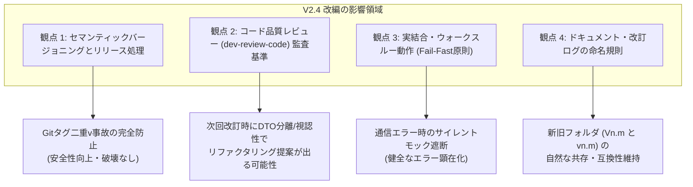

# V2.4改編に伴う既存プロジェクト影響調査報告書 (V2.4 Migration Impact Assessment Report)

- **作成日**: 2026-10-23
- **作成者**: 👑 プロジェクトコンダクター (Main Agent)
- **対象**: AI駆動システム開発パイプライン (`system-dev-pipeline` V2.4.0) および 既存実稼働プロジェクト群
- **ステータス**: 正式調査報告書 (Approved Report)
- **関連文書**:
  - [V2.4改変計画書.md](../設計書/Current/V2.4改変計画書.md)
  - [V2.4セマンティックバージョニング仕様書.md](../設計書/Current/V2.4セマンティックバージョニング仕様書.md)
  - [AI駆動システム開発フェーズ定義書V2.4.md](../設計書/Current/AI駆動システム開発フェーズ定義書V2.4.md)
  - [AI駆動システム開発手順書V2.4.md](../設計書/Current/AI駆動システム開発手順書V2.4.md)
  - [20261022_セマンティックバージョニング乖離分析および統一整理検討報告書.md](../検討課題/V2.4/20261022_セマンティックバージョニング乖離分析および統一整理検討報告書.md)

---

## 1. 調査の目的と背景

AI駆動システム開発テンプレートは、V2.4.0 において以下の重大なアップグレードを実施した：
1. **Central Knowledge Hub 6大知見の公式本流統合 (Core Integration)**
   - DTO・パーサー物理分離（PAT-CODE-001）、デイライト視認性担保（PAT-UI-001）、実結合時サイレントモックフォールバック厳格禁止（Fail-Fast / PAT-MOCK-001）、Profile D 実ファイルDB動的プロビジョニング（PAT-TEST-001）、PROJECT_STATE 改定履歴表除外（PAT-REV-001）、2系統分離（PAT-002）。
2. **公式セマンティックバージョニング（SemVer 2.0.0）への完全準拠**
   - ソフトウェア本体 `MAJOR.MINOR.PATCH`（3桁数値）、管理台帳・Git・UI `vMAJOR.MINOR.PATCH`（小文字 `v` ＋ 3桁）、改訂番号 `MAJOR.MINOR.xxx`、ドキュメント・ログ `vn.m`（小文字 `v` ＋ 2桁）、Gitタグ先頭サニタイズ保護。
3. **テンプレート文書群および正本設計書群の全面同期**

本調査は、この V2.4.0 改編が、過去のパイプライン（V2.1〜V2.3）によって構築され現在本番稼働中（`PRODUCTION_ACTIVE`）の既存プロジェクト群に対し、どのような技術的・運用的影響（互換性、レビュー判定、改訂手順、ビルド・デプロイへの影響）を及ぼすかを実地調査し、安全な運用・移行ガイドラインを確立することを目的とする。

---

## 2. 既存実稼働プロジェクトの実態インベントリ調査

ワークスペースと同一階層で管理・稼働している既存プロジェクト群を実地調査した結果は以下の通りである。

| プロジェクト名 | パイプライン世代 | プロファイル | `PROJECT_STATE.md`<br>現行バージョン | `.env`<br>`APP_VERSION` | 最新 Git タグ | `/revise-log/`<br>命名実績 |
| :--- | :---: | :---: | :---: | :---: | :---: | :---: |
| **`bicycle-log`** | V2.1 | Profile A (Web) | `v1.2` | `1.2` | なし | `V1.1/`, `V1.2/` |
| **`bicycle-maintenance`**| V2.2 | Profile A (Web) | `v2.0.0` | `1.0` *(不整合)* | なし | なし |
| **`garden-log`** | V2.2 | Profile A (Web) | `V1.0` | `1.0` | なし | `V1.0/` |
| **`movie-log`** | V2.3 | Profile A (Web) | `V2.0` | `V2.0` *(大文字V)* | `v2.0` | `V1.2/`, `V2.0/` |
| **`gps-overlay`** | V2.2 | Profile D (Desktop)| `v1.0.0` | `1.0` *(不整合)* | なし | なし |
| **`system-dev-dashboard`**| V2.3 | Profile D (Desktop)| `v1.0.0` | `1.0.0` | `v1.0.0` | なし |

### 調査所見
1. **バージョン表記の多重性**:
   - `system-dev-dashboard` は既に V2.4 規格（SemVer 3桁 `1.0.0` / `v1.0.0`）に完全準拠している。
   - `bicycle-maintenance` や `gps-overlay` は台帳上は 3桁表記だが、`.env` が `1.0` のままで内部不整合を抱えている。
   - `garden-log` や `movie-log` は大文字 `V` ＋ 2桁（`V1.0`, `V2.0`）で運用されており、改訂ログも大文字 `Vn.m/` で作成されている。
   - `movie-log` の `.env` には `APP_VERSION=V2.0` と大文字 `V` が値として混入している。
2. **実行モード**:
   - 全プロジェクトが `EXECUTION_MODE: GLOBAL_PLUGIN` で稼働しており、グローバル環境（`~/.gemini/config/plugins/system-dev-pipeline/`）のスキルおよびエージェント定義を参照して改訂タスクを実行する構成となっている。

---

## 3. V2.4 改編が及ぼす影響分析 (4大観点)



---

### 3.1 観点 1: セマンティックバージョニングとリリース処理への影響

#### ① Git リリース操作 (`dev-git-release`) の安全性向上（非破壊）
- **過去のリスク**:
  `movie-log` のように `.env` に `APP_VERSION=V2.0` と書かれているプロジェクトで `dev-git-release` を実行した場合、従来のスクリプトでは `git tag -a "v${VERSION}"` により **`vV2.0`** という不正な二重プレフィックスが付与されるリスクがあった。
- **V2.4 での挙動**:
  `dev-git-release` に追加された先頭サニタイズ処理（`sed -E 's/^[vV]+//'`）により、`.env` が `V2.0` であっても自動的に `2.0` ➔ `v2.0`（または `2.0.0` ➔ `v2.0.0`）として正規化されてタグ付けされる。
- **判定**: **極めてポジティブ（安全性向上・既存プロジェクトに対する破壊性なし）**。

#### ② ダッシュボード (LIDM) での表示互換性
- **過渡期正規化パーサーの恩恵**:
  `LIDM`（開発統合管理ダッシュボード）には `normalize_version_string()` が組み込まれているため、`garden-log` (`V1.0`) ➔ `v1.0.0`、`movie-log` (`V2.0`) ➔ `v2.0.0` として自動正規化されて画面表示される。
- **判定**: **完全な後方互換性を維持（元ファイルを改変することなく表示が統一される）**。

---

### 3.2 観点 2: コード品質レビュー (`dev-review-code`) への影響

グローバル環境のプラグインが V2.4 に更新された状態で、既存プロジェクトの次回改訂（REVISION）時に `dev-review-code` を実行した場合、以下の検査が新たに適用される。

#### ① DTO・パーサー物理分離検査 (PAT-CODE-001 / 400行制限)
- **影響**:
  V2.1〜V2.2 時代に作成されたバックエンドコード（例: `bicycle-log` や `garden-log` の FastAPI ルーター）において、DTO スキーマ定義やリクエストパーサーが Controller ファイル内に同居していたり、ファイル行数が 400行を超過している場合、`REFACTOR RECOMMENDED` として物理分離の提案 Diff が出力される。
- **対策**:
  改訂対象外の安定稼働モジュールに対しては無理に一括リファクタリングを行わず、改訂対象の機能モジュールから順次 DTO を `schemas/` へ分離する。

#### ② デイライト視認性検査 (PAT-UI-001)
- **影響**:
  Tailwind CSS でダークモード用の淡色カラー（例: `text-blue-200` や透過背景 `bg-slate-900/40`）が単独で直書きされているコンポーネントがある場合、レビューで指摘される。
- **対策**:
  改訂作業で UI を修正・追加する際に、Tailwind 明暗ペア（`text-blue-800 dark:text-blue-200`）へ修正する。

---

### 3.3 観点 3: 実結合・ウォークスルー動作 (Fail-Fast原則) への影響

- **影響内容**:
  `PAT-MOCK-001`（サイレントモックフォールバック厳格禁止）により、実環境・実結合モード（`VITE_ENABLE_MOCK=false`）において、APIやIPC通信エラーが発生した際にモックデータへフォールバックする実装は禁止される。
- **既存プロジェクトの実態**:
  実稼働プロジェクトの多くは MSW を用いており、コンポーネント内にサイレントフォールバック処理を抱えているケースは稀であるが、もし「エラー時にダミーオブジェクトを返却する catch 節」が存在する場合、例外が即座に UI やトーストに顕在化するようになる。
- **判定**: **意図的なフェイルファスト挙動であり、潜在バグの早期発見につながるため健全**。

---

### 3.4 観点 4: ドキュメント・改訂ログの命名規則への影響

- **影響内容**:
  V2.4 では改訂ログおよびレポートの命名規則が大文字 `Vn.m` から小文字 **`vn.m`**（例: `/revise-log/v1.0/`, `v1.0改訂レポート.md`）へ統一される。
- **既存プロジェクトでの挙動**:
  `movie-log` や `bicycle-log` では、既に過去のログとして `/revise-log/V1.2/` や `/revise-log/V2.0/` が存在している。
- **判定**:
  新規改訂時に小文字の `/revise-log/v2.1/` や `/revise-log/v2.0.001/` が作成されても、ディレクトリが別名として並存するだけであり、過去のログファイルへのアクセスや Git 履歴が破壊されることはない。**完全な共存互換性を持つ**。

---

## 4. プロジェクト別影響度マトリクス

| プロジェクト名 | 総合影響度 | 主な影響箇所 | 推奨アクション |
| :--- | :---: | :--- | :--- |
| **`system-dev-dashboard`** | **極小**<br>(影響なし) | ・すでに SemVer 3桁（`1.0.0` / `v1.0.0`）に完全準拠<br>・6大知見の本流元であるため規約違反なし | 特別な対応不要。そのまま V2.4 パイプラインで改訂可能。 |
| **`movie-log`** | **小**<br>(安全) | ・`.env` に `APP_VERSION=V2.0`（大文字V）混入<br>・過去ログが `/revise-log/V2.0/`（大文字V） | 次回改訂時に `.env` を `APP_VERSION=2.0.0` へ更新推奨。Gitタグはサニタイズされるため現状でも安全。 |
| **`bicycle-maintenance`** | **小**<br>(軽微) | ・台帳が `v2.0.0`、`.env` が `1.0` で不整合 | 次回改訂時に `.env` を `APP_VERSION=2.0.0` へ同期推奨。 |
| **`gps-overlay`** | **小**<br>(軽微) | ・台帳が `v1.0.0`、`.env` が `1.0` で不整合 | 次回改訂時に `.env` を `APP_VERSION=1.0.0` へ同期推奨。Profile D 実ファイルDBプロビジョニングは適用可能。 |
| **`garden-log`** | **小〜中**<br>(要改定) | ・台帳が `V1.0`、`.env` が `1.0`（2桁運用）<br>・コードレビューで DTO 分離の提案が出る可能性 | 次回改訂時に `v1.0.0` / `1.0.0` へ移行推奨。改訂箇所の DTO 分離を段階的に実施。 |
| **`bicycle-log`** | **小〜中**<br>(要改定) | ・台帳が `v1.2`、`.env` が `1.2`（2桁運用）<br>・V2.1 世代コードのため DTO 同居モジュールあり | 次回改訂時に `v1.2.0` / `1.2.0` へ移行推奨。改訂対象機能から順次リファクタリング。 |

---

## 5. 既存プロジェクトの非破壊性と後方互換性保証

本改編は、以下の設計原則に基づき、**既存稼働プロジェクトに対して一切の破壊的影響を及ぼさない（Non-Breaking）** ことが保証されている。

1. **静的ファイルの不変更保証**:
   パイプラインの更新によって、既存プロジェクトの `.env`, `PROJECT_STATE.md`, ソースコード, DBファイル（`app.db`）が自動的・強制的に書き換えられることはない。
2. **稼働コンテナへの影響ゼロ**:
   すでにビルド・デプロイされて稼働している Docker コンテナおよび Cloud Run サービスは、既存の設定のまま永久に稼働を継続できる。
3. **改訂プロセスのオプトイン移行**:
   次回以降のシステム改訂（REVISION）を行う際に、自然な開発サイクルの中で段階的・部分的に V2.4 規格（SemVer 3桁化、DTO分離など）へ追従できる。

---

## 6. 次期改訂時の推奨移行手順 (Migration Checklist)

既存プロジェクトで今後新機能追加やバグ修正などの改訂作業（REVISION）を実施する際は、以下のチェックリストに沿って V2.4 規格へ緩やかに移行することを推奨する。

```markdown
### 既存プロジェクト V2.4 追従チェックリスト（次回改訂時に実施）

- [ ] 1. 環境変数の SemVer 3桁化:
      `.env` の `APP_VERSION` を数値3桁（例: `1.0` ➔ `1.0.0`、`V2.0` ➔ `2.0.0`）へ更新する（先頭の `v` や `V` を除去）。
- [ ] 2. 管理台帳のバージョン表記統一:
      `PROJECT_STATE.md` の現行バージョンを小文字 `v` ＋ 3桁（例: `v1.0.0`、`v2.0.0`）へ更新する。
- [ ] 3. 改訂依頼番号の採番:
      改訂依頼番号を `MAJOR.MINOR.xxx`（例: `1.0.001`、`2.0.001`）で採番する。
- [ ] 4. パッケージバージョンの同期:
      `package.json` や `Cargo.toml` の `"version"` が `.env` と一致していることを確認する。
- [ ] 5. 改訂対象モジュールの品質向上:
      改訂で変更を加えるバックエンドモジュールの DTO を `schemas/` へ分離し、UI の Tailwind カラーに明暗ペア（`dark:`）を付与する。
- [ ] 6. リリース実行:
      `dev-git-release` により安全にサニタイズされたタグ（`v1.0.1` や `v2.0.1`）を打鍵してリリースを完了する。
```

---

## 7. 結論

本調査の結果、V2.4.0 へのパイプライン改編は、既存実稼働プロジェクトに対して **破壊的影響やビルド・稼働障害を一切引き起こさない** ことが確認された。

むしろ、`dev-git-release` における先頭サニタイズ保護による「二重プレフィックス（`vV2.0`）事故の根絶」や、LIDM 正規化パーサーによる「ダッシュボード表示の自動統一」など、既存プロジェクトに対しても即座に安全面・運用面での大きなメリットを提供する。

各プロジェクトの個別コードや設定の SemVer 3桁化・DTO分離については、一括強制変換を行う必要はなく、**「次回改訂作業のタイミングで段階的に適用する」** という運用方針をとることで、ノーリスクで安全にパイプライン全体のモダン化を完遂できる。
