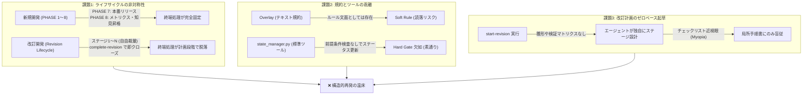
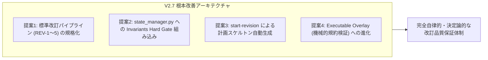

# system-dev-pipeline 次期バージョンに向けた改訂ライフサイクル終端および機械的強制力（Hard Gate）の根本改善提案書

- **文書番号**: `REP-20261105-PIPELINE-ROOT-CAUSE-PROPOSAL`
- **策定日**: 2026-11-05
- **対象システム**: `system-dev-pipeline` (AI駆動システム開発プロセス標準規約・スケルトン基盤)
- **提案エージェント**: 👑 プロジェクトコンダクター (`conductor`)
- **承認・送付先**: 開発パイプライン統括アーキテクト / 👤 ユーザー
- **関連ドキュメント**:
  - [system-dev-pipeline V2.6 適合乖離分析および全面改訂調査報告書](./20261105_system-dev-pipeline_v2.6適合乖離分析および全面改訂調査報告書.md)
  - [改訂作業完了判定における「知見・メトリクス・本番リリース」未実行誤認の根本原因分析 (RCA) レポート](../../../.gemini/antigravity/brain/6ee49369-35a4-49e2-9561-c50c77f1a41e/revision_completion_omission_rca_report.md)
  - [PROJECT_STATE.md](../../PROJECT_STATE.md)
  - [TEMPLATE_PROMOTIONS.md](../../TEMPLATE_PROMOTIONS.md)

---

## 1. 提案の背景と問題意識 (Background & Executive Summary)

### 1.1 対症療法（パッチ的運用）の限界
直近の複数プロジェクト（`gps-overlay` v2.0.0改訂、および本案件 `system-dev-dashboard` v2.0.0改訂）において、改訂完了時に**「本番成果物実体のビルド・配備」「定量メトリクス集計（`dev-metrics-collector`）」「知見の終結・Knowledge Hub 昇格」が未実行のまま、Gitリリースと台帳クローズ（`complete-revision`）のみが行われて完了と誤認される事象**が連続して発生しました。

前者の事象発生時に、知見を Central Knowledge Hub に起票し、環境共通オーバーレイ（`LOCAL_FEEDBACK_RULES.md` の `PAT-SYS-013`）としてテキスト規約を配備していました。しかし、今回の改訂作業においても**同一のスキップと誤認が再発**しました。

この事実は、**「各案件で発生した手戻りを単に Wiki や Overlay（テキストプロンプト）に書き溜め、ローカル環境で対症療法的なパッチを当て続ける運用では、AIエージェントの構造的な見落としや認知バイアスを根本的に防ぎきれない」** ことを明白に示しています。

### 1.2 根本解決の方向性
本問題の本質は、「エージェントのプロンプト注意力不足」ではなく、**「パイプラインテンプレート（`system-dev-pipeline`）本体のライフサイクル設計の非対称性」** および **「テキスト規約（Soft Rule）と機械的遮断スクリプト（Hard Gate）の乖離」** にあります。

次期テンプレートバージョン（`system-dev-pipeline V2.7`）において、改訂ライフサイクルを体系的に再設計し、テンプレートのコアスクリプト群（`state_manager.py` / `harness_guard.py` 等）に決定論的な物理ガードを初期標準として組み込む根本解決を提案します。

---

## 2. 根本原因の構造分析 (Root Cause Architectural Analysis)



### 2.1 課題1: 新規開発（PHASE 1〜8）と改訂開発（Revision）の非対称性
- **新規開発**: PHASE 1（準備）から PHASE 7（本番リリース）、PHASE 8（メトリクス・知見昇格・運用移行）までが不可逆な直列パイプラインとして固定されており、PHASE 8 をスキップしてプロジェクトを終結させることは規約上不可能です。
- **改訂開発**: `start-revision` 以降は、プロジェクトごとの事情に応じて「ステージ1〜N」という任意のステージ分割が許容されています。このため、エージェントが改訂計画書を策定する際に「ステージ6: 本番リリース」などと PHASE 7 相当で計画を打ち切ってしまい、PHASE 8 相当の処理（成果物ビルド、メトリクス集計、知見昇格）が**計画書そのものから構造的に蒸発**します。

### 2.2 課題2: Soft Rule（自然言語規約）依存と Hard Gate（機械遮断）の乖離
パイプライン第1層の基本規範である「事後修正ではなくコミット前・ランタイムに規約を物理遮断する（Shift-Left Hard Gate 原則）」が、改訂管理ツールにおいて徹底されていませんでした。
- `LOCAL_FEEDBACK_RULES.md`（Overlay）には「成果物・メトリクス・知見が完了するまで `complete-revision` を禁止する」と明記されていました。
- しかし、テンプレートが提供する `scripts/state_manager.py` の `complete-revision` 実装は、前提条件のチェック（ファイル実在、メトリクス完了、未処理原票ゼロ）を一切行わず、引数を受け取った瞬間に `status: COMPLETED` へ書き換える仕様になっていました。
- **「コードによる物理遮断を伴わない自然言語ルールは、コンテキスト長やプロンプト指示の強弱によって容易に迂回される」** という AI 協調開発の構造的脆弱性が露呈しました。

### 2.3 課題3: 改訂開始時のスキャフォールディング欠如
新規開発では `dev-phase1-setup` により、ディレクトリ構造、設計書雛形、`PROJECT_STATE.md`、`TEMPLATE_PROMOTIONS.md` が自動展開されます。
一方、改訂開始時（`state_manager.py start-revision`）には、台帳のフラグを `ACTIVE` にするのみで、**改訂計画書の標準スケルトンや必須完了条件チェックリストが一切自動生成されません**でした。エージェントがゼロベースでステージ計画を起草するため、案件ごとに完了条件の品質にばらつきが生じていました。

---

## 3. テンプレートプロジェクト（`system-dev-pipeline`）への根本改善提案

本課題をテンプレート正本において根本解決するため、以下の 4 大改善策を次期バージョン仕様として提案します。



---

### 提案 1: 改訂ライフサイクル標準パイプライン（`REV-1` 〜 `REV-5`）の規約規格化
改訂作業における「自由裁量ステージ制」を廃止し、新規開発と同様に**標準改訂フェーズ（Revision Standard Phases: REV-1〜5）**をパイプライン規約（Rule 10）に公式制定します。

| 改訂フェーズID | フェーズ名称 | 必須アクティビティ | 完了ゲート (Exit Criteria) |
| :--- | :--- | :--- | :--- |
| **`REV-1`** | **改訂要件・設計精査** | 差分要件定義（`REQ-*`）、設計書更新、RTM差分計画 | `dev-doc-reviewer` 整合性 PASS |
| **`REV-2`** | **差分実装・静的検証** | BE/FE実装、250/400行制限、直書きモック排除 | `harness_guard.py --all` PASS |
| **`REV-3`** | **回帰・感覚センサー検証** | シナリオテスト、実機ウォークスルー、視認レビュー | `traceability_checker.py --mode full` PASS |
| **`REV-4`** | **本番総合監査・成果物ビルド** | `dev-review-system`、本番アプリ/コンテナビルド、データ保全検証 | **配布成果物の物理実在確認** & `RELEASE APPROVED` |
| **`REV-5`** | **メトリクス・知見昇格・台帳クローズ** | `metrics_collector.py`、Knowledge Hub 原票起案・監査、`ask_question` 承認 | **全前提条件クリア後の `complete-revision` & `dev-git-release`** |

- **効果**:
  改訂規模の大小（Hotfix / 機能拡張 / 全面改訂）にかかわらず、`REV-4`（成果物ビルド）と `REV-5`（メトリクス・知見・クローズ）が不可避の終端フェーズとして固定化され、計画段階での脱落が物理的に不可能になります。

---

### 提案 2: `scripts/state_manager.py` へのクローズ前「Invariants Hard Gate」標準実装
自然言語ルールによる注意喚起を廃止し、スクリプト側で機械的に検証・遮断します。
テンプレートが初期配備する `scripts/state_manager.py` の `complete-revision` サブコマンドに、以下の **4 大必須チェック機構（Invariants Guard）** を標準実装します。

```python
# scripts/state_manager.py (次期バージョン標準実装仕様)
def validate_revision_closure_invariants(state):
    """改訂クローズ時の前提条件を決定論的に機械検証する (Hard Gate)"""
    violations = []
    metadata = state.get("project_metadata", {})
    profile = metadata.get("deployment_profile", "")

    # 1. 本番成果物の物理実在性検証 (Profile別)
    if "Profile D" in profile:
        target_bundle = Path("src-tauri/target/release/bundle/macos/LIDM.app")
        if not target_bundle.exists() or not any(target_bundle.iterdir()):
            violations.append(
                f"[INV-REL-01] Profile D 本番アプリ成果物 ({target_bundle}) が未ビルド、または空です。"
                " (実行必須: npm run tauri build --bundles app)"
            )
    elif "Profile A" in profile:
        # Dockerイメージ存在確認 or entrypoint検証
        pass

    # 2. 定量メトリクス集計の最新実行検証
    metrics_json = Path("metrics/development-metrics-summary.json")
    if not metrics_json.exists():
        violations.append(
            "[INV-MET-01] 定量メトリクス集計ファイル (metrics/development-metrics-summary.json) が存在しません。"
            " (実行必須: python3 scripts/metrics_collector.py)"
        )
    else:
        try:
            m_data = json.loads(metrics_json.read_text(encoding="utf-8"))
            if not m_data.get("summary", {}).get("total_score"):
                violations.append("[INV-MET-02] メトリクス集計JSONに total_score が算出されていません。")
        except Exception as e:
            violations.append(f"[INV-MET-03] メトリクス集計JSONの構文解析に失敗しました: {e}")

    # 3. Knowledge Hub 昇格知見の未処理残存検証
    promo_file = Path("TEMPLATE_PROMOTIONS.md")
    if promo_file.exists():
        content = promo_file.read_text(encoding="utf-8")
        if "[ ] 承認待ち" in content or "INBOX_PENDING" in content:
            violations.append(
                "[INV-HUB-01] TEMPLATE_PROMOTIONS.md に未承認・未処理の昇格知見原票が残存しています。"
                " (実行必須: ask_question によるユーザー承認 & pipeline-reconciler.sh --activate-claim)"
            )

    # 4. 要件トレーサビリティ (RTM) フル充足検証
    # traceability_checker.py の結果キャッシュまたは直接判定
    
    if violations:
        print("❌ [HARD GATE BLOCKED] 改訂完了前提条件 (Invariants) 違反を検出しました:", file=sys.stderr)
        for v in violations:
            print(f"  • {v}", file=sys.stderr)
        print("\n上記の未完了タスクをすべて物理的に完了してから、再度 complete-revision を実行してください。", file=sys.stderr)
        sys.exit(1)
```

- **効果**:
  未ビルド、未集計、未昇格の状態では `complete-revision` コマンドが Exit Code 1 で即座に自爆（Fail-Fast）するため、エージェントが誤って台帳を完了状態に更新することは物理的に不可能です。

---

### 提案 3: `start-revision` 実行時の「改訂計画スケルトン」自動スキャフォールディング
エージェントがゼロから計画書を作ることを禁止し、`python3 scripts/state_manager.py start-revision --id <ID> --title <TITLE>` 実行時に、以下の資産を決定論的に自動配置します。

1. **自動生成ファイル**:
   - `docs/plans/<ID>改訂計画/00_改訂基本計画書.md`
   - `docs/plans/<ID>改訂計画/REV-1_要件・設計精査手順書.md`
   - `docs/plans/<ID>改訂計画/REV-2_実装・静的検証手順書.md`
   - `docs/plans/<ID>改訂計画/REV-3_テスト・視認レビュー手順書.md`
   - `docs/plans/<ID>改訂計画/REV-4_本番総合監査・成果物ビルド手順書.md`
   - `docs/plans/<ID>改訂計画/REV-5_メトリクス・知見昇格・リリース手順書.md`
2. **Overlay 規約の自動注入**:
   `start-revision` 実行時、`~/.gemini/knowledge-hub/overlay/LOCAL_FEEDBACK_RULES.md` の現行有効ルールを走査し、`00_改訂基本計画書.md` の「適用必須ガードレール一覧」セクションへ自動埋め込み（スナップショット同期）を行います。
- **効果**:
  過去案件で獲得された Overlay 知見が、改訂計画書の起草段階で自動的・強制的に視界に入り、計画書作成時の抜け漏れが根絶されます。

---

### 提案 4: Executable Overlay（機械的規約検証エンジン）への進化
現在、Central Knowledge Hub の Overlay（`LOCAL_FEEDBACK_RULES.md`）は Markdown 形式のテキストファイルであり、エージェントのプロンプト（ユーザー設定ルール）として受動的に読み込まれています。

これを一歩進め、**「知見原票（`CLAIM-*.md`）から、静的解析ルール（AST / 正規表現 / ファイル実在検査）をメタデータとして抽出し、`harness_guard.py` や `state_manager.py` が動的に実行するプラグイン構造」** を導入します。

```yaml
# CLAIM-*.md 内の機械検証メタデータ拡張（将来構想）
executable_guard:
  phase: "REV-5"
  check_type: "file_exists"
  target_pattern: "src-tauri/target/release/bundle/*/*.app"
  error_message: "Profile D 本番バイナリが未ビルドです。"
```
- **効果**:
  知見昇格（`pipeline-reconciler.sh --activate-claim`）を行った瞬間、次案件の `harness_guard.py` や `state_manager.py` に新しい機械検査ロジックが自動注入され、人手やプロンプト指示に一切依存しない「自己進化する決定論的ガードレール」が実現します。

---

## 4. 導入ロードマップと移行方針

| ステップ | 対象スコープ | 主な作業内容 | 期待効果 |
| :--- | :--- | :--- | :--- |
| **Phase 1 (即時適用)** | 本プロジェクト (`system-dev-dashboard`) | `scripts/state_manager.py` に提案2の Invariants Guard を配備 | 本リポジトリにおける次回改訂（v2.1以降）での再発防止 |
| **Phase 2 (次期V2.7)** | テンプレート正本 (`system-dev-pipeline`) | 1. Rule 10 への標準改訂パイプライン（REV-1〜5）規格化<br>2. `state_manager.py` のクローズ前機械ガードの初期標準化<br>3. `start-revision` の計画書自動スキャフォールディング実装 | 全新規・既存プロジェクトにおける改訂プロセスの規格統一 |
| **Phase 3 (将来V3.0)** | Central Knowledge Hub | Executable Overlay（知見の機械検査コード自動変換と動的ロード機構）の実装 | 自然言語プロンプト依存からの完全脱却 |

---

## 5. 結論

「知識があること（Knowledge Presence）」と「行動が強制されること（Mechanical Enforcement）」の間には深い谷が存在します。
AI駆動開発パイプラインにおいて最も警戒すべきは、**「ナレッジベースにルールを増やしたことで安心し、実行エンジン側の機械的防御を怠ること」** です。

本提案による「改訂パイプラインの規格化（REV-1〜5）」と「`state_manager.py` クローズ前 Invariants Guard の初期標準化」は、パッチの無限連鎖を断ち切り、システム開発テンプレートとしての完成度と自律的信頼性を飛躍的に高める根本解決策です。次期 `system-dev-pipeline` 改訂の最優先項目として採用することを強く推奨いたします。
