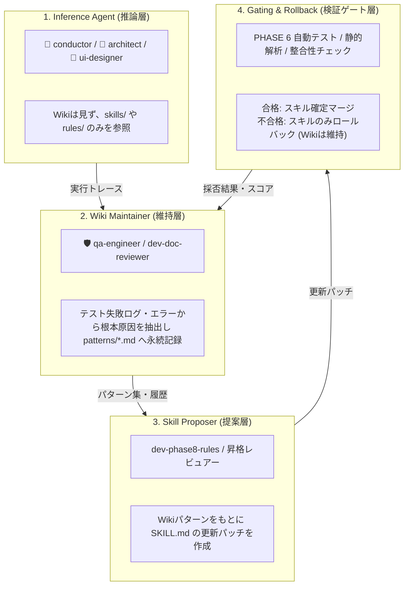

# WikiSkillアーキテクチャの自己進化ナレッジループ導入評価書

文書バージョン: V2.1 検討資料  
作成日: 2026-10-05  
関連設計書:
- [wikiskill.md](./wikiskill.md) - WikiSkill アーキテクチャと実装仕様解説書
- [V2.1へ向けた検討課題.md](./V2.1へ向けた検討課題.md) - V2.1 拡張論点・検討課題集
- [エージェント間知見蓄積運用基準書.md](../../V2.0/エージェント間知見蓄積運用基準書.md) - V2.0 知見蓄積・運用基準書
- [状態管理機構設計書.md](../../V2.0/状態管理機構設計書.md) - V2.0 状態管理仕様書

---

## 1. 検討の目的と背景

AI駆動型開発システムにおける自律的な「自己進化ループ（Self-Evolution Loop）」では、試行錯誤やテスト失敗、改訂作業から得た知見をもとに手順書（`SKILL.md` やエージェントプロンプト、開発ルール）を自動更新する。

しかし、従来の単純な自己進化ループには以下の構造的課題が存在していた：
1. **ロールバックに伴う知見喪失（Catastrophic Forgetting）**:
   - スキル修正案を適用した結果、検証テストでスコアが悪化してロールバックを実行した場合、「何が原因で失敗したか」「どのような修正案を試してダメだったか」という貴重な診断ログや失敗知識まで一緒に破棄されてしまう。
2. **推論時コンテキスト汚染と過剰適合（Overfitting）**:
   - 蓄積された過去のトラブル事例やエラーログをエージェントのプロンプトに無差別に注入すると、トークン長を浪費するだけでなく、特定事例に特化した場当たり的な分岐コードを記述し始め、スキルの汎化性能が低下する。

これらを根本解決する枠組みとして、Google Research と Virginia Tech が提唱した **WikiSkill**（実行トレースと実行手順書の中間に、決してロールバックされない永続的 Wiki 層を配置するアーキテクチャ）を取り入れることの **効果** と **実現性** を多角的に評価する。

---

## 2. WikiSkill アーキテクチャの核心要素

WikiSkill は以下の **3層ストレージ構造** と **4つの責務分離コンポーネント** によって構成される。

```
+---------------------------------------------------------------+
|                      WikiSkill 3層構造                        |
+---------------------------------------------------------------+
 [Raw Layer] (raw/)
   │  - 実行トレース (不変 / Immutable)
   │  - 入出力、推論思考ログ、テスト結果
   ▼
 [Wiki Layer] (wiki/)  <─── ※ 決してロールバックされない永続層
   │  - 成功/失敗の根本原因 (patterns/*.md)
   │  - 採否・差分履歴 (logs.md, skill-impact.md)
   ▼
 [Skills Layer] (skills/) <─── ※ 評価次第でロールバックされる実行層
      - 実行可能な手順書 (SKILL.md)
      - 目的・動機メタデータ (PURPOSE.md)
```

| コンポーネント | 役割と動作原則 |
| :--- | :--- |
| **1. Inference Agent** | 開発タスクを実行する主体。**Wiki 層は直接見せず、蒸留・検証済みの `skills/` のみを参照する**（過学習防止）。 |
| **2. Wiki Maintainer** | トレースログを分析し、失敗の根本原因（RCA）を導出して `wiki/patterns/` や `logs.md` を更新・永続化する。 |
| **3. Skill Proposer** | 蓄積された Wiki パターンと過去ログをもとに、手順書（`SKILL.md`）の改善パッチを作成する。 |
| **4. Gating & Rollback** | 検証ベンチマークを実行し、スコア改善時のみマージ。悪化時は `skills/` のみロールバックし、**`wiki/` の知識は一切破棄せず保持する**。 |

---

## 3. 効果の評価（Effectiveness: ★★★★★）

本開発パイプラインに WikiSkill を組み込むことで得られる主な効果は以下の通りである。

### (1) 失敗知見・試行錯誤履歴の完全保護
- **効果**: スキル更新案がテストに不合格（リジェクト）となった場合でも、その試みと失敗要因（「どのパターンをどう直そうとして失敗したか」）が `wiki/logs.md` に永続記録される。
- **恩恵**: 将来の進化サイクルにおいて、**「過去に失敗したアプローチと同じ轍を再び踏む」ムダな試行錯誤を恒久的に撲滅**できる。

### (2) 推論エージェントのコンテキスト効率と汎化性の担保
- **効果**: 「推論エージェントには Wiki を直接見せない」という分離原則を徹底。
- **恩恵**: `conductor`, `architect`, `ui-designer` 等のコンテキスト長を圧迫せず、過去の個別エラーログに引きずられたパッチワーク的コードの生成を抑止できる。

### (3) 既存の「知見蓄積運用基準書 (Actionable Knowledge)」との高い親和性
- **効果**: 本テンプレートの `docs/V2.0/エージェント間知見蓄積運用基準書.md` で定義済みのスキーマ（状況・現象・根本原因・処方箋）は、WikiSkill の `patterns/*.md` と構造が一致している。
- **恩恵**: 新たなデータ形式をゼロから策定する必要がなく、既存のナレッジ蓄積フォーマットをそのままスライド適用できる。

---

## 4. 実現性の評価（Feasibility: ★★★★☆）

既存の V2.0 アーキテクチャおよびディレクトリ構造へのマッピングが容易であり、高い実現可能性を持つ。

### (1) 3層ストレージ構造のマッピング

| WikiSkill 層 | 本システムでの対応先 | 実現方式 |
| :--- | :--- | :--- |
| **Raw Layer (`raw/`)** | `.system_generated/logs/`<br>PHASE 6 テスト実行ログ<br>Antigravity トランスクリプト | 既存のログ基盤・テスト出力結果を所定ディレクトリへアーカイブ保存。追加開発コストは極小。 |
| **Wiki Layer (`wiki/`)** | `.agents/knowledge/` または `docs/wiki/`<br>- `patterns/*.md`<br>- `logs.md` | 新規永続ディレクトリとして設置。Git管理下またはワークスペース直下に配置し、**ロールバック対象外**として扱う。 |
| **Skills Layer (`skills/`)** | `.agents/plugins/system-dev-pipeline/skills/`<br>`rules/dev-process-standards.md` | 現行のスキルおよび開発ルール群。パッチ適用とGitコミット/リセットによるロールバック制御を行う。 |

### (2) 4つのコンポーネントと既存エージェント・スキルの対応



* **Inference Agent**: `conductor`, `architect`, `ui-designer` 等の通常開発タスク担当。
* **Wiki Maintainer**: `qa-engineer` が PHASE 6 や改訂テストで不具合を検知した際、自動で `patterns/*.md` に根本原因（RCA）を書き込む。
* **Skill Proposer**: `dev-phase8-rules`（知見昇格）または定期バッチにおいて、Wikiパターンを汎用化して `SKILL.md` や `rules/` のパッチを起案。
* **Gating & Rollback**: PHASE 6 のスルーテスト群および `dev-doc-reviewer` が検証ゲートとして機能。

---

## 5. 技術課題と導入対策

| 課題 | 詳細内容 | 対策方針 |
| :--- | :--- | :--- |
| **1. 評価ゲート（Gating）の判定基準** | 汎用コード生成タスクにおいて、単一の数値スコア ($Score_{\text{new}} > Score_{\text{baseline}}$) をどう定義するか。 | **複合判定ゲート**を採用：<br>① TypeScript/Linter 静的エラー 0 件<br>② `dev-doc-reviewer` ドキュメント不整合 0 件<br>③ PHASE 6 シナリオテスト 全件パス<br>の 3 つを満たした場合に合格とする。 |
| **2. Wiki の肥大化と陳腐化** | 追記のみで運用するため、サイクルが進むにつれてパターンファイルが増加し、Proposer のトークンを圧迫する。 | **Wiki Compactor（定期要約・アーカイブ）** を導入：<br>類似パターンを統合・要約し、不要・解決済みの古いパターンは `wiki/archive/` に退避する。 |
| **3. プロジェクト固有知見の混入** | プロジェクト特有の業務ロジック（Tier 1）が、共通スキル（Tier 2）に過剰混入するリスク。 | [エージェント間知見蓄積運用基準書.md](../../V2.0/エージェント間知見蓄積運用基準書.md) の **「二層分離の原則（Tier 1 vs Tier 2）」** を Proposer プロンプトに厳格なガードレールとして組み込む。 |

---

## 6. 結論と V2.1 への導入提言

### 結論
WikiSkill アーキテクチャの導入は、本システムの自己進化・自律改善ループの信頼性を飛躍的に高める。
特に「永続的 Wiki 層による失敗知識の保護」と「推論層と Wiki 層の分離」は、エージェントシステムの致命的な落とし穴である **過学習・コンテキスト浪費・先祖返り** を同時に防ぐ極めて合理的な仕組みである。

### V2.1 への具体的導入アクション
1. **検討課題リストへの追加**:
   - `V2.1へ向けた検討課題.md` に **「課題 6: WikiSkill型 永続ナレッジ自己進化ループの構築」** を追加策定。
2. **ナレッジ基盤ディレクトリの標準化**:
   - テンプレート内に `.agents/knowledge/`（`raw/`, `wiki/patterns/`, `wiki/logs.md`）の標準構造を設計。
3. **エージェント責務の拡張**:
   - `qa-engineer` に Wiki Maintainer 機能、`dev-phase8-rules` に Skill Proposer & Gating 機能を順次実装する。
