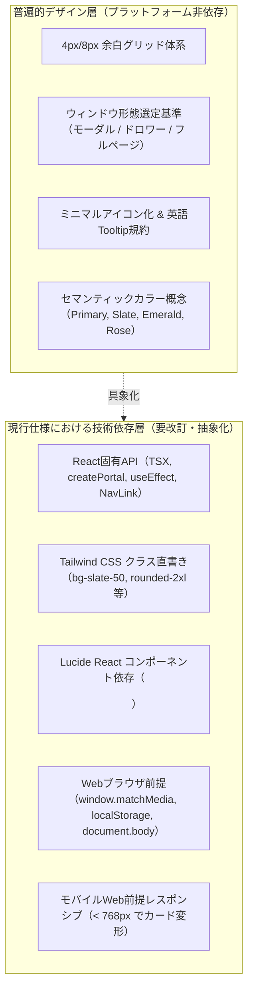
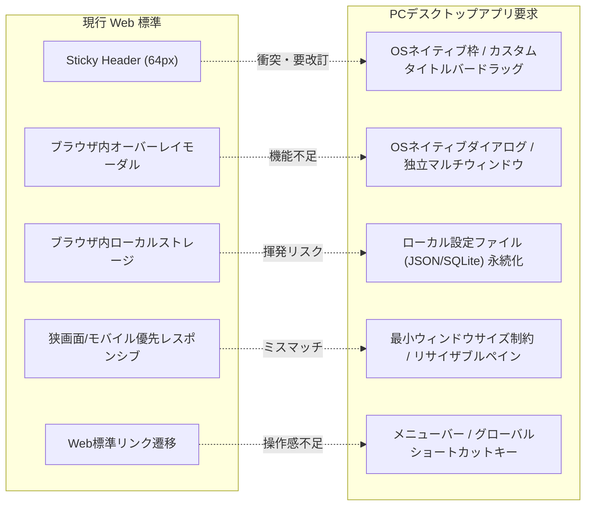
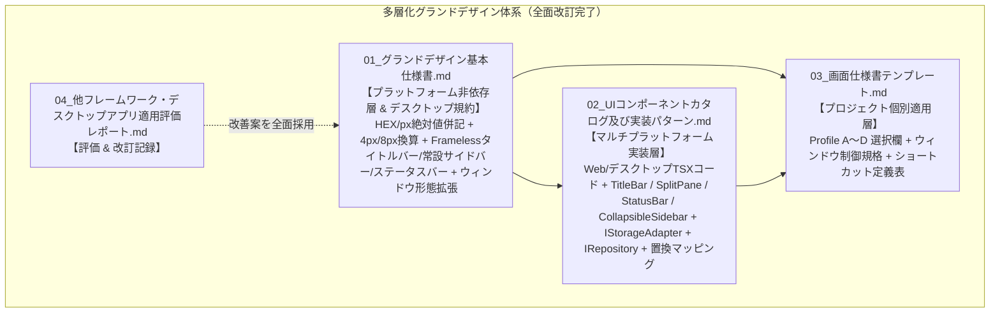

# 他フレームワーク及びPCローカルデスクトップアプリ適用評価レポート (GRAND_DESIGN_CROSS_PLATFORM_EVALUATION_REPORT)

## 1. はじめに（評価の目的と背景）

本レポートは、`doc_samples/グランドデザイン/` 配下に策定された「画面設計グランドデザイン標準（Design System Base）」について、現在の基準技術スタックである **React + Tailwind CSS + Lucide React** から離れ、**他のフロントエンドフレームワーク（Vue, Svelte, Angular, SSR/MPA等）** や **PCローカルデスクトップアプリ（Tauri, Electron, PyQt, Flutter Desktop等）** へ適用・展開する場合の適合性を技術的に評価し、潜在的な課題および追加修正・改訂すべき記述を整理した分析報告書である。

本検討は、先行ドキュメントである [追加検討課題：モックアップコード制御および画面デザイン標準化](../../docs/検討課題/V2.2/追加検討課題_モックアップコード制御および画面デザイン標準化.md) および [システムプロファイル設計および事前組込アーキテクチャ検討レポート](../../docs/検討課題/V2.2/システムプロファイル設計および事前組込アーキテクチャ検討レポート.md) の「Profile A〜D（Web SPA、SSR、静的MPA、デスクトップ/CLI）」の展開構想に直結する。

---

## 2. 現行グランドデザインの技術スタック依存度分析

現行のグランドデザインドキュメント群（`01_グランドデザイン基本仕様書.md`、`02_UIコンポーネントカタログ及び実装パターン.md`、`03_画面仕様書テンプレート.md`）を分析すると、「普遍的なデザイン原則」と「特定技術への密結合」が以下のように混在していることが判明した。

### 依存度マトリクス

| 構成要素               | 現行の仕様・実装形態                                 | 普遍度 | 他環境適用時の主な障害・摩擦                                                         |
| :--------------------- | :--------------------------------------------------- | :----: | :----------------------------------------------------------------------------------- |
| **全体シェル**         | Sticky Top 64px + 右スライドインドロワー             |   △    | デスクトップではタイトルバーやOS枠と干渉。常時表示サイドバーが好まれる。             |
| **レスポンシブ**       | `< 768px` でテーブル→カード変形                      |   ◯    | デスクトップアプリでは最小幅設定やスプリットペイン（リサイズ可能境界）が必要。       |
| **モーダル・ドロワー** | `React.createPortal` による `document.body` 直下描画 |   ✕    | Vueでは `<Teleport>`、デスクトップでは別ウィンドウやOSネイティブダイアログが必要。   |
| **テーマ切り替え**     | `darkMode: 'class'` + `localStorage`                 |   △    | SSR環境でのFOUC（初期ちらつき）、ローカルアプリでの設定ファイル永続化の差異。        |
| **ルーティング**       | `react-router-dom` の `NavLink`                      |   ✕    | Vue Router, Nuxt, SvelteKit, Next.js, デスクトップ独自ステート遷移との不整合。       |
| **アイコン**           | `lucide-react` の JSX 埋め込み                       |   △    | 他フレームワークでは `lucide-vue-next`, `lucide-svelte`, SVGスプライト等へ置換必要。 |
| **スタイリング**       | Tailwind ユーティリティクラス直書き                  |   △    | 非Web（Qt, Flutter, WPF）では流用不能。Tailwind v4 や Scoped CSS への移行配慮不足。  |

---

## 3. 他Webフレームワーク適用時の問題点と改善案

### 3.1 Vue 3 / Nuxt 3 への適用

#### 課題点

1. **Portal 機構の差異**:
   - 現行の `HamburgerMenu.tsx` や `StandardModal.tsx` では `React.createPortal(..., document.body)` を使用している。Vue 3 では `<Teleport to="body">` を使用する必要がある。
2. **ルーティングとナビゲーション**:
   - `NavLink` のアクティブ判定（`({ isActive }) => ...`）は React Router 固有構文である。Vue 3 / Nuxt では `router-link-active` クラスや `<NuxtLink>` の自動クラス付与機能に準拠させる必要がある。
3. **SSR環境（Nuxt 3）におけるハイドレーション不整合とFOUC**:
   - クライアント側で `localStorage` を同期的に読み取って `dark` クラスを操作する現行ロジックは、SSR時にサーバー生成HTMLとクライアント初期状態の間で不整合（Hydration Mismatch）や、画面読み込み時に白から黒へ一瞬チラつく現象（FOUC: Flash of Unstyled Content）を引き起こす。

#### 改善案（記述追加・改訂事項）

- ドロワーやモーダルの仕様記述において、特定フレームワークの関数（`createPortal`）ではなく、「**ルート要素直下へのテレポート / オーバーレイマウント機構**」として概念を定義する。
- テーマ管理について、SSR環境向けに「`<head>` 内インラインスクリプトによるクラス事前注入」または「フレームワーク固有のカラーモードモジュール（`@nuxtjs/color-mode` 等）」の利用指針を追記する。

---

### 3.2 Svelte 5 / SvelteKit への適用

#### 課題点

1. **コンポーネント構造とリアクティビティ**:
   - 現行カタログはすべて React の Hooks（`useState`, `useEffect`, `useRef`）前提で書かれており、Svelte 5 の Runes（`$state`, `$effect`）や Svelte のアクション（`use:portal`, `use:clickOutside`）とパラダイムが異なる。
2. **アイコンの呼び出し構文**:
   - `lucide-svelte` ではコンポーネントプロパティの渡し方（`size={24}` 等）が React と一部異なる。

#### 改善案（記述追加・改訂事項）

- ロジック（デバウンス検索、外側クリック検知、Escapeキー監視）を React Hooks だけでなく、**純粋なTypeScriptクラス / 共通ユーティリティ関数（Headlessロジック）** として仕様化する。

---

### 3.3 SSR / MPA（Next.js App Router, Astro, Django/Rails等）への適用

#### 課題点

1. **`'use client'` 境界線の曖昧さ**:
   - Next.js App Router や Astro（Islands Architecture）では、サーバーコンポーネントとクライアントコンポーネントの分離が極めて重要である。
   - 現行の `Header.tsx` は、タイトル・ロゴ表示（静的）とハンバーガーメニュー開閉（動的ステート）が一体化しており、全体に `'use client'` を強制するため、サーバーレンダリングの最適化効果を阻害する。
2. **MPA（サーバーサイドテンプレート）での対話的コンポーネント制限**:
   - Python（FastAPI/Django + Jinja2/HTMX）や Go（html/template）などのMPA構成（Profile C）において、リアルタイムサジェスト検索バーやインライン編集コンポーネントを再現する際の代替技術（HTMX / Alpine.js / Web Components）への言及がない。

#### 改善案（記述追加・改訂事項）

- アプリケーション基本シェルにおいて、「**静的シェル（サーバー描画可能領域）**」と「**アイランド対話コンポーネント（クライアントステート領域）**」の境界線を明記する。
- MPA/HTMX 向けの代替属性定義（例: `hx-get`, `hx-target`, `hx-swap` によるリアルタイム検索実装パターン）を補助ガイドとして提供する。

---

## 4. PCローカル・デスクトップアプリ適用時の重大な課題と対応策

PCローカルデスクトップアプリ（特に **Tauri**, **Electron**, **PyQt/PySide**, **Flutter Desktop**）を対象とした場合、Webブラウザ向けに作られた現行グランドデザインは複数の深刻なミスマッチを引き起こす。

---

### 4.1 ウィンドウ制御とタイトルバーの衝突（最重要課題）

#### 課題点

- **カスタムタイトルバー（Frameless Window）との干渉**:
  - デスクトップアプリでは、OS標準の無骨なタイトルバーを消去し、アプリ内ヘッダーと一体化した「フレームレスウィンドウ（Frameless Window）」を採用することが多い。
  - 現行仕様の `Header.tsx`（Sticky 64px、左端ロゴ、右端メニュー）をそのまま使うと、以下の致命的な問題が発生する：
    1. **ウィンドウドラッグ領域の欠落**: ウィンドウを掴んで移動させるためのドラッグ領域（`-webkit-app-region: drag` や `data-tauri-drag-region`）が定義されていないため、画面上部をドラッグしてもウィンドウが動かない。
    2. **OSネイティブ操作ボタンとの重なり**:
       - **macOS**: ウィンドウ左上に「赤・黄・緑のトラフィックライトボタン（閉じる・最小化・最大化）」が配置されるため、左端のロゴやタイトルと完全に重なってクリック不能になる。
       - **Windows**: ウィンドウ右上に「最小化・最大化・閉じる」ボタンが配置されるため、右端のハンバーガーメニューボタンと重なって誤操作を引き起こす。

#### 改善案（追加修正すべき仕様記述）

1. **デスクトップ用タイトルバーオフセット仕様の策定**:
   - macOS環境では、ヘッダー左端に `pl-20`（約80px）のセーフエリアパディングを確保する。
   - Windows環境では、ヘッダー右端にウィンドウコントロール用スペース（約140px）を確保するか、最上部に専用の「ドラッグ＆タイトルバー行（高さ32px）」を分離配置する。
2. **ドラッグ領域とクリック領域の分離属性**:
   - タイトルバー領域には `data-tauri-drag-region`（または CSS の `app-region: drag`）を付与し、ボタン・入力欄・リンク要素には明示的に `app-region: no-drag` を適用するルールを明文化する。

---

### 4.2 モーダル・ダイアログとマルチウィンドウの乖離

#### 課題点

- **Webモーダルとネイティブダイアログのギャップ**:
  - 現行の `StandardModal` は Web ブラウザ内の単一 HTML DOM 上にオーバーレイ表示する前提である。
  - デスクトップアプリにおいては、以下の操作で Web モーダルを使うと操作性が極めて不自然になる：
    1. **ファイル・フォルダ選択**: Web の `<input type="file">` はドラッグ＆ドロップやローカルファイルパスの直接取得に制約がある。デスクトップでは OS ネイティブのファイルダイアログ（Tauri の `dialog.open()` や Electron の `dialog.showOpenDialog()`）を呼び出すのが標準である。
    2. **重要な確認・破壊的警告**: OS ネイティブのメッセージボックス（OK/Cancel）を使用することで、アプリ外にフォーカスが外れても安全にユーザー確認を取ることができる。
    3. **サブツール・設定画面の独立ウィンドウ化**: デスクトップでは、設定画面やログビューアを「別ウィンドウ（Multi-window）」として分離し、マルチディスプレイ環境で並べて表示する要求が頻発する。現行仕様には複数ウィンドウ展開の設計指針が存在しない。

#### 改善案（追加修正すべき仕様記述）

- `01_グランドデザイン基本仕様書.md` の「4.1 ウィンドウ形態の選定基準」に、デスクトップ展開用として以下の選択肢を追加する：
  - **ネイティブファイル/フォルダピッカー**: ファイルインポート・エクスポート時にOSダイアログを優先利用。
  - **独立サブウィンドウ（Multi-window）**: 設定画面、リアルタイムログ監視、詳細プレビューを別ウィンドウとして生成・管理する基準。

---

### 4.3 画面サイズ・レスポンシブ戦略のミスマッチ

#### 課題点

- **モバイル優先設計（`< 768px`）の不要性とデスクトップ要求の欠落**:
  - 現行仕様は「デスクトップ（`≥ 768px`）」と「モバイル（`< 768px` でカード変形）」を主軸としている。
  - しかし、PCローカルアプリにおいてウィンドウ幅が 768px 未満になるケースは稀であり、むしろ**「ウィンドウの最小サイズ制約（Min Window Size: 例 960x640px）」** を設けてレイアウト崩れを防ぐのが一般的である。
  - 逆にデスクトップで強く求められる以下のレイアウトパターンが現行仕様から欠落している：
    1. **リサイザブル・スプリットペイン（Split Pane）**: 画面左側にツリーや一覧、右側に詳細を配置し、境界線をマウスドラッグで可変にするレイアウト。
    2. **折りたたみ可能な常設サイドバー（Collapsible Sidebar）**: Webのような「右から全画面オーバーレイで被さるドロワー」は、頻繁な画面切り替えを行うPC業務アプリではクリック数が増えて非効率。デスクトップでは「アイコン幅 ↔ 展開幅をトグルする左サイドバー」が好まれる。

#### 改善案（追加修正すべき仕様記述）

- デスクトップアプリ向けシェル仕様として、「**2ペイン / 3ペイン分割レイアウト（左右可変スプリッター）**」および「**常設アイコンサイドバー（幅64px ↔ 240px 可変）**」のレイアウト定義を追加する。
- アプリケーション起動時の「**ウィンドウ初期サイズ（例: 1280x800）および最小ウィンドウサイズ（例: 800x600）の規格**」を策定する。

---

### 4.4 永続化・オフライン・データアクセス層

#### 課題点

- **`localStorage` の揮発性とデスクトップ特有のファイル永続化**:
  - 現行仕様のテーマ設定や検索状態はすべて `localStorage` に依存している。
  - デスクトップ環境（WebView2 や WebKitGTK 等）では、アプリの再インストール、WebViewキャッシュクリア、アップデートによって `localStorage` が容易に消失するリスクがある。
  - デスクトップアプリでは、ユーザー設定や認証情報はローカルファイルシステム上の設定ファイル（JSON/TOML）や OS 標準のキーチェーン、ローカル SQLite データベースに永続化するのが鉄則である。
- **デバウンス検索の過剰性**:
  - 現行の `RealtimeSearch` はリモートWebサーバーへの負荷軽減のために「250ms デバウンス」を必須としているが、ローカル SQLite やインメモリキャッシュ（DuckDB等）を検索する場合、ローカル通信はゼロレイテンシ（数ミリ秒）で完了するため、過度なデバウンスは逆にUIの追従性（レスポンス感）を悪化させる。

#### 改善案（追加修正すべき仕様記述）

- ストレージアクセスを直接 `localStorage` に依存させず、「**ストレージアダプターインターフェース（`IStorageAdapter`）**」を定義し、Web環境では `localStorage`、デスクトップ環境では `Tauri Store` や `electron-store`、ローカル設定ファイルへ透過的に差し替えられるように設計する。
- ローカルデータストア利用時の検索仕様として、「即時検索モード（デバウンスなし / 50ms）」の選択基準を追加する。

---

### 4.5 デスクトップ固有UIパターンの欠落

現行仕様書には、デスクトップアプリとして不可欠な以下の標準UIパーツ・インタラクション規約が完全に抜け落ちている。

1. **OSネイティブメニューバー（Native Menu Bar）**:
   - macOSの画面最上部メニュー、Windowsのウィンドウ上部メニュー（File, Edit, View, Window, Help）。
   - ここから「新規作成」「保存」「全画面切替」「環境設定」を呼び出せるようにする規約。
2. **キーボードショートカット（アクセラレータキー）体系**:
   - `Ctrl/Cmd + S`: 保存
   - `Ctrl/Cmd + F`: 検索バーへフォーカス
   - `Ctrl/Cmd + N`: 新規作成モーダル展開
   - `Ctrl/Cmd + ,`: 設定画面を開く
   - `Ctrl/Cmd + W`: タブ / ウィンドウを閉じる
3. **ステータスバー（Status Bar）**:
   - 画面最下部に常駐する細いバー（高さ 24px〜28px）。
   - 現在の接続ステータス（ローカルDB接続中、オフライン、同期完了）、アクティブなファイルパス、バックグラウンド処理の進捗バー、行数/文字数カウントを表示する。
4. **コンテキストメニュー（右クリックメニュー）**:
   - テーブル行やカード上で右クリックした際に表示されるクイックアクションメニュー。

---

### 4.6 非Web技術ベースデスクトップ（PyQt/PySide, Flutter, WPF等）への適応

#### 課題点

- **Web技術（HTML/CSS/JS）の完全な非互換**:
  - Python（PyQt / PySide）、Flutter Desktop、C#（WPF / .NET MAUI）で開発する場合、Tailwind CSS クラス（`bg-blue-600`, `rounded-xl`）や JSX 構文は一切解釈できない。
  - 現行仕様書は「Tailwindのクラス名そのもの」をスタイルの正本として記述しているため、非Web環境の開発エージェントやエンジニアが「結局このボタンはRGB値で何色で、角丸は何ピクセルなのか」を逆算しなければならない。

#### 改善案（追加修正すべき仕様記述）

- デザイン仕様書（`01_グランドデザイン基本仕様書.md`）において、Tailwindクラス名と並記して**「絶対値（px、HEX/RGBカラーコード）」**を明記する。
- デザイントークン（Color, Spacing, Radius, Typography）をプラットフォーム非依存の **JSON定義（Design Tokens）** として切り出す。

---

## 5. モックアップ制御機構（検討課題1）のマルチプラットフォーム展開

先行する検討課題「2. 検討課題 1：モックアップコードの扱いについて」で提示された **MSW（Mock Service Worker）** は、ブラウザの Service Worker API を前提としている。

### 各環境におけるモック制御の課題と適合マトリクス

| 開発環境                 | MSW (Browser) の利用可否 | 課題点とボトルネック                                                                             | 推奨される標準モック方式                                                           |
| :----------------------- | :----------------------: | :----------------------------------------------------------------------------------------------- | :--------------------------------------------------------------------------------- |
| **標準 Web SPA**         |          ◯ 可能          | 特になし。最適。                                                                                 | MSW (Service Worker)                                                               |
| **Next.js / Nuxt (SSR)** |         △ 部分的         | サーバー側レンダリング時の fetch は Service Worker を通らない。                                  | MSW Node (`msw/node`) 併用                                                         |
| **Tauri (WebView)**      |        △ 制約あり        | Tauri のカスタムプロトコル（`tauri://`）や IPC通信（`invoke`）は Service Worker をバイパスする。 | **IPCコマンドモック** または **APIクライアントアダプター層** でのモック差し替え    |
| **Electron**             |          ◯ 可能          | IPC通信を行う場合はMSWをバイパスする。                                                           | Preloadスクリプト / IPCハンドラーモック                                            |
| **PyQt / Flutter**       |          ✕ 不可          | Web標準技術ではない。                                                                            | **リポジトリ層 / サービス層のアダプター注入**（DIコンテナによる MockService 切替） |

#### 改善案

- テンプレートのモック制御指針を「MSW一辺倒」とせず、「**APIクライアント / リポジトリ層でのインターフェース分離**」を上位概念とし、ブラウザ環境ではMSW、デスクトップ/ローカル環境ではMockRepositoryクラスを環境変数で切り替えるアーキテクチャに統一する。

---

## 6. グランドデザイン標準の改訂・追加修正提案（To-Be設計）および全面反映完了

以上の分析を踏まえ、`doc_samples/グランドデザイン/` を真に汎用的かつクロスプラットフォーム対応可能な設計体系へと進化させるための**4大改訂提案**を提示し、すべての改善案をフォルダ内のグランドデザインドキュメント群（01, 02, 03, README）へ全面的に採用・改訂を完了した。

### 採用 1: `01_グランドデザイン基本仕様書.md` への反映完了

1. **デザイントークンの「絶対値」併記**:
   - すべてのカラーテーブルに HEXコード（例: `#2563eb`, `#0f172a`）と用途を明記。
   - 角丸（Radius）に Tailwind クラスだけでなく絶対値（`16px`, `12px`, `8px`）を併記。
   - 余白体系に 4px/8px グリッドのピクセル換算表およびプラットフォーム非依存 Design Tokens (JSON) を追加。
2. **デスクトップ向けシェル仕様の統合**:
   - **カスタムタイトルバー規約**: ドラッグ領域属性（`data-tauri-drag-region` / `-webkit-app-region: drag`）、ボタン等の非ドラッグ属性（`no-drag`）、macOSトラフィックライト余白（`pl-20`）、Windowsコントロール余白（`pr-36`）。
   - **常設可変サイドバー規約**: アイコン幅（64px）↔ 展開幅（240px）トグル仕様。
   - **ステータスバー規約**: 画面最下部（高さ28px）の接続・進捗・件数表示。
3. **ウィンドウ選定基準の拡張**:
   - 従来の「標準モーダル」「ドロワー」「フルページ」「インライン編集」に加え、「**OSネイティブダイアログ**」「**独立サブウィンドウ（Multi-window）**」「**スプリットペイン**」を追加。
4. **デスクトップ操作規約の追記**:
   - 標準キーボードショートカットマトリクス（`Ctrl/Cmd + S, F, N, ,, W`）、コンテキストメニュー、OSネイティブメニューバー規約。
5. **SSR/Islands境界線 & データ層規約**:
   - 静的サーバー描画シェルと対話クライアントアイランドの分離原則。
   - リポジトリインターフェース分離（`IRepository`）と即時検索モード（ローカルDB時）。

---

### 採用 2: `02_UIコンポーネントカタログ及び実装パターン.md` への反映完了

1. **タイトルバーコンポーネント（`TitleBar.tsx`）の追加**:
   - Tauri / Electron のドラッグ領域とOS別セーフエリア（macOS `pl-20` / Windows `pr-0` 操作ボタン行）を内包した実装コード。
2. **リサイザブル・スプリットペインコンポーネント（`SplitPane.tsx`）の追加**:
   - マウスドラッグで左右幅を可変調整できるデスクトップ向け2ペインレイアウト。
3. **ステータスバーコンポーネント（`StatusBar.tsx`）の追加**:
   - 画面最下部に接続状況、アクティブパス、進捗スピナー、行数等を表示する定型実装。
4. **常設可変サイドバーコンポーネント（`CollapsibleSidebar.tsx`）の追加**:
   - アイコン幅（64px）↔ 展開幅（240px）トグルコンポーネント。
5. **ストレージアダプター層（`IStorageAdapter`）の追加**:
   - `localStorage` 直書きを排除し、Webとデスクトップ（Tauri Store等）で透過的に切り替えるインターフェースおよび実装例。
6. **リポジトリ抽象化とモック切り替えパターン（`IRepository`）の追加**:
   - WebでのMSWと、デスクトップ/ローカルでのMockRepositoryを環境変数で切り替えるアーキテクチャスニペット。
7. **他フレームワーク置換マッピングおよびHTMXスニペットの追加**:
   - Vue 3, Svelte 5, HTMX (MPA) への置換対照表と検索実装例。

---

### 採用 3: `03_画面仕様書テンプレート.md` への反映完了

1. **展開プラットフォーム / プロファイル指定欄の新設**:
   - Profile A（Web SPA）、Profile B（Web SSR）、Profile C（静的MPA）、Profile D（PCデスクトップ）の選択欄、ストレージ方式、データ層方式のメタデータ定義。
2. **ウィンドウ形態の選択肢拡張**:
   - `スプリットペイン`、`OSネイティブダイアログ`、`独立サブウィンドウ` を選定肢として明文化。
3. **デスクトップ・ウィンドウ制御仕様欄の新設**:
   - 初期サイズ（1280x800px）、最小制約（Min 960x640px）、Frameless/タイトルバー仕様の定義欄。
4. **キーボードショートカット定義表の新設**:
   - 画面固有および共通ショートカットキーの定義セクション。

---

### 採用 4: モックアップ制御とエージェント自動レビュー（ガードレール）の連携方針

1. **`ui-designer` プロンプト / 実装規約**:
   - デスクトップアプリ構築時、OSコントロールボタン領域を無視した全幅ヘッダーの生成を禁止。
   - コンポーネント内直書きモックデータの禁止と、`IStorageAdapter` / `IRepository` 経由でのデータアクセスルールの徹底。
2. **`qa-engineer` / `dev-review-code` レビューゲート**:
   - 静的解析またはコード監査項目に「タイトルバーのドラッグ領域指定の有無（デスクトップ時）」「OSコントロールボタンとの重なり検知」「直書き `localStorage` の禁止」を評価基準として連動。

---

## 7. まとめ

本レポートで指摘された技術スタック依存およびデスクトップアプリ固有の課題は、`doc_samples/グランドデザイン/` 内の全ドキュメント（`01_グランドデザイン基本仕様書.md`、`02_UIコンポーネントカタログ及び実装パターン.md`、`03_画面仕様書テンプレート.md`、`README.md`）へ全面的に採用・改訂された。

これにより、AI駆動開発テンプレート（V2.2以降）は、Web SPA（Profile A）だけでなく、Web SSR（Profile B）、静的MPA（Profile C）、およびPCローカルデスクトップアプリ（Profile D）までをシームレスかつ高水準にカバーする強固なUI/UX設計基盤を確立した。

\*\*_ 本レポートはすでにグランドデザインへ対応済みです。_＊＊
