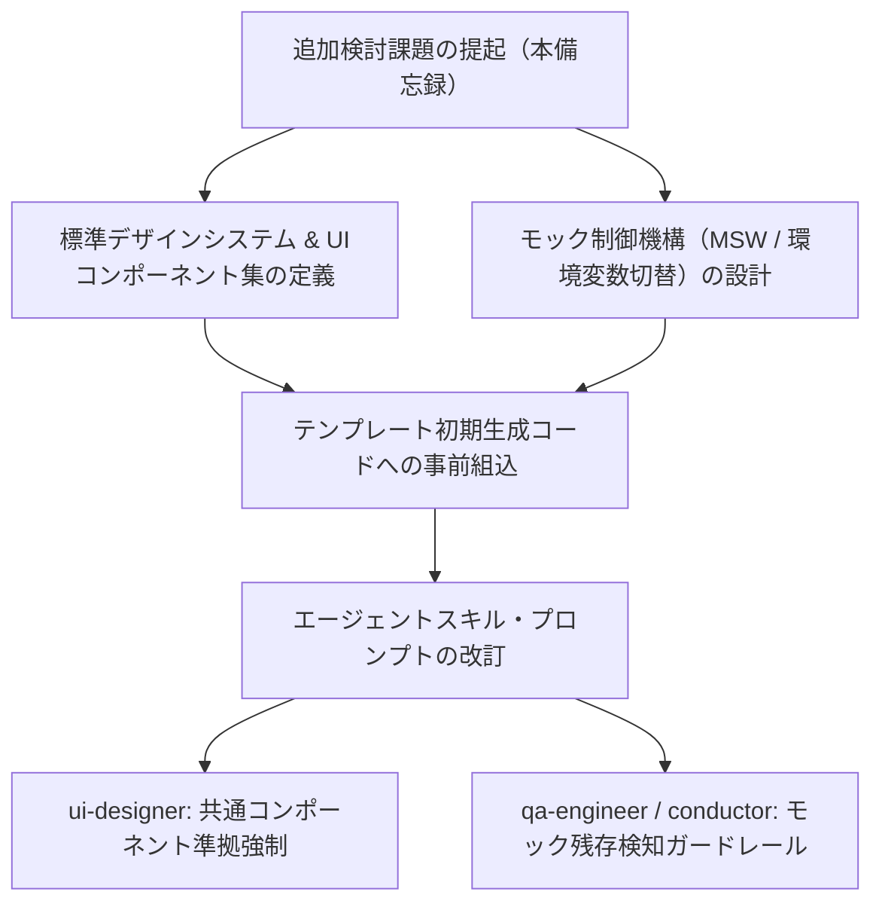

# 追加検討課題：モックアップコード制御および画面デザイン標準化

## 1. はじめに（備忘録の目的と背景）

本ドキュメントは、AI駆動開発テンプレート（V2.2以降）におけるシステム品質と開発パイプラインの洗練に向けた「追加の検討課題」を取りまとめた備忘録である。

先行する分析レポート（[AI駆動開発テンプレート 事前組込推奨要件・設計・留意事項 総合レポート](./AI駆動開発テンプレート_事前組込推奨要件・設計・留意事項_総合レポート.md) および [システムプロファイル設計および事前組込アーキテクチャ検討レポート](./システムプロファイル設計および事前組込アーキテクチャ検討レポート.md)）で示されたアーキテクチャ・インフラ・セキュリティ面の改善に加え、本稿では**「AIによるコード生成の振る舞い（モックコード）」**と**「フロントエンドUI/UXの品質・一貫性（画面デザイン統一パターン）」**に焦点を当て、具体的な課題認識と対応方針案を整理する。

---

## 2. 検討課題 1：モックアップコードの扱いについて

### 2.1 現状の課題とボトルネック
AIエージェント（特にフロントエンドエンジニアやUIデザイナー役）にコードを自律生成させると、API Callや外部接続サービスをシミュレートする「インラインのモックアップコード（ダミーデータ配列やローカルステートによる擬似応答）」を自発的に生成する傾向がある。

- **モックコードの長所**:
  - バックエンドAPIが未完成・未起動の状態でも、画面描画や操作感（インタラクション）を迅速にプレビュー・レビューできる。
- **現行パイプラインで生じる問題点**:
  - **レビューフェーズの重複**: 現在のパイプライン（PHASE 4〜5）では、プレゼンテーション層のUIレビューとバックエンドのビジネスロジック・API疎通検証が同一フェーズで並行して行われる構成になっている。
  - **ノイズ化と除去タイミングの曖昧さ**: フロントエンド内にハードコードされたモックが残存していると、実API接続時の不整合検知が遅れ、どのタイミングでモックをパージ（実API切り替え）すべきかのガバナンスが曖昧になり、技術的負債やデグレの原因となる。

### 2.2 検討すべき対応アプローチ

以下の3つのアプローチ、およびそれらの組み合わせを検討する。

| アプローチ案 | 内容 | メリット | デメリット / 留意事項 |
| :--- | :--- | :--- | :--- |
| **案A: モック生成の厳格抑制** | プロンプトやエージェントルール（`ui-designer`, `backend-engineer`）により、フロントエンド内でのダミーデータ・擬似API生成を原則禁止し、最初から実API/OpenAPIスキーマとの接続を強制する。 | 実API接続への移行漏れが発生せず、モック除去の工数がゼロになる。 | バックエンドAPIの立ち上げが遅れた場合、フロントエンドの画面確認がブロックされる。 |
| **案B: レビューフェーズの分離** | 開発パイプラインのフェーズを再定義し、「UI/UX操作性・画面モックレビュー（フェーズ4a）」と「ビジネスロジック・実API疎通レビュー（フェーズ4b）」を明確に順序分離する。 | 画面デザインのフィードバックサイクルを早期に回し、承認後に実接続へ安全に移行できる。 | パイプラインのターン数・ゲートが増加し、軽量プロジェクトでオーバーヘッドになる可能性がある。 |
| **案C: 環境変数による明示的制御** | `.env` の設定値（例: `DEBUG=MOCKUP` や `VITE_ENABLE_MOCK=true`）によってのみモックアダプター（MSW: Mock Service Worker や APIクライアントのモック実装）が機能するアーキテクチャを標準化する。 | コード本体を汚染せず、環境変数のON/OFFだけで本番/開発の実接続とモック表示を即座に切り替えられる。 | モック用インターフェース・アダプター層の事前設計とテンプレート組込が必要。 |

### 2.3 今後の検討・実装方針案
- **標準構成（推奨）**: **案C（環境変数・アダプター分離）** をベースとしつつ、**案A（コンポーネント内直書きモックの禁止）** をルール化する。
  - コンポーネント内にダミーデータを直接ベタ書きすることは禁止する。
  - APIクライアント層で `VITE_APP_MOCK=true` の場合のみモックハンドラーを注入する構成（MSW等の標準導入）をテンプレートにあらかじめ配備する。
  - レビュー運用としては、デザイン先行確認が必要な大型案件向けに **案B（フェーズ分離オプション）** を選択可能とする。

---

## 3. 検討課題 2：画面デザインの統一パターンの作成について

### 3.1 現状の課題とばらつき
現行のテンプレートでは、Tailwind CSSの利用や大まかな画面レイアウト方針を自然言語で指示しているに留まっている。このため、生成されるシステムごとに以下のようなデザインの揺らぎやばらつきが生じている。

- **配色の不統一**: プライマリカラー、アクセントカラー、背景色、ステータス表示色（成功/警告/危険）がプロジェクトごとにまちまちになる。
- **UIコンポーネントの非標準化**: ボタンの角丸（rounded-md vs rounded-full）、パディング、ホバーエフェクト、ドロップダウンメニューの挙動が統一されていない。
- **画面構造・ウィンドウ幅の差異**: 編集・詳細画面において「モーダル表示」「右スライドイン（ドロワー）」「別画面遷移」の採用基準が曖昧で、コンテナ幅（max-w-4xl, max-w-7xlなど）もバラつく。

### 3.2 策定すべきグランドデザイン標準項目

個別のプロジェクトが共通して準拠すべき「グランドデザイン（Design System Base）」をテンプレートに組み込む。

1. **画面要素とレイアウト展開**:
   - アプリケーション全体の基本シェル（ヘッダー、サイドバーナビゲーション、パンくずリスト、メインコンテンツエリア、フッター）の定型レイアウト。
   - モバイル対応（レスポンシブハンバーガーメニュー・ボトムナビゲーション）の標準展開。
2. **ボタンおよびインタラクション要素**:
   - ボタンバリエーションの規格化（Primary, Secondary, Danger, Ghost, Outline）。
   - サイズ体系（sm, md, lg）とローディング状態（スピナー表示・二重送信防止）の統一。
3. **編集画面・表示画面の標準ウィンドウ形態**:
   - **一覧画面**: 検索バー・フィルタ・ページネーション・テーブル/カードビューの標準レイアウト。
   - **詳細・閲覧画面**: カード型セクション分割、メタ情報ヘッダー。
   - **編集・登録画面**: 
     - 簡易入力: 標準モーダル（中央ポップアップ、幅制限）。
     - 複合・詳細入力: スライドインドロワー または 独立した編集画面フォーム。
4. **基本ルック（トークン & スタイルガイド）**:
   - **セマンティックカラー体系**: ブランドカラー、背景（Light/Dark）、テキスト（Primary/Muted）、ボーダー、ステータスカラー（Success/Warning/Error/Info）のCSS変数/Tailwindトークン化。
   - **タイポグラフィ & 余白体系**: 見出し・本文のフォントサイズスケール、統一スペーシング（4px/8pxグリッド準拠）。
   - **ダークモード対応**: 3モード（Light / Dark / System連動）の切り替えコンポーネントおよび配色パレットの事前固定。

> [!NOTE] 策定済みグランドデザイン標準ドキュメント群
> 本項目の標準仕様およびコンポーネントカタログ・テンプレートは、先行実稼働システム `bicycle-log` をベースに体系化され、以下のディレクトリに配置されています。
> - [グランドデザイン標準仕様書（Design System Base）概要](../../../doc_samples/グランドデザイン/README.md)
> - [01_グランドデザイン基本仕様書](../../../doc_samples/グランドデザイン/01_グランドデザイン基本仕様書.md)
> - [02_UIコンポーネントカタログ及び実装パターン](../../../doc_samples/グランドデザイン/02_UIコンポーネントカタログ及び実装パターン.md)
> - [03_画面仕様書テンプレート](../../../doc_samples/グランドデザイン/03_画面仕様書テンプレート.md)

### 3.3 期待される導入効果

- **デザインの一貫性とブランド統一感**:
  - 同一プラットフォーム上で作成された複数システム間で操作感・視覚体験がシームレスに統一される。
- **画面設計とフロントエンドコードの品質向上**:
  - AIエージェント（`ui-designer`）が画面仕様書やJSX/TSXコンポーネントを生成する際、ゼロからスタイリングを考える必要がなくなり、共通コンポーネント群を組み合わせることでGod Component化を防ぎ、コード量が削減される。
- **高い保守性と将来的なテーマ改編の容易性**:
  - デザインルール（Tailwind config / CSS変数）を一元管理するため、将来的なリブランディングや配色変更が全体に即座に反映される。

---

## 4. 今後のロードマップとパイプライン統合

本備忘録の内容は、今後のテンプレート改訂（V2.2以降）において以下のステップで具体化・組み込みを推進する。

1. **ステップ 1: 共通UIコンポーネント雛形およびデザインガイドの策定**
   - `frontend/src/components/ui/` 配下に標準コンポーネント（Button, Dialog, Drawer, Input, Table 等）のベースを用意、または headless UI / Tailwind UI 準拠の標準スタイルガイドをテンプレートに内包する。
2. **ステップ 2: APIクライアント & モックアダプターの雛形化**
   - OpenAPI生成クライアントと連動し、`.env` による透過的なモック切り替えができるディレクトリ構成（`frontend/src/api/`）を確立する。
3. **ステップ 3: パイプライン（エージェント役割・レビューゲート）への反映**
   - `docs/設計書/` の画面仕様書フォーマットに「標準ウィンドウ形態の指定」を必須化。
   - コードレビューゲート（`dev-review-code`）に「未認可の直書きモックコード検知」チェック項目を追加。
