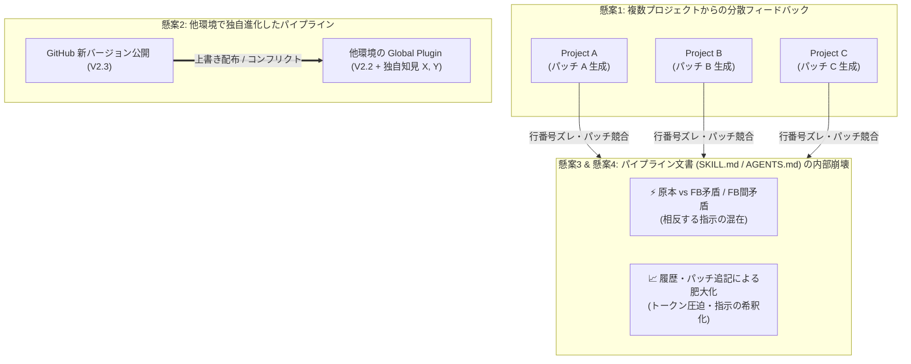
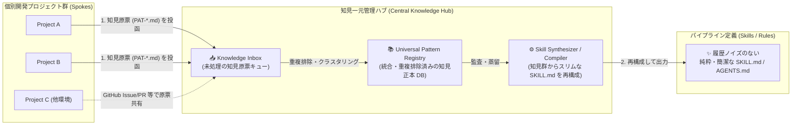
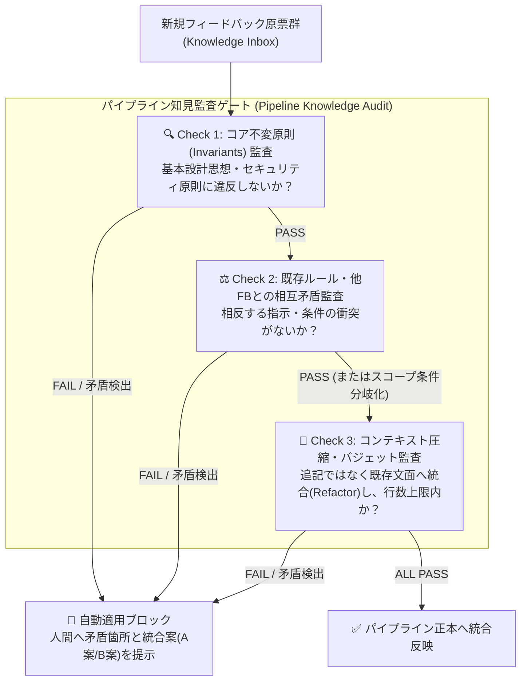
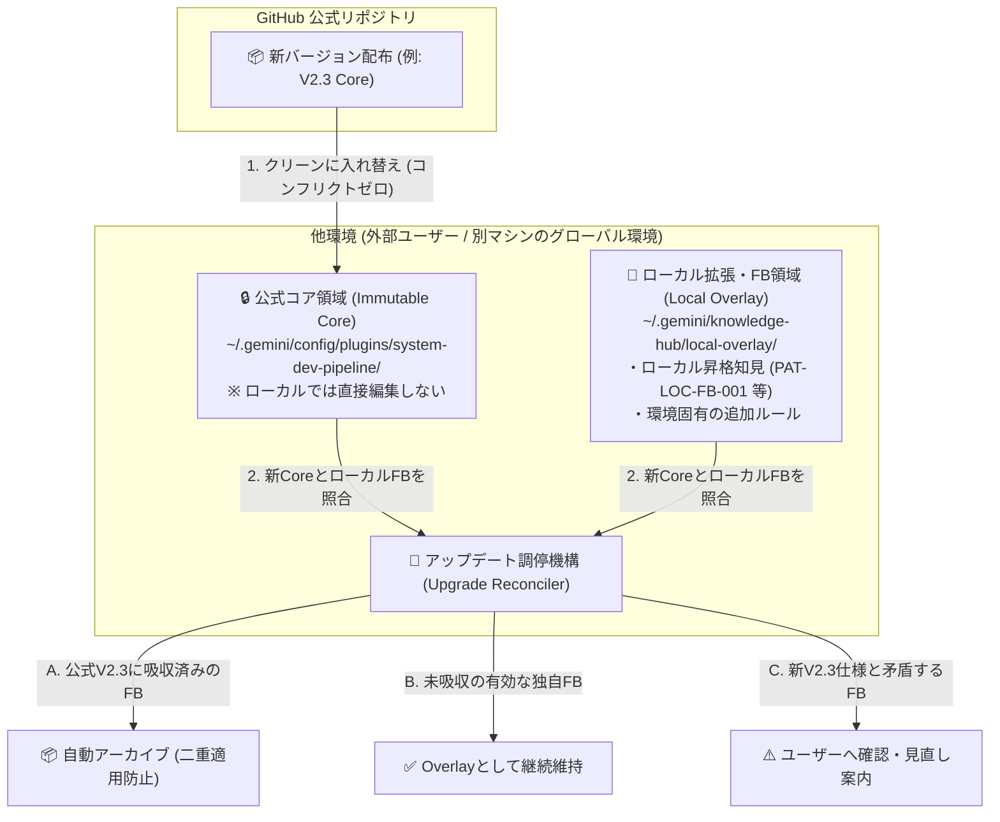

# 知見フィードバック機構の高度化と一元管理・監査・配布に関する検討課題

文書バージョン: 1.0  
作成日: 2026-10-17  
対象バージョン: AI駆動システム開発ライフサイクルテンプレート V2.3  
ステータス: 検討中（議論用叩き台）  
関連先行課題: [知見昇格時のテンプレート正本同期およびドリフト防止検討課題.md](./知見昇格時のテンプレート正本同期およびドリフト防止検討課題.md)

---

## 1. 背景と問題意識：単一環境ドリフトから「多拠点・長期進化問題」への視座拡大

先行の検討文書 [知見昇格時のテンプレート正本同期およびドリフト防止検討課題.md](./知見昇格時のテンプレート正本同期およびドリフト防止検討課題.md) においては、単一開発マシン内における「グローバル環境（`~/.gemini/config/plugins/`）とテンプレート開発正本リポジトリ（`template`）間の1対1のドリフト問題」に焦点を当て、応急的な同期・保護策を整理した。

しかし、PHASE 8（知見昇格）によるパイプラインの自己進化（Self-Evolution）が実際に稼働し始めたことで、問題は単なる「テンプレート改訂時のファイル同期漏れ」にとどまらず、**知見フィードバック機構そのもののスケーラビリティと持続可能性（Sustainability）に関わる以下の4つの本質的な課題**を浮かび上がらせた。

1. **複数プロジェクトからのフィードバックを一元化できない（N対1集約の破綻）**
2. **GitHubへ新バージョンを公開・配布する際、すでにリリース済みの他環境（外部環境・別端末）のパイプラインに蓄積されたフィードバックを保護・統合できない（分散環境アップデートの破綻）**
3. **フィードバックを重ねる中で、「原本（コア仕様）とフィードバック間」および「フィードバックとフィードバック間」に相互矛盾が生じる可能性を排除できない（意味的整合性の破綻）**
4. **フィードバック履歴や個別対策をそのままパイプラインの文書（`SKILL.md` / `AGENTS.md`）に追記し続けることで、コンテキストが肥大化し推論ノイズを生じる（コンテキスト純度の破綻）**

本文書では、これらの4大懸案事項の構造的メカニズムを掘り下げた上で、今後検討すべき3つの柱（**① フィードバックの一元管理**、**② フィードバック適用時の監査とコンテキスト圧縮**、**③ 他環境への新バージョン配布時の配慮**）について、議論の叩き台となるアーキテクチャ案を提示する。

---

## 2. 4大懸案事項の構造的メカニズム分析

### 2.1 懸案 1：複数プロジェクトからのフィードバックを一元化できない
- **現状の課題**:
  - 現行の [wiki-proposer](../../../.agents/plugins/system-dev-pipeline/skills/wiki-proposer/SKILL.md) は、各個別プロジェクトの `./wiki/patterns/universal/` から直接、その時点の `SKILL.md` や `rules/AGENTS.md` に対する **行単位の差分パッチ（`.patch`）** を `./promotions/` に出力する設計となっている。
  - 複数のプロジェクト（Project A, B, C）を並行または連続して開発した場合、各プロジェクトのワークスペース内に知見原票と `.patch` ファイルが分散して取り残される。
  - さらに、Project A のパッチを適用した時点で対象ファイル（`AGENTS.md` 等）の行番号や文脈が変化するため、Project B で生成された `.patch` はハンク不一致（Hunk Failed）を起こし、そのままでは適用できなくなる。
- **本質的ボトルネック**:
  - 知見の交換フォーマットが「抽象的な知識（構造化データ）」ではなく「特定時点のテキストに対するUnified Diff（パッチ）」に密結合していること、および全プロジェクトの知見を集결させる**単一の受付キュー（Central Inbox / Registry）が存在しない**ことにある。

### 2.2 懸案 2：GitHub 新バージョン公開時、他環境の既存フィードバックをケアできない
- **現状の課題**:
  - 本テンプレートを GitHub 等で公開し、別環境（他の開発者のPC、別チームの環境、あるいは自身のサブマシン等）へ導入して運用しているケースを考える。
  - リリース済みの他環境においても日々の開発を通じて PHASE 8 が稼働し、その環境独自の有用なフィードバック（ローカル昇格知見 $X, Y$）がパイプラインへ反映されている。
  - この状態で GitHub から新しい公式バージョン（例: V2.3）が公開された際、他環境側で新バージョンを取り込もうとすると、**「公式の V2.3 変更」と「他環境で適用済みのフィードバック $X, Y$」が同一ファイル上で衝突する**。
  - 単純に新バージョンで上書きすれば他環境のフィードバック $X, Y$ が消失し、さりとて手動で3-wayマージを行うのは非現実的である。また、本流（GitHub側）の開発者にとっても、他環境でどのようなフィードバックが発生しているかを把握・吸収する手段がない。

### 2.3 懸案 3：原本×フィードバック間、およびフィードバック×フィードバック間の相互矛盾
- **現状の課題**:
  - フィードバックが1件、2件のうちは人間が目視で判断できるが、10件、20件と積み重なると、以下の **意味的矛盾（Semantic Conflict）** が不可避的に発生する。
    1. **原本（Core Principle）とフィードバックの矛盾**:
       - 例：原本のコア原則では「テスト失敗時は原因を特定し最大5回まで自律修復せよ」と定めているのに、あるプロジェクトのフィードバックが「特定のE2Eエラー時はリトライせず即座にスキップして完了とせよ」という例外ルールを注入し、品質ゲートを形骸化させてしまう。
    2. **フィードバック同士（FB-A vs FB-B）の矛盾**:
       - 例：Project A（軽量API開発）からのフィードバックで「外部コマンドの待機タイムアウトは最大5秒に制限せよ」というルールが追加された後、Project B（重いデータ移行を含む開発）からのフィードバックで「マイグレーション系コマンドは最低120秒待機せよ」というルールが別箇所に追記され、AIがどちらの基準に従うべきか判断不能になる。
- **本質的ボトルネック**:
  - 現行の複合検証ゲート（[WikiSkill統合設計書.md](../../設計書/Current/WikiSkill統合設計書.md) 第6章）における `dev-doc-reviewer` は、開発対象アプリの設計書（`docs/`）の整合性を検査するものであり、**パイプライン自身の定義ファイル群（`skills/`, `rules/`, `agents/`）の論理的・意味的な一貫性を監査する仕組みになっていない**。

### 2.4 懸案 4：フィードバック履歴の蓄積による文書の肥大化とコンテキスト・ノイズ
- **現状の課題**:
  - 先日の `[PAT-SYS-001]` の昇格事例では、`rules/AGENTS.md` や `agents/conductor.md`、`skills/dev-phase7-release/SKILL.md` の本文中に `（※ [PAT-SYS-001] 対策）` といった履歴メタデータ付きの箇条書きがそのまま追記された。
  - この「追記型（Append-Only）」の更新を繰り返すと、以下の深刻な副作用が生じる：
    1. **コンテキストの肥大化（Token Bloat）**: すべてのフェーズ・すべてのターンで常時読み込まれる `rules/AGENTS.md` や `conductor.md` が肥大化し、推論トークンとアテンション（注意力）を恒常的に奪う。
    2. **指示の希釈化とノイズ（Instruction Dilution）**: 本来もっとも守るべき「コア設計原則」と、レアケースの「個別ツール利用時の注意点（エッジケース対策）」が同じ重み・同じ階層で延々と並ぶことで、LLM が重要度を誤認し、主要ルールの遵守率が低下する。
    3. **Context Isolation 原則の事実上の崩壊**: [WikiSkill統合設計書.md](../../設計書/Current/WikiSkill統合設計書.md) では「推論エージェントに Wiki の履歴を見せない（Context Isolation）」と定めたにもかかわらず、昇格を繰り返すうちに **Skills / Rules 層そのものが「パターン履歴の寄せ集め」と化してしまうパラドックス**が起きている。

---

## 3. 議論の叩き台：3大検討テーマと解決アイデア

上記の4大懸案を根本から解決するため、知見フィードバック機構を **「① 一元管理」「② 適用時監査と蒸留」「③ 分散配布とレイヤー分離」** の3つの軸で再設計するアイデアを提案する。

---

### テーマ ①：フィードバックの一元管理（Centralized Knowledge Hub）

> **基本発想の転換**:  
> 「各プロジェクトが直接パイプライン文書（`SKILL.md`）の差分パッチを作って当てる」方式を廃止し、**「各プロジェクトは構造化された『知見原票（Knowledge Claim）』を中央ハブへ提出するだけとし、パイプライン文書の書き換えは中央ハブ側で一元的に行う」**（Hub & Spoke モデル）。

#### アイデア 1-A：環境共通「Knowledge Inbox（知見スプール領域）」の創設
- **仕組み**:
  - 各開発プロジェクトの PHASE 8 では、プラグイン本体へ当てる `.patch` を作るのではなく、**自己完結した構造化知見パッケージ（`PAT-xxx.md` ＋ 発生コンテキスト・対象スキル候補を記したマニフェスト）** を、マシン内共通のスプール領域（例: `~/.gemini/knowledge-hub/inbox/`）へ自動投函（Export）する。
  - これにより、Project A, B, C で得られた知見が各プロジェクトフォルダ内に散逸せず、1箇所の Inbox に時系列で自動集約される。
- **メリット**:
  - パッチの行番号ズレ（Hunk Conflict）が原理的に発生しない。
  - 複数のプロジェクトを連続実行した後、任意のタイミングでまとめて Inbox 内の知見を棚卸し・統合できる。

#### アイデア 1-B：他環境からのフィードバック還流フォーマット（GitHub Issue / PR 連携）
- **仕組み**:
  - 他環境（別ユーザーの環境や別マシン）で蓄積された知見を GitHub 上の本流テンプレートへ還元できるよう、知見原票を **1ファイルの標準フォーマット（Markdown / JSON バンドル）** として書き出すコマンド（または GitHub Issue テンプレート）を用意する。
  - 本流リポジトリ側は、寄せられた知見原票を一度 `wiki/inbox/` に受け入れ、後述の「テーマ②：適用時監査」を経た上で次期バージョンへ組み込む。

#### アイデア 1-C：「パイプライン文書（State）」と「変更履歴・根拠（Lineage）」の完全分離
- **仕組み**:
  - `rules/AGENTS.md`、`agents/*.md`、`skills/*/SKILL.md` の中には、**`[PAT-SYS-001]` のようなパターンIDや「過去にこういう失敗があったため〜」という履歴説明を一切記述しない**ことを鉄則とする。
  - パイプライン文書は常に「現在守るべき最も簡潔・明快な仕様書（State）」として保ち、「どの行・どのルールがどのフィードバック（`PAT-xxx`）に由来するか」という因果関係（Lineage）は、推論時に読み込まれない別ファイル（`PURPOSE.md` または中央の `wiki/skill-impact.md`）でのみ管理する。

---

### テーマ ②：フィードバック適用時の監査とコンテキスト圧縮（Audit & Distillation）

> **基本発想の転換**:  
> フィードバックを「足し算（Append）」で適用するのではなく、**「意味的矛盾の監査（Semantic Audit）」** と **「既存文脈との統合・再圧縮（Refactor & Compress）」** を必須ゲートとする。

#### アイデア 2-A：3段階の「意味的整合性監査（Semantic Conflict Audit）」の導入
フィードバックをパイプライン正本へ取り込む際、以下の3つの観点で専用監査（`wiki-auditor` スキル等の新設）を実施する。

1. **コア不変原則（Core Invariants）との整合性チェック**:
   - パイプラインの根幹をなす「不変ルール（Invariants）」（例：Single Writer原則、Anti-God Component 250行制限、本番モックOFF二重防御、生SQL禁止など）を明文化したリストと照合し、フィードバックがこれらの原則を弱体化・バイパスしようとしていないかを監査する。
2. **フィードバック間の相互矛盾（Cross-Feedback Conflict）の検出と解消**:
   - 新規フィードバックと既存の `SKILL.md` / `AGENTS.md`（および同時期にInboxに入った他プロジェクトのフィードバック）を突き合わせ、以下の3パターンに分類して処理する：
     - **補強・包含（Subsumption）**: 既存ルールをより具体化・一般化するもの ➔ 既存の一文を書き換えて統合する（行数を増やさない）。
     - **条件付き分岐（Scoped Specialization）**: 前提条件（Profile A〜D の違い、対象コマンドの違い等）によって最適解が異なるもの ➔ 無条件の全体ルールとして書くのではなく、「条件 $C_1$ の場合は $A$、条件 $C_2$ の場合は $B$」として適用スコープを明示的に限定する。
     - **真の矛盾（True Contradiction）**: 同一条件に対して正反対の指示を出しているもの ➔ 自動反映をブロックし、両方の根拠原票（`PAT-xxx`）を並べて開発者に裁定（どちらを採択し、どちらを `rejected/` に送るか）を仰ぐ。
3. **過剰適合（Overfitting）の排除監査**:
   - 特定のプロジェクト固有のディレクトリ名、一時的な外部サービスの障害回避策、特定バージョンのみのワークアラウンドが共通ルールに紛れ込んでいないかを検査する。

#### アイデア 2-B：「追記禁止・統合再編（Synthesize, Don't Append）」とハードバジェット制限
- **仕組み**:
  - 現行の Gate 4 は「1回の更新あたり行数 +20% 以内」という相対基準であるため、更新を重ねると指数関数的に文書が膨張する。これを改め、**ファイル種別ごとの絶対行数上限（Hard Token / Line Budget）** を設定する。
    - 例：`rules/AGENTS.md` は最大 200 行以内、各 `SKILL.md` は最大 80〜120 行以内、各 `agents/*.md` は最大 100 行以内。
  - 上限に近づいた（または超える）場合、新しいフィードバックを入れるには **「既存の冗長な表現を圧縮する」「複数の個別注意書きを1つの汎用原則に抽象化する」「些末な手順をスクリプト側（`scripts/`）へ逃がしてプロンプトから消す」** といったリファクタリング（Distillation）を強制する。
- **効果**:
  - 何十回フィードバックループを回しても、推論エージェントが読むプロンプトは常に筋肉質でスリムな状態（高シグナル・低ノイズ）に保たれる。

---

### テーマ ③：他環境へリリースされたパイプラインへの新バージョン配布時の配慮

> **基本発想の転換**:  
> 他環境において「配布されたプラグイン本体のファイルを直接書き換える」からこそ、新バージョン配布時に上書き消失やコンフリクトが起きる。  
> **「公式配布領域（Immutable Core）」と「環境固有のフィードバック領域（Local Overlay）」を物理的に分離**し、アップデート時に安全に照合・マイグレーションする仕組みを導入する。

#### アイデア 3-A：「Immutable Core ＋ Local Overlay」の2層プラグイン構成
- **仕組み**:
  - GitHub から配布されるパイプライン本体（`system-dev-pipeline`）は **「読み取り専用の公式コア（Immutable Core）」** と位置付け、他環境の PHASE 8 であってもコアファイル（`SKILL.md` 等）を直接パッチ書き換えしない運用とする。
  - 代わりに、各環境で発生・昇格したフィードバックは **「ローカルオーバーレイ領域（例: `rules/LOCAL_FEEDBACK.md` や環境別の拡張ディレクトリ）」** に分離して蓄積する。
- **メリット**:
  - GitHub から新バージョン（V2.3）がリリースされた際、公式コア領域は `git pull` やパッケージ上書きで **100%クリーンに（コンフリクト一切なしで）アップデートできる**。
  - 同時に、他環境で蓄積されたローカルフィードバックは別ファイル（Overlay）にあるため、新バージョン上書きによって勝手に消えることがない。

#### アイデア 3-B：新バージョン適用時の「フィードバック調停・マイグレーション機構（Upgrade Reconciler）」
- **仕組み**:
  - 他環境が GitHub から新バージョン（V2.3）を取り込んだ際、アップデートスクリプト（または専用スキル `dev-pipeline-upgrade`）が「新バージョンの変更内容（`CHANGELOG` / `PURPOSE.md` / 吸収済みパターン一覧）」と「その環境の手元にあるローカルフィードバック（Overlay / Inbox）」を自動照合し、以下の3つに仕分ける：
    1. **公式吸収済み（Upstreamed / Obsoleted）**:
       - 他環境で独自に対策していたフィードバックと同一（または上位互換）の改善が、新バージョン V2.3 の公式コアに組み込まれていた場合、ローカル側のフィードバックを「公式吸収済み」として自動的にアーカイブへ退避する（二重定義によるコンテキスト浪費を防止）。
    2. **継続保持（Retained Local Wisdom）**:
       - 新バージョン V2.3 にもまだ含まれていない、その環境特有の有効な知見である場合、そのまま Local Overlay として維持する（さらに「この知見を GitHub 本流へ Issue/PR としてコントリビュートしますか？」と案内することも可能）。
    3. **破壊的変更との衝突（Breaking Change Conflict）**:
       - 新バージョン V2.3 でアーキテクチャやフェーズ定義が大きく変わり、過去のローカルフィードバックの前提が崩れている場合、該当フィードバックをハイライトしてユーザーへ見直し（更新または破棄）を促す。

#### アイデア 3-C：バージョン・フィードバック追跡マニフェスト（`PIPELINE_LOCK.json`）の導入
- **仕組み**:
  - パイプラインのルートに「現在のベースバージョン（例: `2.2.0`）」「公式コアのハッシュ値」「現在ローカル環境で有効化されている追加フィードバックIDのリスト」を記録した軽量なロックファイル／マニフェストを持たせる。
  - これにより、どの環境を見ても「公式のどのバージョンに対して、どのフィードバックが当たっている状態なのか」が一目で機械判別できるようになる。

---

## 4. 方式比較と段階的導入に向けた論点整理（ディスカッション用）

上記のアイデアを具体化していくにあたり、今後の議論で方向性を決定したい主要な論点（Decision Points）を以下に整理する。

| 論点カテゴリ | 検討すべき問い（Question） | 選択肢 A（シンプル・軽量重視） | 選択肢 B（厳格・スケーラビリティ重視） |
| :--- | :--- | :--- | :--- |
| **1. 知見の一元集約先 (Hubの置き場所)** | 複数プロジェクトから上がる Tier 2 知見をどこに集約するか？ | **ローカル共有ディレクトリ方式** `~/.gemini/knowledge-hub/inbox/` に全案件の原票を集め、テンプレート改訂時に一括取り込みする。 | **専用Gitブランチ / リポジトリ連携方式** テンプレート正本リポジトリの専用ブランチ（`feedback/inbox`）へ各案件から直接原票をコミット/PRする。 |
| **2. パイプライン文書の更新単位** | フィードバック発生時、どのタイミングで `SKILL.md` / `AGENTS.md` を書き換えるか？ | **都度統合＋Compactor方式** 案件完了ごとに反映するが、履歴IDの本文記載を廃止し、一定行数に達したら要約・圧縮を実行する。 | **バッチ・リリースコンパイル方式** 案件完了時は原票のInbox投函のみ行い、パイプラインのバージョン改訂時（V2.3等）にのみ監査・統合して文書を更新する。 |
| **3. 他環境でのフィードバック保持形態** | リリース済みの他環境では、次の公式アップデートまで独自知見をどう保持するか？ | **Git ブランチ管理＋Rebase方式** 他環境でもプラグインをGit管理し、ローカル知見は `local-custom` ブランチにコミット。公式更新時は `git rebase` で追従する。 | **Immutable Core ＋ Local Overlay 方式** 公式ファイルは一切編集せず、ローカル知見は別ファイル（Overlay）に分離配置し、アップデート時に調停スクリプトを回す。 |
| **4. 矛盾監査・コンテキスト圧縮の主体** | 原本・FB間の矛盾検出やテキスト圧縮を誰がどう行うか？ | **既存 `qa-engineer` + `wiki-compactor` の拡張** PHASE 8 のゲート条件に「意味的矛盾チェック」と「絶対行数上限チェック」を追加する。 | **テンプレート開発専用の統合監査スキルの新設** パイプライン改訂作業専用のスキル（例: `pipeline-reconciler`）を新設し、複数案件の知見を横断監査して統合する。 |

---

## 5. まとめ（ネクストステップ案）

知見フィードバックの仕組みが実際に動き出したことで、**「パッチを都度当てて文書に追記していく」という初期プロトタイプ的なアプローチから、「構造化知見の集約・意味的監査・コンテキスト予算管理・配布可能なレイヤー分離」を備えた本格的なナレッジ・エンジニアリング基盤への脱皮**が求められている。

まずは上記の **4つの論点（特に「案件ごとの即時パッチ反映を続けるか、Inbox集約＋バージョン改訂時の一括監査・統合へ切り替えるか」および「他環境のOverlay分離の要否」）** について方針をすり合わせ、V2.3 における設計・実装仕様へと具体化していくことを提案する。
