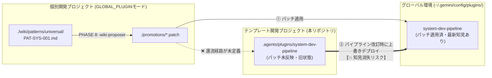
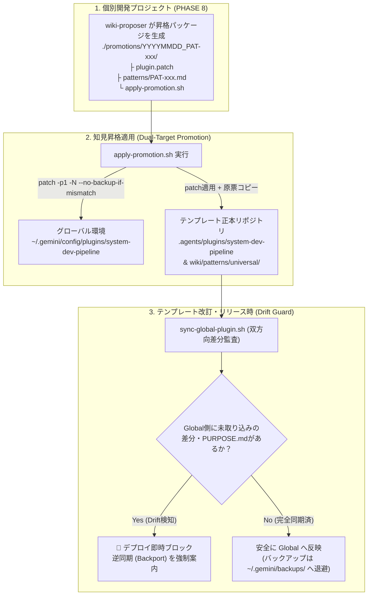

# 知見昇格時のテンプレート正本同期およびドリフト防止に関する検討課題

文書バージョン: 1.0  
作成日: 2026-10-17  
対象バージョン: AI駆動システム開発ライフサイクルテンプレート V2.3  
ステータス: 検討中・対策策定完了  

---

## 1. 背景と課題認識

### 1.1 事象の発覚経緯
`system-dev-pipeline`（V2.2.0）において、グローバル環境（`~/.gemini/config/plugins/system-dev-pipeline`）と本テンプレート開発プロジェクト内の正本（`../../../.agents/plugins/system-dev-pipeline`）の差分調査を実施した結果、以下の状態が確認された。

- 本テンプレートを用いて別プロジェクトの開発を行った際、PHASE 8（知見昇格フェーズ）において Tier 2 汎用知見 **`[PAT-SYS-001]`（外部CLIの非対話実行強制とバックグラウンド待機タイムアウト保護）** が抽出・昇格された。
- この昇格パッチはグローバル環境側のプラグイン（`agents/conductor.md`, `rules/AGENTS.md`, `skills/dev-phase7-release/SKILL.md`, `skills/dev-phase7-release/PURPOSE.md`）へ正常に反映されていた。
- しかし、**パイプライン自身の開発母体である本プロジェクト（`template` リポジトリ）側のファイル群は更新されておらず、グローバル環境とプロジェクト正本の間にドリフト（乖離）が発生していた**。

### 1.2 顕在化した重大リスク（蓄積知見のサイレント消失）
現在の構成のまま本プロジェクトで次期バージョン（V2.3 等）の改訂を行い、改訂後の `.agents/plugins/system-dev-pipeline/` をグローバル環境へ上書きデプロイした場合、**個別開発プロジェクトの実践を通じてせっかく獲得・検証・昇格した Tier 2 知見（`PAT-SYS-001` 等）が跡形もなく上書き破棄（Silent Knowledge Loss）されてしまう**。

これは、[WikiSkill統合設計書.md](../../設計書/Current/WikiSkill統合設計書.md) が解決しようとした最大の課題である **「ロールバックや改訂に伴う知見喪失（Catastrophic Forgetting）」** が、プロジェクト間〜テンプレート本流リポジトリ間のライフサイクル境界において再発し得ることを意味している。

---

## 2. 根本原因の分析 (Root Cause Analysis)

現状の [テンプレート配置形態およびナレッジ境界設計書.md](../../設計書/Current/テンプレート配置形態およびナレッジ境界設計書.md)、[wiki-proposer](../../../.agents/plugins/system-dev-pipeline/skills/wiki-proposer/SKILL.md)、および [dev-phase8-rules](../../../.agents/plugins/system-dev-pipeline/skills/dev-phase8-rules/SKILL.md) の仕様を精査した結果、以下の4つの構造的要因が特定された。



### 要因 1: `GLOBAL_PLUGIN` モードにおける昇格先の片方向性（スプリットブレイン）
`wiki-proposer` の Step 5（動作モード別の出力・昇格ルーティング）では、`GLOBAL_PLUGIN` モード時に `./promotions/*.patch` を出力し、ユーザーへ適用を案内する仕様となっている。しかし、適用対象として想定されているのが稼働中のグローバル環境（`~/.gemini/config/plugins/system-dev-pipeline`）のみであり、**Git管理されたテンプレート正本リポジトリ（本プロジェクト）への同時反映または還流（Backport）の手順・仕組みが定義されていない**。

### 要因 2: パイプライン改訂着手時・デプロイ時の「ドリフト検知ゲート」の不在
本プロジェクト（`template` リポジトリ）においてパイプラインの改訂作業を開始する際や、改訂成果をグローバル環境へ反映する際に、**「グローバル環境側に、まだ本プロジェクトへ取り込まれていない先行昇格知見が存在しないか」を機械的に検査するプリフライトチェック（Pre-flight Drift Check）** が存在しない。

### 要因 3: Tier 2 パターン原票（`PAT-{CAT}-xxx.md`）の分散残留
グローバル環境にパッチが適用された際、`skills/{skill_name}/PURPOSE.md` には `./wiki/patterns/universal/PAT-SYS-001_...md` への参照パスが記録されるが、**その原票ファイル自体は個別開発プロジェクトの `./wiki/` 配下に残されたまま**となり、テンプレート正本リポジトリの `./wiki/patterns/universal/` には集約されない。結果として、正本リポジトリ単体では `PURPOSE.md` のリンク先原票が参照できない状態となる。

### 要因 4: パッチ適用時の残骸ファイル（`.orig`）とバックアップ配置による環境汚染
1. `patch` コマンドを標準オプションのまま実行すると、チャンクのオフセットや再適用時に `rules/AGENTS.md.orig` のようなバックアップ残骸ファイルがプラグインディレクトリ内に生成・残留する。
2. グローバル環境のプラグイン更新時に `~/.gemini/config/plugins/system-dev-pipeline_backup_YYYYMMDD...` のように **同じ `plugins/` ディレクトリ直下にバックアップを作成すると、Antigravity のプラグインローダーがバックアップ側も別プラグインとして二重スキャン・競合させるリスク** がある。

---

## 3. 再発防止・改善プラン（4層防衛アーキテクチャ）

蓄積された知見の消失を完全に防止し、個別開発プロジェクト ➔ グローバル環境 ➔ テンプレート正本リポジトリの3者間で一貫した自己進化サイクルを回すため、以下の4層からなる防止プランを策定する。



---

### 対策 1: 【昇格出力の改善】昇格パッケージ化と2拠点同時反映スクリプトの自動生成 (`wiki-proposer` / `dev-phase8-rules`)

`GLOBAL_PLUGIN` モードにおける PHASE 8 の出力物を単なる `.patch` ファイル単体から、**「原票＋パッチ＋安全適用スクリプト」をセットにした昇格パッケージ**へアップグレードする。

1. **出力ディレクトリ構造の標準化**:
   ```text
   ./promotions/
   └── 20261017_PAT-SYS-001/
       ├── promotion.patch                        # .agents/plugins/system-dev-pipeline 基準の相対パスUnified Diff
       ├── patterns/
       │   └── PAT-SYS-001_cli_noninteractive.md  # Tier 2 パターン原票のコピー
       └── apply-promotion.sh                     # 正本・グローバル両対応の安全適用スクリプト
   ```
2. **クリーンなパッチ適用オプションの強制**:
   - `apply-promotion.sh` 内では、`.orig` ファイルの残留を防ぐため必ず `patch -p1 --forward --no-backup-if-mismatch`（または `git apply`）を使用する。
3. **2拠点（正本リポジトリ ＆ グローバル環境）への同時適用**:
   - 環境変数 `SYSTEM_DEV_PIPELINE_REPO`（未設定時はデフォルトパス候補または引数指定）でテンプレート正本リポジトリのパスを受け取り、以下の双方へワンコマンドで反映できるようにする：
     - **反映先 A（グローバル環境）**: `~/.gemini/config/plugins/system-dev-pipeline/`
     - **反映先 B（テンプレート正本）**: `${SYSTEM_DEV_PIPELINE_REPO}/.agents/plugins/system-dev-pipeline/` および `${SYSTEM_DEV_PIPELINE_REPO}/wiki/patterns/universal/`（原票格納）

---

### 対策 2: 【改訂前・リリース前ゲート】双方向ドリフト監査・同期スクリプトの導入

本テンプレート開発プロジェクト（`template` リポジトリ）において、グローバル環境との同期・デプロイを担う標準スクリプト（例: `scripts/sync-plugin.sh`）を整備し、**盲目的な上書きコピー（`cp -r`）を厳禁**とする。

#### スクリプトの3つの動作モード
1. **`--check`（ドリフト監査モード / Pre-flight Check）**:
   - グローバル環境と `.agents/plugins/system-dev-pipeline/` の全ファイルを比較（`.DS_Store` 除外）。
   - グローバル側のみに存在するファイル（`PURPOSE.md` 等）や、グローバル側のタイムスタンプが新しい変更行（`PAT-xxx` の追記等）を検出した場合、**「未取り込みの昇格知見あり（Drift Detected）」として警告・非ゼロ終了**する。
2. **`--pull`（グローバル ➔ プロジェクト正本への逆同期 / Backport モード）**:
   - 個別案件からグローバル環境へ先行適用された変更を、本プロジェクトの `.agents/plugins/system-dev-pipeline/` へ安全に取り込み、`git diff` で確認できる状態にする。
   - 同時に、グローバル環境内に誤って生成された `.orig` / `.rej` ファイルを検出・クリーンアップする。
3. **`--push`（プロジェクト正本 ➔ グローバルへのリリース反映モード）**:
   - **事前ガード**: 実行前に内部で `--check` を走らせ、グローバル側にのみ存在する知見（`PURPOSE.md` のエントリや `PAT-` 記述）がプロジェクト正本側に含まれていない場合は、**上書き事故防止のため処理を即座に中断（Abort）** する。
   - **バックアップ退避先の適正化**: 更新前のグローバルプラグインのバックアップは、`~/.gemini/config/plugins/` 直下（ローダー競合の原因）ではなく、プラグイン走査対象外の **`~/.gemini/backups/system-dev-pipeline/backup_YYYYMMDD_HHMMSS/`** へ退避する。

---

### 対策 3: 【開発規約の強化】テンプレート改訂ワークフローへのプリフライトチェック組み込み

本プロジェクト自身の開発・改訂ルール（`rules/AGENTS.md` 等）に以下の運用規約を追加する。

- **原則 1（改訂着手時の Backport First 原則）**:
  - `system-dev-pipeline` の設計書やスキル・エージェント定義を改訂する作業を開始する際は、**必ず最初にグローバル環境との差分チェックを実行し、グローバル側に蓄積された未同期の昇格知見（Tier 2 パッチ）をプロジェクト正本へ逆同期（Backport）してから改訂に着手する**。
- **原則 2（グローバル反映時の上書き保護原則）**:
  - プロジェクト正本からグローバル環境へプラグインを反映する際は、直接 `cp -r` や `rsync --delete` を実行してはならず、差分検証とバックアップ退避を備えた手順を経由する。

---

### 対策 4: 【直近措置】今回検出された `[PAT-SYS-001]` ドリフトの即時解消プラン

今回の調査で判明したグローバル環境とプロジェクト環境の差異（計5ファイル）については、本検討課題の策定に続き、以下の手順で即時解消（プロジェクト正本への逆同期＋グローバル環境のクリーンアップ）を実施する。

| ステップ | 対象パス | 実施内容 |
| :---: | :--- | :--- |
| **Step 1** | `~/.gemini/config/plugins/system-dev-pipeline/rules/AGENTS.md.orig` | 不要な `.orig` バックアップ残骸ファイルを削除する。 |
| **Step 2** | `~/.gemini/config/plugins/system-dev-pipeline_backup_20261015161020` | `plugins/` 直下から `~/.gemini/backups/` 等へ移動（または削除）し、プラグインローダーの重複スキャンリスクを排除する。 |
| **Step 3** | `.agents/plugins/system-dev-pipeline/agents/conductor.md`<br>`.agents/plugins/system-dev-pipeline/rules/AGENTS.md`<br>`.agents/plugins/system-dev-pipeline/skills/dev-phase7-release/SKILL.md`<br>`.agents/plugins/system-dev-pipeline/skills/dev-phase7-release/PURPOSE.md` | グローバル環境に反映済みの `[PAT-SYS-001]` の変更3ファイルおよび新規 `PURPOSE.md` 1ファイルをプロジェクト正本側へ逆同期（バックポート）する。 |
| **Step 4** | グローバル環境 ⇔ プロジェクト正本全域 | `diff -rq -x ".DS_Store"` を再実行し、全157ファイルが1バイト単位で完全一致していることを検証する。 |

---

## 4. V2.3 改訂時の対象ドキュメント・スキル一覧

本検討課題で策定したプランをパイプライン仕様へ正式組み込みする際（V2.3 改訂時）の更新対象は以下の通りである。

1. **設計書（`docs/設計書/Current/`）**:
   - [テンプレート配置形態およびナレッジ境界設計書.md](../../設計書/Current/テンプレート配置形態およびナレッジ境界設計書.md): 「5.1 モード A: `GLOBAL_PLUGIN` での知見昇格」にテンプレート正本リポジトリへの還流（Dual-Target Promotion）およびドリフト防止ゲートの仕様を追記。
   - [WikiSkill統合設計書.md](../../設計書/Current/WikiSkill統合設計書.md): Tier 2 パターン原票の正本リポジトリ集約と、改訂時プリフライトチェック（Backport First 原則）を追記。
2. **スキル定義（`.agents/plugins/system-dev-pipeline/skills/`）**:
   - [wiki-proposer/SKILL.md](../../../.agents/plugins/system-dev-pipeline/skills/wiki-proposer/SKILL.md): `./promotions/` への原票同梱出力および `--no-backup-if-mismatch` 付き適用スクリプト生成手順の追加。
   - [dev-phase8-rules/SKILL.md](../../../.agents/plugins/system-dev-pipeline/skills/dev-phase8-rules/SKILL.md): 知見昇格承認後の適用案内に「グローバル環境＋テンプレート正本リポジトリ双方への反映」を明記。
3. **運用スクリプト**:
   - `scripts/sync-plugin.sh`（または同等の同期・監査ユーティリティ）の新規追加。

---

## 5. 関連する発展的検討課題（フィードバック機構そのものの再設計へ）

本ドキュメントの調査を契機として、単一環境内のドリフト防止にとどまらず、複数プロジェクトからのフィードバック一元管理、原本・フィードバック間の相互矛盾監査、コンテキスト肥大化（履歴ノイズ）防止、および GitHub 等を介した他環境への新バージョン配布時のフィードバック保護について、より本質的な検討課題を以下の別冊ドキュメントへ整理した。

- [知見フィードバック機構の高度化と一元管理・監査・配布に関する検討課題.md](./知見フィードバック機構の高度化と一元管理・監査・配布に関する検討課題.md)
