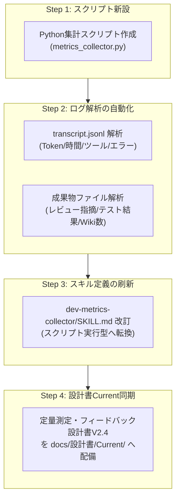

# 定量測定・メトリクス集計スキルのデータ収集ロジック調査報告書

**作成日**: 2026-10-24  
**調査対象**: `dev-metrics-collector` スキル、関連設計文書、および開発ライフサイクルパイプライン  
**ステータス**: 調査完了・改善提言  

---

## 1. エグゼクティブサマリ

開発完了後（PHASE 8）に行う統計処理および定量測定について、「正確にデータを収集できていない」という課題認識に基づき、現行の `dev-metrics-collector` スキル、関連設計書、および実行基盤の調査を実施した。

### 調査結果の総括
現在の定量メトリクス集計は、**「設計書上の理想的なKPI定義」と「スキルの実装実態」の間に決定的な断絶** が存在し、実質的に**スクリプトによる自動集計コードが 0 行（完全な自然言語・LLM手作業依存）** となっていることが判明した。

1. **スクリプトの不在**: 自動集計用のPythonスクリプトやCLIツールが存在せず、`SKILL.md` に書かれた自然言語の抽象的な指示のみで運用されている。
2. **一次データ（ターン・フェーズ）収集トリガーの欠落**: ターン別メトリクス（`metrics/turns/`）や各フェーズ完了時のメトリクス（`metrics/phases/`）を出力・蓄積するライフサイクルフックが存在しない。
3. **データソース（真実のデータ）への未接続**: Antigravity の会話ログ（`transcript.jsonl`）には、トークン消費量、ツール呼出履歴、エラー回数、経過時間などの完全な実行データが記録されているが、スキルから一切参照されていない。
4. **LLMのハルシネーション（数値捏造）の構造化**: 根拠となる一次データが存在しない状態で LLM に集計・レポート作成を求めるため、LLMが「それらしい架空の数値」を捏造（ハルシネーション）するか、集計不能に陥る構造になっている。

---

## 2. 関連資産と現行仕様の調査

### 2.1 関連資産の配置状況

| 資産種別 | パス | 状況・役割 |
| :--- | :--- | :--- |
| **スキル定義** | [.agents/plugins/system-dev-pipeline/skills/dev-metrics-collector/SKILL.md](../../.agents/plugins/system-dev-pipeline/skills/dev-metrics-collector/SKILL.md) | 全49行の指示書のみ。集計スクリプトやテンプレートは未配置。 |
| **設計書（過去版）** | [docs/設計書/V2.3/定量測定・フィードバック設計書.md](../設計書/V2.3/定量測定・フィードバック設計書.md) | 全195行。3大軸12指標、詳細な算出式、目標基準値が網羅されている。 |
| **設計書（Current）** | `docs/設計書/Current/` | **未配備**（V2.3からCurrentへ昇格・同期されておらず欠落）。 |
| **開発手順書** | [docs/設計書/Current/AI駆動システム開発手順書V2.4.md](../設計書/Current/AI駆動システム開発手順書V2.4.md) | PHASE 8 の作業として「メトリクス集計」が言及されている。 |
| **フェーズ定義書** | [docs/設計書/Current/AI駆動システム開発フェーズ定義書V2.4.md](../設計書/Current/AI駆動システム開発フェーズ定義書V2.4.md) | PHASE 8 の完了条件にメトリクス集計結果のサマリ反映が指定。 |

### 2.2 設計書（V2.3）における「設計上の理想」
[docs/設計書/V2.3/定量測定・フィードバック設計書.md](../設計書/V2.3/定量測定・フィードバック設計書.md) では、以下の「3大軸・12指標」および4大カテゴリによるスコアリング（100点満点・Grade S〜Critical）が厳密に設計されていた。

- **軸1: リソース＆コンテキスト効率**
  - `M-RES-01`: メインコンテキスト消費率（目標 < 60%）
  - `M-RES-02`: サブエージェント委譲率（目標 ≥ 50%）
  - `M-RES-03`: 成果物トークン効率（LOC / kTokens）
  - `M-RES-04`: ツール呼出重複率（目標 < 5%）
- **軸2: 開発品質＆手戻り**
  - `M-QLT-01`: レビュー初回合格率（目標 ≥ 70%）
  - `M-QLT-02`: レビュー指摘密度（目標 < 2.0件 / 100行）
  - `M-QLT-03`: スルーテスト初回合格率（目標 ≥ 80%）＆リグレッション率（0%）
  - `M-QLT-04`: 自律修復ループ収束ターン数（目標 ≤ 2.0ターン）
- **軸3: プロセス健全性＆ガバナンス**
  - `M-GOV-01`: Single Writer原則違反件数（目標 0件）
  - `M-GOV-02`: 不変原則・純度・バジェット違反数（目標 0件）
  - `M-GOV-03`: フェーズ所要ターン超過率（目標 ≤ 1.2倍）
  - `M-GOV-04`: ドキュメント相互整合性スコア（目標 100%）

---

## 3. 現在のデータ収集ロジックとその欠陥

現行の [dev-metrics-collector/SKILL.md](../../.agents/plugins/system-dev-pipeline/skills/dev-metrics-collector/SKILL.md) では、処理手順が以下のように定義されている。

### 3.1 規定されている手順
```markdown
### Step 1: ターン/フェーズ データの収集とJSON出力
各フェーズ完了時に、該当フェーズ内の実行ログや完了サマリから実績値を抽出し、`metrics/phases/phase_{N}.json` を出力・更新する。

### Step 2: 健全性スコア (System Health Score) の算出
以下の4大カテゴリに基づいてスコア（各25点満点、計100点）およびグレード（A: 90+, B: 75-89, C: 60-74, D: <60）を算出する：
1. プロセス効率性 (Process Efficiency): 計画工数・ターン数に対する実績比率
2. レビュー品質 (Review Robustness): 3大レビューでの指摘消化率、手戻り回数
3. テスト信頼性 (Test Reliability): シナリオテスト合格率、修復ループ収束速度
4. 知見蓄積度 (Knowledge Capitalization): Wikiパターンの蓄積数および昇格率

### Step 3: PHASE 8 総合健全性診断レポートの生成
PHASE 8 実行時、プロジェクト全体のメトリクスを統合した `metrics/system_health_report.md` を作成する。
```

### 3.2 構造的欠陥・なぜデータが正確に取れないのか

| 問題点 | 詳細な原因と実態 |
| :--- | :--- |
| **① スクリプト完全未実装** | 収集を実行する Python やシェルスクリプトが 1 つも存在しない。すべてコンダクター（LLM）へのプロンプト指示となっており、客観的・機械的集計が不可能。 |
| **② 収集トリガーの不在** | 「各フェーズ完了時に出力する」とあるが、PHASE 1〜7 の手順書やプロンプトには `dev-metrics-collector` を呼び出す指示や自動フックが組み込まれていない。 |
| **③ 一次データの欠損** | `metrics/turns/turn_{N}.json` や `metrics/phases/phase_{N}.json` が実際には一切生成されないため、PHASE 8 の時点で集計元データが完全に空である。 |
| **④ データソースの未定義** | 「実行ログから実績値を抽出」とあるが、どのファイルのどのフィールドを見るべきかが未定義。Antigravity 内のログ仕様がスキルに開示されていない。 |
| **⑤ LLMによる数値捏造** | 一次データが存在しない状態で「レポートを出力せよ」と命じられた LLM は、コンテキストの雰囲気から適当な数字（ハルシネーション）を作り出して JSON や Markdown に記入してしまう。 |
| **⑥ 設計書の指標の欠落** | 設計書にあった 12 指標（M-RES-01等）や数式が `SKILL.md` から丸ごと抜け落ちており、抽象的な4カテゴリの自己採点に退化している。 |

---

## 4. Antigravity 基盤内の実データ検証

調査の結果、**Antigravity の実行基盤側には、極めて高精度な実行生ログが存在している** ことが確認できた。これらを利用することで、機械的かつ決定論的なデータ収集が可能となる。

### 4.1 会話トランスクリプト (`transcript.jsonl`) の実構造
`<appDataDir>/brain/<conversation-id>/.system_generated/logs/transcript.jsonl` には、各ステップ（ターン）ごとに以下のデータが完全記録されている：

```json
{
  "step_index": 1,
  "source": "MODEL",
  "type": "PLANNER_RESPONSE",
  "status": "DONE",
  "created_at": "2026-10-23T22:35:49Z",
  "input_tokens": 22804,
  "cache_read_tokens": 0,
  "output_tokens": 247,
  "tool_calls": [
    {
      "name": "read_file",
      "args": { "Path": "..." }
    }
  ]
}
```

このトランスクリプトを解析することで、以下の数値を**1トークン・1秒単位で正確に自動算出**できる：
1. **ターン数**: `step_index`、または `source: "USER_EXPLICIT"` の境界カウント
2. **トークン消費量**: `input_tokens`, `output_tokens`, `cache_read_tokens` の積算
3. **経過時間**: 各ステップの `created_at` (ISO 8601) のタイムスタンプ差分
4. **ツール呼出回数・種別**: `tool_calls[].name` の頻度集計（`run_command`, `write_file` 等）
5. **サブエージェント委譲回数**: `tool_calls[].name == "invoke_subagent"` の回数・比率
6. **エラー・リトライ回数**: `status == "ERROR"` またはツール実行結果のエラー検知

### 4.2 ワークスペース内成果物からの自動抽出可能性
さらに、ワークスペース内の既存ファイルを機械的に走査することで、品質系メトリクスも自動集計できる：

- **レビュー合否・指摘件数**: `docs/設計書/` 配下のレビュー結果報告書（`基本設計レビュー結果報告書.md` 等）の Markdown テーブルやチェックボックスを正規表現で解析
- **テスト合格率・修復回数**: `docs/plans/scenario-test/` の実行ログや `pytest` 実行結果
- **獲得Wikiパターン数**: `wiki/patterns/local/` および `wiki/patterns/universal/` の `.md` ファイル数
- **Gitコミット・変更行数 (LOC)**: `git log` / `git diff` による正味追加行数の算出

---

## 5. 改善方針とロードマップ（提案）

正確で信頼性の高い定量測定を実現するため、以下の 4 ステップによる改善を提言する。



### 5.1 具体的な改善策

1. **決定論的集計スクリプト (`scripts/metrics_collector.py`) の新設**:
   - `transcript.jsonl`（または現在セッションのトランスクリプト）を読み込み、トークン数、ツール呼出、時間を自動集計する Python スクリプトを配備する。
   - 外部ライブラリに依存せず、Python 3 標準ライブラリ（`json`, `re`, `datetime`, `pathlib`）のみで動作させる（Profile E / Zero-Dependency 準拠）。
2. **スキルの実行形式の転換**:
   - `dev-metrics-collector/SKILL.md` を「LLMが考える」形式から「コンダクターが `uv run python scripts/metrics_collector.py`（または標準Python）を実行し、出力された JSON / MD を確認・報告する」形式へと刷新する。
3. **12指標の完全復活とスコアリングの決定論化**:
   - [docs/設計書/V2.3/定量測定・フィードバック設計書.md](../設計書/V2.3/定量測定・フィードバック設計書.md) に定義された 12 指標（M-RES-01〜04, M-QLT-01〜04, M-GOV-01〜04）の計算式をスクリプト内にそのまま実装し、点数（100点満点）とグレード（Grade S〜Critical）を数式通りに自動算出する。
4. **設計書の Current への昇格・同期**:
   - `docs/設計書/Current/定量測定・フィードバック設計書V2.4.md` を作成・配置し、パイプラインの正本仕様書として最新化する。

---

## 6. まとめ

現在のメトリクス収集の精度不足は、「LLMの性能問題」ではなく、**「データが存在するにもかかわらず、それを読み取るスクリプトが作られておらず、LLMの手作業に丸投げしていた」というパイプライン設計・実装の欠落が根本原因** である。

決定論的スクリプト（`metrics_collector.py`）を 1 本整備し、トランスクリプトと成果物から自動抽出する仕組みを導入することで、開発プロセスの透明性と健全性を 100% 正確に測定できるようになる。
