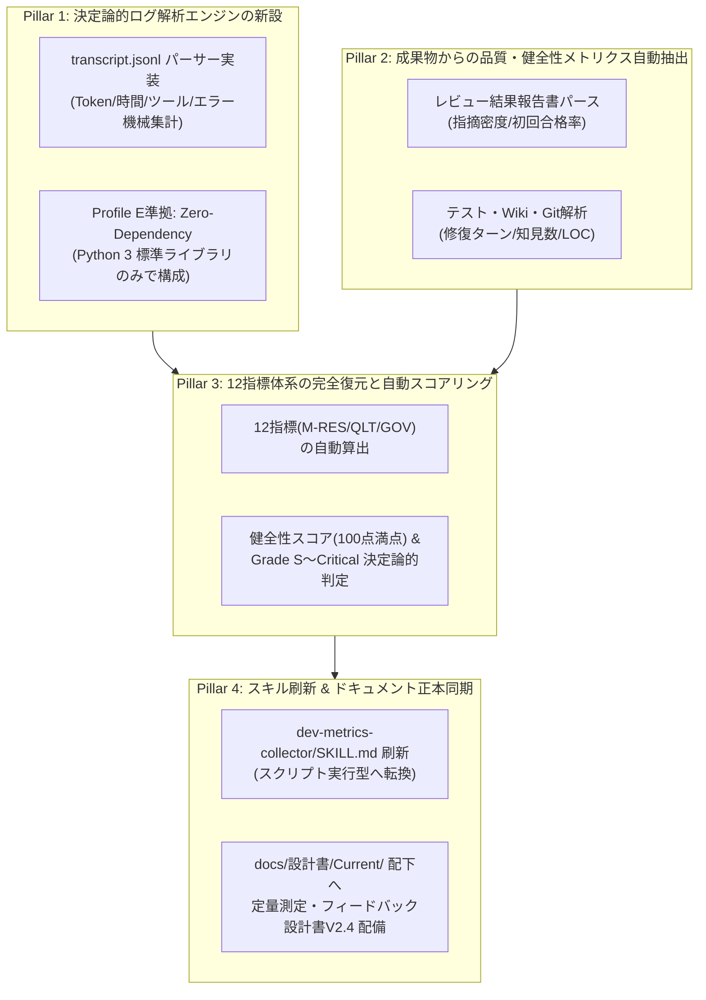
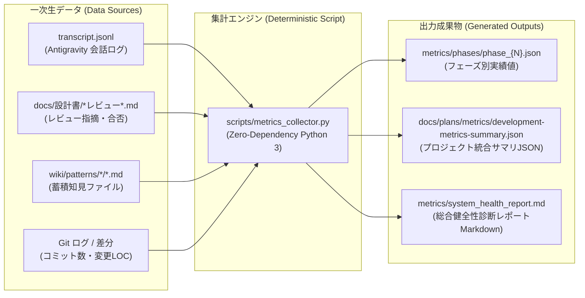
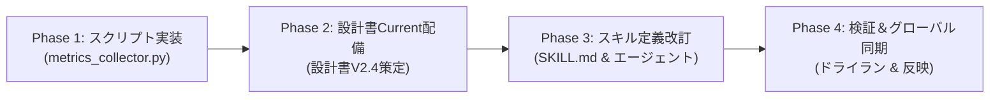

# 定量測定・メトリクス集計機能改善計画書 (Quantitative Metrics System Improvement Plan)

文書バージョン: 1.0  
作成日: 2026-10-24  
対象バージョン: AI駆動システム開発ライフサイクルテンプレート V2.4.0  
ステータス: 正式計画書 (Approved Plan)  
関連文書:
- [20261024_定量測定・メトリクス集計スキルのデータ収集ロジック調査報告書.md](../../reports/20261024_定量測定・メトリクス集計スキルのデータ収集ロジック調査報告書.md)
- [定量測定・フィードバック設計書.md](../V2.3/定量測定・フィードバック設計書.md)
- [AI駆動システム開発フェーズ定義書V2.4.md](./AI駆動システム開発フェーズ定義書V2.4.md)
- [AI駆動システム開発手順書V2.4.md](./AI駆動システム開発手順書V2.4.md)
- [エージェント設計書V2.4.md](./エージェント設計書V2.4.md)
- [状態管理機構設計書V2.4.md](./状態管理機構設計書V2.4.md)
- [レビューシステム設計書V2.4.md](./レビューシステム設計書V2.4.md)
- [V2.4改変計画書.md](./V2.4改変計画書.md)

---

## 1. はじめに

### 1.1 背景と課題認識
[20261024_定量測定・メトリクス集計スキルのデータ収集ロジック調査報告書.md](../../reports/20261024_定量測定・メトリクス集計スキルのデータ収集ロジック調査報告書.md) において実施された現行パイプラインの調査により、開発完了後（PHASE 8）に行う統計処理および定量測定スキル（`dev-metrics-collector`）に以下の **5大構造的欠陥** が存在することが明らかとなった：

1. **集計スクリプトの完全な不在（スクリプトコード 0 行）**:
   - `dev-metrics-collector` 配下に自動集計用の Python スクリプトや CLI ツールが存在せず、LLM に対する自然言語の抽象的な指示（49行）のみで構成されていた。
2. **一次データ（ターン・フェーズ）収集トリガーの欠落**:
   - 各ターン（`metrics/turns/`）や各フェーズ完了時（`metrics/phases/`）にメトリクスを出力・蓄積するライフサイクルフックが存在せず、集計元データが常に空であった。
3. **データソース（真実のデータ）への未接続**:
   - Antigravity の会話ログ（`transcript.jsonl`）にトークン消費量、ツール呼出履歴、エラー回数、経過時間などの完全なデータが記録されているにもかかわらず、スキルから参照されていなかった。
4. **設計書とスキルの決定的な乖離**:
   - [定量測定・フィードバック設計書.md](../V2.3/定量測定・フィードバック設計書.md) に定義されていた「3大軸・12指標（M-RES-01〜04, M-QLT-01〜04, M-GOV-01〜04）」およびスコアリング式がスキルから脱落し、さらに `docs/設計書/Current/` に設計書自体が未配備であった。
5. **LLMのハルシネーション（数値捏造）の構造化**:
   - 一次データがない状態で LLM に集計・レポート作成を求めるため、LLM が「それらしい架空の数値」を捏造（ハルシネーション）するか、集計不能に陥っていた。

### 1.2 目的とゴール
本文書は、上記欠陥を解消し、**「LLMの推測・ハルシネーション」から「100%決定論的・機械的自動集計」へと完全に脱却する** ための改変計画を策定するものである。

- **ゴール 1**: Antigravity の `transcript.jsonl` を解析し、トークン・時間・ツール・エラーを 1 トークン・1 秒単位で自動抽出する決定論的 Python スクリプトを配備する。
- **ゴール 2**: ワークスペース内のドキュメント（レビュー報告書、テストログ、Wiki、Git）から品質指標を機械集計する。
- **ゴール 3**: 12 指標体系およびスコアリング式（100点満点・Grade S〜Critical）を決定論的に計算する。
- **ゴール 4**: `dev-metrics-collector` スキルおよび `docs/設計書/Current/` 配下の正本仕様書を最新化・再構成する。

---

## 2. 改善の基本方針（4大ピラー）



### 2.1 Pillar 1: 決定論的ログ解析エンジンの新設
- Antigravity の会話トランスクリプト（`<appDataDir>/brain/<conversation-id>/.system_generated/logs/transcript.jsonl`）を読み込み、ステップごとの `input_tokens`, `output_tokens`, `cache_read_tokens`, `created_at`, `tool_calls`, `status` を積算・解析する Python スクリプト（`metrics_collector.py`）を開発する。
- 外部依存パッケージ（`pandas` 等）を一切使わず、Python 3 標準ライブラリ（`json`, `re`, `datetime`, `pathlib`, `sys`, `argparse`）のみで完結させる（**Profile E: Zero-Dependency 規約厳守**）。

### 2.2 Pillar 2: 成果物からの品質・健全性メトリクス自動抽出
- **レビュー指標**: `docs/設計書/` 配下の `基本設計レビュー結果報告書.md`, `コード品質レビュー及びリファクタリング提案書.md`, `システム総合レビュー結果報告書.md` をパースし、指摘件数（Critical / High / Medium）および合否判定（PASS / CONDITIONAL PASS / REJECT）を自動抽出。
- **テスト・修復指標**: `docs/plans/scenario-test/` やテストログから修復反復回数を抽出。
- **知見蓄積度**: `wiki/patterns/local/`, `wiki/patterns/universal/` 配下の Markdown ファイル数をカウント。
- **コード規模・変更量**: `git log` / `git diff` を実行して追加行数（LOC）を客観取得。

### 2.3 Pillar 3: 12指標体系の完全復元と自動スコアリング
- 設計書に規定された以下の 12 指標を数式通りに自動算出する：
  - **リソース効率**: `M-RES-01`（メイン消費率）、`M-RES-02`（サブエージェント委譲率）、`M-RES-03`（LOC / kTokens）、`M-RES-04`（ツール呼出重複率）
  - **開発品質**: `M-QLT-01`（レビュー初回合格率）、`M-QLT-02`（指摘密度）、`M-QLT-03`（テスト合格率・リグレッション率）、`M-QLT-04`（自律修復収束ターン数）
  - **プロセス統制**: `M-GOV-01`（Single Writer違反件数）、`M-GOV-02`（不変原則・バジェット違反数）、`M-GOV-03`（フェーズ超過率）、`M-GOV-04`（ドキュメント整合性スコア）
- 4大カテゴリ（各25点、計100点）およびグレード（Grade S, A, B, C, Critical）を自動判定し、JSON（`development-metrics-summary.json`）および Markdown レポート（`system_health_report.md`）を出力する。

### 2.4 Pillar 4: スキル刷新とドキュメント正本同期
- `dev-metrics-collector/SKILL.md` を「LLM による推論・作成」から「コンダクターによる `python scripts/metrics_collector.py` 実行と結果確認・報告」へと刷新する。
- `docs/設計書/Current/定量測定・フィードバック設計書V2.4.md` を正式作成・配備し、パイプラインの正本仕様書として一元管理する。

---

## 3. システムアーキテクチャとデータフロー

### 3.1 データフロー図


### 3.2 ディレクトリ構成と成果物配置

```text
.agents/plugins/system-dev-pipeline/
├── skills/
│   └── dev-metrics-collector/
│       ├── SKILL.md                          # 刷新された実行指示書 (スクリプト実行型)
│       └── scripts/
│           └── metrics_collector.py          # 決定論的データ収集・スコアリングスクリプト (新設)
docs/
├── 設計書/
│   └── Current/
│       └── 定量測定・フィードバック設計書V2.4.md # 正本設計書 (新設配備)
└── plans/
    └── metrics/
        └── development-metrics-summary.json  # 自動生成されるプロジェクト統合サマリ
metrics/                                      # プロジェクトローカル領域 (.gitignore 除外)
├── turns/                                    # ターン別スナップショット (スクリプト出力)
├── phases/                                   # フェーズ別実績値 (スクリプト出力)
└── system_health_report.md                   # 総合健全性診断レポート (スクリプト出力)
```

---

## 4. `metrics_collector.py` 詳細仕様

### 4.1 CLI コマンドライン引数仕様
コンダクターが実行しやすいシンプルな引数構成とする。

```bash
# 基本実行: 現在の会話トランスクリプトを自動探索して全体集計・レポート出力
python .agents/plugins/system-dev-pipeline/skills/dev-metrics-collector/scripts/metrics_collector.py

# オプション指定
python .../metrics_collector.py \
  --transcript <path/to/transcript.jsonl> \  # 明示的なトランスクリプトパス
  --workspace <path/to/workspace> \          # ワークスペースルート (デフォルト: カレント)
  --phase <phase_name_or_number> \           # 特定フェーズのみの中間集計
  --output-dir <path/to/output>              # 出力先ディレクトリ (デフォルト: metrics/)
```

### 4.2 トランスクリプト自動探索ロジック
引数で `--transcript` が渡されない場合、スクリプトは以下の順序でトランスクリプトを自動探索する：
1. 環境変数 `ANTIGRAVITY_TRANSCRIPT_PATH`
2. `~/.gemini/antigravity/brain/*/ .system_generated/logs/transcript.jsonl` のうち、最終更新日時（mtime）が最も新しいもの
3. カレントディレクトリ配下の `.system_generated/logs/transcript.jsonl`

### 4.3 出力データスキーマ

#### ① `development-metrics-summary.json`
```json
{
  "project_name": "template",
  "generated_at": "2026-10-24T08:00:00+09:00",
  "metrics": {
    "resource_efficiency": {
      "main_context_tokens_current": 45200,
      "main_context_tokens_max": 1048576,
      "main_context_usage_percent": 4.31,
      "total_tokens_consumed": 285400,
      "delegation_turns": 14,
      "total_turns": 22,
      "delegation_ratio_percent": 63.64,
      "net_loc_added": 1250,
      "tokens_per_artifact_loc": 4.38,
      "tool_calls_total": 48,
      "tool_calls_duplicated": 1,
      "tool_call_duplicate_percent": 2.08
    },
    "quality_and_rework": {
      "review_first_pass_rate_percent": 100.0,
      "review_defect_density_per_100_loc": 0.48,
      "scenario_test_first_pass_rate_percent": 100.0,
      "regression_rate_percent": 0.0,
      "auto_healing_avg_turns": 1.0
    },
    "process_governance": {
      "single_writer_violations": 0,
      "core_invariants_violations": 0,
      "phase_turn_overrun_ratio": 1.05,
      "doc_consistency_score_percent": 100.0
    }
  },
  "score": {
    "category_scores": {
      "process_efficiency": 24.5,
      "review_robustness": 25.0,
      "test_reliability": 25.0,
      "knowledge_capitalization": 23.0
    },
    "total_score": 97.5,
    "grade": "Grade S",
    "status": "HEALTHY"
  }
}
```

---

## 5. 実装タスクと改訂対象ファイル一覧

| No | 作業項目 | 対象ファイル / ディレクトリ | 変更種別 |
| :---: | :--- | :--- | :---: |
| **T-1** | 決定論的データ収集スクリプトの実装 | `.agents/plugins/system-dev-pipeline/skills/dev-metrics-collector/scripts/metrics_collector.py` | 新規作成 |
| **T-2** | 定量測定・フィードバック設計書 V2.4 の策定・配備 | `docs/設計書/Current/定量測定・フィードバック設計書V2.4.md` | 新規作成 |
| **T-3** | `dev-metrics-collector` スキル定義の刷新 | `.agents/plugins/system-dev-pipeline/skills/dev-metrics-collector/SKILL.md` | 内容改訂 |
| **T-4** | `dev-phase8-rules` スキル定義のスクリプト実行反映 | `.agents/plugins/system-dev-pipeline/skills/dev-phase8-rules/SKILL.md` | 内容改訂 |
| **T-5** | グローバル環境 (`~/.gemini/config/plugins/...`) との同期 | `scripts/sync_pipeline.sh` (または手動配備) | 同期反映 |
| **T-6** | 実セッションによるドライラン検証と動作確認 | 実際のトランスクリプトを用いた実行テスト | 検証 |

---

## 6. 段階的移行ロードマップ（Phase 1〜4）



### Phase 1: スクリプト実装（T-1）
1. `metrics_collector.py` を作成：
   - `transcript.jsonl` パーサー（Token, Time, Tool, Subagent, Error 積算）
   - レビュー報告書・Wikiファイル・Git ログのパーサー
   - 12指標の算出ロジックおよびスコアリング（各25点、計100点、Grade S〜Critical判定）
   - JSON（`development-metrics-summary.json`）および Markdown（`system_health_report.md`）の出力機構
2. 単体動作確認（構文チェック、モックデータによる集計テスト）。

### Phase 2: 設計書 Current 配備（T-2）
1. `docs/設計書/V2.3/定量測定・フィードバック設計書.md` をベースに、V2.4 仕様（SemVer準拠、スクリプト実行型、`transcript.jsonl` 仕様）を反映した `docs/設計書/Current/定量測定・フィードバック設計書V2.4.md` を新規策定・配置。
2. `docs/設計書/Current/` の他設計書とのリンク整合性を確認。

### Phase 3: スキル定義改訂（T-3, T-4）
1. `skills/dev-metrics-collector/SKILL.md` を改訂：
   - 担当: コンダクター
   - コマンド: `python .agents/plugins/system-dev-pipeline/skills/dev-metrics-collector/scripts/metrics_collector.py`
   - 出力確認と完了サマリ報告手順の明文化
2. `skills/dev-phase8-rules/SKILL.md` における `dev-metrics-collector` 実行手順をスクリプト実行型に同期。

### Phase 4: 検証＆グローバル同期（T-5, T-6）
1. 現在の会話セッションの `transcript.jsonl` を対象に `metrics_collector.py` を実際にドライラン実行し、正常に JSON と Markdown レポートが出力されることを確認。
2. ワークスペース側（`.agents/plugins/system-dev-pipeline/`）の改訂内容をグローバル環境（`~/.gemini/config/plugins/system-dev-pipeline/`）へ安全に同期。

---

## 7. 完了条件と検証基準（Definition of Done）

- [ ] `scripts/metrics_collector.py` が Python 3 標準ライブラリのみでエラーなく実行可能であること。
- [ ] `transcript.jsonl` から正確にトークン数、ツール呼出回数、エラー数が機械抽出されること。
- [ ] `docs/plans/metrics/development-metrics-summary.json` および `metrics/system_health_report.md` が正しく生成されること。
- [ ] `docs/設計書/Current/定量測定・フィードバック設計書V2.4.md` が配置され、相対パスリンクの整合性が取れていること。
- [ ] `SKILL.md` がスクリプト実行型に刷新され、LLM による当て推量・ハルシネーションが排除されていること。
