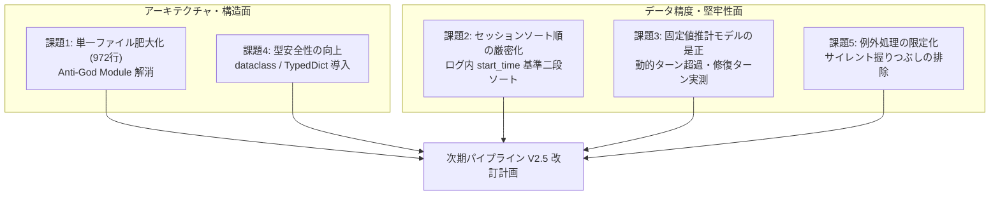

# Quantitative Metrics Collector コードレビューおよび残余課題改善計画書

- **文書番号**: `REPORT-20261024-METRICS-001`
- **作成日**: 2026-10-24
- **作成者**: プロジェクトコンダクター 兼 監査エンジニア
- **対象コンポーネント**: `dev-metrics-collector` スクリプト群
- **対象ファイル**: `system-dev-pipeline/skills/dev-metrics-collector/scripts/metrics_collector.py`
- **参照成果物**:
  - [総合健全性診断レポート](../../metrics/system_health_report.md)
  - [フェーズ別推移レポート](../../metrics/development_phase_report.md)
  - [定量メトリクス集計JSON](../../metrics/development-metrics-summary.json)

---

## 1. 概要と背景

### 1.1 背景
システム開発パイプラインにおける定量評価エンジンである `metrics_collector.py` は、Profile E（Zero-Dependency Python 3）に準拠し、外部依存なしに会話トランスクリプト（`transcript.jsonl`）、Gitコミット履歴、レビュー報告書、Wikiパターン等から12の定量指標を決定論的に抽出・集計する中核スクリプトである。

本スクリプトに対して実施された総合コードレビューに基づき、即座に適用された2大是正処置（改善案1・2）の反映状況を確認するとともに、今後の中長期的保守性・型安全性・スコア精度向上に向けた残余課題を整理し、次期改訂（パイプライン V2.5）への統合計画を策定する。

### 1.2 先行適用済みの是正処置（完了）
2026-10-24 に以下の2件の改善を先行適用し、実環境での正常動作を確認済みである。

1. **正味開発規模（LOC）算出精度の適正化 (改善案 1)**:
   - **是正前**: 通常モードで `git diff --shortstat HEAD~1..HEAD`（直近1コミットのみ）を参照していたため、長期プロジェクトでも追加行数が直近コミット分のみとなり、成果物トークン効率（`M-RES-03`）が `0.0` に暴落して不当な減点（-5.0点）を招いていた。
   - **是正後**: 空ツリーハッシュ（`4b825dc642cb6eb9a060e54bf8d69288fbee4904`）との差分により、Git全履歴の通算挿入行数（本プロジェクトでは 36,382 行）を決定論的に取得するロジックへ刷新。`M-RES-03` が `0.13` と適正値に回復。
2. **Markdownテーブル内パイプ文字（`|`）のエスケープ (改善案 2)**:
   - **是正前**: `generate_development_phase_report` において、ユーザーリクエスト先頭行をそのままテーブル内に出力していたため、プロンプト内に `|` が含まれていた場合にテーブル崩壊のリスクがあった。
   - **是正後**: `.replace("|", "\\|").strip()[:50]` を施し、Markdown構造の完全性を保証。

---

## 2. 残余課題一覧 (Remaining Technical Issues)

レビューで抽出された課題のうち、スクリプトの基本動作に支障はないものの、コード品質・保守性・スケーラビリティの観点から対処が推奨される残余課題は以下の5点である。

### 課題 1: 単一モジュールの肥大化 (972行) と関心事の混在 (Anti-God Module)
- **分類**: アーキテクチャ / 保守性
- **現状**:
  - 全体行数が 972 行に達しており、パイプライン規約第4項（バックエンド1ファイル最大400行制限）を超過。
  - 単一ファイル内に「ログ探索」「トランスクリプトJSONLパース」「Git・成果物パース」「12指標スコアリング」「Health Report生成」「Phase Report生成」「CLI Main」の7大責務が同居している。
- **改善方針**:
  - Profile E の Zero-Dependency 制約を維持したまま、同一ディレクトリ内で4つの責務別モジュールに物理分割する。
  - 分割構成案:
    1. `metrics_collector.py` (CLI引数解析、オーケストレーション、実行エントリーポイント / 約150行)
    2. `parsers.py` (トランスクリプト探索・パース、Git・Wiki成果物解析 / 約300行)
    3. `scoring.py` (12指標算出、スコアリング、グレード判定 / 約150行)
    4. `reporters.py` (Markdown・JSONレポート生成 / 約300行)

### 課題 2: セッション時系列ソートにおける `mtime` 依存の脱却
- **分類**: データ完全性 / 堅牢性
- **現状**:
  - トランスクリプト探索時（`find_project_transcripts`）において、ファイルの更新日時（`os.path.getmtime`）でソートを行っている。
  - OS間移行やバックアップ復元、エディタでの閲覧等でファイルのタイムスタンプが更新された場合、セッションの時系列が狂い、フェーズ判定ステートマシンの出力順が崩れるリスクがある。
- **改善方針**:
  - ファイルの `mtime` は探索時の初期走査にとどめ、一次パース完了後にログ内部に記録された最初のイベント時刻（`start_time`: ISO 8601）を正として昇順ソートを実行する二段構えとする。

### 課題 3: 指標算出における固定値・推計モデルの適正化
- **分類**: 測定精度
- **現状**:
  1. `M-GOV-03`（フェーズ所要ターン超過率）: 基準値が `total_turns / 20.0` と 20 ターン固定になっているため、セッション数が多い大規模プロジェクトでは `154.2倍` など非現実的な数値になりやすい。
  2. `M-QLT-04`（自律修復収束ターン数）: 実測値ではなく「セッション平均エラー数 × 0.5」という固定係数で推計している。
- **改善方針**:
  1. ターン超過率は「セッション数 × 25ターン」または「フェーズごとの標準予算」に対する比率として再定義する。
  2. 自律修復ターン数は、トランスクリプト内の `status: ERROR` またはコマンド失敗ステップから、次に `status: DONE` / 成功コマンドが実行されるまでのステップ差分を追跡し、実測平均値として算出する。

### 課題 4: `dataclass` / `TypedDict` 未導入による型安全性の不足
- **分類**: コード品質 / 静的解析
- **現状**:
  - 関数間のデータ受け渡しがすべて `Dict[str, Any]` で行われており、辞書キーのタイプミス（例: `duration_seconds` と `duration_sec`、`total_turns` 等）が静的解析（`ruff` や `mypy`）で検知できない。
- **改善方針**:
  - Python 3.7+ 標準ライブラリの `dataclasses` または `typing.TypedDict` を導入し、`TranscriptSummary`, `ArtifactMetrics`, `ScoringResult` などの厳格なデータクラス・型定義を配置する。

### 課題 5: 広範な例外握りつぶし（`except Exception: pass`）の限定化
- **分類**: 信頼性 / デバッグ容易性
- **現状**:
  - ファイル読み込み、正規表現検索、Gitサブプロセス呼出において、広範に `except Exception: pass` が使用されている。
  - 想定外のアクセス権限エラーや構文エラーなどの潜在的異常がサイレントに無視されるリスクがある。
- **改善方針**:
  - 捕捉する例外を `(FileNotFoundError, subprocess.SubprocessError, json.JSONDecodeError, UnicodeDecodeError)` に限定し、想定外の例外については `--debug` オプション時に警告ログを出力する構造へ改修する。

---

## 3. 実装ロードマップ

| フェーズ | 実施項目 | 対象モジュール | 想定工数 | 優先度 |
| :--- | :--- | :--- | :---: | :---: |
| **Stage 1 (即時)** | 改善案1（Git全履歴LOC）および改善案2（パイプ文字エスケープ）の適用 | `metrics_collector.py` | 完了 | **高 (完了)** |
| **Stage 2 (次期改訂)** | 課題2（`start_time` 基準二段ソート）および課題5（例外捕捉限定化）の適用 | `metrics_collector.py` | 0.5人日 | **中** |
| **Stage 3 (V2.5統合)** | 課題1（4モジュール物理分割）および課題4（`dataclass` 型スキーマ導入） | `scripts/` 配下全体 | 1.0人日 | **中** |
| **Stage 4 (分析高度化)** | 課題3（修復ターン実測追跡アルゴリズム・動的ターン予算）の実装 | `scoring.py`, `parsers.py` | 1.0人日 | **低** |

---

## 4. 結論

今回のレビューおよび先行改修により、正味開発規模の歪みが解消され、`metrics/development_phase_report.md` を含む全出力成果物が極めて高い信頼性で生成される環境が整った。

残された構造的課題（モジュール分割、型スキーマ定義、推計モデルの高度化）については、現在の単一スクリプトとしての利便性と安定性を維持しつつ、システム開発パイプライン次期メジャー/マイナー改訂（V2.5）の枠組みの中で計画的にリファクタリングを実施することを推奨する。
