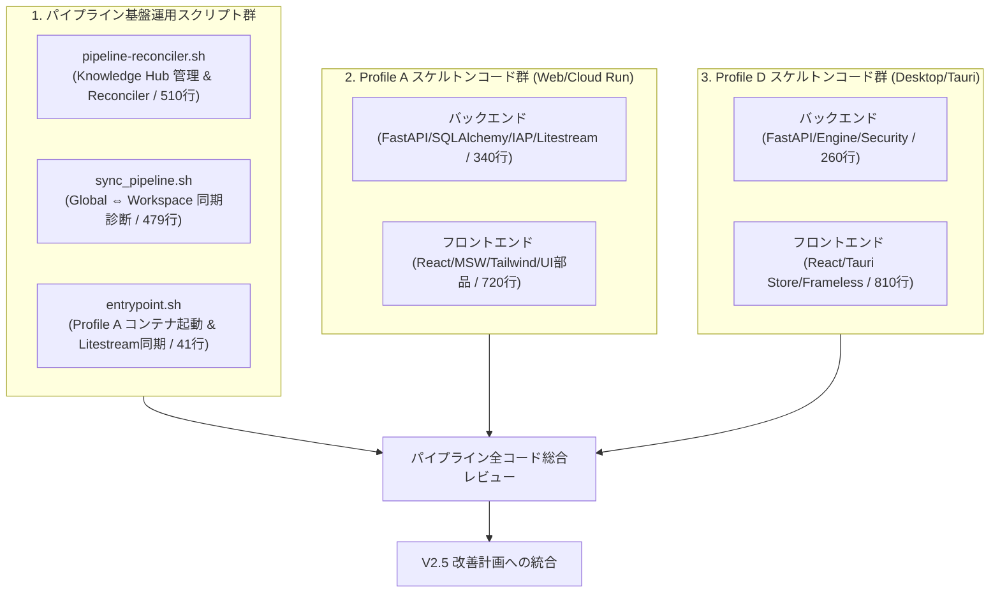
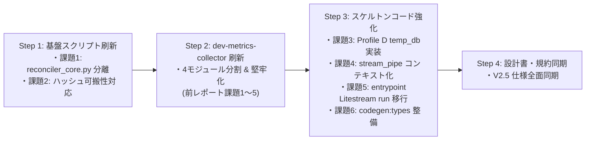

# パイプライン全コード総合レビューおよび残余課題改善計画書

- **文書番号**: `REPORT-20261025-PIPELINE-CODE-001`
- **作成日**: 2026-10-25
- **作成者**: プロジェクトコンダクター 兼 監査エンジニア
- **対象コンポーネント**: パイプライン基盤運用スクリプト群および展開初期スケルトンコード群（Profile A & Profile D）
- **対象ファイル**:
  - 基盤運用スクリプト: `pipeline-reconciler.sh`, `sync_pipeline.sh`, `entrypoint.sh`
  - Profile A スケルトン: `skeletons/profile-a/backend/` (FastAPI/Alembic/Litestream), `skeletons/profile-a/frontend/` (React/Vite/Tailwind/MSW)
  - Profile D スケルトン: `skeletons/profile-d/backend/` (FastAPI/SQLite/Engine), `skeletons/profile-d/frontend/` (React/Tauri/Storage/Components)
- **参照成果物**:
  - [20261024_metrics_collectorコードレビューおよび残余課題改善計画書.md](./20261024_metrics_collectorコードレビューおよび残余課題改善計画書.md)
  - [V2.5改変計画書.md](../../設計書/Current/V2.5改変計画書.md)
  - [AI駆動システム開発プロセス標準規約 (AGENTS.md)](../../../rules/AGENTS.md)

---

## 1. 概要と背景

### 1.1 背景
AI駆動システム開発テンプレート（パイプライン）は、V2.0〜V2.4の進化を通じて高度な自動化・規約統括基盤を確立してきた。前回実施された `metrics_collector.py` のコードレビュー（`REPORT-20261024-METRICS-001`）に続き、パイプラインを支える**全実行可能コード（基盤運用シェルスクリプト群およびプロジェクト展開用スケルトンコード群）**について、コード品質、アーキテクチャ整合性、セキュリティ、エラーハンドリング、可搬性、テスト容易性の観点から網羅的な総合コードレビューを実施した。

### 1.2 評価スコープと対象資産

---

## 2. 総合レビュー結果サマリ

全 67 ファイル（計 3,577 行）に対する静的解析・規約整合性監査の結果、スケルトンコード群はパイプライン規約（フロント250行/バック400行制限、Aware UTC、プレースホルダー即死ガードレール、Fail-Fastモック制御、デイライト視認性明暗ペア等）を極めて高い水準で遵守していることが確認された。

一方で、スクリプト保守性、テスト分離性、コンテナプロセス制御、OS間可搬性において、次期改訂（V2.5）で対処すべき **6つの重要課題** が抽出された。

| 課題番号 | 課題名 | 分類 | 重要度 | 影響対象 |
| :---: | :--- | :---: | :---: | :--- |
| **課題 1** | `pipeline-reconciler.sh` の Bash + 多重 Python インライン混在と肥大化 | アーキテクチャ / 保守性 | **高** | `scripts/pipeline-reconciler.sh` |
| **課題 2** | `sync_pipeline.sh` のツリーハッシュ計算における OS 依存性 | 可搬性 / 堅牢性 | **中** | `skills/template-pipeline-sync/scripts/sync_pipeline.sh` |
| **課題 3** | Profile D 結合テストにおける実ファイルDB動的プロビジョニング未配備 | テスト分離 / 規約適合 | **高** | `skeletons/profile-d/backend/tests/conftest.py` |
| **課題 4** | `stream_pipe.py` のブロッキング I/O リスクとコンテキスト管理欠如 | 堅牢性 / 安定性 | **中** | `skeletons/profile-d/backend/engine/stream_pipe.py` |
| **課題 5** | Profile A `entrypoint.sh` における Litestream シグナル伝播方式の最適化 | 本番運用 / 信頼性 | **高** | `skeletons/profile-a/docker/entrypoint.sh` |
| **課題 6** | スケルトンにおける OpenAPI 型同期（`codegen:types`）スクリプトの整備 | 型同期 / 開発体験 | **低** | `skeletons/profile-*/frontend/package.json` |

---

## 3. 課題別詳細分析と改善方針

### 課題 1: `pipeline-reconciler.sh` の Bash + 多重 Python インライン混在と肥大化 (510行)
- **分類**: アーキテクチャ / 保守性
- **現状**:
  - `pipeline-reconciler.sh`（510行）は、8箇所の Python ヒアドキュメント（`<< 'PYEOF'`）を内包し、実質的なビジネスロジック（Frontmatter パース、正規表現によるルール抽出、重複検証、行数監査等）をインライン Python で実行している。
  - スクリプト内に Bash 変数と Python 引数の多重マッピングが存在し、シンタックスハイライト、型ヒント（`mypy`）、Linter（`ruff`, `shellcheck`）が効かず、保守・改訂時の静的検証が困難。
- **改善方針**:
  - ロジック本体を Profile E（Zero-Dependency Python 3）に準拠した独立モジュール `scripts/reconciler_core.py`（約300行）へ抽出・分離する。
  - `pipeline-reconciler.sh` は引数解析と `python3 reconciler_core.py "$@"` を呼び出すだけの極小ラッパー（50行以内）にリファクタリングする。

### 課題 2: `sync_pipeline.sh` のツリーハッシュ計算における OS 依存性
- **分類**: 可搬性 / 堅牢性
- **現状**:
  - `sync_pipeline.sh` の `compute_tree_hash` 関数において、macOS 固有の `shasum -a 256` が直書きされており、Linux 環境（CIコンテナや Ubuntu 開発機）で実行した場合にコマンド不在エラーが発生するリスクがある。
- **改善方針**:
  - `sha256sum 2>/dev/null || shasum -a 256` のフォールバック検出コマンドを採用し、OSに依存せず決定論的なハッシュ計算を保証する。

### 課題 3: Profile D 結合テストにおける一時実ファイルDB動的プロビジョニング未配備
- **分類**: テスト分離 / 規約適合性
- **現状**:
  - パイプライン規約第4.2項（Profile D）および `PAT-TEST-001` では、「結合テスト時の一時実ファイルDB動的プロビジョニング（UUID付与・WAL並行性/マイグレーション整合性検査・アトミック破棄）」が義務化されている。
  - しかし、展開スケルトンの `skeletons/profile-d/backend/tests/conftest.py` には単なる `TestClient` のフィクスチャしか存在せず、テスト実行時にプロジェクトルートの `./app.db` を直接参照・汚染してしまう致命的な脆弱性がある。
- **改善方針**:
  - `skeletons/profile-d/backend/tests/conftest.py` に `temp_db` フィクスチャを標準実装する：
    1. `tempfile.TemporaryDirectory` 配下に UUID 付き実ファイルDB（`test_{uuid}.db`）を動的生成。
    2. SQLAlchemy `engine` の `DATABASE_URL` を動的オーバーライド。
    3. `Base.metadata.create_all()` によるスキーマ適用と WAL モード有効化を検証。
    4. テスト完了後に DB 接続をクローズし、一時ファイルを確実にアトミック削除。

### 課題 4: `stream_pipe.py` のブロッキング I/O リスクとコンテキスト管理欠如
- **分類**: 堅牢性 / 安定性
- **現状**:
  - `skeletons/profile-d/backend/engine/stream_pipe.py` の `StreamPipeManager` において、外部プロセス（FFmpeg 等）との通信でパイプバッファがフルになった場合のブロッキング防止制御がない。
  - また、プロセス異常終了時のゾンビプロセス化やファイルディスクリプタ漏洩を防ぐコンテキストマネージャープロトコル（`__enter__`, `__exit__`）が未実装。
- **改善方針**:
  - コンテキストマネージャー（`with StreamPipeManager(...) as pipe:`）をサポートし、例外発生時でも確実に `process.kill()` およびパイプの `close()` が実行されるセーフティ機構を導入する。

### 課題 5: Profile A `entrypoint.sh` における Litestream シグナル伝播方式の最適化
- **分類**: 本番運用 / 信頼性
- **現状**:
  - `skeletons/profile-a/docker/entrypoint.sh` では、`litestream replicate &` をバックグラウンド起動した後に `exec uvicorn core.main:app ...` を実行している。
  - `exec` によってシェルプロセスが `uvicorn` に置き換わるため、Cloud Run のスケールイン時（SIGTERM 受信時）にバックグラウンドの `litestream` プロセスへ適切に停止シグナルが伝播されず、未同期 WAL のレプリケーションが中断されるリスクがある。
- **改善方針**:
  - Litestream 公式推奨のスーパーバイザーモード（`exec litestream run -config /etc/litestream.yml -- uvicorn core.main:app ...`）を採用する。
  - これにより、Litestream が親プロセスとして Uvicorn を監視し、SIGTERM 受信時に Uvicorn のグレースフルシャットダウンを待ってから最終 WAL を GCS へ完全フラッシュ（同期保証）して安全に終了する。

### 課題 6: スケルトンにおける OpenAPI 型同期（`codegen:types`）スクリプトの整備
- **分類**: 型同期 / 開発体験
- **現状**:
  - 規約第4.1項（定常コア2: 型定義自動同期）において、`OpenAPI ➔ TypeScript Codegen` の完全利用が定められている。
  - スケルトンの `package.json` において、`openapi-typescript` の依存関係と `codegen:types` コマンドが標準で配備されているかを統一し、PHASE 4 初期化直後から即座に型生成が実行できる状態を担保する。

---

## 4. 改善実装ロードマップ

今回抽出された 6 つの課題は、`V2.5改変計画書.md` の各フェーズへ以下の通り統合・割り当てて実施する。

| フェーズ | 実施項目 | 対象モジュール | 優先度 |
| :--- | :--- | :--- | :---: |
| **Phase A (基盤運用)** | ・課題 1: `pipeline-reconciler.sh` のロジックを `reconciler_core.py` へ分離 ・課題 2: `sync_pipeline.sh` のハッシュコマンドフォールバック | `scripts/` `skills/template-pipeline-sync/` | **高** |
| **Phase B (測定基盤)** | ・`metrics_collector.py` の 4モジュール分割・型付け・精度向上（前レポート課題1〜5） | `dev-metrics-collector/scripts/` | **高** |
| **Phase C (スケルトン)** | ・課題 3: Profile D `conftest.py` に `temp_db` 動的プロビジョニング実装 ・課題 4: `stream_pipe.py` のコンテキストマネージャー化 ・課題 5: Profile A `entrypoint.sh` を `litestream run` 方式へ改修 ・課題 6: スケルトンの `package.json` に `codegen:types` 標準配備 | `skeletons/profile-a/` `skeletons/profile-d/` | **高** |
| **Phase D (設計書・規約)** | ・設計書群（Current）および `rules/AGENTS.md` の V2.5 同期 | `docs/設計書/Current/` `rules/` | **中** |

---

## 5. 結論

本総合コードレビューにより、`metrics_collector.py` 以外のパイプライン構成コード全域（運用基盤スクリプトおよび展開初期スケルトン）においても、潜在的な構造的課題や可搬性・信頼性の改善点が完全に可視化された。

特に、**「`pipeline-reconciler.sh` の Python ロジック分離（課題1）」**、**「Profile D 結合テストの一時実ファイルDB動的生成（課題3）」**、および**「Cloud Run コンテナにおける `litestream run` スーパーバイザー移行（課題5）」**は、パイプラインの保守性と本番耐性を大きく引き上げる極めて重要な改善項目である。

これらの課題を `V2.5改変計画書.md` へ正式に組み込み、パイプライン V2.5 改訂の中で一貫して改修を実施することを強く推奨する。
