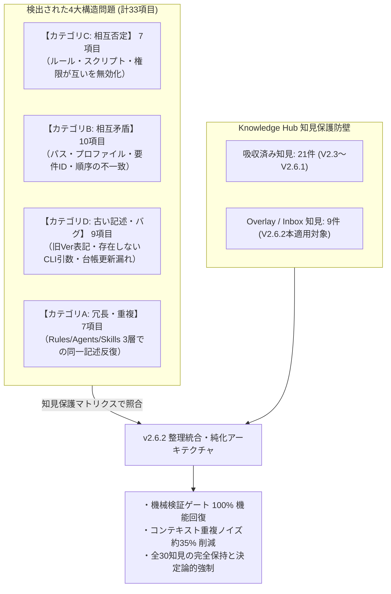

# v2.6.2 パイプライン文書・スクリプト構造監査および整理統合レポート

- **文書作成日**: 2026-11-05
- **対象システム**: `system-dev-pipeline` (v2.6.1 ➔ v2.6.2)
- **監査スコープ**: プラグイン全域（`rules/`, `agents/`, `skills/` 全19種, `scripts/`, `templates/`, `skeletons/`, `FEEDBACK_LEDGER.md`, `PIPELINE_MANIFEST.json`, `plugin.json`）、ワークスペース `rules/AGENTS.md`、`doc_samples/` 全10種、および Central Knowledge Hub（`~/.gemini/knowledge-hub/`）
- **関連ドキュメント**:
  - [v2.6.2検討課題: 新規プロジェクトにおけるルール文書の扱いと配置方針](./v2.6.2検討課題_ルール文書の扱い.md)
  - [system-dev-pipeline 次期バージョンに向けた改訂ライフサイクル終端および機械的強制力（Hard Gate）の根本改善提案書](../20261105_system-dev-pipeline次回改訂に向けたライフサイクル終端および機械的強制力の根本改善提案書.md)

---

## 1. エグゼクティブサマリー

V2.0 から V2.6.1 にわたる計21件の知見吸収と段階的機能拡張の結果、パイプラインを構成するルール・エージェント定義・スキル（19種）・スクリプト（5種＋メトリクス集計器）・テンプレート・スケルトンの間に、**「相互否定（ガードレールの自己破壊）」「相互矛盾（パス・引数・採番の食い違い）」「古い記述の取り残し」「3層間の多重重複（冗長）」** が蓄積していることが判明しました。

本監査では、プラグイン全ファイルを横断的にクロスチェックし、**計 33 項目の構造的問題** を特定しました。同時に、Central Knowledge Hub に蓄積された **全 30 件の知見（吸収済み 21 件 ＋ Overlay 稼働中 8 件 ＋ Inbox 未処理 1 件）** の所在を完全マッピングし、知見を1件たりとも喪失・弱体化させることなく問題を根絶するための解決策を策定しました。

---

## 2. 【カテゴリC】相互否定（Mutual Negation）の洗い出しと解決案

あるルールやスクリプトの実装が、別のルールやガードレールの効果を真っ向から打ち消し、機能不全や機械的エラーを引き起こしている **最優先修正対象（7項目）** です。

### C-1. 【重大】`INV-09`（本文への履歴ID混入禁止）と V2.6.1 追記箇所の自己否定（`--audit-budget` が FAIL する状態）
- **現状の衝突**:
  - **禁止側**: `rules/CORE_INVARIANTS.md` L20 (`INV-09`)、`rules/AGENTS.md` L105、`FEEDBACK_LEDGER.md` L4/L27 にて「推論コンテキストの純度を保つため、`SKILL.md` や `AGENTS.md` 本文（State）にはパターンID（`PAT-*`）を一切記載しない」と定め、`scripts/reconciler_core.py` L298-300 (`audit_budget` / New Gate 4) で `\bPAT-[A-Z]+-\d{3}\b` を検知すると **`[Lineage Impurity]` として機械的にエラー終了 (`sys.exit(1)`)** する仕様となっています。
  - **否定側**: V2.6.1 改訂時、以下の **7ファイル・計13箇所** の本文・見出しに `(PAT-SYS-xxx)` 等の識別子が直接書き込まれました：
    1. `agents/conductor.md` (L22: `PAT-SYS-008`, L44: `PAT-SYS-009`)
    2. `agents/qa-engineer.md` (L33: `PAT-SYS-010`)
    3. `skills/dev-phase1-setup/SKILL.md` (L49: `PAT-SYS-007`, L60: `PAT-ENV-001`, L62: `PAT-SYS-007`)
    4. `skills/dev-phase6-testing/SKILL.md` (L34, L35: `PAT-SYS-010`, L34, L40: `PAT-SYS-007`)
    5. `skills/dev-phase7-release/SKILL.md` (L11: `PAT-SYS-008`)
    6. `skills/dev-phase8-rules/SKILL.md` (L59: `PAT-SYS-008`)
    7. `skills/dev-doc-reviewer/SKILL.md` (L33: `PAT-DOC-003`, L34: `PAT-DOC-002`)
  - **悪影響**: 現在 `pipeline-reconciler.sh --audit-budget` を実行すると、**プラグイン自身が 12 件の `[Lineage Impurity]` エラーを出して FAIL** します。
- **解決案**:
  - 上記7ファイル13箇所から `(PAT-xxx-xxx)` の文字列のみを除去し（ルールの本文自体は1文字も削らず保持）、系譜情報はすべて `FEEDBACK_LEDGER.md` および `PIPELINE_MANIFEST.json` へ移管する。

### C-2. 【重大】`harness_guard.py` の `HG-004`/`HG-005`（`backend/app/` 固定検査）と `skeletons/` ディレクトリ構造の相互否定
- **現状の衝突**:
  - `scripts/harness_guard.py` L113 (`check_raw_sql` / `HG-004`) および L120 (`check_ast_fitness` / `HG-005`) は、`if not norm.startswith("backend/app/"): return []` として **`backend/app/` 配下のみを検査対象** にハードコードしています。
  - しかし、`skeletons/profile-a/backend/` および `skeletons/profile-d/backend/` の実際のディレクトリ構造は `backend/api/`, `backend/core/`, `backend/db/`, `backend/engine/` であり、**`backend/app/` ディレクトリは存在しません**。
  - **悪影響**: スケルトンから生成されたプロジェクトにおいて、**`HG-004`（生SQL DDL禁止）と `HG-005`（ルーターからのモデル直接import禁止・DTO未分離・`except: pass` 禁止）が 100% 素通り（無効化）** されています。
- **解決案**:
  - `harness_guard.py` のバックエンド検査対象プレフィックスを `backend/` 全域（ただし `backend/tests/`, `backend/alembic/`, `backend/migrations/`, `venv/` を除外）へ拡大し、ルーター判定も `routers/` と `api/` の双方を対象とする。また `HG-002`（直書きモック検査 L97）の対象にも `frontend/src/hooks/`, `frontend/src/services/` を追加する。

### C-3. 【重大】`ui-designer` / `qa-engineer` の `enable_mcp_tools: false` と「Chrome DevTools MCP 感覚センサー検証」の相互否定
- **現状の衝突**:
  - `agents/ui-designer.md` L29 および `agents/qa-engineer.md` L32、`rules/AGENTS.md` §4.1.3 では、**「Chrome DevTools MCP（`navigate_page`, `list_console_messages`, `evaluate_script`, `take_snapshot`）により実ブラウザのコンソールエラー0件・コントラスト比・A11yツリーを自動計測・検証する」** ことを必須責務として課しています。
  - しかし、両エージェント定義ファイルの YAML Frontmatter（`agents/ui-designer.md` L6, `agents/qa-engineer.md` L6）では **`enable_mcp_tools: false`** が設定されています。
  - **悪影響**: サブエージェント起動時に MCP ツールへのアクセス権が物理的に剥奪されるため、指示されたブラウザ感覚センサー検証が実行不能になっています。
- **解決案**:
  - `agents/ui-designer.md` および `agents/qa-engineer.md` の Frontmatter を `enable_mcp_tools: true` に修正する（`architect` と `backend-engineer` は `false` を維持）。

### C-4. 【重大】`metrics_collector.py` (`reporters.py`) と `state_manager.py` (`cmd_sync_metrics`) の JSON スキーマ相互否定
- **現状の衝突**:
  - `skills/dev-metrics-collector/scripts/reporters.py` L179-192 が生成する `development-metrics-summary.json` は、`summary.category_scores` のキーが **日本語**（`"リソース効率"`, `"品質・堅牢性"`, `"ナレッジ進化"`, `"ガバナンス"`）かつ値が辞書 `{"score": ..., "weighted_score": ...}` であり、トークン数等は `resources.total_tokens_consumed`, `resources.tool_calls_total`, `artifacts.git_net_loc_added` に格納されます。
  - 一方、`scripts/state_manager.py` の `cmd_sync_metrics` (L285-290) および `render_markdown` (L97-102) は、`summary.category_scores` のキーが **英語**（`resource`, `quality`, `evolution`, `governance`）かつ数値であり、`summary` 直下に `total_tokens`, `total_tool_calls`, `net_loc` が存在することを前提としています。
  - **悪影響**: `metrics_collector.py --all --sync-state` を実行しても、すべての数値がキー不一致で欠落（`null`）し、`PROJECT_STATE.md` のメトリクス表がすべて `- / 25.0 点`, `- tokens` と空欄になります。
- **解決案**:
  - `reporters.py` と `state_manager.py`（および `templates/project_state.schema.json`）の間でキー構造を完全統一し、双方のフォーマットを透過的に読み取れるよう `state_manager.py` の `cmd_sync_metrics` / `render_markdown` を改修する。

### C-5. 【重大】ワークスペース `rules/AGENTS.md` 重複排除規約と `dev-phase1-setup` L77 コピー指示の相互否定
- **現状の衝突**:
  - ワークスペースルート `rules/AGENTS.md` および [v2.6.2検討課題_ルール文書の扱い.md](./v2.6.2検討課題_ルール文書の扱い.md) では、プラグイン共通規約のワークスペースへのコピー（二重注入ノイズ）を厳禁としています。
  - しかし、`skills/dev-phase1-setup/SKILL.md` L77 では依然として `PLUGIN_DIR/rules/AGENTS.md および PLUGIN_DIR/templates/システム改訂ルール.md を ./rules/ へコピーします` と指示しており、`skills/dev-phase8-rules/SKILL.md` L58 でも再度 `rules/システム改訂ルール.md` への配置を指示しています。
- **解決案**:
  - [v2.6.2検討課題_ルール文書の扱い.md](./v2.6.2検討課題_ルール文書の扱い.md) の「役割分離モデル（案C）」に従い、`dev-phase1-setup` ではプロジェクト固有規約専用テンプレート（`templates/rules_AGENTS.md.template`）のみを `./rules/AGENTS.md` へ展開し、`システム改訂ルール.md` は `docs/システム改訂運用基準書.md` として `docs/` 配下へ移管する。

### C-6. コンダクターの「`docs/設計書/` 直接編集禁止（`PAT-SYS-009`）」と `dev-doc-reviewer` 役割定義の衝突
- **現状の衝突**:
  - `rules/AGENTS.md` L30 および `agents/conductor.md` L44-46 では、コンダクターによる `docs/設計書/` の直接編集を禁止し、設計変更は必ず `architect`（画面仕様書は `ui-designer`）へ委譲することを義務付けています。
  - 一方、`skills/dev-doc-reviewer/SKILL.md` L8-9 では副担当に `conductor`、主担当に `qa-engineer` を挙げ、「不整合が解消されるまでドキュメントの記載を自動補正」と記述しているため、コンダクターやQAが設計書を直接書き換えてしまう誘因となっています。
- **解決案**:
  - `dev-doc-reviewer/SKILL.md` の責務を明確化し、「🛡️ `qa-engineer` は不整合の検出と検査レポート出力（および軽微な誤植・リンク切れの補正）を担当し、要件・設計仕様に関わる修正は 📐 `architect` / 🎨 `ui-designer` へ委譲する（👑 `conductor` はオーケストレーション専任とし直接編集しない）」と明記する。

### C-7. `HG-009`（正本設計書タイトルの個別バージョン番号禁止）とテンプレート・既存設計書の自己否定
- **現状の衝突**:
  - `scripts/harness_guard.py` L204-213 (`HG-009`) は、タイトル行（1行目）に `(V2.6)` や `V1.x` が含まれるとコミットを機械遮断します。
  - しかし、`templates/基本設計レビュー結果報告書.md.template` (L1)、`コード品質レビュー及びリファクタリング提案書.md.template` (L1)、`システム総合レビュー結果報告書.md.template` (L1) の1行目に `(V2.6)` が残っており、また本ワークスペースの `docs/設計書/Current/*V2.6.md` のタイトル・ファイル名にも `V2.6` が含まれています。
- **解決案**:
  - テンプレートおよび `docs/設計書/Current/` 配下のタイトル・ファイル名から個別バージョン番号（`V2.6` 等）を排除し、`HG-009` と完全整合させる。

---

## 3. 【カテゴリB】相互矛盾（Contradiction）の洗い出しと解決案

ファイル間または同一ファイル内の別セクション間で、指定パス・項目数・採番・手順が食い違っている **10項目** です。

| ID | 矛盾のテーマ | 記述A（現行正本・新仕様） | 記述B（矛盾している旧仕様・別記述） | 解決案（統一基準） |
| :--- | :--- | :--- | :--- | :--- |
| **B-1** | **設計書の正本配置パス** | `docs/設計書/Current/*.md` (`rules/AGENTS.md` §10.1, `dev-phase1-setup` L75, `dev-doc-reviewer` L34) | `docs/*.md` 直下 (`architect.md`, `backend-engineer.md`, `ui-designer.md`, `dev-phase2/3/4/5`, `dev-review-arch/code/system`, `templates/画面仕様書.md`) | 全エージェント・全スキル・全テンプレートの設計書参照・出力パスを **`docs/設計書/Current/<文書名>.md`**（計画・レビュー系は `docs/plans/`、運用基準書は `docs/` 直下）へ完全統一する。 |
| **B-2** | **第2層プロファイルの範囲** | **Profile A〜E（5種類）** (`rules/AGENTS.md` §4.2, `dev-phase2-requirements` L31) | **Profile A〜D（4種類）** (`dev-phase2-requirements` L3 Frontmatter, `architect.md` L26-30, `dev-review-arch` L17/45-58, `dev-review-system` L49-66, `wiki-maintainer` L18/48) | 全ファイルで **Profile A〜E** に統一し、`architect.md`, `dev-review-arch`, `dev-review-system`, `templates/` に **Profile E（Zero-Dependency Python CLI / Skill型）** の設計・監査基準を追加する。 |
| **B-3** | **第1層「定常的コア設計規範」の項目数** | **全9項目**（項目9: CI・静的解析・テスト実行ディレクトリ非依存を含む） (`rules/AGENTS.md` §4.1) | **「定常コア8項目」**（かつ旧リスト内容） (`architect.md`, `qa-engineer.md`, `dev-phase2/3/4`, `dev-review-arch`, `dev-doc-reviewer`, `templates/要件定義書.md`, `技術要件定義書.md`) | `rules/AGENTS.md` §4.1 の9項目を正とし、名称を **「第1層：定常的コア設計規範（9項目）」**（または項目番号に依存しない「定常的コア設計規範」）へ全ファイル統一する。 |
| **B-4** | **`PROJECT_STATE.md` の更新方法** | `state_manager.py` による `project_state.json` 更新と `PROJECT_STATE.md` 自動生成（手動改ざんはハッシュ遮断） (`rules/AGENTS.md` §3) | 「`PROJECT_STATE.md` のテーブルやブランチ情報を直接編集・記録せよ」 (`dev-metrics-collector` L64-66, `dev-git-init` L73-74, `dev-git-release` L105-106) | 手動編集指示を全廃し、`state_manager.py` のサブコマンド（`--sync-state` / `sync-metrics` 等、およびブランチ・コミット同期オプション）経由での更新手順に統一する。 |
| **B-5** | **テンプレート間の非機能要件ID (`[REQ-NFxx]`) 採番衝突** | `templates/技術要件定義書.md` & `テーブルスキーマ定義書.md`: 定常コア規範に **`[REQ-NF01]`〜`[REQ-NF08]`** を採番 | `templates/要件定義書.md`, `ビジネスロジック仕様書.md`, `シナリオテスト計画書.md`: プロファイル固有要件（認証・永続化・モック・監視）に **`[REQ-NF01]`〜`[REQ-NF04]`** を重複採番 | `要件定義書.md` §1.3 の定常コア規範に **`[REQ-NF01]`〜`[REQ-NF09]`** を割り当て、§3 のプロファイル別非機能要件（認証、永続化、監視、性能等）に **`[REQ-NF10]`〜** を割り当てるよう全テンプレートを統一する。 |
| **B-6** | **`skeletons/profile-a` と `templates/` のインフラ・Docker仕様矛盾** | `skeletons/profile-a/docker/`: ・DB: `/data/app.db` ・変数: `LITESTREAM_BUCKET` ・起動: `alembic upgrade head` ➔ `exec litestream replicate -config /etc/litestream.yml -exec "uvicorn core.main:app --host 0.0.0.0 --port ${PORT:-8080}"` | `templates/本番適用作業手順書.md` & `技術要件定義書.md`: ・DB: `/app/data/app.db` ・変数: `GCS_LITESTREAM_BACKUP_BUCKET` ・起動: **`sqlite3 ... < schema.sql`（禁止されている生SQL実行！）**、`-config` 欠落、`app.main:app` (port 8000) | `templates/本番適用作業手順書.md` および `技術要件定義書.md` の記載を `skeletons/profile-a/docker/` の実装（Alembic 適用＋正規 Litestream 構文＋生SQL完全排除）へ完全一致させる。 |
| **B-7** | **内部監視エンドポイントとコードパスの表記揺れ** | ・`/api/internal/health`, `/api/internal/litestream` ・`frontend/src/`, `backend/` (`skeletons/profile-a/backend/api/internal/`) | ・`/internal/health`, `/api/internal/litestream/status` が同一ファイル（`dev-review-system` L43 vs L53）内で混在 ・`dev-review-code` L26-29 が単一 `src/` 前提 | エンドポイントはスケルトン実体に合わせて `/api/internal/health` および `/api/internal/litestream` に統一。コードパスは `frontend/src/` および `backend/` に統一する。 |
| **B-8** | **PHASE 8 と改訂終端の実行順序** | `dev-phase8-rules/SKILL.md` & `PAT-SYS-013`: ①成果物検証 ➔ ②メトリクス集計 ➔ ③知見昇格・監査・Overlay更新 ➔ ④`dev-git-release` & 台帳クローズ | `templates/システム改訂ルール.md` L34-38: 知見昇格 ➔ Overlay更新 ➔ **その後にメトリクス集計** ➔ Gitリリース | [根本改善提案書](../20261105_system-dev-pipeline次回改訂に向けたライフサイクル終端および機械的強制力の根本改善提案書.md) の **`REV-1`〜`REV-5` 標準パイプライン** に統合し、「①本番成果物ビルド検証 (`REV-4`) ➔ ②メトリクス集計 (`REV-5.1`) ➔ ③知見昇格・監査 (`REV-5.2`) ➔ ④Invariants検証付き `complete-revision` & `dev-git-release` (`REV-5.3`)」に完全統一する。 |
| **B-9** | **`dev-phase1-setup` のスクリプト展開漏れと CI 設定の乖離** | `dev-phase1-setup` L69 で `python3 scripts/state_manager.py init` を実行、`rules/AGENTS.md` §4.1.1 で pre-commit / CI での `harness_guard.py` 実行を規定 | ・`dev-phase1-setup` L56 に `scripts/` と `.githooks/` のコピーおよび `git config core.hooksPath .githooks` が未記載 ・`skeletons/common/.github/workflows/ci.yml` の対象ブランチが `feature/*`（実際は `feature`, `revision/**`）で `harness_guard.py` 未実行 | ・`dev-phase1-setup` §4.1 に `scripts/` と `.githooks/` の展開および `core.hooksPath` 設定を明記 ・`ci.yml` の対象ブランチに `feature`, `revision/**` を追加し、`harness_guard.py --all` と `traceability_checker.py` を組み込む。 |
| **B-10** | **構造化ログのタイムゾーン指定** | `rules/AGENTS.md` §4.1.6 & `システム総合レビュー結果報告書.md.template` L22: **Aware UTC 保存** / JST 表示 | `templates/要件定義書.md` L34 & `技術要件定義書.md` L29, L93: 「**JSTタイムスタンプ**を自動バインドした構造化JSONログ」 | バックエンド出力ログ・DB保存はすべて **Aware UTC (ISO 8601)**、UI表示のみ JST へ統一する。 |

---

## 4. 【カテゴリD】古い記述・取り残し・実装バグ（Stale / Legacy Remnants）の洗い出しと解決案

バージョンアップの過程で更新から取り残された記述およびスクリプトの潜在バグ **9項目** です。

### D-1. 各ファイルに散在する旧バージョン番号（V2.2 〜 V2.6.0）の取り残し
- **問題箇所**:
  - `plugin.json` L3-4: `"version": "2.3.0"`, `"description": "...V2.3..."` のまま放置されている。
  - `scripts/state_manager.py` L133, L141: `"schema_version": "2.6.0"`, `"Immutable Core v2.6.0"` のまま。
  - `rules/CORE_INVARIANTS.md` L1: `(Core Invariants Catalog V2.3)` のまま。かつ `INV-01` が旧仕様（`PROJECT_STATE.md` 直接編集前提）の文面。
  - `skills/*/SKILL.md` 全19種のタイトル行に `V2.2`（4件）、`V2.3`（4件）、`V2.4`（3件）、`V2.5`（4件）がバラバラに残存。
  - `skills/dev-git-init/SKILL.md` L64: コミットメッセージが `"feat: initial project setup (V2.2 pipeline)"` のまま。
- **解決案**:
  - `SKILL.md` や `agents/*.md`、`CORE_INVARIANTS.md` の見出しから個別の古いバージョン番号（`V2.2` 等）を排除して陳腐化を防ぎ、バージョン番号は `plugin.json`、`PIPELINE_MANIFEST.json`、`rules/AGENTS.md`、`state_manager.py` で **`2.6.2`** に一元管理する。

### D-2. `dev-metrics-collector/SKILL.md` の存在しない引数 `--single-session` とリンク切れ
- **問題箇所**:
  - `skills/dev-metrics-collector/SKILL.md` L38 に `metrics_collector.py ... --single-session` と記載されているが、`metrics_collector.py` の `argparse` には `--single-session` 引数は存在せず、実行すると即座にクラッシュする。
  - 同 L28 および `dev-phase8-rules/SKILL.md` L28 の標準実行コマンドに `--all --sync-state` が抜けており、L10 の設計書リンク（`定量測定・フィードバック設計書V2.5.md`）がリンク切れを起こしている。
- **解決案**:
  - L38 の `--single-session` を削除（単一セッションは引数なしデフォルト動作である旨を記載）し、標準実行コマンドを `--all --sync-state` に統一、設計書リンクを最新パスに修正する。

### D-3. `state_manager.py` の `cmd_complete_revision` バグ（`version` vs `app_version`）および Invariants Guard 未実装
- **問題箇所**:
  - `scripts/state_manager.py` L336, L346 で `state["project_metadata"]["version"] = args.version` と誤ったキー名に書き込んでおり、正規キー `"app_version"` が更新されない。また `revisions.history` への追加辞書に `version`, `turn`, `author` が欠落している。
  - さらに、`PAT-SYS-013` および [根本改善提案書](../20261105_system-dev-pipeline次回改訂に向けたライフサイクル終端および機械的強制力の根本改善提案書.md) で求められているクローズ前機械検証（本番成果物実在、メトリクス算出済み、`TEMPLATE_PROMOTIONS.md` 未処理原票ゼロ）が未実装である。
- **解決案**:
  - `"app_version"` キー修正と履歴フィールド補完を行うとともに、`validate_revision_closure_invariants()` による Hard Gate 遮断ロジックと `start-revision` 時の計画スケルトン自動生成を実装する。

### D-4. `FEEDBACK_LEDGER.md` の更新停止（V2.5.0・V2.6.1 の計13パターン未記載）
- **問題箇所**:
  - `FEEDBACK_LEDGER.md` が V2.4.0（計8件）で止まっており、`PIPELINE_MANIFEST.json` に登録済みの V2.5.0（5件）および V2.6.1（8件）が未記載。また既記載分の反映先セクション番号も古くなっている。
- **解決案**:
  - V2.5.0（5件）、V2.6.1（8件）、および今回 V2.6.2 で本適用する 9 件の **全 30 件** を `FEEDBACK_LEDGER.md` と `PIPELINE_MANIFEST.json` に完全同期して記録する。

### D-5. `traceability_checker.py` のサブ要件ID・多言語テスト・トートロジーテスト検出漏れ
- **問題箇所**:
  - `scripts/traceability_checker.py` L12 の正規表現 `r"\[(REQ-(?:F|NF)\d+)\]"` がハイフン付きサブ要件ID（`[REQ-F01-01]` 等：`PAT-TEST-002`）を認識できない。
  - L101 のテスト検出正規表現 `r"^\s*(def test_|it\(|test\()"` が Python の `async def test_` や Rust の `fn test_` / `async fn test_`（`PAT-QA-003`）を認識できない。
  - `PAT-TEST-003`（自己完結型トートロジー・アリバイテストのAST/静的遮断）が未実装。
- **解決案**:
  - `traceability_checker.py` の正規表現を拡張し、サブ要件ID、非同期テスト、Rust テスト関数、およびトートロジー・実コード未呼出テストの機械的検出ロジックを実装する。

### D-6. `reconciler_core.py` の `inbox/` 滞留問題（`active_claims/` との重複排除欠落）
- **問題箇所**:
  - `~/.gemini/knowledge-hub/inbox/` に残存している 6 件のうち 5 件（`gps-overlay` 由来）は、既に `active_claims/` に同一 `claim_id` で存在し `LOCAL_FEEDBACK_RULES.md` にも反映済みであるにもかかわらず、`reconciler_core.py` が `inbox/` と `active_claims/` の重複チェックを行わないため `inbox/` に残留し続けている。
  - 残り 1 件（`CLAIM-20261105-system-dev-pipeline-PAT-METRICS-001.md`）は、`parsers.py` への実装反映後にマニフェスト登録・退役処理が未実行のため残存している。
- **解決案**:
  - `reconciler_core.py` に `inbox/` ⇔ `active_claims/` / `archive/upstreamed/` の重複自動解消ロジックを追加し、V2.6.2 マニフェストへ全 9 知見を登録した上で `--upgrade` を実行し、`inbox/` および `active_claims/` をクリーンに退役・整理する。

### D-7. 旧ディレクトリ・不要キャッシュ・重複テンプレートの残骸
- **問題箇所**:
  - `dev-phase1-setup/SKILL.md` L33, L35 に廃止済みの `./docs/plans/metrics/`, `./metrics/turns/`, `./metrics/phases/` が残存。
  - `skeletons/profile-d/backend/` および `skills/dev-metrics-collector/scripts/` に `.pyc`（旧 `types.cpython-314.pyc` 等）が混入。
  - `templates/グランドデザイン/03_画面仕様書テンプレート.md` (V2.0) が `templates/画面仕様書.md` の古い重複版として残存。
  - `skeletons/profile-a/backend/tests/conftest.py` がインメモリDB（`sqlite:///:memory:`）のまま（`profile-d` は一時実ファイルDB + WAL 適用済み）。
- **解決案**:
  - 旧ディレクトリ指定の削除、`.pyc` 残骸の削除と `.gitignore` 保護、`03_画面仕様書テンプレート.md` の統合・リダイレクト化、`profile-a` テストDB設定の統一を行う。

---

## 5. 【カテゴリA】冗長（Redundancy）の洗い出しと SSOT 整理案

コンテキストウィンドウの浪費と保守時の修正漏れ（片方だけ直して矛盾が生じる原因）を引き起こしている **7項目の重複構造** と、その整理方針です。

| ID | 重複している内容 | 現在の重複箇所（ファイル数・行数規模） | SSOT（Single Source of Truth）整理・圧縮案 |
| :--- | :--- | :--- | :--- |
| **A-1** | **標準完了サマリ（出力フォーマット）** | `agents/*.md` (4ファイル) ＋ `skills/*/SKILL.md` (8ファイル) ＝ **計12ファイル・約250行** にわたりほぼ同一のMarkdownテンプレートを重複記載 | 基本構造は `agents/*.md` 側（または共通規約）に定義し、各 `SKILL.md` ではテンプレート全文の再掲を廃止して「当該フェーズ固有の必須記載項目（2〜3行）」のみを指示する。 |
| **A-2** | **委譲時の標準指示フォーマット（入力形式）** | `agents/conductor.md` ＋ 4サブエージェント定義 ＝ **計5ファイル・約45行** で同一箇条書きを反復 | `agents/conductor.md`（送り手）に正本定義を置き、各サブエージェント側は「コンダクターからの委譲パラメータに従う」と1行化して専門責務記述に集中させる。 |
| **A-3** | **第1層定常コア規範 & 第2層 Profile A〜E 定義リスト** | `rules/AGENTS.md`（常時注入）に加え、`architect.md`, `dev-phase2-requirements`, `dev-review-arch`, `dev-review-system` の **計5ファイル** でフルリストを再掲（かつ項目数8 vs 9やProfile E有無の矛盾を誘発） | 常時ロードされる `rules/AGENTS.md` §4 を唯一の正本とし、スキル・エージェント側ではリストの再定義を行わず「フェーズ固有の判定・適用アクション（Fit-Gap 5大診断や監査コマンド）」のみを記述する。 |
| **A-4** | **4大基本設計書の記載項目リスト** | `rules/AGENTS.md` L32、`agents/architect.md` L35-38、`skills/dev-phase3-design/SKILL.md` L21-24 で同一説明文を3重記載 | `skills/dev-phase3-design/SKILL.md`（実行手順）に詳細を集約し、`architect.md` と `AGENTS.md` は簡潔な責務定義にとどめる。 |
| **A-5** | **3大レビューゲート合否条件 & Semantic Auditor 4関門** | ・`rules/AGENTS.md` 内で2回重複（L44-48 と L90-95） ・Semantic Auditor 4関門が `qa-engineer.md`, `dev-phase8-rules`, `wiki-proposer` の3ファイルに同文重複 | ・`rules/AGENTS.md` L44-48 は §5 への参照に統合 ・Semantic Auditor 4関門の詳細は `qa-engineer.md`（および `reconciler_core.py`）を正本とし、スキル側は呼び出し手順に簡潔化する。 |
| **A-6** | **全ファイル共通の一般原則（相対パス強制・Docker再構成・禁止事項）** | ・相対パス強制（`INV-10`）が7ファイルに同文重複 ・Docker再構成コマンドが5ファイルに重複 ・`architect.md`, `ui-designer.md`, `qa-engineer.md` の同一ファイル内で禁止事項が2回ずつ重複 | `<user_rules>` で常時注入される `rules/AGENTS.md` に一元化し、各エージェントファイル内の自己重複セクション（末尾の「重要ルール」での再掲）を統合・整理する。 |
| **A-7** | **`scripts/` と `skeletons/common/scripts/` の物理重複** | `state_manager.py`, `harness_guard.py`, `traceability_checker.py` の3ファイル（計約900行）が2ディレクトリに物理重複 | `sync_pipeline.sh`（および改修スクリプト）にて `scripts/` を唯一の編集正本とし、`skeletons/common/scripts/` へ機械的にミラーコピーする仕組みを組み込み、手動二重編集を排除する。 |

---

## 6. Knowledge Hub 蓄積知見（全30件）の完全保護マトリクス

パイプライン文書の整理・圧縮にあたり、過去に獲得された知見（21件）および今回本適用する知見（9件）が絶対に失われないよう、以下の保護マトリクスに基づき **「自然言語ルール（Immutable Core）」と「機械的検査（Executable Hard Gate）」の双方** へ確実に定着させます。

### 6.1 今回（v2.6.2）で新たに本流統合する 9 件の知見（Overlay 8件 ＋ Inbox 1件）

| Pattern ID | Claim ID | 知見の核心（絶対に保護・実装すべき内容） | v2.6.2 での本流統合先（Core 文書 & スクリプト実装） |
| :--- | :--- | :--- | :--- |
| **`PAT-CODE-002`** | `CLAIM-20261104-gps-overlay-PAT-CODE-002` | **機能等価性マトリクス監査**: 行数制限分割・リファクタリング時の分割前後1対1対応確認必須化。ロジックのプレースホルダー縮退・未接続コンポーネント・固定リテラル直書きは `dev-review-code` で必ず `BLOCKED` 判定とする。 | ・`rules/AGENTS.md` (§5.2) ・`skills/dev-review-code/SKILL.md` (§2.1) ・`templates/コード品質レビュー及びリファクタリング提案書.md.template` |
| **`PAT-SYS-012`** | `CLAIM-20261104-gps-overlay-PAT-SYS-012` | **5大適合性診断（Fit-Gap Assessment）と2択提案プロトコル**: 要件定義時に標準プロファイル（A〜E）との5大適合性診断を必須化し、1項目でも乖離があれば「選択肢A：標準プロファイルへの完全収斂」または「選択肢B：専用プロファイル新規定義と静的解析・完了基準の先行拡張」の2択をユーザーに提示する。 | ・`rules/AGENTS.md` (§4.2) ・`skills/dev-phase2-requirements/SKILL.md` (§2) ・`templates/要件定義書.md` (§1.3) |
| **`PAT-SYS-013`** | `CLAIM-20261104-gps-overlay-PAT-SYS-013` | **改訂終端の成果物ビルド・メトリクス・知見昇格完了検証と Invariants Hard Gate**: ①本番成果物ビルド・物理検証、②`metrics_collector.py` 集計、③知見昇格・Overlay更新のすべてが完了した後にのみ `complete-revision` と `dev-git-release` を実行。`state_manager.py complete-revision` で未達時は機械的に ABORT する。 | ・`rules/AGENTS.md` (§10.2 `REV-1〜5`) ・`scripts/state_manager.py` (`validate_revision_closure_invariants`) ・`skills/dev-phase8-rules/SKILL.md` ・`templates/システム改訂運用基準書.md` |
| **`PAT-SYS-014`** | `CLAIM-20261105-system-dev-dashboard-PAT-SYS-014` | **Profile D 本番モック排除二重防御規範**: 第1防壁（`isMockMode()` は本番時無条件 `false`、IPC失敗時は即例外伝播 Fail-Fast）、第2防壁（MSW 動的インポートはモックモードかつ `!('__TAURI_INTERNALS__' in window)` のみ）。 | ・`rules/AGENTS.md` (§4.2 Profile D) ・`skills/dev-review-system/SKILL.md` (§2 Profile D) ・`skeletons/profile-d/frontend/` |
| **`PAT-TEST-002`** | `CLAIM-20261104-gps-overlay-PAT-TEST-002` | **サブ要件ID細分化と1対1テストバインド**: 大括り採番を禁じ、受入基準単位でサブ要件ID（`REQ-F01-01` 等）へ細分化し、独立した結合・E2Eテストケースを1対1以上でバインドする。 | ・`rules/AGENTS.md` (§4.1.2) ・`skills/dev-phase2-requirements/SKILL.md` ・`scripts/traceability_checker.py` (`REQ_PATTERN` 拡張) |
| **`PAT-TEST-003`** | `CLAIM-20261104-gps-overlay-PAT-TEST-003` | **自己完結型トートロジー・テスト（アリバイテスト）のAST機械遮断**: テスト関数内でローカル変数・関数のみを定義して自己アサートするテストを厳禁とし、実アプリモジュール・HTTP/RPCクライアント・実DOM操作の直接呼出を必須化。 | ・`rules/AGENTS.md` (§4.1.2) ・`skills/dev-phase6-testing/SKILL.md` (§2.5) ・`scripts/traceability_checker.py` (トートロジー・未呼出テスト検査実装) |
| **`PAT-TEST-004`** | `CLAIM-20261104-gps-overlay-PAT-TEST-004` | **モックOFF・実データ一気通貫E2Eユーザージャーニー検証の必須化**: 単なる画面遷移確認のみの合格を禁じ、`VITE_ENABLE_MOCK=false` 環境下で実データ投入から状態加工・動的描画・最終成果物取得までを一気通貫で完走するE2Eテスト合格を必須化。 | ・`rules/AGENTS.md` (§5.3) ・`skills/dev-phase6-testing/SKILL.md` (§1, §3) ・`templates/シナリオテスト計画書.md` |
| **`PAT-QA-003`** | `CLAIM-20261105-system-dev-dashboard-PAT-QA-003` | **RTM検証スクリプトの多言語テスト検出と一時ディレクトリ分離**: `traceability_checker.py` で Python (`def test_`, `async def test_`) / TS (`it(`, `test(`) / Rust (`fn test_`, `async fn test_`) を網羅検出し、並行テスト時は `temp_dir` + UUID で分離する。 | ・`rules/AGENTS.md` (§4.1.2) ・`scripts/traceability_checker.py` (テスト検出正規表現拡張) ・`skills/dev-phase6-testing/SKILL.md` |
| **`PAT-METRICS-001`** | `CLAIM-20261105-system-dev-pipeline-PAT-METRICS-001` | **Antigravity transcript ログのトークン抽出二重探索**: `step` 直下キー（`input_tokens`, `cache_read_tokens`, `output_tokens`）を最優先探索し、`usage` / `token_usage` 辞書へフォールバックする。 | ・`skills/dev-metrics-collector/scripts/parsers.py` (実装反映済) ・`PIPELINE_MANIFEST.json` & `FEEDBACK_LEDGER.md` |

### 6.2 既存吸収済み 21 件（V2.3.0〜V2.6.1）の保全確認
- `PAT-SYS-001`〜`011`、`PAT-DOC-001`〜`003`、`PAT-ENV-001`、`PAT-MOCK-001`、`PAT-UI-001`、`PAT-REV-001`、`PAT-CODE-001`、`PAT-TEST-001`、`PAT-002` の全21件について、`rules/AGENTS.md`、各スキル、および `harness_guard.py` / `state_manager.py` / `reconciler_core.py` 内の実装ロジックを100%維持したまま、重複文面の整理と `(PAT-xxx)` ラベル文字列の台帳移管のみを実施します。
- なお、`rules/AGENTS.md` §4.2 Profile D から記述が薄れていた `PAT-TEST-001`（SQLite WAL 結合テスト時の一時実ファイルDBプロビジョニング）については、`rules/AGENTS.md` 側にも明示的に復元・補強します。
