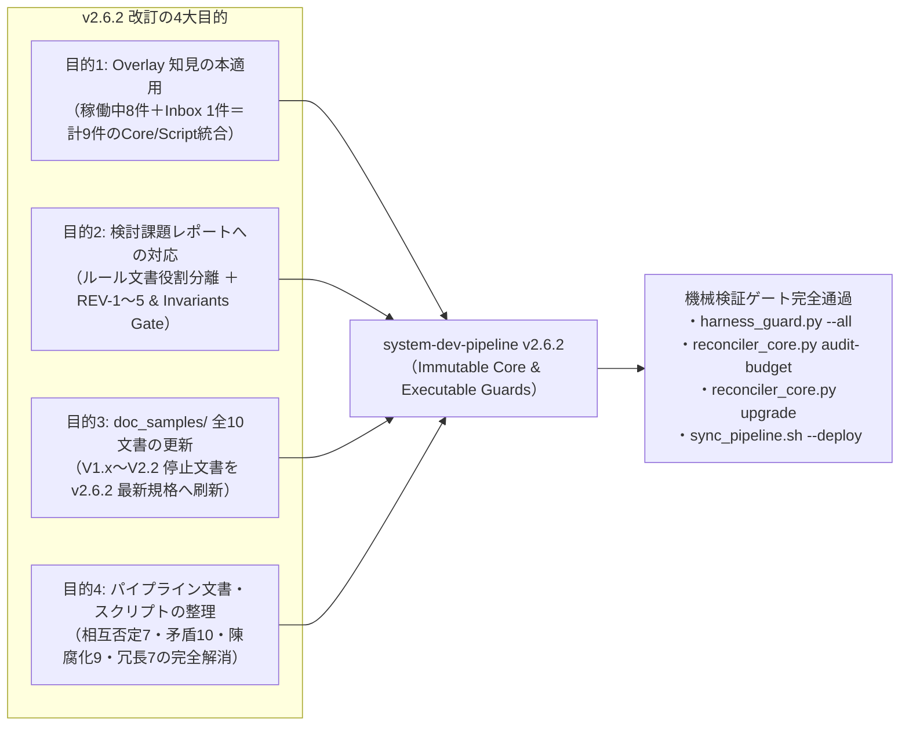

# system-dev-pipeline v2.6.2 改訂基本計画書

- **文書作成日**: 2026-11-05
- **対象バージョン**: `v2.6.1` ➔ `v2.6.2`
- **ステータス**: 計画策定完了 / 承認待ち
- **関連ドキュメント**:
  - [v2.6.2 パイプライン文書・スクリプト構造監査および整理統合レポート](./20261105_v2.6.2パイプライン文書・スクリプト構造監査および整理統合レポート.md)
  - [v2.6.2 検討課題: 新規プロジェクトにおけるルール文書の扱いと配置方針](./v2.6.2検討課題_ルール文書の扱い.md)
  - [system-dev-pipeline 次期バージョンに向けた改訂ライフサイクル終端および機械的強制力（Hard Gate）の根本改善提案書](../20261105_system-dev-pipeline次回改訂に向けたライフサイクル終端および機械的強制力の根本改善提案書.md)

---

## 1. 改訂の4大目的と全体アーキテクチャ

本改訂（`v2.6.2`）は、以下の4つの目的を一貫した設計思想のもとで同時達成し、パイプラインの決定論的強制力とコンテキスト純度を抜本的に引き上げることを目的とします。

### 1.1 目的1：Overlay の本適用（Central Knowledge Hub 知見の昇格・退役）
- 現在 `~/.gemini/knowledge-hub/overlay/LOCAL_FEEDBACK_RULES.md`（および `active_claims/`）に蓄積されている **8件の知見** と、`inbox/` に残存している **1件の新規知見（`PAT-METRICS-001`）** の **計9件** を、パイプライン正本（`rules/AGENTS.md`、各 `SKILL.md`、および `state_manager.py` / `traceability_checker.py` 等の機械検査スクリプト）へ完全統合（Upstream）します。
- 統合後、`PIPELINE_MANIFEST.json` および `FEEDBACK_LEDGER.md` に `2.6.2` 吸収パターンとして登録し、`pipeline-reconciler.sh --upgrade` を実行することで、`active_claims/` と `inbox/` の該当原票を `archive/upstreamed/` へ自動退役させ、`LOCAL_FEEDBACK_RULES.md` を 0 件（クリーン状態）へリセットします。

### 1.2 目的2：検討課題レポートへの対応
1. **[v2.6.2検討課題_ルール文書の扱い.md](./v2.6.2検討課題_ルール文書の扱い.md) への対応（役割分離モデル・案Cの実装）**:
   - **共通規約の二重注入根絶**: `dev-phase1-setup` で `PLUGIN_DIR/rules/AGENTS.md` をワークスペースへコピーする処理を廃止し、新設する **`templates/rules_AGENTS.md.template`（プロジェクト固有規約専用テンプレート）** を展開する方式へ変更します。
   - **改訂ルールのオンデマンド化**: `templates/システム改訂ルール.md` を **`templates/システム改訂運用基準書.md`** へ改称し、配置先を `rules/` から **`docs/システム改訂運用基準書.md`** へ移管することで、PHASE 1〜7 における `<user_rules>` 常時注入ノイズ（約140行）を排除します。
   - **Git運用基準書の純化**: `templates/Git運用基準書.md` からパイプライン内部スクリプト固有の冗長記述を削ぎ落とし、人間・外部ツール兼用の標準Git運用基準書へスリム化します。
2. **[改訂ライフサイクル終端および機械的強制力の根本改善提案書](../20261105_system-dev-pipeline次回改訂に向けたライフサイクル終端および機械的強制力の根本改善提案書.md) への対応**:
   - **標準改訂フェーズ（`REV-1`〜`REV-5`）の規格化**: 自由裁量ステージ制による終端処理（成果物ビルド・メトリクス集計・知見昇格）の脱落を防ぐため、Rule 10 および `docs/システム改訂運用基準書.md` に `REV-1`（要件・設計）〜 `REV-5`（メトリクス・知見昇格・クローズ）の5段階標準パイプラインを公式制定します。
   - **`state_manager.py` クローズ前 Invariants Hard Gate の実装**: `complete-revision` 実行時に「①本番成果物の物理実在」「②`metrics/development-metrics-summary.json` の実在・スコア算出済み」「③`TEMPLATE_PROMOTIONS.md` の未処理原票ゼロ」を機械検査し、未達時は Exit Code 1 で即座に遮断する `validate_revision_closure_invariants()` を標準実装します。
   - **`start-revision` 計画スケルトン自動生成**: `start-revision` 実行時に `docs/plans/<ID>改訂計画/` 配下へ `REV-1`〜`REV-5` 準拠の改訂基本計画書スケルトン（現行 Overlay ルールの自動スナップショット埋め込み付き）を自動生成する機能を `state_manager.py` に実装します。

### 1.3 目的3：`doc_samples/` 配下 全10文書の最新版（v2.6.2規格）への更新
- V1.x〜V2.2 時点で更新が止まっていた `doc_samples/` 全10文書について、最新の v2.6.2 規約（`[REQ-Fxx]` / `[REQ-NF01〜12]` 要件ID付与、Hybrid State Ledger、Profile A〜E、Hard Gate `HG-001〜009`、3階層深層アサーション、モックFail-Fast原則、Dual Provisioning、Alembicマイグレーション必須・生SQL排除、Mermaid ダブルクォート規約、Rule 10 改定履歴テーブル）を完全反映した模範サンプル文書へ全面刷新します。

### 1.4 目的4：パイプライン文書・スクリプトの整理統合
- [構造監査レポート](./20261105_v2.6.2パイプライン文書・スクリプト構造監査および整理統合レポート.md) で洗い出した **全33項目の問題（相互否定7件、相互矛盾10件、古い記述・バグ9件、冗長7件）** を解決します。
- 整理にあたっては、同レポート §6 の「Knowledge Hub 蓄積知見（全30件）の完全保護マトリクス」を厳守し、既存の知見を一切損なうことなく、重複の排除・パスの統一・スクリプトバグの修正を実施します。

---

## 2. 作業トラック別・詳細改修計画（Work Breakdown Structure）

改修作業を以下の **5つのトラック（Track 1〜5）** に分割し、依存関係の順（スクリプト・基盤 ➔ ルール・エージェント・スキル ➔ テンプレート・スケルトン ➔ サンプル文書 ➔ 統合検証・デプロイ）に実行します。

---

### Track 1：コアスクリプトのバグ修正・機能拡張 & Hard Gate 強化

| 対象スクリプト | 改修項目と実装内容 | 対応する目的・課題ID |
| :--- | :--- | :--- |
| **`scripts/state_manager.py`** (及び `skeletons/common/scripts/`) | 1. **`cmd_complete_revision` バグ修正**: `state["project_metadata"]["version"]` を正規キー `"app_version"` に修正し、`revisions.history` に `version`, `turn`, `author` を追加。 2. **Invariants Hard Gate 実装**: `validate_revision_closure_invariants()` を実装し、成果物・メトリクスJSON・未処理原票・ブランチ整合性を機械検査して未達時は `sys.exit(1)` で遮断（緊急時用の明示フラグ `--skip-invariants-check` 以外は無条件強制）。 3. **`cmd_start_revision` スキャフォールディング**: `docs/plans/<ID>改訂計画/00_改訂基本計画書.md`（`REV-1`〜`REV-5` チェックリスト＆現行 `LOCAL_FEEDBACK_RULES.md` 自動注入）を自動生成。 4. **`cmd_sync_metrics` / `render_markdown` 整合化**: `reporters.py` が出力する JSON 構造（日本語/英語カテゴリキー、`resources.total_tokens_consumed` 等）を正確に読み取り、`PROJECT_STATE.md` へ完全反映。 5. **`schema_version` 更新**: `"2.6.0"` ➔ `"2.6.2"` へ更新。 | ・目的1 (`PAT-SYS-013`) ・目的2 (根本改善提案1, 2, 3) ・目的4 (`C-4`, `D-1`, `D-3`) |
| **`scripts/harness_guard.py`** (及び `skeletons/common/scripts/`) | 1. **`HG-004` / `HG-005` の検査対象パス修正**: `backend/app/` 固定プレフィックス制限を解除し、`backend/` 配下の全 `.py` ファイル（`tests/`, `alembic/`, `migrations/`, `.venv/` 除く）を対象化。ルーター検査を `routers/` および `api/` の双方に適用。 2. **`HG-002`（直書きモック検査）対象拡充**: `frontend/src/hooks/`, `frontend/src/services/` を検査対象に追加。 3. **ミラー同期**: `skeletons/common/scripts/` と完全一致を維持。 | ・目的4 (`C-2`, `A-7`) |
| **`scripts/traceability_checker.py`** (及び `skeletons/common/scripts/`) | 1. **サブ要件ID対応 (`PAT-TEST-002`)**: `REQ_PATTERN` を `r"\[(REQ-(?:F|NF)\d+(?:-\d+)?)\]"` に拡張し、`REQ-F01-01` 等のサブ要件IDを抽出・検証。 2. **多言語・非同期テスト検出 (`PAT-QA-003`)**: テスト関数抽出正規表現を `r"^\s*(?:async\s+)?(?:def\s+test_|fn\s+test_)|^\s*(?:it|test)\("` に拡張し、Python `async def test_` および Rust `fn test_` / `async fn test_` を網羅。 3. **トートロジー・アリバイテスト遮断 (`PAT-TEST-003`)**: `assert True` / `expect(true).toBe(true)` 等の自己完結型ダミーアサーションのみで構成された関数や、外部モジュール/クライアント/DOM操作を一切伴わないローカル変数自己アサート関数を検知・無効化。 | ・目的1 (`PAT-TEST-002`, `PAT-TEST-003`, `PAT-QA-003`) ・目的4 (`D-5`) |
| **`scripts/reconciler_core.py`** | 1. **`inbox/` 重複滞留の自動解消**: `inbox/` 内の原票が既に `active_claims/` または `archive/upstreamed/`（および `PIPELINE_MANIFEST.json`）に同一 `claim_id` / `pattern_id` で存在する場合、`rebuild_overlay` および `run_upgrade` 時に自動的に重複分を整理・退役させるロジックを追加。 2. **`init_hub` ディレクトリ補完**: `archive/consolidated` ディレクトリ定義を追加。 | ・目的1 ・目的4 (`D-6`) |
| **`skills/dev-metrics-collector/scripts/reporters.py`** | 1. **メトリクス JSON 出力キーの標準化**: `development-metrics-summary.json` の `summary` 直下に `total_tokens`, `total_tool_calls`, `net_loc` および英語エイリアスキー（`resource`, `quality`, `evolution`, `governance`）を併記出力し、`state_manager.py` および `project_state.schema.json` と完全互換化。 2. **不要 `.pyc` 削除**: `types.cpython-314.pyc` 等の残骸を削除。 | ・目的1 (`PAT-METRICS-001`) ・目的4 (`C-4`, `D-7`) |

---

### Track 2：ルール・エージェント・全19スキルの整理統合と Overlay 本適用

| 対象カテゴリ | 対象ファイル | 改修内容 | 対応する目的・課題ID |
| :--- | :--- | :--- | :--- |
| **ルール定義** | ・`.agents/plugins/system-dev-pipeline/rules/AGENTS.md` ・`rules/CORE_INVARIANTS.md` | 1. **バージョン更新**: `Rule V2.6.2`、`Core Invariants Catalog V2.6.2` へ更新（`INV-01` を `project_state.json` / `state_manager.py` 仕様へ更新）。 2. **Overlay 知見の本流統合**:    - §4.1.2: サブ要件ID細分化（`PAT-TEST-002`）、トートロジーテストAST遮断（`PAT-TEST-003`）、多言語テスト検出＆`temp_dir`+UUID分離（`PAT-QA-003`）を統合。    - §4.2: 標準プロファイル5大適合性診断と2択提案プロトコル（`PAT-SYS-012`）、Profile D 本番モック排除二重防御（`PAT-SYS-014`）＆結合テスト一時実ファイルDB（`PAT-TEST-001`）を明記。    - §5: `dev-review-code` における機能等価性マトリクス監査と縮退実装 `BLOCKED` 化（`PAT-CODE-002`）、PHASE 6/7 におけるモックOFF・実データ一気通貫E2Eユーザージャーニー必須化（`PAT-TEST-004`）を統合（§2.5 との同一ファイル内重複 A-5 を解消）。    - §10: `docs/システム改訂運用基準書.md` への参照変更、および標準改訂パイプライン **`REV-1`〜`REV-5`** と `complete-revision` の Invariants 機械検証ガード（`PAT-SYS-013`）を定義。 | ・目的1 (全9知見) ・目的2 (役割分離・REV-1〜5) ・目的4 (`A-5`, `D-1`) |
| **エージェント定義 (5種)** | ・`agents/conductor.md` ・`agents/architect.md` ・`agents/backend-engineer.md` ・`agents/ui-designer.md` ・`agents/qa-engineer.md` | 1. **Lineage 汚染除去 (`C-1`)**: `conductor.md` (L22, L44) および `qa-engineer.md` (L33) から `(PAT-SYS-xxx)` 表記を除去。 2. **MCP 権限の修正 (`C-3`)**: `ui-designer.md` と `qa-engineer.md` の Frontmatter を `enable_mcp_tools: true` に変更。 3. **設計書パスの統一 (`B-1`)**: 全エージェント内の `docs/xxx.md` を `docs/設計書/Current/xxx.md` に統一。 4. **プロファイル・コア規範の統一 (`B-2`, `B-3`, `A-3`)**: `architect.md` に Profile E を追加し、定常コア9項目を `rules/AGENTS.md` 参照へスリム化。 5. **自己重複・旧Ver表記の排除 (`A-6`, `D-1`)**: 同一ファイル内で2回書かれている禁止事項や `(V2.4)`, `(V2.5)` 等の旧バージョン表記を整理。 | ・目的4 (`C-1`, `C-3`, `B-1`, `B-2`, `B-3`, `A-2`, `A-3`, `A-6`, `D-1`) |
| **フェーズスキル (Phase 1〜8)** | ・`dev-phase1-setup` ・`dev-phase2-requirements` ・`dev-phase3-design` ・`dev-phase4-env-build` ・`dev-phase5-walkthrough` ・`dev-phase6-testing` ・`dev-phase7-release` ・`dev-phase8-rules` | 1. **Lineage 汚染除去 (`C-1`)**: `phase1`, `phase6`, `phase7`, `phase8` から `(PAT-xxx-xxx)` 文字列をすべて除去。 2. **ルール文書の役割分離 (`C-5`, 目的2)**:    - `dev-phase1-setup`: `PLUGIN_DIR/rules/AGENTS.md` のコピーを廃止し、`templates/rules_AGENTS.md.template` を `./rules/AGENTS.md` へ配置。`templates/システム改訂運用基準書.md` を `./docs/システム改訂運用基準書.md` へ配置。`skeletons/common/scripts/` と `.githooks/` の展開＋ `git config core.hooksPath .githooks` を明記 (`B-9`)。廃止済みメトリクスサブディレクトリ（`metrics/turns/` 等）を削除 (`D-7`)。    - `dev-phase8-rules`: `rules/システム改訂ルール.md` 配置を廃止し、`docs/システム改訂運用基準書.md` の確認と `REV-1〜5` 体制への移行に更新。 3. **Overlay 知見の手順反映 (`目的1`)**:    - `dev-phase2-requirements`: 5大適合性診断と2択提案（`PAT-SYS-012`）、サブ要件ID `REQ-F01-01` 細分化（`PAT-TEST-002`）を追加。Frontmatter の `Profile A〜D` を `Profile A〜E` に修正 (`B-1`)。    - `dev-phase6-testing`: トートロジーテスト排除（`PAT-TEST-003`）、モックOFF実データ一気通貫E2Eユーザージャーニー検証（`PAT-TEST-004`）、多言語テスト＆一時ディレクトリ分離（`PAT-QA-003`）を反映。 4. **設計書パスの統一 (`B-1`)**: `phase2`〜`phase5` の設計書パスをすべて `docs/設計書/Current/` に統一。 5. **冗長サマリ・旧Ver表記の整理 (`A-1`, `D-1`)**: タイトルの `V2.2`〜`V2.5` を排除し、重複記述を圧縮。 | ・目的1 ・目的2 ・目的4 (`C-1`, `C-5`, `B-1`, `B-2`, `B-3`, `B-8`, `B-9`, `A-1`, `A-3`, `D-1`, `D-7`) |
| **レビュー・運用・Wikiスキル (11種)** | ・`dev-review-arch` ・`dev-review-code` ・`dev-review-system` ・`dev-doc-reviewer` ・`dev-git-init` ・`dev-git-release` ・`dev-db-overwrite` ・`dev-metrics-collector` ・`wiki-maintainer` ・`wiki-proposer` ・`wiki-compactor` | 1. **`dev-review-code`**: 機能等価性マトリクス監査とプレースホルダー縮退時の即時 `BLOCKED` 判定（`PAT-CODE-002`）を追加。対象パスを `frontend/src/` & `backend/` に修正 (`B-7`)。 2. **`dev-review-system`**: Profile E 監査項目追加 (`B-2`)、Profile D 本番モック排除二重防御（`PAT-SYS-014`）追加、内部監視エンドポイントを `/api/internal/health` & `/api/internal/litestream` に統一 (`B-7`)、`.env.example` + `.env` 監査に更新 (`D-5`)。 3. **`dev-review-arch`**: Profile E 監査項目追加 (`B-2`)、定常コア9項目化 (`B-3`)、対象パスを `docs/設計書/Current/` に統一 (`B-1`)。 4. **`dev-doc-reviewer`**: `(PAT-DOC-002/003)` 表記を除去 (`C-1`)、QA検査と Architect/UI-Designer 修正委譲の責務分離を明記 (`C-6`)、`docs/システム改訂運用基準書.md` リンクに対応。 5. **`dev-metrics-collector`**: 存在しない `--single-session` 引数を削除 (`D-2`)、`--all --sync-state` を標準化、`PROJECT_STATE.md` 直接編集指示を廃止 (`B-4`)、設計書リンクを最新化。 6. **`dev-git-init` / `dev-git-release`**: `PROJECT_STATE.md` 手動編集指示を `state_manager.py` 経由に修正 (`B-4`)、`.gitignore` 定義を統一 (`B-8`)、コミットメッセージから `(V2.2 pipeline)` を除去 (`D-1`)。 7. **`wiki-proposer` / `wiki-maintainer` / `wiki-compactor`**: Profile A〜E 表記統一 (`B-2`)、`active_claims/` 重複事前チェック徹底 (`D-6`)、タイトルの旧バージョン番号排除 (`D-1`)。 | ・目的1 (`PAT-CODE-002`, `PAT-SYS-014`) ・目的2 ・目的4 (`C-1`, `C-6`, `B-1`〜`B-8`, `D-1`, `D-2`, `D-5`, `D-6`) |

---

### Track 3：テンプレート (`templates/`)・スケルトン (`skeletons/`)・正本設計書の整合化

1. **ルール・運用基準書テンプレートの改編（目的2）**:
   - `templates/rules_AGENTS.md.template` を新規作成（プロジェクト固有規約専用テンプレート）。
   - `templates/システム改訂ルール.md` を削除（`git mv`）し、**`templates/システム改訂運用基準書.md`** を作成。内部に **`REV-1`〜`REV-5` 標準改訂パイプライン** と `complete-revision` Invariants ガードを定義。
   - `templates/Git運用基準書.md` をスリム化・純化。
2. **設計書テンプレート間の `[REQ-NFxx]` 採番統一とインフラ記述整合（`B-5`, `B-6`, `B-10`, `C-7`）**:
   - `templates/要件定義書.md`、`技術要件定義書.md`、`テーブルスキーマ定義書.md`、`ビジネスロジック仕様書.md`、`画面仕様書.md`、`シナリオテスト計画書.md` において、定常コア規範を `[REQ-NF01]`〜`[REQ-NF09]`、プロファイル別非機能要件を `[REQ-NF10]`〜`[REQ-NF13]` に完全統一。
   - `templates/本番適用作業手順書.md` の `entrypoint.sh` 例から生SQL (`schema.sql`) を完全排除し、`skeletons/profile-a/docker/entrypoint.sh` と同一の Alembic マイグレーション＋正規 Litestream 起動構文へ統一。
   - `templates/*レビュー結果報告書.md.template` (3種) の1行目タイトルから `(V2.6)` を削除（`HG-009` 適合）。
   - `templates/グランドデザイン/03_画面仕様書テンプレート.md` を最新 `templates/画面仕様書.md` の仕様に同期。
3. **スケルトン基盤 (`skeletons/`) の改善（`B-9`, `D-7`）**:
   - `skeletons/common/.github/workflows/ci.yml`: トリガーブランチを `[ main, feature, "feature/**", "revision/**" ]` に拡張し、`python3 scripts/harness_guard.py --all` ステップを追加。
   - `skeletons/common/.githooks/pre-commit`: コメントの `HG-001〜HG-007` を `HG-001〜HG-009` に更新。
   - `skeletons/profile-a/backend/tests/conftest.py`: 一時実ファイルDB + `PRAGMA journal_mode=WAL; PRAGMA foreign_keys=ON;` 方式へ統一。
   - `skeletons/profile-d/backend/` 配下の `__pycache__/*.pyc` 残骸を削除。
4. **ワークスペース正本設計書 (`docs/設計書/Current/`) の `HG-009` 適合と v2.6.2 同期**:
   - `docs/設計書/Current/` 配下の設計書群について、v2.6.2 の変更内容（ルール文書役割分離、`REV-1〜5`、Invariants Guard 等）を反映し、タイトル行の個別バージョン番号表記を整理する。

---

### Track 4：`doc_samples/` 配下 全10文書の v2.6.2 全面更新（目的3）

`doc_samples/` 配下の全10ファイルを、刷新後の `templates/` および v2.6.2 規約に完全準拠した具体的なシステムサンプル（タスク管理・業務Webアプリケーション題材）として更新します。

| # | 対象ファイル (`doc_samples/`) | 主な更新内容 |
| :--- | :--- | :--- |
| 1 | `AI駆動システム開発フェーズ定義書.md` | V2.2 から **v2.6.2 最新プロセス定義**（5大エージェント、Hybrid State Ledger、`HG-001〜009`、RTM・3階層深層アサーション、感覚センサー、Profile A〜E、Knowledge Hub、標準改訂フェーズ `REV-1〜5`）へ全面刷新。 |
| 2 | `AI駆動ロギングシステム仕様書.md` | V1.x から刷新。5大エージェント担当メタデータ・`[REQ-NF06]` 付与、タイムスタンプを **Aware UTC** に統一、ルーター内 `BaseModel` 直書きと `os.environ` 直参照を排除（`schemas/` 分離＋Pydantic Settings 利用で `HG-005` 適合）、AIプロンプトを「RCA記録 (`wiki-maintainer`) ＋コンダクター経由の委譲修復」へ修正、改定履歴表を追加。 |
| 3 | `APIキー安全管理・一元化設計書.md` | 30行の初期メモから正式設計書へ全面刷新。`[REQ-NF03]` / `[REQ-NF10]` 付与、**Dual Provisioning (`.env.example` + `.env`)**、**Pydantic Settings 起動時即死ガード**、**`HG-007` 平文シークレット遮断**、**IAP JWT 署名二重検証 (`core/auth.py`)**、Profile D セッショントークン検証、改定履歴表を完備。 |
| 4 | `要件定義書.md` | V2.2 表記を排除。第1層定常コア9項目（`[REQ-NF01]`〜`[REQ-NF09]`）、第2層 **Profile A〜E** と **5大適合性診断 (`PAT-SYS-012`)**、サブ要件IDまで細分化された機能要件（`[REQ-F01-01]` 等：`PAT-TEST-002`）および非機能要件（`[REQ-NF10]`〜`[REQ-NF13]`）、Rule 10 準拠の改定履歴表を完備。 |
| 5 | `技術要件定義書.md` | `[REQ-NF01]`〜`[REQ-NF13]` の完全マッピング、フロント250行/バック400行制限、AST適応度 (`HG-005`)、Dual Provisioning、Aware UTC、モックFail-Fast原則、デイライト視認性、Profile A〜E、正規 Litestream 起動構文、標準コマンドシーケンス（`harness_guard.py --all`, `traceability_checker.py`）、改定履歴表を反映。 |
| 6 | `テーブルスキーマ定義書.md` | 対応要件ID（`[REQ-NF04]`, `[REQ-NF05]`, `[REQ-F01-01]` 等）の完全紐付け、生SQL手動DDL絶対禁止（`HG-004`）・Alembicマイグレーション厳格運用・モデル400行制限、Mermaid ER図、改定履歴表を反映。 |
| 7 | `ビジネスロジック仕様書.md` | 全セクションへの `対応要件ID: [REQ-*]` 紐付け、バックエンド400行制限・DTO分離 (`HG-005`)、Mermaid ダイアグラムのダブルクォート安全構文 (`HG-008` 適合)、モックFail-Fast原則 (`PAT-MOCK-001`)、内部監視エンドポイント (`/api/internal/health`, `/api/internal/litestream`)、改定履歴表を反映。 |
| 8 | `画面仕様書.md` | 参照パスを `docs/設計書/Current/画面仕様書.md` に更新、デイライト視認性・WCAG AA 4.5:1・明暗ペア規約 (`PAT-UI-001`)、ブラウザ感覚センサー検証、画面一覧表および全画面詳細への `対応要件ID` (`[REQ-F01-01]` 等) 付与、Mermaid 矢印ラベルのダブルクォート化 (`HG-008` 適合)、改定履歴表を反映。 |
| 9 | `シナリオテスト計画書.md` | 生SQL (`schema.sql`) リストア記述を排除し Alembic + Profile D 一時実ファイルDB (`PAT-TEST-001`) へ刷新。RTM 100% カバレッジ・異常系比率20%以上・サブ要件ID対応テストケース表 (`[REQ-*]`)、**3階層深層アサーション (`PAT-SYS-010`)**、**トートロジーテスト禁止 (`PAT-TEST-003`)**、**実行ディレクトリ非依存 `ROOT_DIR` (`PAT-SYS-007`)**、**モックOFF実データ一気通貫E2Eユーザージャーニー検証 (`PAT-TEST-004`)**、改定履歴表を反映。 |
| 10 | `本番適用作業手順書.md` | PHASE 0 に本番モックOFF二重防御・Alembic確認・`traceability_checker.py --mode full` PASS を追加。`Dockerfile.prod` に **`ENV VITE_ENABLE_MOCK=false`** を明記。`entrypoint.sh` から生SQL (`schema.sql`) を排除し、`alembic upgrade head` ＋ 正規 `exec litestream replicate -config /etc/litestream.yml -exec ...`（`/data/app.db`, `LITESTREAM_BUCKET`, `core.main:app`, `PORT=8080`）へ統一、改定履歴表を反映。 |

---

### Track 5：マニフェスト・台帳同期、Reconciler アップグレード、グローバル反映

1. **`plugin.json` / `PIPELINE_MANIFEST.json` / `FEEDBACK_LEDGER.md` の更新**:
   - `plugin.json` の `version` を `"2.6.2"` に更新。
   - `PIPELINE_MANIFEST.json` の `version` を `"2.6.2"` に更新し、今回本流統合した 9 パターン（`PAT-CODE-002`, `PAT-SYS-012`, `PAT-SYS-013`, `PAT-SYS-014`, `PAT-TEST-002`, `PAT-TEST-003`, `PAT-TEST-004`, `PAT-QA-003`, `PAT-METRICS-001`）を `absorbed_patterns` に追加（計30パターン）。
   - `FEEDBACK_LEDGER.md` に V2.5.0（5件）、V2.6.1（8件）、V2.6.2（9件）の系譜レコードを完全記載。
2. **機械的検証ゲート（Hard Gate & Reconciler Audit）の実行**:
   - `python3 .agents/plugins/system-dev-pipeline/scripts/harness_guard.py --all` ➔ **ALL PASS (違反 0件)** を確認。
   - `bash .agents/plugins/system-dev-pipeline/scripts/pipeline-reconciler.sh --audit-budget` ➔ **行数バジェット適合 & Lineage Impurity 0件 (PASS)** を確認。
3. **Central Knowledge Hub のアップグレード調整と Overlay リセット**:
   - `bash .agents/plugins/system-dev-pipeline/scripts/pipeline-reconciler.sh --upgrade` を実行し、`active_claims/` (8件) および `inbox/` (6件) を `archive/upstreamed/` へ自動退役させ、`LOCAL_FEEDBACK_RULES.md` がアクティブ 0 件のクリーン状態になることを確認。
4. **グローバル環境へのデプロイ同期 (`template-pipeline-sync`)**:
   - `bash .agents/skills/template-pipeline-sync/scripts/sync_pipeline.sh --deploy` を実行し、`🎉 判定結果: [SYNCED]`（ドリフト 0件、未処理原票 0件）を達成。

---

## 3. 実行ステップと進行スケジュール（承認後の実行順序）

ユーザー承認後、以下の順序で着実に改訂作業を遂行します。

1. **Step 1 (Track 1)**: コアスクリプト5種（`state_manager.py`, `harness_guard.py`, `traceability_checker.py`, `reconciler_core.py`, `reporters.py`）の改修・単体動作確認、および `skeletons/common/scripts/` へのミラー同期。
2. **Step 2 (Track 2)**: `rules/AGENTS.md`、`rules/CORE_INVARIANTS.md`、`agents/*.md`（5種）、`skills/*/SKILL.md`（19種）の整理統合・Overlay 9知見の本適用・Lineage 文字列除去。
3. **Step 3 (Track 3)**: `templates/`（ルール文書役割分離・`[REQ-NFxx]` 採番統一・インフラ構文整合）、`skeletons/`（`ci.yml`, `conftest.py`, `.pyc` 削除）、および `docs/設計書/Current/` の更新。
4. **Step 4 (Track 4)**: `doc_samples/` 全10文書の v2.6.2 最新規格への全面更新。
5. **Step 5 (Track 5)**: `plugin.json`、`PIPELINE_MANIFEST.json`、`FEEDBACK_LEDGER.md` の v2.6.2 更新、`harness_guard.py --all` および `pipeline-reconciler.sh --audit-budget` / `--upgrade` の実行、ならびに `sync_pipeline.sh --deploy` によるグローバル同期（承認ゲート経由）。
