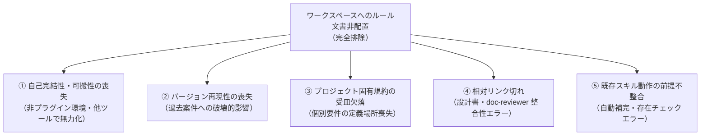
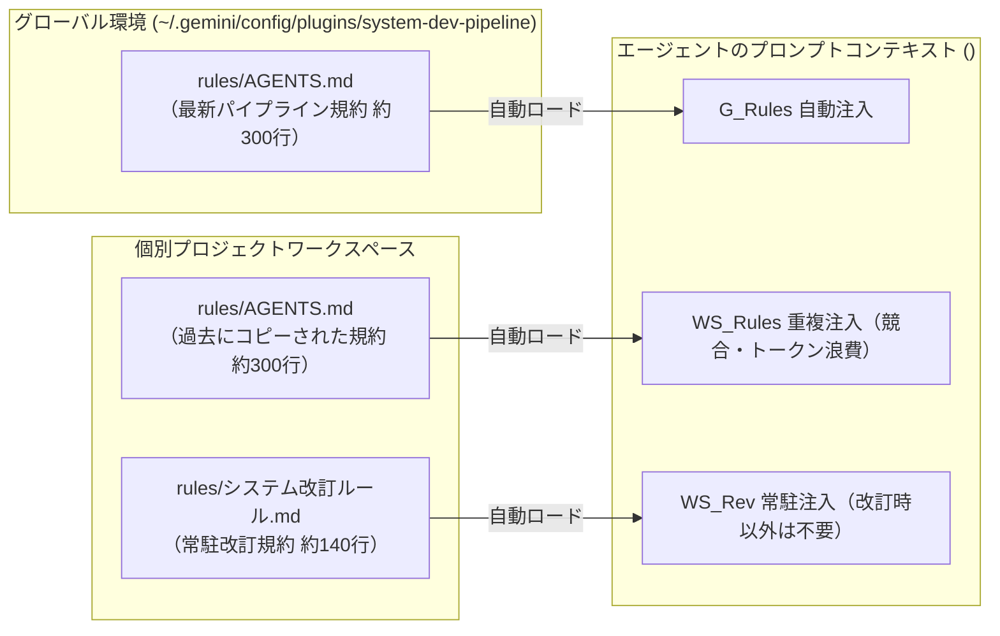
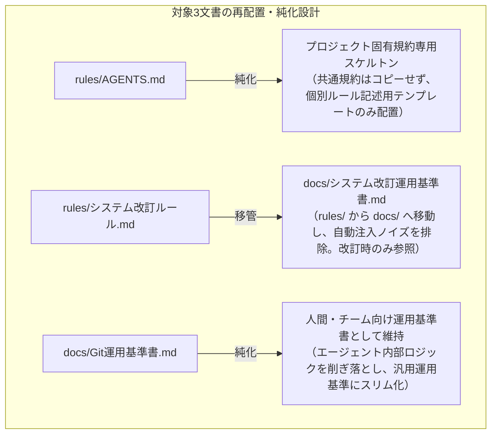

# v2.6.2 検討課題: 新規プロジェクトにおけるルール文書の扱いと配置方針

- **文書作成日**: 2026-10-31
- **対象バージョン**: v2.6.1 ➔ v2.6.2
- **ステータス**: 検討中 / 提案策定 (Draft)
- **対象スコープ**: `system-dev-pipeline` プラグイン正本、初期展開スケルトン/テンプレート、および個別プロジェクトワークスペース

---

## 1. 検討の背景と問題意識

### 1.1 背景
新規プロジェクトの開始時（PHASE 1〜4）、パイプラインは以下のルール文書・運用基準書をプロジェクトのワークスペースへ自動展開（コピー配置）している。

1. `rules/AGENTS.md`: プラグイン共通規約（5大エージェント協調、定常コア8項目、プロファイル規約等）をプロジェクトルートへコピー（`dev-phase1-setup`）。
2. `rules/システム改訂ルール.md`: システム改訂ライフサイクル、SemVer運用、改訂ターン文書化規約をコピー（`dev-phase1-setup` / `dev-phase8-rules`）。
3. `docs/Git運用基準書.md`: 2ブランチモデル（`main`/`feature`）、コミット命名規約、Gitコマンド手順をコピー（`dev-phase4-env-build` / `dev-git-init`）。

### 1.2 問題意識（ノイズ化と設定乖離の懸念）
パイプライン（`system-dev-pipeline`）がバージョンアップ（例: v2.6.1 ➔ v2.7 ➔ v3.0）され、新しい規約や修正が導入された際、プロジェクトのワークスペースにこれらの文書が固定コピーされたままであると、以下の問題が発生する。

- **二重注入ノイズ（Duplicated Context Injection）**: Antigravity はプラグイン側の `rules/AGENTS.md` を自動認識してプロンプトへ注入する。ワークスペース側にも同内容のファイルが存在すると、同一の長文規約が `<user_rules>` に二重で注入され、コンテキストトークンを著しく浪費する。
- **設定乖離とルール競合（Configuration Drift & Staleness）**: パイプライン側でルールが更新・廃止された場合、プロジェクト側の古い静的コピーとグローバルの最新規約が矛盾し、AIエージェントの推論に競合や混乱（ノイズ）をもたらす。

これを受け、**「これらの文書をプロジェクトのワークスペースに配置しない運用にした場合、どのような不都合が起こり得るか」** を検証し、恒久的な設計方針を確立する。

---

## 2. ワークスペースに配置しない運用にした場合の不都合・影響分析

これら3文書をプロジェクトから完全に排除した場合、以下の 5 つの不都合・トレードオフが発生する。



### 2.1 【重大】リポジトリの自己完結性（Self-contained）と可搬性の喪失
- **事象**: プロジェクトを別の端末で開発する場合、プラグインが未インストールの環境、あるいは人間開発者や別エージェント（Cursor, Claude Code, GitHub Copilot）で開いた場合、開発規約やGit運用ルールがリポジトリ内に一切存在しない。
- **影響**: リポジトリ単体で「どう開発・改訂し、どうブランチ運用するのか」がブラックボックス化し、特定のプラグイン実行環境に過度に依存する状態（ポータビリティの喪失）を招く。

### 2.2 【重大】バージョン固定（再現性）の喪失と後方互換性破壊
- **事象**: パイプライン規約がグローバルプラグイン側にしか存在しない場合、すべての過去プロジェクトが常に「実行環境における最新のパイプライン規約」で評価・動作する。
- **影響**: 
  - 例えば「半年前の Pipeline v2.4 規約で完了したプロジェクト」を保守・Hotfixしようとした際、グローバル側が v3.0 に進化して新しいHard Gateや厳格なASTチェックが導入されていると、**過去プロジェクトが即座にゲート不合格となり、改訂作業を開始できなくなる（依存関係のピン留め・再現性の喪失）**。

### 2.3 【中】プロジェクト固有ルール（Local Overrides）の定義場所の欠落
- **事象**: `rules/` ディレクトリおよび `rules/AGENTS.md` を排除してしまうと、そのプロジェクト特有の業務ルール（社内固有API仕様、特定のディレクトリ制約、独自命名規則など）を記述する場所が失われる。
- **影響**: プロジェクト固有ルールをエージェントに常駐認識させることが困難になり、グローバル一律の規約しか適用できなくなる。

### 2.4 【中】ドキュメント間の相対リンク切れ（Dead Links）
- **事象**: `docs/設計書/` 配下の既存設計書や要件定義書、および `dev-doc-reviewer` は、`docs/Git運用基準書.md` 等への相対リンク（例: `../Git運用基準書.md`）を含んでいる。
- **影響**: 対象ファイルが存在しない場合、ドキュメント相互整合性チェック（`dev-doc-reviewer`）で「リンク先ファイル不在」のエラーが検知され、自動修復ループが無駄に発動・失敗する原因となる。

### 2.5 【軽】既存パイプラインスキルの前提不整合
- **事象**: 現行の `dev-phase1-setup`, `dev-git-init`, `dev-phase8-rules` は、これらのファイルが存在・配置されることを前提としたステップが記述されている。
- **影響**: スキル側を改修しないままファイル配置のみを中止すると、エージェントが自律的に「未配置を検知してスケルトンから補完コピーしてしまう」か、存在チェックステップで警告を発する。

---

## 3. 現行方式の構造的欠陥（ノイズの正体）

一方で、現行の「テンプレートからの丸ごとコピー方式」が引き起こすノイズのメカニズムは以下の通りである。



1. **ルールの二重注入**: `G_Rules` と `WS_Rules` が双方とも `<user_rules>` に展開され、約300行のプロンプトが丸ごと重複する。
2. **新旧ルールの競合**: グローバル側が更新されてもワークスペース側は古い記述のまま残り、新旧ルール間で指示の食い違いが発生する。
3. **ライフサイクルの不一致**: `rules/システム改訂ルール.md` は本番リリース後（PHASE 8 以降）の改訂サイクルでのみ必要な規約であるにもかかわらず、`rules/` 配下に配置されることで新規開発フェーズ（PHASE 1〜7）の間も無駄にプロンプトへ常駐注入される。

---

## 4. 代替案の比較評価

| 評価観点 | 案A: 現行維持<br>(静的フルコピー) | 案B: 完全排除<br>(一切配置しない) | 案C: 役割分離モデル<br>(純化＋オンデマンド化) 【推奨】 |
| :--- | :---: | :---: | :---: |
| **二重注入ノイズの排除** | ✕（大量重複） | ◯（完全解消） | **◯（完全解消）** |
| **パイプライン更新への追従** | ✕（手動更新必須） | ◯（常に最新） | **◯（共通規約は最新を自動参照）** |
| **リポジトリの自己完結性** | ◯（自己完結） | ✕（外部依存大） | **◯（固有ルール＋運用基準書を保持）** |
| **プロジェクト固有ルールの定義** | △（共通規約と混在） | ✕（定義場所なし） | **◯（専用スケルトンに明瞭記述）** |
| **過去案件の後方再現性** | ◯（当時の規約固定） | ✕（最新規約強制適用） | **◯（スコープガード＋個別規約で両立）** |
| **ドキュメント内リンク整合性** | ◯（整合） | ✕（リンク切れ発生） | **◯（整合性維持）** |

---

## 5. 推奨アプローチ: 「役割分離（Role Separation）方式」の詳細設計

「完全排除」による弊害を回避しつつ、現行の「二重注入ノイズ」を根本解消するため、以下の3段階の純化・配置方針を提案する。



### 5.1 `rules/AGENTS.md` の純化（プロジェクト固有規約専用化）
- **方針**: パイプライン共通規約はワークスペースへコピーしない。ワークスペースルートには、**「プロジェクト固有規約記述用」の軽量テンプレート** のみを展開する。
- **展開ファイル内容（イメージ）**:
  ```markdown
  # プロジェクト固有開発規約 (Local Project Rules)

  本ドキュメントは、本プロジェクト固有の開発方針・業務制約・ローカルオーバーライドを定義する。
  パイプライン共通規約（System Dev Pipeline Rules）はグローバルプラグインから自動適用されるため、
  共通規約の転記は行わず、本プロジェクト独自の差分・例外事項のみを以下に記述すること。

  ## 1. プロジェクト固有要件・制約
  - （例: 外部API認証情報の取り扱い、個別命名規約、外部サービス連携仕様など）
  ```
- **効果**:
  - 共通規約の二重注入（約300行の重複）が **100% 根絶** される。
  - プロジェクト固有の規約を記述する受皿が公式に確保される。
  - パイプラインが更新された場合も、共通規約はプラグイン側から最新のものが自動適用されるため、古いコピーとの競合が発生しない。

### 5.2 `システム改訂ルール.md` の `docs/` 配下への移管（オンデマンド化）
- **方針**: `rules/システム改訂ルール.md` という名称・配置を廃止し、**`docs/システム改訂運用基準書.md`**（あるいは `docs/運用保守手順書.md`）として `docs/` 配下に配置する。
- **効果**:
  - `rules/` 配下から外れるため、新規開発期間中（PHASE 1〜7）に `<user_rules>` へ常時注入されるノイズ（約140行）が完全に排除される。
  - PHASE 8 以降の改訂作業時には、コンダクターや改訂スキル（`dev-revision`）が `docs/システム改訂運用基準書.md` を必要に応じて明示的に読み込む（オンデマンド参照）。
  - リポジトリ内に改訂プロセス仕様書として存続するため、自己完結性や人間向けドキュメントとしての価値は損なわれない。

### 5.3 `docs/Git運用基準書.md` のスリム化・純化
- **方針**: `docs/Git運用基準書.md` は配置を維持するが、パイプライン内部のエージェント自動化都合（特定スクリプトのオプションやエージェント間連携手順）を削ぎ落とし、**「人間開発者・チームおよび外部エージェントが読むための標準Git運用基準」** に純化する。
- **効果**:
  - 各種設計書からの相対リンク切れ（Dead Links）を防止する。
  - パイプラインツールの内部リファクタリングの影響を受けにくくなり、文書の陳腐化（Staleness）を防ぐ。

---

## 6. v2.6.2 パイプライン改修計画（Roadmap）

本方針を適用するための具体的なパイプライン改修タスクは以下の通りである。

### Step 1: テンプレート資産の改変
- `templates/rules_AGENTS.md.template` を新規作成（空のプロジェクト固有規約枠）。
- `templates/システム改訂ルール.md` を `templates/システム改訂運用基準書.md` へ改名し、`docs/` への展開を前提とした文書ヘッダー・リンクへ補正。
- `templates/Git運用基準書.md` の記述をスリム化（内部スクリプト依存を分離）。

### Step 2: スキル定義の更新
- `skills/dev-phase1-setup/SKILL.md`:
  - `PLUGIN_DIR/rules/AGENTS.md` のコピーを廃止し、プロジェクト固有規約テンプレート（`rules_AGENTS.md.template`）を展開するよう修正。
  - `システム改訂ルール.md` を `rules/` に置く処理を廃止。
- `skills/dev-phase8-rules/SKILL.md`:
  - `rules/システム改訂ルール.md` への配置処理を廃止し、`docs/システム改訂運用基準書.md` を配置・参照するよう修正。

### Step 3: チェックツールおよび整合性検証スクリプトの同期
- `.agents/skills/template-pipeline-sync/scripts/sync_pipeline.sh`:
  - ワークスペース側の `rules/AGENTS.md` にプラグイン共通規約が混入していないか機械検証する検査ルールを継続強化。
- `skills/dev-doc-reviewer/SKILL.md`:
  - 参照先リンクの変更（`docs/システム改訂運用基準書.md`）に対応。

---

## 7. 結論

「ワークスペースに一切配置しない」という極端な排除策は、リポジトリの自己完結性や可搬性、人間向けドキュメントの欠落という新たな運用障害を引き起こす。
本検討課題で策定した**「共通規約の二重注入を排除し、プロジェクト固有規約とドキュメントを適切な場所（`rules/` と `docs/`）に分離・純化するアプローチ」**を採用することで、ノイズを完全に根絶しつつ、堅牢で自立したリポジトリ運用を実現できる。
