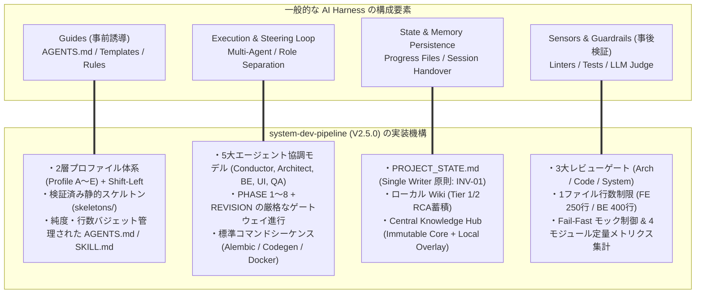
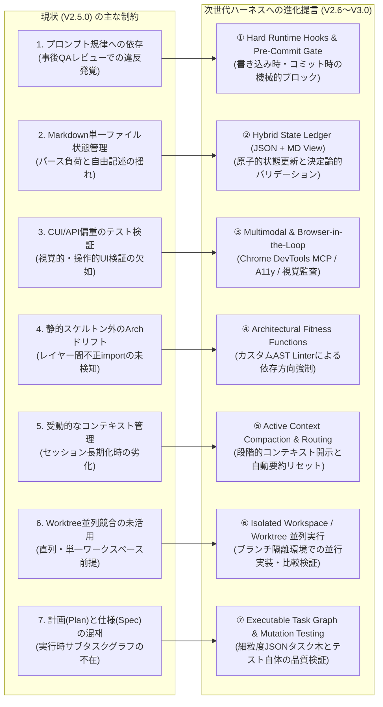

# `system-dev-pipeline` と「AIハーネス（Harness Engineering）」の包括的比較分析レポート：優位性の評価と次世代に向けた欠落思想・機能の提言

- **作成日**: 2026-10-26
- **対象システム**: AI駆動システム開発ライフサイクルテンプレート (`system-dev-pipeline` V2.5.0)
- **比較対象**: AIハーネス / ハーネスエンジニアリング（Harness Engineering：OpenAI / Anthropic / Thoughtworks 等の業界標準パラダイム）
- **関連正本**:
  - [AI駆動システム開発フェーズ定義書V2.5.md](../../設計書/Current/AI駆動システム開発フェーズ定義書V2.5.md)
  - [エージェント設計書V2.5.md](../../設計書/Current/エージェント設計書V2.5.md)
  - [レビューシステム設計書V2.5.md](../../設計書/Current/レビューシステム設計書V2.5.md)
  - [定量測定・フィードバック設計書V2.5.md](../../設計書/Current/定量測定・フィードバック設計書V2.5.md)
  - [状態管理機構設計書V2.5.md](../../設計書/Current/状態管理機構設計書V2.5.md)
  - [AGENTS.md](../../../.agents/plugins/system-dev-pipeline/rules/AGENTS.md)
  - [CORE_INVARIANTS.md](../../../.agents/plugins/system-dev-pipeline/rules/CORE_INVARIANTS.md)

---

## 1. エグゼクティブサマリー

2025年後半から2026年にかけ、自律型AIコーディングエージェントの社会実装が急速に進む中で、ソフトウェア工学の焦点は「プロンプトエンジニアリング」や「コンテキストエンジニアリング」から、**「AIハーネス（AI Harness / Harness Engineering）」** へと完全に移行した。

$$
\text{Agent} = \text{Model} + \text{Harness}
$$

この基本方程式が示す通り、非決定論的な推論を行うLLM（Model）単体の性能に依存するのではなく、モデルを取り囲む環境・制約・検証ループ・状態管理（Harness）をいかに設計するかが、エージェントの信頼性とスケーラビリティを決定づける。

本レポートでは、業界で提唱されている「AIハーネス」の主要パラダイム（OpenAIのScaled Agentic Architecture、AnthropicのLong-Running Agent Harness、Thoughtworks / Martin FowlerのGuides & Sensorsフレームワーク）と、本プロジェクトで構築・進化させてきた **`system-dev-pipeline`（V2.5.0）** を多次元で比較分析する。

結論として、`system-dev-pipeline` は単なる「タスク実行用ハーネス」の枠を大きく超え、**「要件定義から本番デプロイ、さらにはクロスプロジェクトでの自己進化（Meta-Harness Evolution）までを網羅したフルライフサイクルSDLCハーネス」** として極めて高い優位性を有している。一方で、最新のAIハーネス工学が重視する **「機械的強制（Hard Runtime Interception）」「構造化タスク台帳（JSON等による原子的状態管理）」「ライブブラウザ/マルチモーダル感覚フィードバック」「動的なコンテキストガベージコレクション」** などの面で、プロンプト規律（Soft Governance）への依存が残存しており、これらが次期バージョン（V2.6 / V3.0）に向けた重要な進化の伸び代となる。

---

## 2. 「AIハーネス（Harness Engineering）」の定義と業界潮流

「ハーネス（馬具・安全帯）」とは、強大だが制御が難しい力（LLMの生成能力）を手綱によって正しい方向へ導き、暴走や転落を防ぐためのソフトウェア基盤・周辺環境の総称である。2026年現在のAIハーネス工学は、主に以下の3大潮流によって体系化されている。

### 2.1 OpenAIの潮流：環境設計とリポジトリの可読性（Repository Legibility）
OpenAI（*“Harness engineering: leveraging Codex in an agent-first world”*, 2026）は、人間が1行も手書きせず100万行規模のシステムを構築した事例を通じ、**「人間は環境を設計して操舵（Steer）し、エージェントが実行（Execute）する」** という原則を確立した。
- **コンテキストの階層化**: ルートの `AGENTS.md` を百科事典のように肥大化させるのではなく「簡潔な目次（Index）」として保ち、詳細な仕様へ動的誘導する。
- **エントロピー（腐敗）との戦い**: AIが生成するコードの冗長化やアーキテクチャ境界の浸食を防ぐため、カスタムLinterや構造テストによってリポジトリの秩序を機械的に維持する。

### 2.2 Anthropicの潮流：長時間稼働エージェントとセッション断絶の克服
Anthropic（*“Effective harnesses for long-running agents”*）は、コンテキストウィンドウの限界により複数セッションを跨ぐ開発で発生する「健忘症（Amnesia）」「早期の勝利宣言（Premature Victory）」「未検証での完了マーク」を防ぐハーネス構造を定式化した。
- **Initializer と Coding Agent の分離**: 初回に環境とタスク台帳をセットアップする役割と、1機能ずつ着実にテスト・コミットを繰り返す役割の分離。
- **構造化状態管理（JSON Task Ledger）**: Markdownの自由記述による構造破壊を防ぐため、機能リストや合否状態を厳格なJSONスキーマ（`feature_list.json` 等）で管理する。
- **実環境感覚フィードバック**: MCP（Puppeteer / Chrome DevTools等）を介し、エージェント自身が実ブラウザを操作・視覚確認して初めて「完了」と認めるループ。

### 2.3 Thoughtworks (Martin Fowler / Birgitta Böckeler) の潮流：Guides & Sensors
Thoughtworksは、AIハーネスの制御機構を「実行前（Feedforward）」と「実行後（Feedback）」の2軸×「決定論的（Computational）」と「推論的（Inferential）」の2軸からなるマトリクスとして整理した。

| 制御のタイミング | 決定論的制御 (Computational / Hard) | 推論的制御 (Inferential / Soft) |
| :--- | :--- | :--- |
| **Guides (Feedforward)** *行動前の事前誘導・制約* | ・静的スケルトン・プロジェクト雛形 ・型システム / OpenAPI スキーマ ・ツール権限の物理的サンドボックス | ・`AGENTS.md` / スキル定義書 ・アーキテクチャ設計書・プロンプト指示 ・デザインシステムガイドライン |
| **Sensors (Feedback)** *行動後の検知・自己修正* | ・コンパイラ / 型チェッカー (`tsc`, `ruff`) ・単体/結合テストスイート (`pytest`) ・行数制限/依存関係チェックスクリプト | ・LLM-as-a-Judge（QAサブエージェント監査） ・コード品質レビュー / 設計整合性レビュー ・Semantic Auditor（意味的矛盾監査） |

---

## 3. `system-dev-pipeline` と一般的AIハーネスの構造的マッピング

`system-dev-pipeline`（V2.5.0）の各コンポーネントを上記の「AIハーネス」の構成要素にマッピングすると、当パイプラインが極めて体系的なハーネスアーキテクチャを備えていることが分かる。

| 比較軸 | 一般的なAIハーネス（業界標準プラクティス） | `system-dev-pipeline` (V2.5.0) |
| :--- | :--- | :--- |
| **対象スコープ** | 主に「実装〜単体テスト（Coding & Testing）」の局所ループ | **PHASE 1（準備・要件）〜 PHASE 7（本番デプロイ）〜 PHASE 8（自己進化・改訂）のSDLC全域** |
| **エージェント編成** | 単一エージェント、または Generator + Evaluator の2者構成が主流 | **5大専門エージェント**（Conductor, Architect, BE, UI, QA）による明確な責務・権限分離 |
| **アーキテクチャ規定** | リポジトリごとに個別定義（フレームワーク非依存・アドホック） | **2層プロファイル体系**（定常コア8項目 ＋ Profile A〜E）と初期スケルトンによる **Shift-Left** |
| **状態管理 (State)** | `progress.txt` や `feature_list.json` によるタスク消化管理 | **`PROJECT_STATE.md`（Single Writer原則）** ＋ メトリクスサマリ即時同期 ＋ Gitブランチ連携 |
| **品質ゲート (Sensors)** | Linter / CI テストのパス、簡易なセルフレビュー | **3大必須レビューゲート**（基本設計・コード品質・システム総合）＋ ドキュメント相互整合性ループ |
| **本番運用・インフラ境界** | ローカル開発環境止まりが多い（デプロイは人間または別CI） | Cloud Run + Litestream (`litestream run`) + IAP JWT二重検証 + ロールバック手順まで統合 |
| **学習と進化のスコープ** | 単一リポジトリ内の `AGENTS.md` や `.cursorrules` の手動更新 | **二段階進化サイクル**（ローカルWiki ➔ Central Knowledge Hub ➔ 3段階意味的監査 ➔ Local Overlay） |
| **定量評価 (Telemetry)** | トークン消費量やAPIコストの簡易モニタリング | **4モジュール決定論的集計エンジン**（4カテゴリ12指標・100点満点スコアリング・フェーズ推移） |

---

## 4. `system-dev-pipeline` の圧倒的優位性（Strengths & Advantages）

一般的なAIハーネスと比較した際、`system-dev-pipeline` が特に優れている（業界の最先端を凌駕している）ポイントは以下の6点に集約される。

### 4.1 優位性①：「Meta-Harness（自己進化するハーネス）」としての二段階進化アーキテクチャ
一般的なAIハーネスでは、開発中に得られた教訓（エージェントが陥りやすい罠やバグパターン）は、人間が手動で `AGENTS.md` に追記するか、そのプロジェクト限りで散逸する。また、無秩序にルールを追記し続けると、プロンプトが肥大化して推論性能が劣化する「ルール腐敗（Instruction Bloat）」を引き起こす。

これに対し、`system-dev-pipeline` は **ハーネス自身が複数案件を通じて自律的に進化・代謝する「Meta-Harness」機構** を確立している。
1. **Two-Tier Separation（二層分離）**: 案件固有仕様（Tier 1）はプロジェクト内の `docs/` へ逆同期して封じ込め、汎用パターン（Tier 2）のみを `CLAIM-*.md` として Central Knowledge Hub へ昇格させる。
2. **Immutable Core + Local Overlay**: 公式プラグイン（Core）を直接汚染せず、最大80行のバジェット制限を持つ `LOCAL_FEEDBACK_RULES.md`（Overlay）で即時有効化し、成熟した段階で Core へ本流統合（Subsumption）して Overlay を解放する。
3. **2系統分離原則（Executable Specs 優先）と 3段階意味的監査**: 決定論的バグはプロンプトに書かず Linter/テストへ吸収させ（系統A）、セマンティック判断のみを反復観測（$N \ge 3$）後に構造化し、さらに `CORE_INVARIANTS.md`（INV-01〜10）と行数バジェット（AGENTS 220行、スキル120行上限）で厳格に検疫する。この「プロンプトのエントロピー管理」は業界最高水準の洗練度にある。

### 4.2 優位性②：コーディング前後の「フルSDLC統制」と 2層プロファイルによる Shift-Left
多くのAIハーネスが「与えられたIssueに対してコードを書く」段階から始まるのに対し、`system-dev-pipeline` は上流の要件定義（PHASE 2）・4大基本設計書（PHASE 3）から、下流の本番リリース（PHASE 7）・リリース後の継続的改訂（REVISION）までを一貫したプロトコルでカバーしている。
- **2層プロファイル体系（Profile A〜E）**: サーバーレスWeb（Profile A）からローカルデスクトップ（Profile D）、さらにはZero-Dependency Pythonスキル（Profile E）まで、アーキテクチャ選定をディシジョンツリーで標準化している。
- **Shift-Left スケルトン展開**: ゼロからAIにボイラープレートを書かせる（ハルシネーションの温床）のではなく、認証・ロギング・マイグレーション・モック基盤が組み込み済みの `skeletons/` を初期展開することで、手戻りを根源から断っている。

### 4.3 優位性③：5大エージェントの厳格な権限分離と「Single Writer原則」
マルチエージェント環境で最も頻発する障害は、「複数エージェントによる状態ファイルの競合上書き」「設計エージェントによる勝手なコマンド実行」「QAエージェントによる仕様を無視した直接コード書き換え（テストの改ざん）」である。
`system-dev-pipeline` はこれを **Core Invariants（不変原則）** として封じ込めている。
- **Single Writer 原則 (INV-01)**: `PROJECT_STATE.md` の更新権限を 👑 `conductor` のみに独占させ、状態の一貫性を保証。
- **最小権限の原則 (INV-02)**: 📐 `architect` の `run_command` 絶対禁止、🛡️ `qa-engineer` の本体コード直接改変禁止（Unified Diff提案のみ）により、「評価者が自らコードを書き換えてテストを通す」というAIハーネス最大のアンチパターンを構造的に防いでいる。

### 4.4 優位性④：「モックの罠（Silent Mock Fallback）」と「God Object化」への実践的防衛線
LLMコーディングエージェントは、「テストを通すため、あるいはエラーを隠すために、勝手にダミーデータをハードコードする」「1つのファイルに数千行のコードを詰め込む」という強いバイアスを持つ。
当パイプラインは実案件のRCA（根本原因分析）から生まれた極めて実践的なガードレールを備えている。
- **Anti-God Component / Module (INV-03, PAT-CODE-001)**: フロントエンド250行・バックエンド400行制限、およびDTO・パーサーの物理分離強制により、AIが理解可能なモジュール粒度を維持。
- **モック二重防御と Fail-Fast 原則 (INV-04, PAT-MOCK-001)**: コンポーネント内直書きモックを禁止してMSWへ集約した上で、実結合モード（`VITE_ENABLE_MOCK=false`）でのサイレントフォールバックを禁じ、本番ビルド時のモック混入を徹底排除している。
- **デイライト視認性担保 (PAT-UI-001)**: AIが陥りがちな「ダークモード偏重の淡色直書きによるライトモードでの文字消失」をデザイン仕様レベルで封じている。

### 4.5 優位性⑤：本番インフラ・データ永続化・非対話CLI保護まで踏み込んだ運用リアリズム
Cloud Run + SQLite + Litestream 構成（Profile A）における `litestream run` スーパーバイザー起動と SIGTERM シグナル伝播・WAL最終フラッシュ保証、IAP JWT署名二重検証、さらにはエージェントが外部CLI（`gcloud`, `npm` 等）を実行した際の **対話プロンプト待ち無限ハング防止（`--quiet` 強制、`2>/dev/null` による標準エラー破棄禁止、`schedule` タイマー保護：INV-06 / PAT-SYS-001）** など、実際の自律実行で発生する泥臭いインフラ・ランタイム障害に対する防御策が体系化されている。

### 4.6 優位性⑥：主観を排した「決定論的メトリクス集計エンジン」による定量ガバナンス
`dev-metrics-collector`（V2.5で4モジュール構成へ刷新）は、会話トランスクリプト（`transcript.jsonl`）、Git空ツリー差分LOC、レビュー報告書、Wiki知見数を機械的にパースし、12指標・100点満点でハーネスと開発プロセスの健全性を定量評価する。さらに集計結果を `PROJECT_STATE.md` へ即時同期（PAT-SYS-002）し、フェーズ別推移レポート（PAT-SYS-004）を出力する仕組みは、ハーネスエンジニアリングにおける **Observability（可観測性）** の理想形を体現している。

---

## 5. `system-dev-pipeline` に欠けている思想・機能と改善提言（Gaps & Future Roadmap）

上述の通り、`system-dev-pipeline` は極めて高い完成度を誇るが、OpenAI・Anthropic・Thoughtworks等が提唱する最新のAIハーネス工学の知見と照らし合わせると、**「プロンプトによる行動規範（Soft Guides）への過度な依存」** や **「実行時フィードバックのモダリティ不足」** など、以下の7つの思想・機能が欠落（または発展途上）していると評価できる。

---

### 5.1 欠落①：「プロンプトによる禁止（Soft Rule）」から「ランタイム機械的遮断（Hard Interceptor）」への転換不足
- **現状の課題**:
  現在、「📐 `architect` は `run_command` 実行禁止」「🛡️ `qa-engineer` は本体コード改変禁止」「1ファイル250行/400行制限」「Single Writer原則」といった重要規約の多くが、エージェントのプロンプト記述（Soft Guide）と、PHASE 5.5 等の事後QAレビューおよびPHASE 8のメトリクス事後集計（`M-GOV-01`, `M-GOV-02`）によって担保されている。つまり、**「エージェントが規約を破ろうと思えば物理的には実行できてしまい、後からQAや集計スクリプトが違反を検知して手戻り（修復ループ）が発生する」** 構造になっている。
- **AIハーネスの思想**:
  真のハーネス工学では、決定論的に判定可能なルールは推論モデル（LLM）の良心に委ねず、**ツール実行の前後（Pre/Post Tool-Call Hooks）や Git Pre-Commit Hook で物理的に遮断（Fail-Fast Block）** する。
- **具体的な導入提言**:
  1. **Pre-Commit / Post-Edit 機械的ガードスクリプトの標準配備**: `skeletons/` に Git `pre-commit` フック（または軽量検証スクリプト `harness_guard.py`）を組み込み、250行/400行超過、絶対パス混入、直書きモックパターン、生SQL記述が存在する場合はコミット自体を機械的に `exit 1` で拒絶する。
  2. **エージェント定義レベルの権限制御徹底**: `define_subagent` / プラグイン設定において、`architect` や `qa-engineer` の `EnableWriteTools` やコマンド実行権限をシステムレベルで剥奪・制限する設定の完全強制。

### 5.2 欠落②：状態管理における「構造化データ台帳（JSON State Ledger）」の不在
- **現状の課題**:
  Anthropicのハーネス研究が指摘するように、Markdownファイル（`PROJECT_STATE.md` や各種レビュー報告書）を唯一の正（Single Source of Truth）としてLLMに自由編集させると、表記揺れや構造破損が避けられない。実際、V2.5改訂における `PAT-SYS-005`（レビュー報告書の太字や見出し表記揺れに対応するための正規表現の複雑化）は、**「機械が読むべき状態を自然言語Markdownに依存していること」** の副作用そのものである。
- **AIハーネスの思想**:
  状態管理は **「機械可読な厳格スキーマ（JSON / SQLite）」を正本（System of Record）** とし、人間向けのMarkdown（`PROJECT_STATE.md`）はそこから決定論的スクリプトによって自動レンダリングされる「ビュー（View）」として扱う。
- **具体的な導入提言**:
  1. **`project_state.json`（またはタスク台帳JSON）の導入**: フェーズ進行状態、各機能要件の実装・テスト合否ステータス、レビュー判定結果（`PASS` / `CLEAN` / `RELEASE APPROVED`）、メトリクス数値を厳格なJSONスキーマで保持する。
  2. **状態更新CLIの提供**: コンダクターが `PROJECT_STATE.md` をテキスト編集するのではなく、`python3 state_manager.py --set-phase PHASE_4 --sync-metrics` のような決定論的CLIを介して原子的（Atomic）に状態を遷移させ、同時に `PROJECT_STATE.md` を自動再生成するアーキテクチャへの移行。これにより Single Writer 違反や正規表現パースエラーを根絶できる。

### 5.3 欠落③：実ブラウザ・マルチモーダル感覚フィードバック（Visual & DOM Sensor）の未統合
- **現状の課題**:
  PHASE 5（ウォークスルー）および PHASE 6（シナリオテスト）において、バックエンドAPIの疎通やコード上の静的検査（Tailwind明暗ペア文字列の有無など）は行われているが、**「実際にレンダリングされた画面でレイアウト崩れが起きていないか」「モーダルが背面に隠れてクリック不能になっていないか」「コンソールエラーやCSP違反が出ていないか」** をAI自身が視覚的・DOM的に検証するループが弱い（人間の目視ウォークスルーに依存している）。
- **AIハーネスの思想**:
  最先端のコーディングハーネスは、Chrome DevTools MCP や Playwright 等を Sensor として直結し、エージェント自身がヘッドレス/実ブラウザを操作して DOM スナップショット、アクセシビリティツリー（A11y）、ネットワークログ、スクリーンショットを取得・自己検証してから人間へ承認を求める。
- **具体的な導入提言**:
  1. **PHASE 5 / 6 における Chrome DevTools MCP 検証の標準組込**: コンダクターおよび `qa-engineer` が、ウォークスルー時にブラウザ自動化ツール（`chrome-devtools`, `a11y-debugging` 等）を用いて実画面のコンソールエラーゼロ、コントラスト比（デイライト視認性の実測検証）、主要ユーザーフローのDOM遷移を自動確認する工程の追加。

### 5.4 欠落④：アーキテクチャ適応度関数（Architectural Fitness Functions / AST構造テスト）
- **現状の課題**:
  現在のコード品質ガードは「1ファイル250行/400行制限」や「ファイル名・ディレクトリ配置」といった表層的・テキストベースの検査が中心である。そのため、行数を守るために無意味にファイルを細分化したり、ControllerからDBモデルや外部APIを直接呼び出してService層をバイパスしたりする「アーキテクチャ境界の浸食（Architectural Drift）」を機械的に検知できない。
- **AIハーネスの思想**:
  OpenAIやThoughtworksが強調する通り、大規模化するAI生成コードの秩序を守るには、AST（抽象構文木）レベルでモジュール間の依存方向（例：`routers/` から `models/` の直接import禁止、循環参照禁止、DTOを経由しないレスポンス返却禁止）を強制する **構造的Linter / Fitness Functions** が不可欠である。
- **具体的な導入提言**:
  1. **軽量AST構造チェッカーの配備**: Profile E（Zero-Dependency Python `ast` モジュール）で実装した軽量アーキテクチャ検査スクリプトを `dev-review-code` に組み込み、レイヤー間の不正import、未承認の外部ライブラリ追加、例外握りつぶし（`except Exception: pass`）を100%機械的に検出する。

### 5.5 欠落⑤：能動的コンテキスト管理（Active Context Compaction & Progressive Disclosure）
- **現状の課題**:
  `dev-metrics-collector` の `M-RES-01`（最大コンテキスト消費率）によって事後測定は行われているものの、PHASE 4 や PHASE 6 のような長時間フェーズにおいてコンテキスト消費率が閾値（例：60%）を超えた際に、**「どのようにコンテキストを圧縮・リセットして次セッションへ安全に引き継ぐか」** の能動的なプロトコル（Active Compaction / Handover Protocol）が定義されていない。また、設計書群（`docs/設計書/Current/`）が充実するほど、サブエージェントが全設計書を一括読み込みしてコンテキストを圧迫するリスクがある。
- **AIハーネスの思想**:
  1. **Progressive Disclosure（段階的開示）**: エージェントには最初に軽量なインデックス（目次と要約）のみを渡し、担当タスクに必要なセクションのみをピンポイントで `read_file`（行範囲指定）させる。
  2. **Proactive Session Handover（予防的セッション引き継ぎ）**: コンテキストが飽和する前に、現在の作業状態と次ステップのチェックリストを構造化ファイルへ書き出し、クリーンなコンテキスト（または新規サブエージェント）へバトンタッチする。
- **具体的な導入提言**:
  1. **設計書インデックス（`ARCHITECTURE_INDEX.md`）またはコンテキストマップの導入**: 各サブエージェントがどの設計書の何章を読むべきかをマッピングし、不要な全文読み込みを抑制する。
  2. **コンテキスト閾値アラートと `/compact` 連携手順の明文化**: コンダクターが一定ターン数（例：15〜20ターン）ごとに中間状態を `PROJECT_STATE.md` にチェックポイント保存し、ユーザーへ `/compact` またはセッション分割を促す運用ルールの整備。

### 5.6 欠落⑥：Workspace Isolation（Worktree並列実行・サンドボックス検証）の活用不足
- **現状の課題**:
  PHASE 4 において「💻 `backend-engineer` と 🎨 `ui-designer` の並行委譲実装」が謳われているが、サブエージェント呼び出し時の `Workspace` モードがデフォルト（`inherit`：親と同一ワークスペースの共有）である場合、複数エージェントが同時にファイル操作やテスト実行を行うと、環境変数や一時ファイル、Dockerコンテナの状態が干渉する恐れがある。
- **AIハーネスの思想**:
  最新のエージェント基盤（Antigravityの `Workspace: "share"` や `"branch"` を含む）では、サブエージェントごとに独立した Git Worktree やブランチ環境を割り当て、隔離されたサンドボックス内で実装・単体テストを完了させてから、メインエージェント（Conductor）が差分をレビューしてマージする。
- **具体的な導入提言**:
  1. **サブエージェント委譲時の Workspace モード基準の策定**: 並行実装時やリスクの高いリファクタリング時において、`Workspace: "share"` または `"branch"` を活用した隔離実装 ➔ コンダクターによる統合検証フローを `エージェント設計書` に定義する。

### 5.7 欠落⑦：仕様駆動（Spec-Driven）とテスト駆動（Mutation / Adversarial Testing）の深化
- **現状の課題**:
  PHASE 6 のシナリオテストでは、QAエンジニアがテスト計画を立ててテストコードを作成・実行するが、**「AIが書いたテストコード自体が甘く、本質的なバグを見逃して 100% PASS してしまう（Tautological Tests / 形式的テスト合格）」** という、AIハーネス特有の失敗モードに対する検証機構が不足している。
- **AIハーネスの思想**:
  - **実行可能な細粒度タスクグラフ（Executable Task List）**: 要件定義書の各項目（`REQ-001` 等）から基本設計、実装コード、テストケース（`TEST-001`）までをIDで完全トレース（Traceability Matrix）し、未テストの要件が存在すれば機械的にリリースをブロックする。
  - **敵対的テスト検証（Adversarial / Mutation Check）**: 境界値異常データ、認証トークン改ざん、DB接続断などの異常系（Chaos / Negative Path）がテストスイートに含まれているかを機械的に検査する。
- **具体的な導入提言**:
  1. **要件IDトレーサビリティ検証の追加**: `要件定義書.md` の機能ID（`F-01` 等）が `シナリオテスト計画書.md` および実テストコードの docstring / テスト名に100%マッピングされているかを `dev-doc-reviewer` / `dev-review-system` で機械検査する。

---

## 6. 総括：次世代 `system-dev-pipeline` への進化ロードマップ

`system-dev-pipeline`（V2.5.0）は、業界で語られている一般的な「AIハーネス」の概念をすでに多くの領域（特に **フルSDLCカバー、5大エージェントの責務分離、2層プロファイルによるShift-Left、Central Knowledge Hubによるクロスプロジェクト自己進化、4モジュール定量メトリクス評価**）において凌駕しており、極めて実践的かつ先進的な **「エンタープライズ級 SDLC メタハーネス」** として完成されている。

今後、本パイプラインが V2.6 〜 V3.0 へとさらなる進化を遂げるための核心的テーマは以下の1点に集約される。

> **「プロンプトによる規律（Soft Governance / 事後監査）から、ランタイム・スキーマによる物理的強制（Hard Architectural Enforcement / 事前遮断）へのシフト」**

### 推奨アクションプラン（優先度順）

| 優先度 | 施策テーマ | 具体的なアクション内容 | 期待される効果 |
| :---: | :--- | :--- | :--- |
| **高 (P1)** | **Hard Gate スクリプトの前倒し (Pre-Commit / CLI Guard)** | 250行/400行制限、直書きモック、絶対パス、AST依存違反を検査するZero-Dependency Pythonスクリプトを整備し、PHASE 5.5まで待たずに実装フェーズ（PHASE 4）のコミット前に機械的ブロックする。 | レビュー手戻りターン数の激減、系統A（決定論的検証）の完全自動化 |
| **高 (P1)** | **構造化状態台帳 (`project_state.json`) と決定論的同期** | 進行状態・タスク消化・レビュー判定・メトリクスをJSON正本で保持し、CLI経由で更新して `PROJECT_STATE.md` を自動生成する仕組みを導入する。 | Single Writer原則の物理的保証、表記揺れによるパーサー改修（PAT-SYS-005等）の根絶 |
| **中 (P2)** | **ブラウザ感覚センサー（Chrome DevTools MCP）の標準統合** | PHASE 5（ウォークスルー）および PHASE 6 において、実ブラウザのDOM・コンソールエラー・A11y・デイライトコントラスト比をAI自身が自動計測する手順を組み込む。 | UI/UX不具合の早期自己検知、人間の目視確認コストの大幅削減 |
| **中 (P2)** | **要件〜テストのIDトレーサビリティ機械検証** | 要件定義の機能IDとテストコードの対応関係を機械的にクロスチェックし、「未検証機能の完了宣言（Premature Victory）」を防止する。 | シナリオテストの実効性向上、仕様漏れゼロの保証 |
| **低 (P3)** | **Progressive Disclosure と予防的コンテキスト圧縮** | 設計書の軽量インデックス化と、一定ターン経過時のチェックポイント保存・セッション引き継ぎプロトコルの策定。 | 長時間フェーズにおけるトークン効率（`M-RES-01`, `M-RES-03`）と推論精度の維持 |

以上の知見と機構を取り込むことで、`system-dev-pipeline` は「モデルの進化に依存せず、いかなる規模・複雑度のシステムであっても100%の再現性と品質で自律構築・自己進化し続ける究極のAIハーネス」へと到達する。
