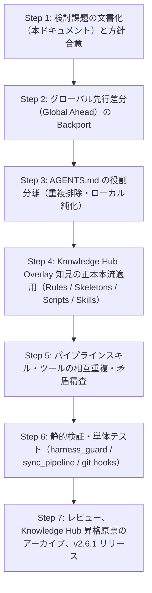

# v2.6.1 改訂基本方針および検討課題整理書

- **文書作成日**: 2026-10-31
- **対象バージョン**: v2.6 ➔ v2.6.1
- **ステータス**: 完了 (グローバルデプロイおよび知見退役完了)
- **対象スコープ**: `system-dev-pipeline` プラグイン正本および `template` ワークスペース

---

## 1. 改訂の背景と目的概要

本改訂（v2.6.1）は、AI駆動システム開発パイプラインの運用において蓄積された実践知見を正本へと安全に還流（昇格）させるとともに、コンテキスト効率と開発者体験（DX）を阻害するルールの重複・輻輳を解消することを目的とする。

具体的には、以下の2大テーマを主軸として改訂を推進する。

1. **Knowledge Hub で Overlay 適用された知見の本適用・パイプライン精査**:
   - `~/.gemini/knowledge-hub/` の Overlay 層（`LOCAL_FEEDBACK_RULES.md`）および有効原票（`active_claims/`）に蓄積された実践知見を整理し、プラグイン正本（規約、スケルトン、スクリプト、スキル）へ正式に本流適用（Backport & Promotion）する。
   - あわせて、各スキルの役割分担、ガイダンス、ルール記述を精査し、相互の重複や矛盾を洗い出してスリム化・適正化する。
2. **AGENTS.md の整理（重複排除とノイズ・輻輳防止）**:
   - プラグイン正本（`.agents/plugins/system-dev-pipeline/rules/AGENTS.md`）とワークスペースルート（`rules/AGENTS.md`）に存在するルールの重複を解消する。
   - ルート側の `rules/AGENTS.md` にはワークスペース固有のルールのみを残し、共通規約の二重読み込みによるノイズ・プロンプトコンテキストの圧迫・推論輻輳を根絶する。

---

## 2. 検討課題①: Knowledge Hub Overlay 知見の本適用とパイプライン精査

### 2.1 現状分析: 蓄積された知見の棚卸し

現在、Central Knowledge Hub（`~/.gemini/knowledge-hub/`）には、実プロジェクト運用から昇格された 8 件の知見原票（`active_claims/`）と、それらを圧縮集約した Overlay 規約（`LOCAL_FEEDBACK_RULES.md`）が存在している。

| 分類 | 原票 ID / 知見テーマ | 主な内容 | 正本での反映先候補 |
| :--- | :--- | :--- | :--- |
| **DOC** | `CLAIM-20261027-bicycle-maintenance-PAT-DOC-002` `CLAIM-20261028-bicycle-log-PAT-DOC-003` | ① 正本設計書タイトルから個別バージョン番号を排除し、一元管理する規約。 ② Mermaid ダイアグラムにおける特殊記号（括弧等）のダブルクォート義務化および `harness_guard.py` によるコミット前機械遮断。 | ・`rules/AGENTS.md` (第1節/第10節) ・`skeletons/common/scripts/harness_guard.py` ・`skills/dev-doc-reviewer` |
| **INFRA** | `CLAIM-20261026-bicycle-maintenance-PAT-ENV-001` | **Dual Provisioning 原則**: `.env.example`（Git追跡用公開テンプレート）と `.env`（ローカル実行用実体）のペア生成・同期義務化。欠落時の自己修復（Self-Healing）とリリース時の安全フォールバック。 | ・`rules/AGENTS.md` (第4節) ・`skills/dev-phase1-setup` ・`skills/dev-git-release` ・`skeletons/common/scripts/harness_guard.py` |
| **SYS** | `CLAIM-20261028-bicycle-log-PAT-SYS-007` | バックエンド静的解析設定（`pyproject.toml`）におけるフレームワーク標準イディオム（FastAPI `Depends` 等）との競合抑止、循環参照許容設定の初期配備。 | ・`skeletons/backend/pyproject.toml` ・`skills/dev-phase1-setup` |
| **SYS** | `CLAIM-20261028-bicycle-log-PAT-SYS-008` | リポジトリ除外設定（`.gitignore`）で `*.json` を除外する際も、CI 再現性確保のため `!package-lock.json` をホワイトリストとして保護する。 | ・`skeletons/common/.gitignore` ・`skills/dev-git-init` |
| **SYS** | `CLAIM-20261028-bicycle-log-PAT-SYS-009` | シナリオテストコードにおけるテストランナー実行カレントディレクトリ非依存の相対パス解決（`ROOT_DIR = Path(__file__).resolve().parent.parent.parent`）。 | ・`skeletons/backend/tests/` ・`skills/dev-phase6-testing` |
| **SYS** | `CLAIM-20261029-garden-log-PAT-SYS-010` | **Stage/Phase 境界の厳格遵守**: 「終端処理」「クローズ」指示があっても、ユーザーの明示的承認なく次のフェーズ（GitHub push、デプロイ等）へ先走ることを禁止。 | ・`rules/AGENTS.md` (第2節/第8.5節) ・`skills/dev-phase7-release` ・`skills/dev-git-release` |
| **SYS** | `CLAIM-20261029-garden-log-PAT-SYS-011` | **改訂サイクル完了（`complete-revision`）時監査**: `app_version`、`current_branch`、`decisions`、`open_questions` の機械的・意味的完全一致検証と、コンダクターの直接編集抑止（サブエージェント委譲指差し確認）。 | ・`rules/AGENTS.md` (第2節/第10節) ・`skeletons/common/scripts/state_manager.py` ・`skills/dev-phase8-rules` |

### 2.2 グローバル先行差分（Global Ahead）との統合

知見原票の昇格に伴い、グローバル環境側（`~/.gemini/config/plugins/system-dev-pipeline/`）で先行適用されている以下の 3 資産をワークスペースへ安全に取り込む（Backport）。

1. `skeletons/common/.githooks/pre-push`: プッシュ前のローカル CI 検証フック（Ruff, Mypy, Pytest, npm type-check/build, harness_guard）。
2. `skeletons/common/scripts/harness_guard.py`: シークレット検知例外の微修正（`harness_guard.py` 自体の誤検知抑止）。
3. `skills/dev-git-release/SKILL.md`: `main` マージ前のローカル CI 検証ゲート（Pre-Push CI Gate / Shift-Left Hard Gate）の明文化。

### 2.3 パイプラインのスキル・ルール精査（重複・矛盾・役割境界の整理）

知見をただ追加するだけでなく、既存スキル群（`dev-phase1-setup` 〜 `dev-phase8-rules`、`dev-review-*` 等）および `rules/AGENTS.md` の記述を精査する。

- **スキルの役割重複の解消**:
  - `dev-git-init` と `dev-phase1-setup` における初期ファイル生成の責務境界。
  - `dev-doc-reviewer` と `harness_guard.py` における Markdown/Mermaid 構文チェックの役割分担（静的スクリプトによる即死遮断 vs 自然言語レビュアーによる文脈修復）。
  - `wiki-maintainer`、`wiki-proposer`、`wiki-compactor` の連携フローの再確認と、Overlay 適用後のライフサイクル整合。
- **制約・指示の矛盾解消**:
  - コンダクターの「直接編集禁止」原則（サブエージェント委譲）と、初期セットアップ（PHASE 1）や改訂起票・完了時におけるスクリプト実行権限の明確化。
  - セマンティックバージョニングと改訂ライフサイクルの文脈における「ドキュメント個別バージョン非推奨化」の徹底。

---

## 3. 検討課題②: AGENTS.md の整理（重複排除とノイズ・輻輳防止）

### 3.1 現状の重複構造と課題

現在、システム内には以下の 2 箇所の `AGENTS.md` が存在している。

1. **プラグイン規約**: `.agents/plugins/system-dev-pipeline/rules/AGENTS.md`（全 125 行、第0〜10節）
2. **ワークスペースルート規約**: `rules/AGENTS.md`（全 141 行、第0〜11節）

#### 発生している問題
- **トークンとコンテキストの二重消費**: 第1〜10節（文字コード、5大エージェント、状態台帳、2層プロファイル、3大レビュー、知見境界、Docker再構成、自律修復、セキュリティ、改訂ライフサイクル）が 100% 重複してエージェントに読み込まれている。
- **指示の競合・推論ノイズ（輻輳）**: 同一内容の重複プロンプトにより、エージェントがどのルール定義を優先すべきかの判定コスト（アテンションの散漫化）が発生している。
- **同期メンテナンスの複雑化**: `template-pipeline-sync` において「共通部完全一致」を維持・検証する保守コストが発生している。

### 3.2 改善方針: ワークスペースルールの純化と役割分離

- **ワークスペースルート（`rules/AGENTS.md`）の純化**:
  - プラグイン共通規約（第0〜10節）をルートの `rules/AGENTS.md` から完全に除去する。
  - ルートの `rules/AGENTS.md` には、**`template` ワークスペース固有のローカル開発ルール**（テンプレート改訂専用規約、パイプライン同期義務、知見本流化作業ルール等）のみを配置する。
  - プラグイン側の `AGENTS.md` は、システム開発全般の標準規約としてプラグインコンポーネント配下に閉じる。
- **同期スクリプト（`sync_pipeline.sh`）の改修**:
  - 現在の「共通部（第1〜10節）が一致しているかを diff 比較するロジック」を廃止。
  - 「ルートの `rules/AGENTS.md` にプラグイン規約の重複が含まれていないこと」および「テンプレート固有規約が健全に維持されていること」を検証するロジックへアップデートする。

---

## 4. 改訂ロードマップ（実行ステップ）

1. **Step 1: 検討課題の文書化と方針確定（完了）**:
   - `docs/検討課題/v2.6/20261031_v2.6.1改訂基本方針および検討課題整理書.md` の作成。
2. **Step 2: グローバル先行差分の取り込み**:
   - `sync_pipeline.sh --backport` による先行資産（`harness_guard.py`, `pre-push`, `dev-git-release`）の取り込み。
3. **Step 3: AGENTS.md の重複排除と純化**:
   - `rules/AGENTS.md` から共通部（第0〜10節）を撤去し、ワークスペース固有規約のみに整理。
   - `sync_pipeline.sh` の検査ロジックを更新。
4. **Step 4: Knowledge Hub 知見（Overlay）の本流適用**:
   - [DOC] Mermaid 記法・タイトル一元化ルールを規約・スクリプト・スキルへ適用。
   - [INFRA] Dual Provisioning（`.env.example` / `.env`）原則をセットアップ・リリーススキルへ適用。
   - [SYS] FastAPI静的解析設定、`package-lock.json` 保護、相対パス解決、Phase境界遵守、改訂完了監査を各資産へ適用。
5. **Step 5: パイプライン全体の精査とリファクタリング**:
   - スキル・ルール間の記述重複・矛盾を排除。
6. **Step 6: 検証と総合テスト**:
   - スクリプト・ゲート・同期状態の検証（`sync_pipeline.sh --status`、`harness_guard.py`）。
7. **Step 7: 成果物のリリースと Knowledge Hub クリーンアップ**:
   - v2.6.1 へのバージョン更新、知見原票の本流化完了に伴う整理。

---

## 5. 次期アクション（ユーザー承認・合意事項）

本検討課題書の内容に基づき、以下の順序で実装改訂を進めることを提案します。

1. **先行差分（Global Ahead 3件）の Backport 実行の承認**:
   - `bash .agents/skills/template-pipeline-sync/scripts/sync_pipeline.sh --backport`
2. **AGENTS.md の重複排除作業の着手**:
   - `rules/AGENTS.md` のスリム化・ローカルルール専任化
3. **Knowledge Hub 知見の本流適用作業の着手**:
   - 各対象ファイル（規約・スケルトン・スキル等）への知見マージ
