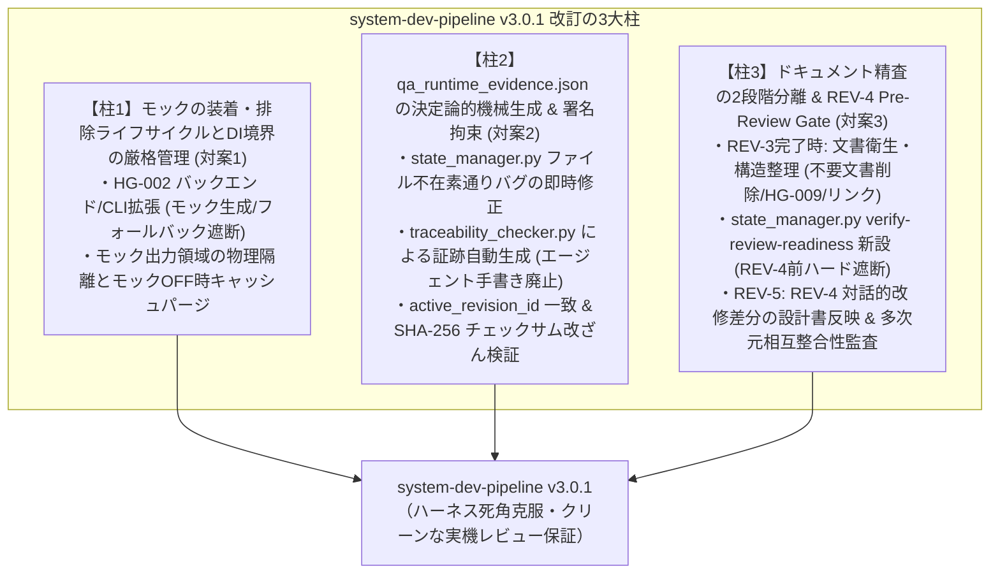

# system-dev-pipeline v3.0.1 改訂基本計画書（ハーネス死角克服・モック管理・証跡機械化・Pre-Review Gate）

- **文書ID**: `PLAN-V301-001`
- **改訂対象システム**: `system-dev-pipeline`
- **対象バージョン**: `v3.0.0` ➔ `v3.0.1` (`.env` `APP_VERSION=3.0.1`)
- **策定日**: 2026-11-10
- **ステータス**: 計画策定完了 / 承認待ち (REV-1)
- **親検討文書**:
  - [評価・考察レポート: V3.0 ハーネス死角フィードバックの客観的評価と改善設計案](../評価考察_V3.0ハーネス死角フィードバックの客観的評価と改善設計案.md) (`EVAL-PL-002`)
  - [パイプライン改善フィードバック報告書: V3.1 AIハーネス死角克服と意味的監査の導入](../パイプライン改善フィードバック報告書_V3.1_AIハーネス死角克服と意味的監査の導入.md)
  - [評価・考察レポート: system-dev-pipeline 抜本的改革案の客観的評価と対案](../評価考察_system-dev-pipeline抜本的改革案の客観的評価と対案.md) (`EVAL-PL-001`)

---

## 1. 改訂の背景と3大基本方針（Executive Summary）

`system-dev-pipeline` V3.0.0 において配備された Shift-Left Hard Gate（ASTトートロジー排除、2段階行数制限、空実装遮断、Stage 1.5/Stage 2 Testing Gate、`REV-1`〜`REV-6` 改訂パイプライン）は高いコード統制力を発揮した。
しかし、実践プロジェクトにおいて「全テスト100%合格・RTM 100%合格・Hard Gate PASS」という完全な判定結果をすり抜け、ユーザー実機レビュー（`REV-4`）に開発用モック（カラーバー映像 `testsrc`・正弦波音声 `sine=440`）や未整理の文書群が流出する重大な死角が報告された。

ユーザーの指示および [評価・考察レポート (`EVAL-PL-002`)](../評価考察_V3.0ハーネス死角フィードバックの客観的評価と改善設計案.md) の採択結果に基づき、本改訂（`v3.0.1`）では過剰特化な「事後波形解析（Active Semantic Auditor）」を排し、**モックの装着・排除の規律徹底、証跡JSONの決定論的機械生成、およびドキュメント精査の2段階分離（Pre-Review Readiness Gate新設）** を柱とする以下の **3大対案** を実装する。

---

## 2. 3大対案の具体化仕様

### 2.1 【柱1】モックの装着・排除ライフサイクルとDI境界の厳格管理 (対案1)

1. **`harness_guard.py` における `HG-002`（直書きモック排除）のバックエンド・CLI拡張**:
   - 従来のフロントエンド限定（`frontend/src/`）から、バックエンドおよびデスクトップ領域（`backend/`, `src-tauri/`）へ検査スコープを拡大。
   - 本番コード領域（テストディレクトリ `tests/`, `__tests__/` およびモック専用ディレクトリ `mocks/` を除く）において、以下のパターンをコミット時に `BLOCK` する：
     - モック生成関数・クラス名: `generate_mock_*`, `dummy_*`, `Mock[A-Z0-9_]+`
     - ダミーメディア生成コマンド・フィルタ: `testsrc`, `sine=`, `anoisesrc`, `color=black`
     - 例外発生時のサイレントモックフォールバック（`except Exception: return mock_data` 等）
2. **モック出力ストレージの物理隔離とクリーンアップ規約**:
   - テスト・モック実行時の生成物は、本番ワークスペース（`workspace/` や実DB）を汚染させず、必ず `tmp/` や `pytest` の `tmp_path` など隔離領域へ出力させる規約を `rules/AGENTS.md` に明記。
   - `REV-3` から `REV-4`（実結合モード）へ移行する際、残存キャッシュ・一時出力ファイルのパージ手順を確立。

### 2.2 【柱2】`qa_runtime_evidence.json` の決定論的生成と自己申告の排除 (対案2)

1. **`state_manager.py` の Invariants Gate バグ修正**:
   - `validate_revision_closure_invariants` における `if qa_evidence_path.is_file():` の素通りバグを修正し、**ファイル不在時に即座に `[INV-QA-01]` 違反として `BLOCK`** する。
2. **`traceability_checker.py` による署名付き証跡 JSON の自動出力**:
   - エージェントが手動（`write_file` 等）で作成・編集する運用を完全禁止。
   - `traceability_checker.py --mode full` 実行時、以下の全条件を満たした場合のみ `metrics/qa_runtime_evidence.json` を自動出力する：
     - 全要件の設計・テスト 100% カバレッジ達成、異常系比率 20% 以上、動的カバレッジ基準達成。
     - `.env` の `VITE_ENABLE_MOCK=false`（モック無効化）の確認。
     - 現在の `active_revision_id`、Git HEAD コミットハッシュ、生成タイムスタンプの記録。
     - 内容改ざんを検知する SHA-256 チェックサム（`evidence_checksum`）の付与。
3. **`state_manager.py` による整合性検証**:
   - `active_revision_id` との完全一致、および `evidence_checksum` の再計算突合を行い、過去改訂の使い回しや手書き改ざんを機械遮断。

### 2.3 【柱3】ドキュメント精査の「2段階分離」と `REV-4` Pre-Review Readiness Gate (対案3)

1. **ドキュメント精査の2段階分離モデル**:
   - **第1段階（`REV-3` 完了時 / `REV-4` 突入直前）：ドキュメント衛生・構造整理 (Document Hygiene)**
     - 不要な作業メモ・一時ドラフト・重複ファイルの削除。
     - `docs/設計書/Current/` 配下のファイル名正規化、タイトルからの個別バージョン番号排除（`HG-009`）、相対パスリンク切れ解消（`HG-003`）、Mermaid構文クォート確認（`HG-008`）。
     - 実装済みの既知仕様を正本へ反映し、整然とした状態でレビューを迎える。
   - **第2段階（`REV-5`）：ドキュメント内容・相互整合性精査 (Semantic Cross-Check)**
     - `REV-4` の実機テストレビューで発生した仕様・UI変更差分を設計書へ逆反映。
     - `dev-doc-reviewer` による要件定義 ⇔ 基本設計書 ⇔ 実装コード間の多次元相互整合性チェックと自動修復。
2. **`state_manager.py verify-review-readiness`（新設ゲート）の実装**:
   - 👑 コンダクターが開発サーバーを起動し、ユーザーへ実機レビューを要請する前の必須前提条件として新設。
   - 以下の 4項目 を一括機械検証し、1つでも違反があれば Exit Code 1 で遮断する：
     - `harness_guard.py --all` PASS（形式・行数・モック混入・文書衛生違反 0 件）
     - ドキュメント衛生状態（`docs/設計書/` 直下の野良ファイル不在、Current 配下の一時ファイル不在）
     - モック解除状態（`.env` の `VITE_ENABLE_MOCK=false`、`project_state.json` の `mock_mode = DISABLED`）
     - 最新かつ署名済みの `metrics/qa_runtime_evidence.json` の実在・妥当性

---

## 3. 改訂影響範囲マトリクス

| 対象コンポーネント | 変更種別 | 改修内容の概要 |
| :--- | :---: | :--- |
| **`scripts/harness_guard.py`** | コア改修 | ・`HG-002` の検査対象に `backend/`, `src-tauri/` を追加しバックエンドモック・ダミーフィルタ・例外フォールバックを遮断。 ・`HG-009` を強化し、ファイル名自体のバージョンサフィックスや一時ファイルの混入、`docs/設計書/` 直下の未整理ファイルを遮断。 |
| **`scripts/state_manager.py`** | コア改修 | ・`validate_revision_closure_invariants` のファイル不在時素通りバグ修正、`active_revision_id` 一致・チェックサム検証追加。 ・`verify-review-readiness` サブコマンド（REV-4前ゲート）の新設。 ・`set-phase REV_4` 実行時の事前検証インターロック追加。 |
| **`scripts/traceability_checker.py`** | コア改修 | ・`--mode full` 合格時に `metrics/qa_runtime_evidence.json` を署名付きで決定論的に自動出力する機能の追加（エージェント手書き廃止）。 |
| **`skeletons/common/scripts/*`** | 同期 | 上記3スクリプトの改修を共通スケルトンへ完全同報同期。 |
| **`rules/AGENTS.md`** | 規約改訂 | ・§2 コンダクター責務に `REV-4` 突入前の `verify-review-readiness` 実行義務を明記。 ・§4.1 定常コア規範に「モック出力の物理隔離」「ドキュメント精査の2段階分離」を追加。 |
| **`templates/システム改訂運用基準書.md`** | 規約改訂 | ・`REV-3` 完了条件に「第1段階：文書衛生整理」と `verify-review-readiness` PASS を追加。 ・`REV-4` 手順の前提条件としてモック完全排除と `verify-review-readiness` を明記。 ・`REV-5` を「第2段階：対話的改修差分反映と相互整合性監査」として位置づけを明確化。 |
| **`skills/dev-doc-reviewer/SKILL.md`** | スキル改訂 | 衛生整理（第1段階）と相互整合性チェック（第2段階）のフェーズ別責務を明記。 |

---

## 4. 6段階標準改訂パイプライン（REV-1〜REV-6）実施計画

- [x] **REV-1: 要件・設計・契約フィクスチャ精査 (Planning, Design & Contracts)**
  - [x] 差分要件定義書起草・精査（`[REQ-F-301-01]` モック排除、`[REQ-F-301-02]` 証跡自動生成、`[REQ-F-301-03]` Pre-Review Gate）
  - [x] スクリプト設計書および規約変更差分の策定
  - [x] 基本設計レビュー（`dev-review-arch` / `traceability_checker.py --mode design`）PASS
- [x] **REV-2: 実装・静的検証・Stage 1.5 スモーク (Implementation, Hard Gate & Smoke)**
  - [x] `harness_guard.py` 改修（`HG-002` バックエンド拡大、`HG-009` 文書衛生強化）
  - [x] `state_manager.py` 改修（証跡検証バグ修正・署名チェック、`verify-review-readiness` 実装）
  - [x] `traceability_checker.py` 改修（証跡 JSON 自動生成機能実装）
  - [x] 規約・テンプレート改訂（`AGENTS.md`, `システム改訂運用基準書.md`, `SKILL.md`）
  - [x] スケルトン（`skeletons/common/scripts/`）への同報同期
  - [x] コミット前 Hard Gate（`python3 scripts/harness_guard.py --all`）PASS
- [x] **REV-3: 自動テスト・実結合E2E・感覚センサー検証 (Automated E2E & Sensory)**
  - [x] 改修スクリプト群の単体・異常系テストスイート実行（モック検知、証跡チェックサム検証、文書衛生検知）
  - [x] `traceability_checker.py --mode full` による RTM 100% 達成および `qa_runtime_evidence.json` の自動発行確認
  - [x] **第1段階：ドキュメント衛生・構造整理**（不要文書削除、文書名正規化、リンク切れゼロ）の実施
  - [x] **Pre-Review Readiness Gate 検証**: `python3 scripts/state_manager.py verify-review-readiness` の実行・ALL CLEAR 確認
- [x] **REV-4: 開発サーバー起動・ユーザー実機レビュー・改修 (User Live Review & Refinement)**
  - [x] `verify-review-readiness` PASS を受けて、実結合モードで改修内容の動作確認デモを提示
  - [x] ユーザーへの実機・実動作レビュー要請
  - [x] ユーザー指摘事項の対話的改修・再検証ループ
  - [x] ユーザー実機レビュー承認取得（`python3 scripts/state_manager.py record-approval --phase REV_4`）
- [x] **REV-5: 本番総合監査・成果物ビルド (System Review & Production Build)**
  - [x] **第2段階：ドキュメント内容・相互整合性精査**（`REV-4` 改修差分の正本反映、`dev-doc-reviewer` 実行）
  - [x] コード品質レビュー（`dev-review-code`: `CLEAN`）
  - [x] システム総合レビュー（`dev-review-system`: `RELEASE APPROVED`）
  - [x] プラグインパッケージ整合性およびスケルトン完全一致検証
- [x] **REV-6: メトリクス・知見昇格・リリース (Metrics, Evolution & Closure)**
  - [x] 定量メトリクス集計（`metrics_collector.py --all`）
  - [x] Central Knowledge Hub 整合性確認（`pipeline-reconciler.sh --status`）
  - [x] グローバル環境へのデプロイ同期（`sync_pipeline.sh --deploy`）
  - [x] GitHub 本番リリース（`v3.0.1` リリース、タグ付与）

---

## 5. 完了判定条件（Exit Criteria）

1. `harness_guard.py` がバックエンドのモック関数・`testsrc` 等のダミー生成および文書衛生違反を確実に `BLOCK` できること。
2. `traceability_checker.py --mode full` がチェックサム付きの `metrics/qa_runtime_evidence.json` を決定論的に出力すること。
3. `state_manager.py verify-review-readiness` が配備され、不備がある場合に `REV-4` への進行を物理遮断できること。
4. 全6段階の手順書および規約ドキュメント群が相互に矛盾なく整備されていること。
