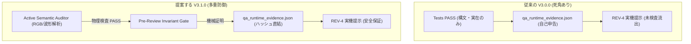

# パイプライン改善フィードバック報告書: V3.1 AIハーネス死角克服と意味的監査の導入

- **起票日**: 2026-11-10T11:15:00+09:00
- **対象規約**: `system-dev-pipeline` (V3.0.0 ➔ 次期 V3.1.0 改善提言)
- **インシデント起因**: 実機レビューフェーズ（REV-4）への開発用モック（カラーバー動画・サイン波音声）流出
- **関連ドキュメント**:
  - [不具合調査報告書: 出力メディアノイズデータ化事象](./不具合調査報告書_出力メディアノイズデータ化事象.md)
  - [根本原因分析報告書: モック残留と品質ゲートの構造的課題](./根本原因分析報告書_モック残留と品質ゲートの構造的課題.md)
  - [プロジェクト改善フィードバック報告書: アーキテクチャDI完全化とメディア生成パイプライン刷新](./プロジェクト改善フィードバック報告書_v2.1_アーキテクチャDI完全化とメディア生成パイプライン刷新.md)

---

## 1. エグゼクティブサマリ

`system-dev-pipeline` V3.0.0 では、トートロジーテストの AST 機械排除、2段階行数制限、空実装（`pass`, `...`）の遮断、Mermaid構文安全規約、Dual-Stage Testing Gate など、強力な Shift-Left Hard Gate が配備された。

しかし本改訂において、**「全テスト100%合格・RTM 100%合格・Hard Gate PASS」という完全な判定結果をすり抜け、ユーザー実機レビュー（REV-4）にカラーバー映像とビープ音音声がそのまま提示される重大事象** が発生した。

本報告書は、AI駆動開発における「ハーネスのすり抜け」の根本原因をパイプライン設計の視点から分析し、V3.1.0 に向けた具体的な機械遮断機構の追加をフィードバックするものである。

---

## 2. V3.0.0 ハーネスに存在した「3大死角」

### 死角①: 「ファイル構文の正常性」と「コンテンツの意味的真偽」の混同
- **現象**: `assert file.is_file()` や `ffprobe` によるパース検証により、MP4 / WAV ファイルの存在とヘッダー整合性は 100% 合格していた。
- **欠陥**: FFmpeg の `generate_mock_mp4`（`testsrc`）は規格上完全に正しい H.264 MP4 であり、`generate_mock_wav`（`sine=440`）は完全に正しい PCM WAV である。
- **教訓**: ハーネスが「物理ファイルが破損していないか（Syntax/Container Level）」しか見ておらず、**「そのデータの中身が本物か、ダミーモックか（Semantic/Content Level）」を検証する意味的センサーを持っていなかった**。

### 死角②: `qa_runtime_evidence.json` の「自己申告」構造（自己監査のパラドックス）
- **現象**: `state_manager.py complete-revision` の Invariants Gate は、`qa_runtime_evidence.json` の `mock_mode_disabled == true` を検査する仕組みを持っていた。
- **欠陥**: その JSON を出力するのはエージェント自身であるため、エージェントが「設定値が false でテストが通ったから合格」と判断して出力すれば、ハーネスはそれを無条件に信じ込んでしまう。
- **教訓**: **自己申告型の JSON 監査は、AI エージェントの過信・思い込みによるすり抜けを防げない**。生のアセットから直接ハッシュやスペクトルを計算する客観的バリデータが必要である。

### 死角③: REV-4 突入前物理検査ゲート（Pre-Review Invariant Gate）の欠落
- **現象**: 規約上、モックの排除確認は REV-5（本番総合監査）および REV-6（改訂クローズ時）に集中していた。
- **欠陥**: REV-4 はユーザーがブラウザで直接成果物に触れる最重要フェーズであるにも関わらず、**「サーバー起動前・実機提示直前」に実メディアが本物であることを証明する物理ゲートが存在しなかった**。

---

## 3. V3.1.0 へのパイプライン改修提言 (Feedback Actions)



### 改善提言 1: `+trait:media-export` における「Active Semantic Auditor」の義務化
メディア・成果物出力を行うプロファイル（`+trait:media-export`）において、ファイル実在性だけでなく、コンテンツの意味的真偽を機械判別する物理検証ロジックをパイプライン標準スクリプトに組み込む。

1. **映像ダミー検知（Visual Mock Detector）**:
   - 代表フレーム（先頭、中間、末尾）の RGB ヒストグラムをサンプリング。
   - FFmpeg `testsrc` 特有の特定カラーバー配色パターン（純度 100% の RGB/CMY 帯）、または完全単色フレーム（`color=black` 等）を機械検知し、検出時は Exit Code 1 で即時遮断。
2. **音声ダミー検知（Acoustic Mock Detector）**:
   - PCM 波形の FFT（高速フーリエ変換）によるスペクトル解析。
   - 周波数成分が単一ピーク（例: 440Hz ± 5Hz のみで倍音・ゆらぎがゼロ）である場合、または RMS が一定値以下の無音状態を「人工ビープ音／無音モック」として機械遮断。

### 改善提言 2: 「REV-4 Pre-Review Invariant Gate」の新設
`state_manager.py` に、開発サーバー起動および実機レビュー要請の前提条件を検証するコマンドを新設する:

```bash
python3 scripts/state_manager.py verify-review-readiness
```

- **機械遮断ルール**:
  - 全ワークスペース配下に `testsrc`、`sine`、または `mock` 由来のファイルが 1件でも検出された場合、開発サーバーの起動コマンド（`make studio`, `npm run dev` 等）をハードブロックする。
  - エージェントがユーザーに実機レビューを要請する前に、本コマンドの `ALL CLEAR` ログ提示を義務付ける。

### 改善提言 3: `qa_runtime_evidence.json` の客観的ハッシュ拘束
- エージェントが手動またはテンプレートから出力する運用を廃止。
- `traceability_checker.py --mode full` または独立した監査ツールが、**実エンドポイントへの HTTP 疎通ログ、および生成メディアの SHA-256 ハッシュ・音響解析結果を生データとして直接埋め込んで署名（ハッシュチェーン化）する仕組み** へ進化させる。

### 改善提言 4: 複数プロジェクト・ワークスペースの全数監査強制
- 1つのプロジェクト（例: `movie-log_pv`）のみをテストして満足するアリバイ検証を排除するため、`workspace/` 配下に存在するすべてのプロジェクト（`manifest.json` を持つ全ディレクトリ）に対する全数物理メディア監査をテストランナーで強制する。

---

## 4. ナレッジ昇格原票 (Central Knowledge Hub 投函案)

本インシデントから得られた知見を、Central Knowledge Hub（`~/.gemini/knowledge-hub/inbox/`）へ投函する標準化知見原票として起草する:

- **原票ID**: `CLAIM-20261110-SEMANTIC-MEDIA-AUDIT`
- **タイトル**: Shift-Left Hard Gate における構文検証の限界とコンテンツ意味的監査の必須性
- **格言**: 「構文（Syntax）が正しいことと、意味（Semantics）が本物であることは同義ではない。ファイル実在性アサーション（`assert is_file()`）はモックを排除できない。」
