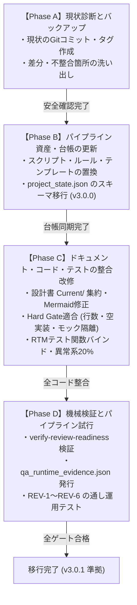

# v3.0.1 改訂対応移行ロードマップ (Migration Roadmap)

- **文書ID**: `ROADMAP-V301-MIG`
- **作成日**: 2026-11-12
- **対象バージョン**: `system-dev-pipeline` v2.6.2 ➔ v3.0.1 (次期 v3.0.3 検討課題)
- **対象読者**: v2.6.2 以前のパイプラインで構築された既存プロジェクトの開発者、保守担当者、およびプロジェクトコンダクター (`conductor`)
- **関連文書**:
  - [v2.6.2からv3.0.1への変更詳細仕様書](./01_v2.6.2からv3.0.1への変更詳細仕様書.md)
  - [既存プロジェクト向けv3.0.1移行改訂実践ガイド](./02_既存プロジェクト向けv3.0.1移行改訂実践ガイド.md)
  - [移行チェックリストおよびトラブルシューティング](./03_移行チェックリストおよびトラブルシューティング.md)
  - [AI駆動システム開発プロセス標準規約 (AGENTS.md)](../../../.agents/plugins/system-dev-pipeline/rules/AGENTS.md)
  - [AI駆動システム開発フェーズ定義書](../../設計書/Current/AI駆動システム開発フェーズ定義書.md)
  - [AI駆動システム開発手順書](../../設計書/Current/AI駆動システム開発手順書.md)

---

## 1. はじめに

### 1.1 背景
AI駆動システム開発パイプライン（`system-dev-pipeline`）は、バージョン `v2.6.2` から `v3.0.0`（メジャーアップデート: 構造改革・AIハーネス強化）および `v3.0.1`（パッチアップデート: ハーネス死角克服・実結合事前検証強化）を経て、大きな進化を遂げました。

従来（v2.6.2）のパイプラインで構築・運用されている複数のシステム開発プロジェクトにおいて、今後の機能追加や保守運用を最新パイプラインの品質保証・安全機構のもとで円滑に継続するためには、各プロジェクトの管理台帳、スクリプト、設計文書、およびテストコードを `v3.0.1` 規格へ整合させる改訂（マイグレーション）が必要です。

### 1.2 本ドキュメント群の目的
本ドキュメント群は、既存プロジェクトを v2.6.2 から v3.0.1 へバージョンアップする際の手順と変更点を体系的に整理し、開発者および AI エージェントが迷うことなく、かつ安全に改訂作業を遂行できる実践的な手引きを提供することを目的とします。

---

## 2. v2.6.2 から v3.0.1 への進化の全体像

v2.6.2 から v3.0.1 へのバージョンアップは、単なるスクリプトの更新にとどまらず、**「AIエージェントの過信・浅いアリバイテストの排除」「実機提示直前の品質保証（Shift-Left Pre-Review Gate）」「モックの装着・排除の物理的分離」** というアーキテクチャ上の本質的改革を含んでいます。

```mermaid
flowchart LR
    subgraph V262["v2.6.2 世代"]
        V2_Pipe["5段階改訂 (REV-1〜5)"]
        V2_RTM["文字列マッチング型 RTM"]
        V2_Line["単一ハード行数制限 (FE 250 / BE 400)"]
        V2_Doc["設計書個別バージョン表記 (V2.6.md)"]
    end

    subgraph V301["v3.0.1 世代 (最新規約)"]
        V3_Pipe["6段階改訂 (REV-1〜6)<br>ユーザー実機レビュー・承認義務化"]
        V3_RTM["有効テスト関数直結 RTM<br>＋ トートロジー排除 ＋ 署名付証跡"]
        V3_Line["2段階行数制限 (WARN / BLOCK)"]
        V3_Doc["SemVer一元管理 (Current/ 配下集約)<br>＋ ドキュメント2段階分離"]
        V3_Gate["Pre-Review Hard Gate<br>(verify-review-readiness)"]
        V3_Trait["2.5層プロファイル体系<br>(Core Profile ＋ Traits)"]
    end

    V262 -->|"抜本的アップグレード"| V301
```

### 主要な構造的変更の対比

| 観点 | v2.6.2 | v3.0.1 (最新) | 影響と効果 |
| :--- | :--- | :--- | :--- |
| **改訂ライフサイクル** | `REV-1`〜`REV-5` の5段階。 ユーザー実機確認は暗黙的。 | `REV-1`〜`REV-6` の6段階。 `REV-4` 実機レビューと明示承認が必須。 | 開発完了とリリース承認の境界が明確化され、未検証のままリリースされるリスクを根絶。 |
| **事前レビュー遮断** | 存在しない（REV-4/5で一括監査）。 | `REV-4` 突入前に `verify-review-readiness` で機械遮断。 | 不備のあるドキュメントやモック残留状態での実機提示を未然防止。 |
| **要件トレーサビリティ** | ファイル内の文字列有無や計画書の文脈で判定可能だった。 | テスト関数スコープ直結、トートロジー排除、異常系20%以上、カバレッジ70%連携。 | 「中身のないアリバイテスト」を物理排除し、真のテストカバレッジを保証。 |
| **実結合QA実行証跡** | 自己申告または未配備（ファイル不在でも通過）。 | `traceability_checker.py` が SHA-256 チェックサム付きで自動発行し、Invariants で照合。 | 自己申告のパラドックスを解消し、モックOFFでの実結合E2E通過を保証。 |
| **行数制限** | FE 250行 / BE 400行の即時遮断。 | 2段階緩衝帯（FE: 250 WARN / 350 BLOCK, BE: 400 WARN / 550 BLOCK）。 | 開発作業中の不必要な手戻りを防ぎつつ、肥大化を確実に防止。 |
| **プロファイル体系** | 第1層（定常コア）＋第2層（Profile A〜E）。 | 第1層＋第2層＋Capability Traits（`+trait:*`）。Scope Guard搭載。 | 複合的なシステム要件（API同梱、メディア出力等）の検証を自動付与。 |
| **ドキュメント管理** | ファイル名にバージョン混在（`設計書V2.6.md`）。 | 個別バージョン名排除、`Current/` 集約、2段階精査分離（衛生 ➔ 整合）。 | リンク切れ・重複ファイルの発生を抑止し、常に最新の仕様を明示。 |

---

## 3. 既存プロジェクト移行の全体ロードマップ

既存プロジェクトの v3.0.1 への移行は、以下の4つのフェーズで段階的かつ安全に進めます。

### 各フェーズの概要

1. **Phase A: 現状診断とバックアップ**
   - 既存プロジェクトのGit作業ツリーをクリーンにし、移行前のベースラインタグ（例: `pre-v3-migration`）を作成。
   - 現行の `project_state.json`、設計書構成、行数超過、モック残留状況を把握。
2. **Phase B: パイプライン資産・管理台帳の更新**
   - `scripts/` 配下の `harness_guard.py`, `state_manager.py`, `traceability_checker.py` を最新版に更新。
   - `rules/AGENTS.md`, テンプレート類を最新化。
   - `project_state.json` の `schema_version` を `3.0.0` に更新し、`capability_traits`, `session_mode`, 6段階の `rev_phases` を追記。
3. **Phase C: ドキュメント・コード・テストの整合改修**
   - `docs/設計書/` 配下を整理し、`Current/` に集約。個別バージョンファイル名を廃止。
   - `harness_guard.py` に適合するよう、空実装（`pass`, `...`）の排除、バックエンドモックの隔離、Mermaid のクォート囲みを修正。
   - テストコードの `[REQ-*]` を有効なテスト関数ノード内または直上3行コメントへ配置し、異常系比率を20%以上に調整。
4. **Phase D: 機械検証とパイプライン試行**
   - `python3 scripts/harness_guard.py --all` ➔ PASS。
   - `python3 scripts/traceability_checker.py --mode full` ➔ PASS（`metrics/qa_runtime_evidence.json` 出力）。
   - `python3 scripts/state_manager.py verify-review-readiness` ➔ PASS。
   - 実際の改訂パイプライン（`REV-1`〜`REV-6`）を模擬または実際の改訂で実行し、クローズできることを確認。

---

## 4. ドキュメント構成一覧

プロジェクトの改訂作業をスムーズに行えるよう、本検討課題フォルダ配下に以下のドキュメントを用意しています。

| ドキュメント名 | 役割と対象読者 | 主な内容 |
| :--- | :--- | :--- |
| **[00_v3.0.1改訂対応移行ロードマップ.md](./00_v3.0.1改訂対応移行ロードマップ.md)** (本文書) | 全体概要・ロードマップ | バージョンアップの背景、進化の全体像、4段階移行フェーズ。 |
| **[01_v2.6.2からv3.0.1への変更詳細仕様書](./01_v2.6.2からv3.0.1への変更詳細仕様書.md)** | 詳細仕様・差分分析 | アーキテクチャ、6段階改訂、スクリプト（3大ツール）、テスト、ドキュメントの全変更詳細。 |
| **[02_既存プロジェクト向けv3.0.1移行改訂実践ガイド](./02_既存プロジェクト向けv3.0.1移行改訂実践ガイド.md)** | 実践手順書・コマンド集 | 各プロジェクトでの具体的な実行手順（Step 1〜8）、コマンド例、コード変換パターン。 |
| **[03_移行チェックリストおよびトラブルシューティング](./03_移行チェックリストおよびトラブルシューティング.md)** | 品質チェック＆FAQ | 移行完了判定チェックリスト、Hard Gate/RTM/Invariants エラー時の具体的解消法。 |

---

## 5. 次のステップ

既存プロジェクトの改訂に着手する前に、まず [01_v2.6.2からv3.0.1への変更詳細仕様書](./01_v2.6.2からv3.0.1への変更詳細仕様書.md) を通読して仕様変更の全貌を把握し、その後 [02_既存プロジェクト向けv3.0.1移行改訂実践ガイド](./02_既存プロジェクト向けv3.0.1移行改訂実践ガイド.md) に従って作業を進めてください。
