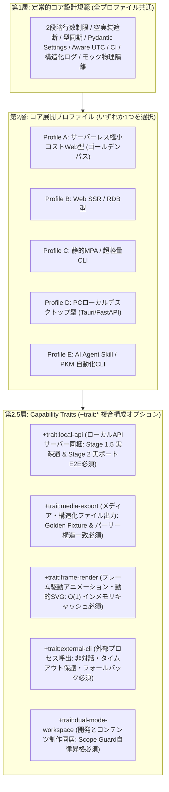
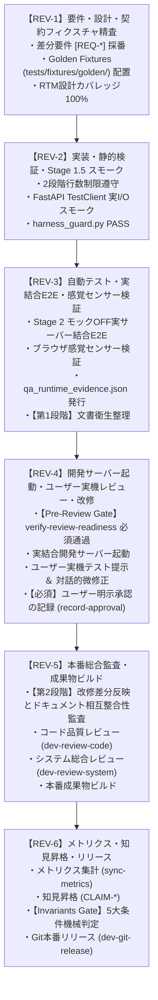
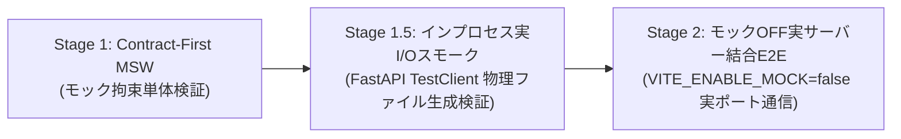

# v2.6.2からv3.0.1への変更詳細仕様書 (Specification of Changes)

- **文書ID**: `SPEC-V301-CHANGES`
- **作成日**: 2026-11-12
- **対象規約**: `system-dev-pipeline` (v2.6.2 ➔ v3.0.0 ➔ v3.0.1)
- **対象読者**: アーキテクト、エンジニア、QA担当者、およびプロジェクトコンダクター
- **関連文書**:
  - [v3.0.1改訂対応移行ロードマップ](./00_v3.0.1改訂対応移行ロードマップ.md)
  - [既存プロジェクト向けv3.0.1移行改訂実践ガイド](./02_既存プロジェクト向けv3.0.1移行改訂実践ガイド.md)
  - [移行チェックリストおよびトラブルシューティング](./03_移行チェックリストおよびトラブルシューティング.md)
  - [AI駆動システム開発プロセス標準規約 (AGENTS.md)](../../../.agents/plugins/system-dev-pipeline/rules/AGENTS.md)

---

## 1. 概要と改訂の背景

`system-dev-pipeline` は、バージョン `v2.6.2` から `v3.0.0` において**「AIハーネスの死角克服と機械的強制力の根本改革」**を断行し、続く `v3.0.1` において**「実機提示前ゲートの導入と証跡署名の機械化」**を完了しました。

本仕様書は、v2.6.2 と v3.0.1 の間に生じたすべての規約、スクリプト、データ構造、プロセス設計の変更点を項目別に詳細に規定します。

---

## 2. 2.5層システムプロファイル体系と Scope Guard

### 2.1 2.5層プロファイル構造
v2.6.2 までは「第1層：定常コア」＋「第2層：展開プロファイル（Profile A〜E）」の2層構造でしたが、v3.0.0 以降はシステム構成の多様化に対応するため **「2.5層プロファイル体系（Core Profile ＋ Capability Traits）」** に進化しました。



### 2.2 セッション動作モード (`SESSION_MODE`) と Scope Guard (`HG-011`)
- **セッションモードの導入**: `project_state.json` の `project_metadata.session_mode` に `DEV_PIPELINE`（システム開発モード）または `CONTENT_PRODUCTION`（日常コンテンツ制作・非開発モード）を保持。
- **Scope Guard (`HG-011`)**:
  - 非開発モード（`CONTENT_PRODUCTION`）や改訂未起票の待機状態（`PRODUCTION_ACTIVE` かつ `current_revision_status == "IDLE"`）において、システム本体コード領域（`backend/`, `frontend/`, `src/`, `src-tauri/`, `docs/設計書/Current/`）の編集を検出した場合、コミット前またはガード実行時に即時遮断（`BLOCK`）。
  - エージェントは手動宣言を待たずに `python3 scripts/state_manager.py start-revision --id <ID>` を呼び出してシステム改訂パイプラインへ自律昇格（Elevation）しなければならない。

---

## 3. 改訂ライフサイクル (REV-1〜REV-6) の全面改定

### 3.1 5段階から6段階への再編
v2.6.2 の 5段階改訂パイプライン（REV-1〜REV-5）は、実機提示直前の品質保証が不十分であったため、v3.0.0 / v3.0.1 では **6段階（REV-1〜REV-6）** へ全面再編されました。



### 3.2 REV-4 新設とユーザー承認記録の義務化
- **位置付け**: 開発者がブラウザや実機で直接動作を確認し、UIや文言の微調整を行うフェーズ。
- **承認ゲート**: ユーザーが実機動作をレビューし承認するまで、REV-5 および REV-6 への進行は不可。
- **承認記録コマンド**:
  ```bash
  python3 scripts/state_manager.py record-approval --rev REV_4 --approver "<User/Role>" --comment "実機動作確認完了"
  ```
  この記録が `project_state.json` に存在しない場合、改訂完了（`complete-revision`）は機械遮断されます。

### 3.3 Pre-Review Hard Gate (`verify-review-readiness`)
ユーザーに実機を提示する直前（REV-4 突入時）に、モックの残留や文書の不衛生がないことを機械的に保証する事前ゲートです。
```bash
python3 scripts/state_manager.py verify-review-readiness
```
以下の3重検査をすべてパスしなければ、開発サーバー起動や実機提示を行ってはなりません：
1. `harness_guard.py --all` の違反 0件（終了コード 0）。
2. ドキュメント衛生検査（`docs/設計書/Current/` 直下に一時ファイル・旧版ファイル不在、未整理ファイル不在）。
3. 実結合QA証跡の妥当性（`metrics/qa_runtime_evidence.json` の存在、SHA-256署名一致、モックOFF確認）。

### 3.4 改訂クローズ前提条件 (Invariants Gate) の5大条件
改訂を完了するコマンド `python3 scripts/state_manager.py complete-revision` において、以下の5大不変条件が機械検証されます：
1. **[INV-01] 本番成果物の実在**: 本番ビルド成果物（`frontend/dist/index.html` または `backend/` 等）の実在。
2. **[INV-02] 定量メトリクス集計済**: `metrics/` にメトリクスが存在し、スコアが反映されていること。
3. **[INV-03] 未処理ナレッジゼロ**: Central Knowledge Hub の inbox に未処理原票がないこと。
4. **[INV-04] REV-4 ユーザー承認記録済**: `revisions.rev_phases.REV_4.approved == true` であること。
5. **[INV-QA-01] 実結合QA実行証跡の正当性**: `metrics/qa_runtime_evidence.json` が存在し、対象改訂ID一致、SHA-256 チェックサム一致、`mock_mode_disabled == true` であること。

---

## 4. AIハーネス・スクリプト群の仕様変更詳細

### 4.1 `scripts/harness_guard.py` の変更点

#### ① 2段階行数制限 (Two-Tier Line Limit)
従来の単一ブロック制から、作業中の緩衝帯を設けた2段階制限に緩和・適正化されました。

| 対象領域 | 旧制限 (v2.6.2) | 新・ソフト上限 (WARN) | 新・ハード上限 (BLOCK) | 警告・遮断時の対応 |
| :--- | :--- | :--- | :--- | :--- |
| **フロントエンド** (`.tsx`, `.ts`, `.jsx`, `.js`) | 250行 (BLOCK) | **250行** | **350行** | WARN: PHASE 5.5 で分割推奨<br>BLOCK: コミット・CI遮断 |
| **バックエンド** (`.py`, `.rs`) | 400行 (BLOCK) | **400行** | **550行** | WARN: サービス層分割推奨<br>BLOCK: コミット・CI遮断 |

※ テストファイル (`/tests/`, `*.test.*`) および自動生成ファイル (`*.generated.ts`, `alembic/`) は除外。

#### ② HG-002: 直書きモック・メディアダミー・サイレントフォールバック遮断の強化
- フロントエンドのみならずバックエンドコード領域全般を検査。
- 禁止識別子パターンの拡充: `mockUsers`, `dummyData`, `MOCK_*`, `generate_mock_*`, `dummy_*`, `Mock*`。
- メディアダミー生成パラメータの遮断: `testsrc`, `sine=`, `anoisesrc`, `color=black`。
- **Python AST によるサイレントモックフォールバック遮断**: `except` 節内で `mock` や `dummy` を返却する記述を構文木解析で検知し物理遮断。

#### ③ HG-010: 空実装・縮退実装（Anti-Placeholder）の機械遮断
AIが実装をサボる縮退実装を検出・遮断：
- 空JSXハンドラ: `onClick={() => {}}`
- ダミー生成コメント: `<!-- Generated -->`, `<!-- TODO -->`, `placeholder_output`
- **Python AST 空関数検知**: `@abstractmethod` や `@overload` を除く通常関数で、本文が `pass`, `...` (Ellipsis), `raise NotImplementedError` のみである単一文関数を検出して BLOCK。

#### ④ PAT-DOC-003: Mermaid 構文安全規約（クォート必須化）
Markdown 内の Mermaid 定義において、矢印ラベル（`-->|...|`）に丸括弧 `()`、角括弧 `[]`、波括弧 `{}`、隅付き括弧 `【】` を含める場合、ダブルクォーテーション `"` で囲まれていないものを構文エラー予防として機械遮断。

---

### 4.2 `scripts/traceability_checker.py` の変更点

#### ① テスト計画書カウントの完全排除
旧バージョンでは `docs/plans/シナリオテスト計画書.md` 内に `[REQ-*]` の記載があるだけでテスト済みと誤認されていましたが、新仕様では計画書を完全に除外しました。

#### ② 有効テスト関数スコープ直結バインド
単純な「ファイル内に文字列が存在するか」の判定を廃止し、**「有効なテスト関数スコープ内、またはその直前3行コメントに存在する `[REQ-*]`」** のみを正当なテスト参照としてカウントします。
- Python: `ast.FunctionDef` / `ast.AsyncFunctionDef`（`test_` で始まる関数）。
- TypeScript / JavaScript: `it(...)` / `test(...)` のブロック内、または直前3行コメント。
- Rust: `fn test_*` の関数内、または直前3行コメント。

#### ③ トートロジーテスト（無意味なアリバイテスト）の機械排除
Python AST 解析により、以下のような「常に True になる自己完結テスト」を無効化し、カウント対象から除外します：
- 定数比較（例: `assert 1 == 1`, `assert True`）。
- 実コードやAPIの呼出を伴わないローカル自己代入の検証（例: `x = 5; assert x == 5`）。
- TS/JS の浅いアサーションのみ（例: `expect(x).toBeDefined()` のみで操作・インタラクションなし）。

#### ④ 異常系テスト比率（20%以上）および動的カバレッジ（70%以上）の検証
- テスト関数名または docstring 内に `@test_type: negative`, `abnormal`, `error`, `invalid`, `failure`, `異常系` などの語句が含まれる割合が **全体の 20.0% 以上** であることを要求。
- カバレッジレポート（`coverage/coverage-summary.json` 等）と連携し、コード網羅率が **70.0% 以上** であることを機械判定。

#### ⑤ `metrics/qa_runtime_evidence.json` の SHA-256 署名付き自動発行
自己申告によるすり抜けを防ぐため、`traceability_checker.py --mode full` が成功した際にのみ、以下の構造を持つ証跡 JSON を自動出力します。
```json
{
  "active_revision_id": "REV-20261112-001",
  "all_requirements_covered": true,
  "anomaly_test_ratio": 25.0,
  "generated_at": "2026-11-12T12:00:00Z",
  "git_commit_hash": "a1b2c3d...",
  "mock_mode_disabled": true,
  "overall_status": "PASS",
  "sha256_checksum": "9f83c61179... (残余フィールドから算出した署名)"
}
```

---

### 4.3 `scripts/state_manager.py` の変更点

#### ① 管理台帳の分離（Hybrid State Ledger & Single Writer 原則）
- 機械正本: `project_state.json`（JSON Schema 準拠）。
- 自動生成ビュー: `PROJECT_STATE.md`（人間可読用）。
- コンダクター（`conductor`）のみが `state_manager.py` を通じて更新することを厳格化。

#### ② スキーマ拡張
- `schema_version`: `"3.0.0"`
- `project_metadata.capability_traits`: 配列（例: `["local-api", "media-export"]`）
- `project_metadata.session_mode`: `"DEV_PIPELINE"` または `"CONTENT_PRODUCTION"`
- `revisions.rev_phases`: `REV_1`〜`REV_6` の状態および `REV_4` 承認メタデータ。

#### ③ 新規サブコマンド
- `python3 scripts/state_manager.py set-mode --mode <DEV_PIPELINE|CONTENT_PRODUCTION>`
- `python3 scripts/state_manager.py set-traits --traits <trait1,trait2,...>`
- `python3 scripts/state_manager.py verify-review-readiness`（REV-4 前ゲート検査）
- `python3 scripts/state_manager.py record-approval --rev REV_4 --approver <名> --comment <文>`

---

## 5. テスト・検証アーキテクチャの変更

### 5.1 Dual-Stage Testing Gate (Stage 1 ➔ 1.5 ➔ 2)
v2.6.2 では MSW（モック）と実結合テストの境界が曖昧でしたが、v3.0.1 では 3段階の厳格なステージングが定義されました。



1. **Stage 1 (Contract-First MSW)**: `openapi.json` から生成した型定義に厳格拘束された MSW によるフロント単体テスト。
2. **Stage 1.5 (インプロセス実I/Oスモーク)**:
   - バックエンドの FastAPI `TestClient` を用いて、ネットワークスタックを介さずに実サービス層・実ファイルシステムI/Oを実行。
   - 物理ファイル（JSON, MP4, CSV 等）を実際に書き出し、標準パーサー（Pydantic, JSON パーサー, ffprobe 等）でヘッダー・構造を検証するスモークテスト。
3. **Stage 2 (モックOFF実サーバー結合E2E)**:
   - `.env` で `VITE_ENABLE_MOCK=false` を設定。実バックエンドコンテナを起動し、Chrome DevTools MCP / Playwright でブラウザ結合操作を検証。

### 5.2 Executable Golden Fixtures (`tests/fixtures/golden/`)
設計書への巨大な JSON やサンプルデータのベタ書きを廃止し、テスト実行可能な具象期待値を `tests/fixtures/golden/` 配下に配置して設計書から相対リンク参照する規律を徹底しました。

### 5.3 ドキュメント精査の2段階分離
- **第1段階: 文書衛生整理 (REV-3 完了時 / REV-4 直前)**:
  - `docs/設計書/Current/` 直下の一時ファイル（`tmp_*`）、旧版ファイル（`*_v2.6.md` 等）の排除。
  - ファイル命名規則の適合（`HG-009`）、ファイル間リンクの相対パス検証。
- **第2段階: 対話的改修差分反映と相互整合性監査 (REV-5)**:
  - REV-4 の実機レビューで発生した UI やロジックの対話的変更を、要件定義書・画面仕様書・ビジネスロジック仕様書・API設計書へ完全に同期・整合確認。

---

## 6. ドキュメント管理および命名規約の変更

### 6.1 設計書タイトル・ファイル名からの個別バージョン番号排除
- **旧規約**: `docs/設計書/Current/AI駆動システム開発手順書V2.6.md`
- **新規約**: `docs/設計書/Current/AI駆動システム開発手順書.md`
  - ファイル名および見出しから個別バージョン番号を排除し、システム全体の SemVer（`APP_VERSION`）で一元管理。
  - 過去版は `docs/設計書/v2.6/` 等のアーカイブディレクトリへ隔離。

### 6.2 相対パスの強制
- Markdown 内のリンクに `file:///` や `/Users/...` 等の絶対パスを使用することを厳禁とし、必ず対象ファイル間の相対パス（例: `../設計書.md`）を使用すること。

---

## 7. 5大エージェント協調モデルの責務更新

| エージェント | 主な更新点・禁止事項 |
| :--- | :--- |
| 👑 **プロジェクトコンダクター (`conductor`)** | ・`state_manager.py` 一元更新（Single Writer）。<br>・**REV-4 前 `verify-review-readiness` の実行義務**。<br>・開発サーバー起動、実機レビュー提示、ユーザー承認記録。<br>・コード・設計書の直接編集原則禁止（委譲徹底）。 |
| 📐 **設計・立案スペシャリスト (`architect`)** | ・2.5層プロファイル（Core ＋ Traits）選定提案。<br>・Golden Fixtures の配置と設計書からの相対リンク。<br>・**【絶対禁止】いかなる場合も `run_command` を呼び出してはならない**。 |
| 💻 **バックエンドエンジニア (`backend-engineer`)** | ・2段階行数制限（400 WARN / 550 BLOCK）遵守。<br>・空実装（`pass`, `...`, `NotImplementedError`）絶対禁止（`HG-010`）。<br>・モック混入・サイレントフォールバック遮断（`HG-002`）。<br>・FastAPI `TestClient` による Stage 1.5 スモークテスト実装。 |
| 🎨 **UI/UXデザイナー (`ui-designer`)** | ・2段階行数制限（250 WARN / 350 BLOCK）遵守。<br>・空JSXハンドラ（`onClick={() => {}}`）禁止（`HG-010`）。<br>・Contract-First MSW 拘束。<br>・動的SVG・フレーム描画時の O(1) インメモリキャッシュ配備。 |
| 🛡️ **品質・テストスペシャリスト (`qa-engineer`)** | ・テスト関数スコープ直結 `[REQ-*]` バインド・異常系20%検証。<br>・トートロジーテストの排除。<br>・**`metrics/qa_runtime_evidence.json` の発行と検証**。<br>・コードの直接修正禁止（調査結果・Diff案をConductorへ報告）。 |

---

## 8. 仕様変更まとめ

v2.6.2 から v3.0.1 へのバージョンアップは、AI駆動開発における**「見せかけの合格」「モックの意図せぬ本番流出」「過度な行数ブロックによる作業停滞」**という実務上のペインを解決するために最適化された構造改革です。

既存プロジェクトの改訂作業にあたっては、次章の「[既存プロジェクト向けv3.0.1移行改訂実践ガイド](./02_既存プロジェクト向けv3.0.1移行改訂実践ガイド.md)」に従い、安全かつ確実に移行を進めてください。
