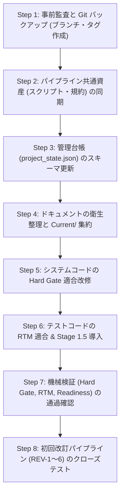

# 既存プロジェクト向けv3.0.1移行改訂実践ガイド (Migration & Revision Practical Guide)

- **文書ID**: `GUIDE-V301-PRACTICAL`
- **作成日**: 2026-11-12
- **対象バージョン**: `system-dev-pipeline` v2.6.2 ➔ v3.0.1
- **対象読者**: プロジェクトコンダクター、リードエンジニア、改訂作業担当者
- **関連文書**:
  - [v3.0.1改訂対応移行ロードマップ](./00_v3.0.1改訂対応移行ロードマップ.md)
  - [v2.6.2からv3.0.1への変更詳細仕様書](./01_v2.6.2からv3.0.1への変更詳細仕様書.md)
  - [移行チェックリストおよびトラブルシューティング](./03_移行チェックリストおよびトラブルシューティング.md)
  - [AI駆動システム開発プロセス標準規約 (AGENTS.md)](../../../.agents/plugins/system-dev-pipeline/rules/AGENTS.md)

---

## 1. はじめに

本書は、`v2.6.2` 以前のパイプラインで構築された既存プロジェクトを、最新の `v3.0.1` 規約および AI ハーネス環境へ安全かつ確実に移行（マイグレーション）するための実践手順書です。

作業は段階的なステップ（Step 1〜8）で構成されており、各ステップでの具体的な実行コマンド、コード修正例、および検証判定基準を網羅しています。

---

## 2. 移行作業の全体フロー



---

## 3. ステップ・バイ・ステップ移行手順

### Step 1: プロジェクトの事前監査と Git バックアップ

移行作業を開始する前に、作業ツリーの状態を確認し、安全のための退避タグを作成します。

1. **未コミット変更の整理**:
   ```bash
   git status
   # 未コミットの変更がある場合はコミットまたは stash
   git commit -am "chore: pre-migration clean state"
   ```
2. **移行前ベースラインタグの作成**:
   ```bash
   git tag "pre-v301-migration"
   ```
3. **作業用ブランチの作成**:
   ```bash
   git checkout -b "feature/v301-pipeline-migration"
   ```

---

### Step 2: パイプライン共通資産の同期・更新

パイプラインの中核スクリプト、規約、およびテンプレートを最新版に更新します。

1. **共通スクリプトの更新**:
   最新のテンプレートリポジトリ（または `~/.gemini/config/plugins/system-dev-pipeline/`）から以下の3スクリプトをプロジェクトの `scripts/` 配下へ上書きコピーします：
   - `scripts/harness_guard.py`
   - `scripts/state_manager.py`
   - `scripts/traceability_checker.py`

   実行権限を付与します：
   ```bash
   chmod +x scripts/*.py
   ```

2. **プロジェクト規約（`rules/`）の更新**:
   `.agents/plugins/system-dev-pipeline/rules/AGENTS.md`（またはプロジェクトの `rules/AGENTS.md`）を v3.0.0/v3.0.1 準拠の規約へ更新します。

---

### Step 3: 管理台帳 (`project_state.json`) のスキーマ更新

`project_state.json` を v3.0.0 形式のスキーマへ移行します。

#### ① `project_state.json` の差分更新例
```json
{
  "schema_version": "3.0.0",
  "project_metadata": {
    "project_name": "your-project-name",
    "app_version": "1.0.0",
    "deployment_profile": "Profile A",
    "capability_traits": [
      "local-api",
      "media-export"
    ],
    "session_mode": "DEV_PIPELINE",
    "mock_mode": "DISABLED",
    "execution_mode": "GLOBAL_PLUGIN",
    "template_source": "~/.gemini/config/plugins/system-dev-pipeline",
    "knowledge_hub_status": "SYNCED (Immutable Core v3.0.0 + Local Overlay)",
    "current_branch": "feature/v301-pipeline-migration",
    "updated_at": "2026-11-12T12:00:00Z",
    "updated_by": "conductor"
  },
  "revisions": {
    "current_revision_status": "IDLE",
    "active_revision_id": null,
    "rev_phases": {
      "REV_1": { "title": "要件・設計・契約フィクスチャ精査", "status": "PENDING" },
      "REV_2": { "title": "実装・静的検証・Stage 1.5 スモーク", "status": "PENDING" },
      "REV_3": { "title": "自動テスト・実結合E2E・感覚センサー検証", "status": "PENDING" },
      "REV_4": { "title": "開発サーバー起動・ユーザー実機レビュー・改修", "status": "PENDING", "approved": false, "approved_at": null, "approver": null },
      "REV_5": { "title": "本番総合監査・成果物ビルド", "status": "PENDING" },
      "REV_6": { "title": "メトリクス・知見昇格・リリース", "status": "PENDING" }
    }
  }
}
```

#### ② コマンドによる Traits とセッションモードの設定
```bash
# 必要に応じて Capability Traits を設定
python3 scripts/state_manager.py set-traits --traits "local-api,media-export"

# セッションモードを DEV_PIPELINE に設定
python3 scripts/state_manager.py set-mode --mode DEV_PIPELINE
```

---

### Step 4: ドキュメントの衛生整理と `Current/` 集約

旧バージョン（v2.6.2以前）の設計書は、ファイル名に個別バージョン（`V2.6` 等）が含まれていたり、不要な一時ファイルが散在しているケースがあります。

1. **旧版ファイルの退避と `Current/` 集約**:
   ```bash
   # 旧版保存用ディレクトリの作成
   mkdir -p docs/設計書/v2.6
   
   # バージョン名付きファイルの移動
   mv docs/設計書/Current/*V2.6*.md docs/設計書/v2.6/ 2>/dev/null || true
   
   # 正本設計書はバージョン名を排除して Current/ 直下に配置
   # 例: AI駆動システム開発手順書V2.6.md ➔ docs/設計書/Current/AI駆動システム開発手順書.md
   ```

2. **Mermaid 構文安全規約（ダブルクォート囲み）の修正**:
   Markdown 内で特殊記号（`()`, `[]`, `{}`, `【】`, `/` 等）を含む Mermaid の矢印ラベルをクォートします。
   ```mermaid
   %% 修正前 (NG: コミット前ガードで遮断される)
   %% A -->|処理実行(同期)| B
   
   %% 修正後 (OK)
   A -->|"処理実行(同期)"| B
   ```

3. **相対パスの徹底**:
   ドキュメント内のリンクが `file:///` や絶対パスになっていないか確認し、相対パス（例: `../設計書.md`）へ統一します。

---

### Step 5: システムコードの Hard Gate 適合改修

最新の `harness_guard.py` は、以下のチェックを厳格に行います。事前実行して違反を検出・修正します。

```bash
python3 scripts/harness_guard.py --all
```

#### ① 行数制限の確認（2段階緩衝帯）
- フロントエンド: 250行超（WARN / 推奨分割）/ 350行超（BLOCK / 必須分割）
- バックエンド: 400行超（WARN / 推奨分割）/ 550行超（BLOCK / 必須分割）
- **対応**: 350行または550行を超えているファイルは、サブコンポーネント、カスタムフック、DTO、サービスクラスへ物理分割します。

#### ② 空実装・縮退実装（`HG-010`）の解消
- **Python**:
  ```python
  # 修正前 (NG: HG-010 で遮断)
  def calculate_tax(amount: float) -> float:
      pass  # あるいは ... や raise NotImplementedError
  
  # 修正後 (OK: 実ロジックまたは具象例外)
  def calculate_tax(amount: float) -> float:
      return round(amount * 0.10, 2)
  ```
- **React / TypeScript**:
  ```tsx
  // 修正前 (NG: HG-010 で遮断)
  <button onClick={() => {}}>保存</button>
  
  // 修正後 (OK: ハンドラ実装)
  <button onClick={handleSave}>保存</button>
  ```

#### ③ バックエンドモック混入・サイレントフォールバック（`HG-002`）の排除
- バックエンドコード内での `generate_mock_*`, `dummy_*`, `testsrc` 等の直書きを排除。
- `try-except` 節内でエラー時にモックデータを返却するサイレントフォールバックを排除し、Fail-Fast に例外を送出するよう改修。

---

### Step 6: テストコードの RTM 適合 & Stage 1.5 導入

最新の `traceability_checker.py` は、有効なテスト関数スコープ内の `[REQ-*]` のみを認識します。

#### ① `[REQ-*]` バインドの適正化
テストコード内の `[REQ-*]` タグを、テスト関数の docstring 内、または直前3行のコメントに配置します。

- **Python (pytest)**:
  ```python
  # OK: 関数 docstring 内にバインド
  def test_user_authentication():
      """
      ユーザー認証の正常系検証
      [REQ-F01]
      """
      response = client.post("/login", json={"user": "admin", "password": "secret"})
      assert response.status_code == 200

  # OK: 直前3行コメントにバインド
  # @test_type: negative
  # [REQ-F01] 不正パスワード時の拒絶検証
  def test_user_authentication_invalid_password():
      response = client.post("/login", json={"user": "admin", "password": "wrong"})
      assert response.status_code == 401
  ```

- **TypeScript (Vitest / Jest)**:
  ```typescript
  // OK: it ブロック直前にバインド
  // @test_type: negative
  // [REQ-F02] 空文字送信時のバリデーションエラー
  it("should reject empty input", async () => {
    render(<UserForm />);
    fireEvent.click(screen.getByRole("button", { name: /送信/i }));
    expect(await screen.findByText(/必須項目です/i)).toBeInTheDocument();
  });
  ```

#### ② トートロジーテストの排除
実コードを呼び出さない定数アサーション（`assert True` 等）を排除し、実際の関数・API・コンポーネントの戻り値や副作用を検証するよう書き換えます。

#### ③ 異常系テスト比率（20%以上）の確保
テスト関数名に `error`, `invalid`, `failure`, `negative` を含めるか、docstring / コメントに `@test_type: negative` を付与し、異常系テスト比率が 20% 以上になるように調整します。

#### ④ Stage 1.5 スモークテストの追加
FastAPI `TestClient` を用いて、インプロセスで実ファイルシステムI/Oを行い物理ファイル構造を検証するスモークテスト（例: `tests/test_stage1_5_smoke.py`）を作成します。

```python
from pathlib import Path
from fastapi.testclient import TestClient
from backend.main import app

client = TestClient(app)

def test_stage1_5_export_smoke(tmp_path: Path):
    """
    Stage 1.5 スモーク: 物理ファイル生成と構造整合性検証
    [REQ-F05]
    """
    response = client.post("/api/export", json={"target_dir": str(tmp_path)})
    assert response.status_code == 200
    
    exported_file = tmp_path / "output.json"
    assert exported_file.is_file()
    assert exported_file.stat().st_size > 0
```

---

### Step 7: 機械検証の実行

すべての改修が完了したら、以下の3大検証を実行してすべて PASS することを確認します。

```bash
# 1. ハードゲート静的検証 (違反0件)
python3 scripts/harness_guard.py --all

# 2. 要件トレーサビリティ & 異常系比率検証 (証跡発行)
python3 scripts/traceability_checker.py --mode full

# 3. REV-4 実機レビュー突入前ゲート検証
python3 scripts/state_manager.py verify-review-readiness
```

- `traceability_checker.py --mode full` が成功すると、`metrics/qa_runtime_evidence.json`（SHA-256 署名付き）が生成されます。
- `verify-review-readiness` が成功すると、実機提示準備が完了したことが確認されます。

---

### Step 8: 初回改訂パイプライン (REV-1〜6) のクローズテスト

最後に、`state_manager.py` による 6段階改訂パイプラインの正常動作を確認します。

1. **改訂の起票**:
   ```bash
   python3 scripts/state_manager.py start-revision --id "REV-MIG-001" --title "v3.0.1パイプライン移行改訂"
   ```
2. **各フェーズの進行記録**:
   ```bash
   python3 scripts/state_manager.py set-phase REV_2
   python3 scripts/state_manager.py set-phase REV_3
   # 文書衛生整理・テスト実行・証跡発行
   python3 scripts/traceability_checker.py --mode full
   
   # REV-4 突入前の事前ゲート検査
   python3 scripts/state_manager.py verify-review-readiness
   python3 scripts/state_manager.py set-phase REV_4
   ```
3. **ユーザー実機レビュー承認の記録 (必須)**:
   ```bash
   python3 scripts/state_manager.py record-approval --rev REV_4 --approver "User" --comment "移行後実機動作確認完了"
   ```
4. **本番総合監査とビルド**:
   ```bash
   python3 scripts/state_manager.py set-phase REV_5
   # 本番ビルド実行
   # npm run build (frontend/dist/index.html 生成)
   ```
5. **改訂完了 (Invariants Gate 判定)**:
   ```bash
   python3 scripts/state_manager.py set-phase REV_6
   python3 scripts/state_manager.py complete-revision
   ```
   `🎉 改訂 [REV-MIG-001] が正常に完了・クローズされました。` と表示されれば、移行は完全に成功です。

6. **Git マージとタグ付け**:
   ```bash
   git add .
   git commit -m "chore: completed migration to system-dev-pipeline v3.0.1"
   git checkout main
   git merge feature/v301-pipeline-migration
   git tag "v1.0.1"  # プロジェクトの次期SemVer
   ```

---

## 4. まとめ

以上の手順を実行することにより、既存プロジェクトは最新の `system-dev-pipeline` v3.0.1 の全セーフティ機構（Shift-Left Pre-Review Gate、トートロジー排除、実結合証跡署名、2段階行数制限、Scope Guard）を完全に享受できるようになります。

不整合やエラーに遭遇した場合は、次章の「[移行チェックリストおよびトラブルシューティング](./03_移行チェックリストおよびトラブルシューティング.md)」を参照してください。
